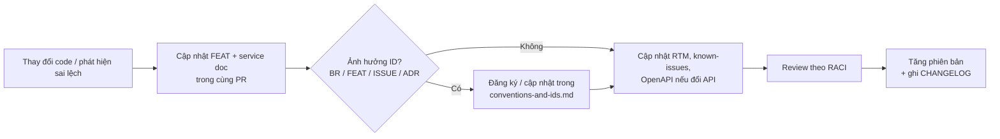

# Kiểm soát tài liệu (Document Control)

> **Phiên bản:** 1.0 · **Trạng thái:** Final · **Cập nhật:** 2026-11-12 · **Phạm vi:** Ứng dụng (as-is)

## 1. Thông tin bộ tài liệu

| Thuộc tính | Giá trị |
| :--- | :--- |
| Tên | Tài liệu ứng dụng — E-Commerce Microservices Platform |
| Mã bộ tài liệu | ECOM-APP-DOCS |
| Phiên bản | **1.0 (Final)** |
| Ngày phát hành | 2026-11-12 |
| Phạm vi | Ứng dụng: 11 backend service, 2 frontend SvelteKit, package dùng chung, cấu hình APISIX/Keycloak ở mức ứng dụng |
| Ngoài phạm vi | Hạ tầng (Kubernetes, k3d, CI/CD, GitOps, observability, backup) — bộ tài liệu riêng |
| Cơ sở | Source code tại thời điểm phát hành (reverse-engineered, as-is). Repo không có lịch sử git trong bản sao được phân tích nên không ghi commit hash. |
| Ngôn ngữ | Tiếng Việt (thuật ngữ kỹ thuật tiếng Anh) |
| Định dạng | Markdown (GFM) + Mermaid; đặc tả máy đọc: OpenAPI 3.1, AsyncAPI 3.0 |

## 2. Chuẩn tham chiếu

| Chuẩn / khung | Áp dụng cho | Ánh xạ |
| :--- | :--- | :--- |
| ISO/IEC/IEEE 29148:2018 (Requirements engineering) | BRD, use case, NFR, traceability | [01-brd/](../01-brd/brd.md) |
| BABOK v3 (Business analysis) | Stakeholder, phạm vi, quy trình, quy tắc nghiệp vụ | [brd.md](../01-brd/brd.md), [business-processes.md](../01-brd/business-processes.md) |
| arc42 | Cấu trúc tài liệu kiến trúc (12 mục) | [02-architecture/README.md](../02-architecture/README.md) |
| C4 model | Context (L1), Container (L2), Component (L3) | [system-context](../02-architecture/system/system-context.md), [container-view](../02-architecture/system/container-view.md), [component-view](../02-architecture/system/component-view.md) |
| ADR (Michael Nygard) | Quyết định kiến trúc | [adr/](../02-architecture/adr/README.md) |
| ISO/IEC 25010 | Mô hình chất lượng / NFR | [quality-scenarios](../02-architecture/quality-scenarios.md), [NFR](../01-brd/non-functional-requirements.md) |
| STRIDE | Threat model | [threat-model](../02-architecture/system/threat-model.md) |
| OpenAPI 3.1 / AsyncAPI 3.0 | Đặc tả API & sự kiện | [05-api/](../05-api/README.md) |
| ISO/IEC/IEEE 29119-3 (Test documentation) | Test plan | [test-plan](../07-plan/test-plan.md) |
| Nghị định 13/2023/NĐ-CP | Dữ liệu cá nhân (đánh giá khoảng trống) | [data-privacy-pii](../06-data/data-privacy-pii.md) |

## 3. Vai trò & trách nhiệm (RACI)

R = thực hiện · A = phê duyệt · C = tham vấn · I = được thông báo.

| Nhóm tài liệu | Tech Lead | Solution Architect | BA / PO | Backend | Frontend | QA | Security |
| :--- | :---: | :---: | :---: | :---: | :---: | :---: | :---: |
| Tổng quan (00) | A | R | C | I | I | I | I |
| BRD, use case, RTM (01) | C | C | A/R | I | I | C | I |
| Kiến trúc hệ thống & phần mềm, ADR (02) | A | R | I | C | C | I | C |
| Threat model, PII | C | C | I | C | C | I | A/R |
| Service docs (03) | A | C | I | R | R (frontend) | I | I |
| Feature docs (04) | C | I | A | R | R | C | I |
| API & sự kiện (05) | A | C | I | R | C | C | C |
| Data (06) | A | C | I | R | I | I | C |
| Plan, backlog, test plan (07) | C | C | A | C | C | R (test) | C |
| Guides (08) | A | I | I | R | R | I | I |

> Tên người cụ thể được điền khi ký duyệt (mục 5); tài liệu chỉ ghi vai trò.

## 4. Lịch sử phiên bản

| Phiên bản | Ngày | Mô tả thay đổi | Người thực hiện (vai trò) |
| :--- | :--- | :--- | :--- |
| 0.1 | 2026-11-12 | Khảo sát code; khung tài liệu, quy ước ID, danh sách issue ban đầu (ISSUE-01…51) | Nhóm biên soạn |
| 0.5 | 2026-11-12 | BRD, kiến trúc hệ thống & phần mềm, ADR, 15 service docs, 28 feature docs, API catalog, data dictionary, plan; bổ sung ISSUE-52…102 | Nhóm biên soạn |
| **1.0** | 2026-11-12 | **Bản Final**: kiểm soát tài liệu, use case, RTM, screen catalog, C4 L3, quality scenarios, threat model, PII, OpenAPI/AsyncAPI, event & error catalog, configuration reference; metadata chuẩn trên mọi file; rà soát nhất quán toàn bộ | Nhóm biên soạn |

Chi tiết thay đổi: [CHANGELOG.md](../CHANGELOG.md).

## 5. Review & phê duyệt

| Vai trò | Họ tên | Ngày | Kết quả | Ghi chú |
| :--- | :--- | :--- | :--- | :--- |
| Tech Lead | | | ☐ Duyệt ☐ Duyệt có điều kiện ☐ Từ chối | |
| Solution Architect | | | ☐ Duyệt ☐ Duyệt có điều kiện ☐ Từ chối | |
| Product Owner | | | ☐ Duyệt ☐ Duyệt có điều kiện ☐ Từ chối | |
| QA Lead | | | ☐ Duyệt ☐ Duyệt có điều kiện ☐ Từ chối | |
| Security | | | ☐ Duyệt ☐ Duyệt có điều kiện ☐ Từ chối | |

## 6. Quy trình thay đổi tài liệu

| Loại thay đổi | Phiên bản |
| :--- | :--- |
| Sửa lỗi chính tả, link | 1.0 → 1.0.x |
| Bổ sung / cập nhật nội dung theo thay đổi code | 1.0 → 1.x |
| Tái cấu trúc bộ tài liệu, đổi phạm vi (vd thêm hạ tầng) | 1.x → 2.0 |

## 7. Trạng thái tài liệu

| Trạng thái | Ý nghĩa |
| :--- | :--- |
| Draft | Đang viết, chưa review |
| Review | Đã đủ nội dung, chờ duyệt |
| **Final** | Đã rà soát nhất quán, phát hành để sử dụng (chờ ký duyệt mục 5) |
| Superseded | Bị thay thế bởi phiên bản mới |

## 8. Hạn chế đã biết của bộ tài liệu

| # | Hạn chế |
| :--- | :--- |
| L-1 | Nội dung được suy ra từ **đọc source code**, không chạy hệ thống; hành vi runtime phụ thuộc cấu hình môi trường có thể khác. Các điểm cần xác minh khi chạy được ghi rõ trong tài liệu chi tiết. |
| L-2 | Sơ đồ Mermaid chưa được render kiểm tra bằng công cụ tự động trong môi trường biên soạn. |
| L-3 | Không có lịch sử git nên không gắn commit hash; số dòng (`file:line`) đúng tại thời điểm phát hành và có thể lệch khi code thay đổi. |
| L-4 | Mục tiêu/KPI nghiệp vụ trong BRD là đề xuất suy luận; cần PO xác nhận. |
