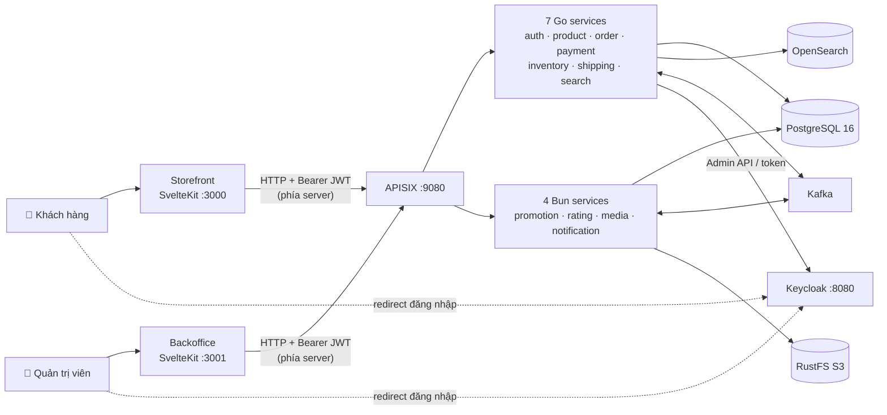

# Tổng quan dự án

> **Phiên bản:** 1.0 · **Trạng thái:** Final · **Cập nhật:** 2026-11-12 · **Phạm vi:** Ứng dụng (as-is)

## 1. Hệ thống là gì?

**E-Commerce Microservices Platform** là một nền tảng bán hàng trực tuyến gồm:

- **Storefront** (`frontend/apps/web`) — website cho khách hàng: xem trang chủ, duyệt danh mục, xem chi tiết sản phẩm, giỏ hàng, đặt hàng, xem lịch sử đơn. Giao diện song ngữ Việt / Anh, đơn vị tiền VND.
- **Backoffice** (`frontend/apps/admin`) — website quản trị: dashboard, quản lý sản phẩm, danh mục, xem đơn hàng (các module Users, Inventory, Shipping, Settings còn là placeholder).
- **11 backend microservice** sau một API Gateway (Apache APISIX), xác thực bằng Keycloak (OIDC), lưu dữ liệu PostgreSQL theo mô hình database-per-service, giao tiếp bất đồng bộ qua Kafka, tìm kiếm bằng OpenSearch, lưu file trên RustFS (S3-compatible).

Hai frontend là các ứng dụng **SvelteKit SSR đóng vai trò BFF** (Backend-for-Frontend): trình duyệt chỉ nói chuyện với server SvelteKit; server SvelteKit giữ token trong cookie `httpOnly` và gọi API Gateway.

## 2. Bức tranh 1 trang

## 3. Tech stack (theo code hiện tại)

| Lớp | Công nghệ | Ghi chú |
| :--- | :--- | :--- |
| Backend Go | Go 1.27, `chi/v5` (router), `go-chi/cors`, `bob` + `pgx/v5` (PostgreSQL), `golang-jwt/v5` (parse claims), Kafka client | 7 service + module `services/shared`, quản lý bằng `go.work` |
| Backend Bun | Bun 1.4, Hono 4, Drizzle ORM `1.0.0-rc.4` trên `Bun.sql`, Zod 4, `kafkajs`, `nodemailer`, `Bun.S3Client` | 4 service độc lập (mỗi service có `package.json` riêng) |
| Frontend | SvelteKit 3, Svelte 5 (runes), Vite 8, Tailwind CSS 4, TypeScript 6, Zod 4, Paraglide JS 2 (i18n), shadcn-svelte / bits-ui, `@sveltejs/adapter-bun` | Bun workspaces: `apps/web`, `apps/admin`, `packages/lib`, `packages/ui` |
| API Gateway | Apache APISIX 3.15 (standalone, cấu hình YAML) | Plugin: `openid-connect`, `proxy-rewrite`, `cors`, `limit-count`, `prometheus` |
| Identity | Keycloak 26.0, realm `ecommerce` | Role realm: `ADMIN`, `USER`, `MANAGER` |
| Database | PostgreSQL 16 | 1 instance, nhiều database (mỗi service một DB) |
| Messaging | Apache Kafka 3.9 (KRaft, không ZooKeeper) | payment → notification; (dự kiến) product CDC → search |
| Search | OpenSearch 3.9 | Index `product` |
| Object storage | RustFS (S3-compatible) | Bucket `ecommerce-media` |
| Cache | Redis 7.4 | Có trong compose nhưng **không service ứng dụng nào dùng** |

## 4. Danh sách thành phần

| Thành phần | Đường dẫn | Stack | Port | Database | Vai trò thực tế |
| :--- | :--- | :--- | :---: | :--- | :--- |
| auth-service | `services/auth-service` | Go | 8088 | `authservice` | SSO với Keycloak (login/callback/ticket/refresh/logout), đăng ký, CRUD user, gán/thu hồi role |
| product-service | `services/product-service` | Go | 8086 | `productservice` | CRUD danh mục, sản phẩm, sản phẩm yêu thích |
| order-service | `services/order-service` | Go | 8084 | `orderservice` | CRUD giỏ hàng (cart) & đơn hàng (order) |
| payment-service | `services/payment-service` | Go | 8085 | `paymentservice` | CRUD bản ghi thanh toán, publish sự kiện Kafka |
| inventory-service | `services/inventory-service` | Go | 8082 | `inventoryservice` | Tra cứu còn hàng theo tên sản phẩm (chỉ đọc) |
| shipping-service | `services/shipping-service` | Go | 8087 | `shippingservice` | CRUD dòng hàng (`order_items`) |
| search-service | `services/search-service` | Go | 8094 | — (OpenSearch) | Tìm kiếm catalog, gợi ý; consumer Kafka đồng bộ index |
| promotion-service | `services/promotion-service` | Bun | 8093 | `promotionservice` | CRUD khuyến mãi; CRUD tax class / tax rate; tra % thuế |
| rating-service | `services/rating-service` | Bun | 8089 | `ratingservice` | Đánh giá sản phẩm, điểm trung bình |
| media-service | `services/media-service` | Bun | 8083 | `mediaservice` | Upload / tải / xóa file trên S3 |
| notification-service | `services/notification-service` | Bun | 8090 | `ecommerce` | Gửi email, thông báo in-app, consumer Kafka |
| Storefront | `frontend/apps/web` | SvelteKit | 3000 | — | Website khách hàng (BFF) |
| Backoffice | `frontend/apps/admin` | SvelteKit | 3001 | — | Website quản trị (BFF) |

Chi tiết từng thành phần: [`03-services/`](../03-services/).

## 5. Trạng thái tổng thể (đánh giá từ code)

| Khu vực | Đánh giá |
| :--- | :--- |
| Frontend | Hoàn chỉnh về UI cho storefront và 4 màn hình admin; trang chủ dùng dữ liệu mock; chưa được kiểm chứng đầu-cuối với backend thật (xem [ISSUE-48](../07-plan/known-issues-tech-debt.md#6-hợp-đồng-api-frontend--backend)). |
| Identity | Luồng SSO qua auth-service có lỗi `redirect_uri` và fallback mock token ([ISSUE-04](../07-plan/known-issues-tech-debt.md#1-bảo-mật--xác-thực)); không có kiểm tra role ở backend ([ISSUE-01](../07-plan/known-issues-tech-debt.md#1-bảo-mật--xác-thực)). |
| Nghiệp vụ đơn hàng | Chỉ CRUD: không trạng thái đơn, không giữ kho, không tính giá/khuyến mãi/thuế/phí ship phía server, không tích hợp cổng thanh toán. |
| Bất đồng bộ | Kafka topic giữa producer/consumer không khớp → không có luồng sự kiện nào hoạt động đầu-cuối ([ISSUE-17](../07-plan/known-issues-tech-debt.md#3-messaging-kafka), [ISSUE-19](../07-plan/known-issues-tech-debt.md#3-messaging-kafka)). |
| Kiểm thử | Unit test ở mức router (DB `nil`) cho backend; 60 unit test cho `packages/lib`; không có integration/E2E. |

Danh sách đầy đủ: [known-issues-tech-debt.md](../07-plan/known-issues-tech-debt.md). Lộ trình khắc phục: [project-plan.md](../07-plan/project-plan.md).

## 6. Liên kết nhanh

- Yêu cầu nghiệp vụ: [BRD](../01-brd/brd.md)
- Kiến trúc: [Container view](../02-architecture/system/container-view.md)
- Tính năng: [Danh mục](../04-features/README.md)
- Chạy local: [Developer guide](../08-guides/developer-guide.md)
