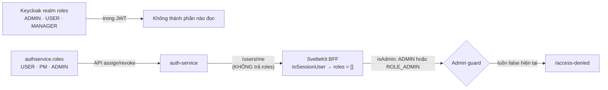

# Actors & Ma trận quyền

> **Phiên bản:** 1.0 · **Trạng thái:** Final · **Cập nhật:** 2026-11-12 · **Phạm vi:** Ứng dụng (as-is)

> Mô tả các actor của hệ thống, vai trò được định nghĩa ở đâu, và **quyền thực tế đang được thực thi ở tầng nào**. Điểm mấu chốt: phân quyền theo vai trò **chỉ tồn tại ở frontend admin**; API Gateway chỉ kiểm tra "có token hợp lệ hay không" ([ISSUE-01](../07-plan/known-issues-tech-debt.md#1-bảo-mật--xác-thực)).

## 1. Actor

| Actor | Mô tả | Cách nhận diện | Ứng dụng |
| :--- | :--- | :--- | :--- |
| **Guest** | Khách chưa đăng nhập | Không có cookie `access_token` | Storefront |
| **Customer** | Khách đã đăng nhập | Cookie phiên hợp lệ; role thường là `USER` | Storefront |
| **Admin** | Nhân viên quản trị | `session_user.roles` chứa `ADMIN` hoặc `ROLE_ADMIN` | Backoffice |
| **Manager** | Role `MANAGER` trong Keycloak | Có trong token nhưng **không được code nào sử dụng** | — |
| **PM** | Role `PM` (id 2) seed trong DB `authservice` | **Không được code nào sử dụng** | — |
| **Hệ thống (System)** | Tiến trình nội bộ: consumer Kafka, cron purge SSO store | — | notification-service, search-service, auth-service |
| **Hệ thống ngoài** | Keycloak (IdP), SMTP server, RustFS (S3) | — | — |

## 2. Nguồn định nghĩa vai trò

Có **hai nguồn role độc lập, không đồng bộ** với nhau:

| Nguồn | Vai trò | Định nghĩa tại | Được dùng bởi |
| :--- | :--- | :--- | :--- |
| Keycloak realm `ecommerce` | `ADMIN`, `USER`, `MANAGER` | `deploy/keycloak/import/ecommerce-realm.json` | Có trong JWT (`realm_access.roles`) nhưng **không ai đọc** — APISIX chỉ xác thực chữ ký/hạn token; `services/shared/middleware` chỉ lấy `sub`, `email`, `preferred_username`. |
| DB `authservice` (bảng `roles`, `user_role`) | `USER` (1), `PM` (2), `ADMIN` (3) | `services/auth-service/internal/repository/user_repository.go:30-64` | Gán/thu hồi qua API `/api/v1/roles/users/{userId}/...`. Frontend **dự kiến** đọc role từ `/api/v1/users/me`, nhưng endpoint này không trả role ([ISSUE-100](../07-plan/known-issues-tech-debt.md#7f-phát-hiện-của-nhóm-biên-soạn-chính-issue-100)). |

## 3. Ma trận quyền — Ứng dụng (UI)

| Chức năng | Guest | Customer | Admin | Thực thi tại |
| :--- | :---: | :---: | :---: | :--- |
| Xem trang chủ, catalog, chi tiết SP | ✅ | ✅ | ✅ | Không cần đăng nhập |
| Giỏ hàng (localStorage) | ✅ | ✅ | ✅ | Client |
| Checkout `/checkout` | ❌ → chuyển `/login?redirect=` | ✅ | ✅ | `frontend/apps/web/src/routes/checkout/+page.server.ts` |
| Lịch sử đơn `/orders` | ❌ → chuyển `/login` | ✅ | ✅ | `frontend/apps/web/src/routes/orders/+page.server.ts` |
| Vào backoffice (mọi route trừ `/login`, `/auth/callback`, `/access-denied`) | ❌ → `/login` | ❌ → `/access-denied` | ✅ (thiết kế) / ❌ thực tế do ISSUE-100 | `frontend/apps/admin/src/hooks.server.ts` (`handleAdminGuard`) |

## 4. Ma trận quyền — API qua Gateway (thực tế)

`🌐` = public (không cần token) · `🔑` = cần Bearer token hợp lệ bất kỳ (**không phân biệt role**).

| Nhóm API (đường dẫn gateway) | Service | Yêu cầu | Ai gọi được thực tế | Nên là |
| :--- | :--- | :---: | :--- | :--- |
| `/api/v1/auth/*` (login, callback, session, refresh, logout, signup) | auth | 🌐 | Mọi người | Đúng |
| `/api/v1/users*` (CRUD user, `/me`) | auth | 🔑 | Mọi user đã đăng nhập — **kể cả xóa user khác** | Admin (trừ `/me`) |
| `/api/v1/roles*` (gán/thu hồi role) | auth | 🔑 | Mọi user — **tự nâng quyền được** | Admin |
| `/api/products*`, `/api/categories*` (GET, POST, PUT, DELETE) | product | 🌐 | **Mọi người, kể cả Guest, có thể tạo/sửa/xóa** sản phẩm, danh mục ([ISSUE-102](../07-plan/known-issues-tech-debt.md#7f-phát-hiện-của-nhóm-biên-soạn-chính-issue-100)) | GET public; ghi = Admin |
| `/api/favourites*` | product | 🔑 | (route hỏng — [ISSUE-13](../07-plan/known-issues-tech-debt.md#2-api-gateway-apisix)) | Chủ sở hữu |
| `/api/carts*`, `/api/orders*` | order | 🔑 | Mọi user — đọc/sửa/xóa đơn của người khác ([ISSUE-49](../07-plan/known-issues-tech-debt.md#6-hợp-đồng-api-frontend--backend)) | Chủ sở hữu; Admin đọc tất cả |
| `/api/payments*` | payment | 🔑 | Mọi user | Hệ thống / Admin |
| `/api/inventory*` | inventory | 🔑 | Mọi user | Đọc: public; ghi: Admin |
| `/shipping/api/shippings/*` | shipping | 🔑 | Mọi user | Admin / hệ thống |
| `/storefront/catalog-search`, `/storefront/search_suggest` | search | 🌐 | Mọi người | Đúng |
| `/storefront/ratings*` (gồm **POST**) | rating | 🌐 | Mọi người — đánh giá ẩn danh ([ISSUE-03](../07-plan/known-issues-tech-debt.md#1-bảo-mật--xác-thực)) | GET public; POST = Customer |
| `/rating/backoffice/ratings/*` | rating | 🔑 | Mọi user | Admin |
| `/promotion/backoffice/promotions/*` | promotion | 🔑 | Mọi user | Admin |
| `/tax/backoffice/{tax-classes,tax-rates}/*` | promotion | 🔑 | (route hỏng local — [ISSUE-13](../07-plan/known-issues-tech-debt.md#2-api-gateway-apisix)) | Admin |
| `/media/medias/*` | media | 🔑 | Mọi user | Upload: Admin; đọc: public |
| `/notification/api/{email,notifications,payment-notifications}/*` | notification | 🔑 | Mọi user — **gửi email tùy ý**, đọc thông báo người khác | Hệ thống / chủ sở hữu |

> ⚠️ Kiểm tra lại cột "Yêu cầu" với [gateway-routing.md](../05-api/gateway-routing.md) — đó là tài liệu phân tích chi tiết từng route.

## 5. Ma trận quyền — Truy cập trực tiếp service (bỏ qua gateway)

Trong `docker-compose.yml`, mọi service publish port ra host (8082–8094). Service **không tự xác thực** token (middleware `UserClaims` chỉ decode, không verify — [ISSUE-02](../07-plan/known-issues-tech-debt.md#1-bảo-mật--xác-thực)). Do đó bất kỳ ai truy cập được mạng nội bộ / host đều gọi được mọi API mà không cần token. Trong k8s, việc này phụ thuộc network policy (thuộc tài liệu hạ tầng).

## 6. Khuyến nghị

Xem [project-plan.md](../07-plan/project-plan.md) — giai đoạn **P1: Bảo mật & định danh** (sửa ISSUE-01, 02, 03, 04, 05, 100, 101, 49).
