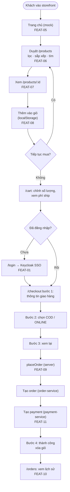
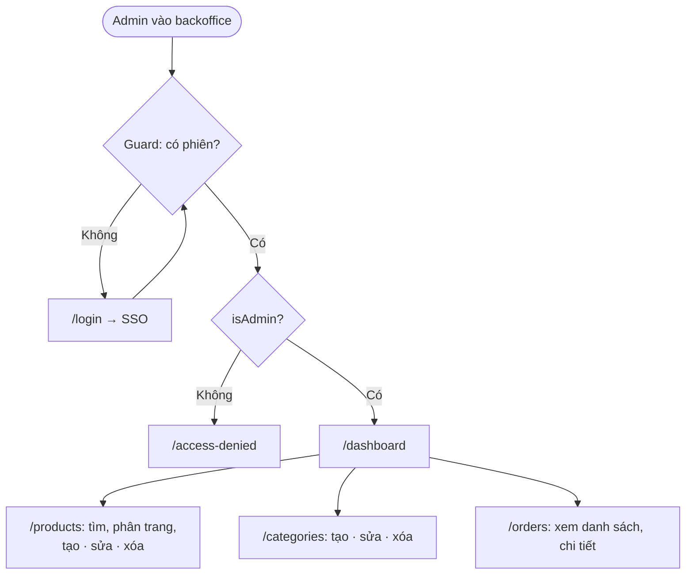
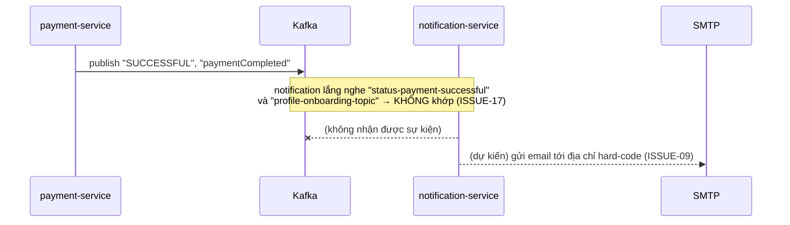

# Quy trình nghiệp vụ

> **Phiên bản:** 1.0 · **Trạng thái:** Final · **Cập nhật:** 2026-11-12 · **Phạm vi:** Ứng dụng (as-is)

> Mô tả các quy trình nghiệp vụ end-to-end **như hệ thống đang thực hiện**. Mỗi bước ghi rõ thành phần thực hiện. Chi tiết kỹ thuật: [runtime-flows.md](../02-architecture/system/runtime-flows.md); chi tiết từng bước: tài liệu FEAT tương ứng.

## BP-01 — Mua hàng trực tuyến (Guest → Customer)

| Bước | Tác nhân | Thành phần | Quy tắc / ghi chú |
| :--- | :--- | :--- | :--- |
| 1. Duyệt sản phẩm | Guest / Customer | web → product-service | Không cần đăng nhập. |
| 2. Thêm giỏ | Guest / Customer | web (client) | Lưu `localStorage["ecommerce-cart"]`; không gửi về server. |
| 3. Đăng nhập | Guest | web → auth-service → Keycloak | Chỉ bắt buộc khi vào `/checkout` hoặc `/orders`; quay lại trang cũ qua cookie `auth_redirect`. |
| 4. Nhập thông tin giao hàng | Customer | web | Validate `shippingSchema` (RULE-04). **Không được lưu** (ISSUE-22). |
| 5. Chọn thanh toán | Customer | web | COD hoặc ONLINE; ONLINE **không** chuyển tới cổng thanh toán. |
| 6. Đặt hàng | Customer | web server → product, order, payment | Lấy lại giá từ server (RULE-05); tính tổng + phí ship (RULE-02); tạo **1 order chỉ với sản phẩm đầu tiên** (ISSUE-20); tạo payment (RULE-06). |
| 7. Hậu đặt hàng | Hệ thống | payment-service → Kafka | Publish `SUCCESSFUL`/`paymentCompleted` — **không có consumer** tương ứng (ISSUE-17). Không trừ kho, không gửi email. |
| 8. Theo dõi đơn | Customer | web → order-service | Trạng thái luôn "Đang xử lý" (ISSUE-41). |

**Những gì quy trình này KHÔNG làm** (so với kỳ vọng nghiệp vụ thông thường): không kiểm tra/giữ tồn kho, không áp mã giảm giá, không tính thuế, không tính phí ship theo địa chỉ, không thanh toán qua cổng, không email xác nhận, không lưu nhiều dòng hàng.

## BP-02 — Đăng nhập / đăng xuất (SSO)

```mermaid
flowchart LR
    A["/login"] -->|"Click SSO"| B["Gateway /api/v1/auth/login<br/>→ auth-service"]
    B -->|"302"| C["Keycloak login page"]
    C -->|"code + state"| D["auth-service /callback"]
    D -->|"302 ?ticket="| E["BFF /auth/callback"]
    E -->|"đổi ticket"| F["auth-service /session"]
    F --> G["BFF lấy profile /users/me"]
    G --> H["Set cookie httpOnly<br/>redirect trang cũ"]
```

Đăng xuất: remote command `logout` → `POST /api/v1/auth/logout` (best-effort) → xóa cookie. Chi tiết: [FEAT-01](../04-features/FEAT-01-sso-login-logout.md).

## BP-03 — Đăng ký tài khoản

| Bước | Mô tả |
| :--- | :--- |
| 1 | Client gọi `POST /api/v1/auth/signup` với `username`, `password`, `email` (bắt buộc) và `fullName`, `gender`, `phone`, `avatar`, `roles` (tùy chọn). |
| 2 | auth-service kiểm tra trùng username / email / phone → 409 nếu trùng. |
| 3 | Tạo user trong Keycloak (Admin API), sau đó ghi DB `authservice` với role mặc định `USER`; nếu ghi DB lỗi → xóa user Keycloak (bù trừ). |

Storefront **không có form đăng ký**; nút "Đăng ký qua SSO" dẫn tới trang Keycloak, nhưng realm tắt `registrationAllowed`. Chi tiết: [FEAT-02](../04-features/FEAT-02-user-registration.md).

## BP-04 — Quản trị catalog

| Bước | Ghi chú |
| :--- | :--- |
| Guard | Với backend hiện tại `isAdmin` luôn false (ISSUE-100) → mọi người bị chặn ở `/access-denied`. |
| Tạo / sửa sản phẩm | Form `productUpsertSchema`: tiêu đề, SKU, giá, số lượng, ảnh, danh mục; không có trường mô tả. Không có id → tạo mới (`POST`), có id → cập nhật (`PUT /{id}`). |
| Xóa | Hộp thoại xác nhận → `DELETE`; danh sách được làm mới. |
| Tồn kho | `products.quantity` được sửa ở form sản phẩm; **không đồng bộ** với `inventory-service` (ISSUE-26). |

Chi tiết: [FEAT-21](../04-features/FEAT-21-admin-access-control.md) … [FEAT-25](../04-features/FEAT-25-admin-order-mgmt.md).

## BP-05 — Thanh toán & thông báo (bất đồng bộ — thiết kế trong code)

Hiện tại luồng này **không chạy được đầu-cuối**. Chi tiết: [FEAT-11](../04-features/FEAT-11-payment.md), [FEAT-19](../04-features/FEAT-19-notifications-email.md), [integration-messaging.md](../02-architecture/system/integration-messaging.md).

## BP-06 — Đồng bộ catalog sang tìm kiếm (thiết kế trong code)

search-service được viết để đọc message CDC (Debezium) từ topic `dbproduct.public.product` và index vào OpenSearch. Repo không có Debezium connector, và schema mong đợi (`id, name, slug, price`) không khớp bảng `products` → index không được nạp (ISSUE-19). Chi tiết: [FEAT-14](../04-features/FEAT-14-catalog-search-suggest.md).

## BP-07 — Quản lý dữ liệu hỗ trợ (chỉ API)

| Quy trình | Service | Tài liệu |
| :--- | :--- | :--- |
| Tạo / sửa / xóa khuyến mãi | promotion-service | [FEAT-16](../04-features/FEAT-16-promotion-management.md) |
| Cấu hình thuế, tra % thuế | promotion-service | [FEAT-17](../04-features/FEAT-17-tax-management.md) |
| Upload / tải / xóa media | media-service | [FEAT-18](../04-features/FEAT-18-media-management.md) |
| Đánh giá & kiểm duyệt đánh giá | rating-service | [FEAT-15](../04-features/FEAT-15-ratings-reviews.md) |
| Ghi dòng hàng vận chuyển | shipping-service | [FEAT-20](../04-features/FEAT-20-shipping-order-items.md) |
| Gán / thu hồi vai trò | auth-service | [FEAT-04](../04-features/FEAT-04-user-role-management.md) |

Các quy trình này chưa có giao diện; thực hiện qua API (Postman/curl) với Bearer token.
