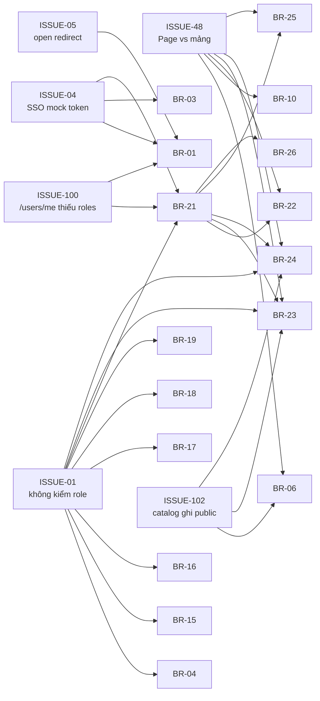
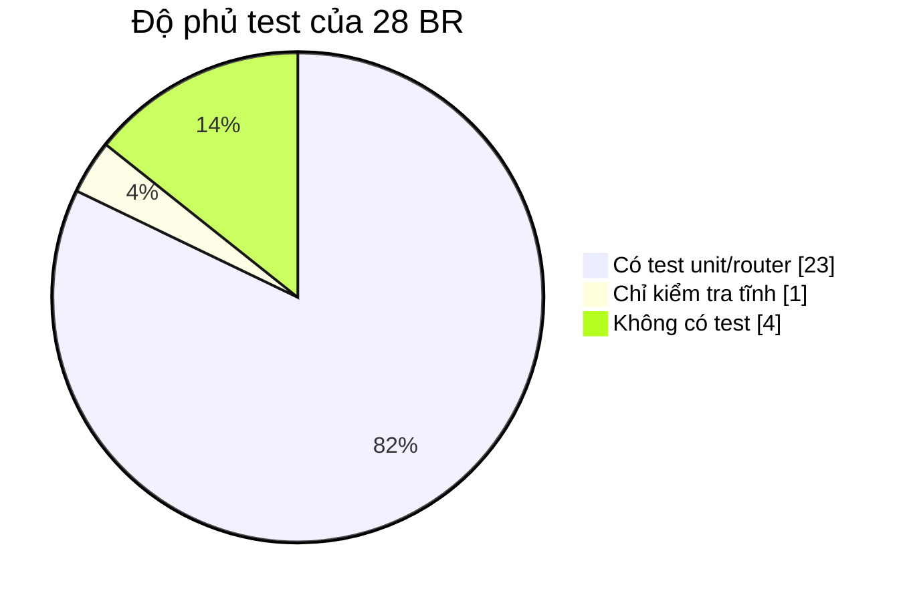

# Ma trận truy vết yêu cầu (RTM)

> **Phiên bản:** 1.0 · **Trạng thái:** Final · **Cập nhật:** 2026-11-12 · **Phạm vi:** Ứng dụng (as-is)

> Truy vết hai chiều từ yêu cầu nghiệp vụ tới code, dữ liệu, kiểm thử và kế hoạch: **BR → UC → FEAT → route frontend → API (path qua gateway) → service → bảng → test → issue → backlog → trạng thái**. Mọi giá trị phản ánh **code hiện tại**. Nguồn: [brd.md](brd.md), [use-cases.md](use-cases.md), [04-features](../04-features/README.md), [api-catalog.md](../05-api/api-catalog.md), [data-dictionary.md](../06-data/data-dictionary.md), [test-plan.md](../07-plan/test-plan.md), [backlog.md](../07-plan/backlog.md), [known-issues-tech-debt.md](../07-plan/known-issues-tech-debt.md). Màn hình (SCR-xx): [screen-catalog.md](../04-features/screen-catalog.md).

## 1. Quy ước

| Cột | Ý nghĩa |
| :--- | :--- |
| Route | Path tiếng Việt; mọi route có biến thể `/en/...` ([FEAT-27](../04-features/FEAT-27-i18n.md)). `web` = storefront `:3000`, `admin` = backoffice `:3001`. |
| API | Path **qua APISIX** (`:9080`). ❌ = không tới được service trên compose (ISSUE-13/15). "BFF" = gọi phía server SvelteKit. |
| Bảng | `database.table` theo [data-dictionary](../06-data/data-dictionary.md). |
| Test hiện có | Tên test thật trong repo ([test-plan §1](../07-plan/test-plan.md#1-hiện-trạng)). Go: `services/<svc>/main_test.go`; Bun: `services/<svc>/src/index.test.ts`; frontend: `frontend/packages/lib/src/**/*.test.ts`. Test Go/Bun chỉ gọi router với DB `nil` — **không** kiểm nghiệp vụ đầu-cuối. |
| E2E | Kịch bản **kế hoạch** ở [test-plan §3](../07-plan/test-plan.md#3-kịch-bản-e2e-ưu-tiên) (chưa có Playwright trong repo). |
| Issue | Issue đang mở ảnh hưởng BR; **in đậm** = Critical/High. |
| Trạng thái | Theo tài liệu FEAT (nguồn chốt): ✅ / 🟡 / ⛔. |

## 2. Ma trận xuôi (BR → …)

### 2.1 Định danh & truy cập

| BR | UC | FEAT | Route frontend | API (gateway) | Service | Bảng | Test hiện có | E2E | Issue mở | Backlog | TT |
| :--- | :--- | :--- | :--- | :--- | :--- | :--- | :--- | :--- | :--- | :--- | :---: |
| BR-01 Đăng nhập SSO / đăng xuất | UC-01, UC-02, UC-03, UC-37 | FEAT-01 | web `/login`, `/auth/callback`, header "Đăng xuất"; admin `/login`, `/auth/callback`, sidebar/`/access-denied` "Đăng xuất" | `GET /api/v1/auth/login` (trình duyệt); `GET /api/v1/auth/callback` (Keycloak gọi thẳng auth-service qua `SSO_BACKEND_CALLBACK_URL`); `GET /api/v1/auth/session`; `GET /api/v1/users/me`; `POST /api/v1/auth/logout` | auth-service, Keycloak | `authservice.users` (tra profile); SSO store in-memory | `TestSSOFlow`, `TestSSOSessionStore` (auth); `session.test.ts`, `redirect.test.ts`, `api.test.ts` (lib) | E2E-03, E2E-10 | **04**, **05**, **06**, 11, **52**, **66**, **67**, **100**, **101** | US-0103, US-0104, US-0105, US-0204, US-0205, US-0209 | 🟡 |
| BR-02 Đăng ký tài khoản | UC-05, UC-35 | FEAT-02 | — (web `/login` nút "Đăng ký qua SSO" chỉ mở lại SSO) | `POST /api/v1/auth/signup` | auth-service, Keycloak Admin API | `authservice.users`, `authservice.user_role`, `authservice.roles` | `TestSignupValidation` (auth) | — | **08**, 53, **71**, **101**, **17** | US-0402 (email chào mừng) | 🟡 |
| BR-03 Duy trì & làm mới phiên | UC-04 | FEAT-03 | `hooks.server.ts` web & admin (mọi route) | `POST /api/v1/auth/refresh` | auth-service, Keycloak | — (cookie) | `session.test.ts` (`shouldRefresh`, `setSession`), `api.test.ts` | E2E-09 | **06**, 11, **66**, **67**, 69 | US-0105 | 🟡 |
| BR-04 Quản lý user & vai trò | UC-06, UC-07 | FEAT-04 | — (admin `/users` placeholder) | `GET /api/v1/users/{me,all,{id}}`, `GET /api/v1/users?username=`, `PUT/DELETE /api/v1/users/{id}`, `PUT /api/v1/users/me/password`, `POST /api/v1/roles/users/{userId}/{assign,revoke}`, `GET /api/v1/roles/users/{userId}` | auth-service, Keycloak | `authservice.users`, `authservice.roles`, `authservice.user_role` | — (không có test cho endpoint user/role) | — | **01**, **02**, **07**, **08**, 53, **100** | US-0201, US-0208, US-0606 | 🟡 |
| BR-21 Kiểm soát truy cập backoffice | UC-02 | FEAT-21 | admin `hooks.server.ts` (`handleAdminGuard`), `/login`, `/auth/callback`, `/access-denied` | `GET /api/v1/users/me` | auth-service | `authservice.users`, `authservice.user_role`, `authservice.roles` | `session.test.ts` (`isAdmin`, `toSessionUser`), `redirect.test.ts` | E2E-06, E2E-07 | **01**, 11, **66**, **68**, **100**, **101** | US-0103, US-0201, US-0203 | 🟡 |

### 2.2 Storefront

| BR | UC | FEAT | Route frontend | API (gateway) | Service | Bảng | Test hiện có | E2E | Issue mở | Backlog | TT |
| :--- | :--- | :--- | :--- | :--- | :--- | :--- | :--- | :--- | :--- | :--- | :---: |
| BR-05 Trang chủ | UC-08 | FEAT-05 | web `/` | — (dữ liệu mock `home-mock.ts`) | — | — | — | — | **38**, 39, 44, 79 | US-0108, US-0610 | 🟡 |
| BR-06 Danh mục sản phẩm | UC-09 | FEAT-06 | web `/products` | `GET /api/products?page&size&sort&categoryId&search`, `GET /api/categories?page=0&size=50` (BFF) | product-service | `productservice.products`, `productservice.categories` | `TestProductEndpoints`, `TestCategoryEndpoints` (product); `schemas.test.ts` (`productQuerySchema`), `api.test.ts` | E2E-01 | 40, 44, **48**, 78, **102** | US-0101, US-0308, US-0603 | 🟡 |
| BR-07 Chi tiết sản phẩm | UC-10 | FEAT-07 | web `/products/[id]` | `GET /api/products/{id}` (BFF) | product-service | `productservice.products`, `productservice.categories` | `TestProductEndpoints` | (gián tiếp E2E-02) | 39, 50, 82 | — (gián tiếp US-0601) | ✅ |
| BR-08 Giỏ hàng | UC-11 | FEAT-08 | web `/cart`, badge header, nút thêm ở `ProductCard`/PDP | — (client-side) | — | `localStorage["ecommerce-cart"]` (trình duyệt) | `cart.test.ts` (`computeTotals`) | E2E-02 | 42, 79 | US-0612 | ✅ |
| BR-09 Checkout & đặt hàng | UC-12, UC-33 | FEAT-09 | web `/checkout` (remote command `placeOrder`) | `GET /api/products/{id}`, `POST /api/orders`, `POST /api/payments` (BFF) | product-, order-, payment-service | `productservice.products`, `orderservice.orders`, `paymentservice.payments` | `schemas.test.ts` (`shippingSchema`, `checkoutSchema`), `cart.test.ts`; `TestOrdersEndpoints` (order), `TestPaymentsEndpoints` (payment) | E2E-03, E2E-04 | **20**, **21**, 22, 23, **38**, **75**, **76**, 79 | US-0301, US-0302, US-0304, US-0305, US-0306, US-0604, US-0605 | 🟡 |
| BR-10 Lịch sử đơn hàng | UC-13, UC-33 | FEAT-10 | web `/orders` | `GET /api/orders?page&size` (BFF) | order-service | `orderservice.orders` | `TestOrdersEndpoints` | E2E-05 | 41, **48**, **49**, **76** | US-0202, US-0303 | 🟡 |
| BR-27 Đa ngôn ngữ vi/en | UC-14 | FEAT-27 | mọi route web & admin (`/…` vi, `/en/…` en) | — | — | — (cookie locale Paraglide) | Kiểm tra tĩnh `bun run i18n:check` (`frontend/scripts/locale-parity.ts`); `format.test.ts` | E2E-08 | 39, 43, 44, 83 | US-0611 | ✅ |
| BR-28 SEO & trang lỗi | UC-15, UC-16 | FEAT-28 | web `/sitemap.xml`, `/robots.txt`, `+error.svelte`; admin `/robots.txt`, `+error.svelte` | — | — | — | — | — | 82 | — | ✅ |

### 2.3 Nghiệp vụ thương mại (backend, chỉ API)

| BR | UC | FEAT | Route frontend | API (gateway) | Service | Bảng | Test hiện có | E2E | Issue mở | Backlog | TT |
| :--- | :--- | :--- | :--- | :--- | :--- | :--- | :--- | :--- | :--- | :--- | :---: |
| BR-11 Ghi nhận thanh toán | UC-22, UC-34 | FEAT-11 | — (gọi từ `placeOrder` của `/checkout`) | `POST /api/payments`; `GET /api/payments[/all,/{id},/getOrder/{orderId}]`; `PUT/DELETE /api/payments/{id}` | payment-service, Kafka (`SUCCESSFUL`, `paymentCompleted`) | `paymentservice.payments` | `TestPaymentsEndpoints` (payment) | E2E-04 | **17**, **18**, 25, 57, 59, **75** | US-0307, US-0401 | 🟡 |
| BR-12 Kiểm tra tồn kho | UC-23 | FEAT-12 | — (admin `/inventory` placeholder) | `GET /api/inventory?productName=`, `GET /api/inventory/{products}` | inventory-service | `inventoryservice.inventory` | `TestIsInStockQuery`, `TestIsInStockPath` (inventory) | — | **26**, **28**, 51 | US-0304, US-0607 | 🟡 |
| BR-13 Sản phẩm yêu thích | UC-24 | FEAT-13 | — | `/api/favourites*` ❌ (upstream 7 không tồn tại — ISSUE-13) | product-service | `productservice.favourites` | `TestFavouriteRoutes` (product) | — | **13**, 35, 56, 74 | US-0602 | 🟡 |
| BR-14 Tìm kiếm & gợi ý | UC-25, UC-36 | FEAT-14 | — (ô tìm header gửi tới product-service — ISSUE-78) | `GET /storefront/catalog-search`, `GET /storefront/search_suggest` | search-service, OpenSearch, Kafka (`dbproduct.public.product`) | OpenSearch index `product` | `TestCatalogSearch`, `TestSearchSuggest` (search) | — | **19**, 34, 58, 78 | US-0403, US-0404, US-0603 | 🟡 |
| BR-15 Đánh giá sản phẩm | UC-26, UC-27 | FEAT-15 | — | `POST /storefront/ratings`, `GET /storefront/ratings/products/{id}`, `GET /storefront/ratings/product/{id}/average-star`; `GET /rating/backoffice/ratings` ❌ (ISSUE-15), `DELETE /rating/backoffice/ratings/{id}` | rating-service | `ratingservice.rating` | rating: "should calculate average star for product", "should reject ratings query with invalid productId", "should reject rating submission with missing fields", "should reject delete rating with non-numeric ID" | — | **01**, **03**, 15, 62 | US-0206, US-0601, US-0608 | 🟡 |
| BR-16 Quản lý khuyến mãi | UC-28 | FEAT-16 | — | `/promotion/backoffice/promotions/{id}` (GET/DELETE); list/POST/PUT ở path gốc ❌ (ISSUE-15) | promotion-service | `promotionservice.promotion` | promotion: "should list promotions with paging parameters", "should reject promotion with invalid ID", "should reject promotion creation with invalid payload" | — | 15, 30, 62, 65 | US-0604, US-0608 | 🟡 |
| BR-17 Quản lý thuế | UC-29 | FEAT-17 | — | `/tax/backoffice/tax-classes*`, `/tax/backoffice/tax-rates*` (gồm `tax-percent`, `location-based-batch`) ❌ local (ISSUE-13) | promotion-service (module tax) | `promotionservice.tax_class`, `promotionservice.tax_rate` | promotion: "should reject tax rate percent query without required params", "should reject tax batch query without required params", "should list tax classes paging" | — | **13**, 31, 62, 94 | US-0605 | 🟡 |
| BR-18 Quản lý media | UC-30 | FEAT-18 | — (admin chỉ nhập URL ảnh dạng text) | `GET/DELETE /media/medias/{id}`, `GET /media/medias/{id}/file/{fileName}`; `POST /media/medias`, `GET /media/medias?ids=` ❌ (ISSUE-15) | media-service, RustFS | `mediaservice.media`, S3 bucket `${STORAGE_BUCKET}` | media: "should reject media list query without ids", "should reject get single media with invalid ID", "should reject upload without file" | — | 15, 32, 63 | US-0507, US-0609 | 🟡 |
| BR-19 Thông báo & email | UC-31, UC-34, UC-35 | FEAT-19 | — | `POST /notification/api/email/{sendSimpleMail,sendMailWithAttachment,sendMail}`; `/notification/api/notifications/{id}`, `/notification/api/payment-notifications/{id}` (list/POST ❌ — ISSUE-15) | notification-service, Kafka, SMTP | `ecommerce.notifications`, `ecommerce.payment_notifications` | notification: "should handle sendSimpleMail", "should handle sendMail with query params", "should list notifications" | — | **09**, **17**, 33, **64**, 65, 80 | US-0207, US-0401, US-0402 | 🟡 |
| BR-20 Dòng hàng vận chuyển | UC-32 | FEAT-20 | — (admin `/shipping` placeholder) | `/shipping/api/shippings/{orderId}/{productId}`, `/find`, `/delete`; path gốc (list/POST/PUT) ❌ (ISSUE-15) | shipping-service | `shippingservice.order_items` | `TestShippingEndpoints` (shipping) | — | 15, **20**, 81 | — (gián tiếp US-0301) | 🟡 |

### 2.4 Backoffice

| BR | UC | FEAT | Route frontend | API (gateway) | Service | Bảng | Test hiện có | E2E | Issue mở | Backlog | TT |
| :--- | :--- | :--- | :--- | :--- | :--- | :--- | :--- | :--- | :--- | :--- | :---: |
| BR-22 Dashboard | UC-17 | FEAT-22 | admin `/dashboard` (và `/` → 303) | `GET /api/products?page=0&size=5`, `GET /api/categories?page=0&size=1`, `GET /api/orders?page=0&size=5` (BFF) | product-, order-service | `productservice.products`, `productservice.categories`, `orderservice.orders` | `TestProductEndpoints`, `TestCategoryEndpoints`, `TestOrdersEndpoints` (chỉ router) | (gián tiếp E2E-06) | **48**, **49**, **100** | US-0102 | 🟡 |
| BR-23 Quản lý sản phẩm | UC-18 | FEAT-23 | admin `/products` (dialog thêm/sửa, xác nhận xóa) | `GET /api/products`, `GET /api/categories?page=0&size=100`, `POST /api/products`, `PUT /api/products/{id}`, `DELETE /api/products/{id}` (BFF) | product-service | `productservice.products`, `productservice.categories` | `TestProductEndpoints`; `schemas.test.ts` (`productUpsertSchema`) | E2E-06 | **01**, **48**, **60**, **68**, **102** | US-0102, US-0106, US-0201, US-0609 | 🟡 |
| BR-24 Quản lý danh mục | UC-19 | FEAT-24 | admin `/categories` | `GET /api/categories`, `POST /api/categories`, `PUT/DELETE /api/categories/{id}` (BFF) | product-service | `productservice.categories` | `TestCategoryEndpoints`; `schemas.test.ts` (`categoryUpsertSchema`) | — | **01**, 44, **48**, **68**, **102** | US-0102, US-0201 | 🟡 |
| BR-25 Quản lý đơn hàng (admin) | UC-20, UC-33 | FEAT-25 | admin `/orders` (dialog chi tiết) | `GET /api/orders?page&size` (BFF) | order-service | `orderservice.orders`, `orderservice.carts` | `TestOrdersEndpoints`, `TestCartsEndpoints` | — | **20**, 40, 41, **48**, **49** | US-0102, US-0303, US-0308 | 🟡 |
| BR-26 Module Users/Inventory/Shipping/Settings | UC-21 | FEAT-26 | admin `/users`, `/inventory`, `/shipping`, `/settings` | — | — | — | — | — | **01**, **08**, **26** (khi hiện thực) | US-0606, US-0607 | ⛔ |

## 3. Ma trận ngược — Issue Critical/High → BR / FEAT

Gồm toàn bộ 32 issue mức **Critical** (6) và **High** (26) đang mở trong [known-issues-tech-debt.md](../07-plan/known-issues-tech-debt.md). Cột "Backlog" để trống = **chưa có story xử lý** (xem §5).

| Issue | Mức | Tóm tắt | BR bị ảnh hưởng | FEAT | UC | Backlog | Kiểm chứng (E2E / test đề xuất) |
| :--- | :--- | :--- | :--- | :--- | :--- | :--- | :--- |
| ISSUE-01 | Critical | Backend không kiểm role | BR-04, 15, 16, 17, 18, 19, 21, 23, 24, 26 | FEAT-04, 15, 16, 17, 18, 19, 21, 23, 24, 26 | UC-06, 07, 18, 19, 27, 28, 29, 30, 31 | US-0201 | Test phân quyền [test-plan §4](../07-plan/test-plan.md#4-test-phân-quyền-security-regression) |
| ISSUE-04 | Critical | SSO callback sai `redirect_uri`, fallback mock token | BR-01, 03, 21 | FEAT-01, 03, 21 | UC-01, 02 | US-0104 | E2E-03 |
| ISSUE-05 | Critical | Open redirect `redirect_uri` | BR-01 | FEAT-01 | UC-01, 02 | US-0204 | Test phân quyền §4 |
| ISSUE-48 | Critical | List API trả mảng thô, BFF đọc `Page` | BR-06, 10, 22, 23, 24, 25 | FEAT-06, 10, 22, 23, 24, 25 | UC-09, 13, 17, 18, 19, 20 | US-0101, US-0102 | E2E-01, E2E-05; contract test |
| ISSUE-100 | Critical | `/users/me` không có `roles`, key `fullname` | BR-01, 21, 22, 23, 24, 25, 26 | FEAT-01, 21 … 26 | UC-01, 02, 17 … 21 | US-0103 | E2E-06, E2E-07 |
| ISSUE-102 | Critical | Ghi catalog qua gateway không cần token | BR-06, 23, 24 | FEAT-06, 23, 24 | UC-18, 19 | US-0201 | Test phân quyền §4 |
| ISSUE-02 | High | `UserClaims` không verify chữ ký JWT | BR-04 (và mọi service khi gọi trực tiếp) | FEAT-04 | UC-06 | — | Test phân quyền §4 (gọi thẳng port service) |
| ISSUE-03 | High | Rating ẩn danh, decode token không verify | BR-15 | FEAT-15 | UC-26 | US-0206 | Test phân quyền §4 |
| ISSUE-06 | High | SSO store in-memory | BR-01, 03 | FEAT-01, 03 | UC-01, 37 | US-0205 | Kiểm thử 2 replica |
| ISSUE-07 | High | Đổi mật khẩu là stub | BR-04 | FEAT-04 | UC-06 | US-0208 | — |
| ISSUE-08 | High | Id Keycloak giả, role không đồng bộ Keycloak | BR-02, 04, 21 | FEAT-02, 04, 21 | UC-05, 06, 07 | — | Integration test auth + Keycloak |
| ISSUE-09 | High | Email thanh toán gửi địa chỉ hard-code | BR-11, 19 | FEAT-11, 19 | UC-34 | US-0207 | Integration test Kafka (P3) |
| ISSUE-13 | High | Route favourites/tax trỏ upstream không tồn tại | BR-13, 17 | FEAT-13, 17 | UC-24, 29 | US-0107 | Smoke test route gateway |
| ISSUE-17 | High | Lệch topic Kafka payment ↔ notification | BR-11, 19, 02 | FEAT-11, 19, 02 | UC-34, 35 | US-0401 | Integration test Kafka (P3) |
| ISSUE-18 | High | Publish "thành công" mỗi lần tạo payment | BR-11, 19 | FEAT-11, 19 | UC-22, 34 | US-0401 | Integration test Kafka (P3) |
| ISSUE-19 | High | Index search không được nạp | BR-14 | FEAT-14 | UC-25, 36 | US-0403 | Integration test product → search (P3) |
| ISSUE-20 | High | Đơn không trạng thái, chỉ 1 `product_id` | BR-09, 10, 20, 25 | FEAT-09, 10, 20, 25 | UC-12, 13, 20 | US-0301, US-0303 | E2E-04 (nhiều dòng hàng — P2) |
| ISSUE-21 | High | `order_fee` tin client, không orchestration | BR-09 | FEAT-09 | UC-12 | US-0306 | Integration test order |
| ISSUE-26 | High | Tồn kho theo tên, chỉ đọc, tách `products.quantity` | BR-12, 09, 26 | FEAT-12, 09, 26 | UC-23, 12 | US-0304 | Integration test inventory (P2) |
| ISSUE-28 | High | Không migration, service chạy khi thiếu DB | Mọi BR có backend (02–04, 06, 07, 09–25) | Mọi FEAT backend | — | US-0501 | Integration test với DB thật |
| ISSUE-38 | High | Trang chủ mock → checkout lỗi | BR-05, 09 | FEAT-05, 09 | UC-08, 12 | US-0108 | E2E bổ sung (thêm từ trang chủ → checkout) |
| ISSUE-49 | High | `/api/orders` trả đơn của mọi người | BR-10, 25 | FEAT-10, 25 | UC-13, 20, 33 | US-0202 | E2E-05 |
| ISSUE-52 | High | Callback SSO không bắt buộc `state` | BR-01 | FEAT-01 | UC-01, 02 | — | Test bảo mật auth |
| ISSUE-60 | High | `categoryId` phẳng bị product-service bỏ qua | BR-23 | FEAT-23 | UC-18 | US-0106 | E2E-06; contract test |
| ISSUE-64 | High | Email API là open relay | BR-19 | FEAT-19 | UC-31 | US-0207 | Test phân quyền §4 |
| ISSUE-66 | High | Cookie `session_user` không ký | BR-01, 03, 21 | FEAT-01, 03, 21 | UC-01, 02, 04 | US-0203 | Test bảo mật BFF |
| ISSUE-67 | High | Profile lỗi → có token nhưng là khách | BR-01, 03 | FEAT-01, 03 | UC-01, 04 | US-0105 | E2E-03 |
| ISSUE-68 | High | Bypass guard admin qua `/_app/` | BR-21, 23, 24 | FEAT-21, 23, 24 | UC-02, 18, 19 | US-0203 | E2E-07 + gọi `/_app/remote` |
| ISSUE-71 | High | Không có đường tự đăng ký | BR-02 | FEAT-02 | UC-05 | — | — |
| ISSUE-75 | High | Checkout ONLINE ghi `isPayed=true` | BR-09, 11 | FEAT-09, 11 | UC-12, 22 | — | E2E-04 (biến thể ONLINE) |
| ISSUE-76 | High | Đơn/payment không mang danh tính người đặt | BR-09, 10 | FEAT-09, 10 | UC-12, 13 | — (US-0202 chỉ liên kết ISSUE-49) | E2E-05 |
| ISSUE-101 | High | User chỉ có ở Keycloak → `/users/me` 404 | BR-01, 21 | FEAT-01, 21 | UC-01, 02 | US-0103 | E2E-03, E2E-06 |

### 3.1 Sơ đồ ảnh hưởng của các issue Critical

## 4. Tóm tắt độ phủ

### 4.1 Theo BR (28 yêu cầu)

| Tiêu chí | Số BR | Danh sách | Ghi chú |
| :--- | :---: | :--- | :--- |
| Có UI chức năng | 15 | BR-01, 03, 05, 06, 07, 08, 09, 10, 21, 22, 23, 24, 25, 27, 28 | BR-03 chạy ngầm ở hook; BR-22 … 25 bị chặn bởi ISSUE-100 |
| Chỉ có UI placeholder | 1 | BR-26 | |
| Không có UI | 12 | BR-02, 04, 11, 12, 13, 14, 15, 16, 17, 18, 19, 20 | BR-11 được gọi gián tiếp từ checkout |
| Có API backend | 23 | Tất cả trừ BR-05, 08, 26, 27, 28 | 5 BR thuần frontend |
| API tới được qua gateway compose đầy đủ | 16 | BR-01 … 04, 06, 07, 09 … 12, 14, 21 … 25 | BR-13, 17 ❌ toàn bộ; BR-15, 16, 18, 19, 20 ❌ một phần (ISSUE-13/15) |
| Có test tự động (unit/router) | 23 | BR-01, 02, 03, 06 … 25 | Chủ yếu test router với DB `nil` hoặc helper `lib` |
| Chỉ có kiểm tra tĩnh | 1 | BR-27 | `i18n:check` + `format.test.ts` |
| Không có test | 4 | BR-04, 05, 26, 28 | |
| Có kịch bản E2E kế hoạch | 10 | BR-01, 03, 06, 08, 09, 10, 11, 21, 23, 27 | E2E-01 … E2E-10 |
| Có story backlog trực tiếp | 25 | Tất cả trừ BR-07, 20, 28 | BR-07, 20 chỉ có story gián tiếp |
| Trạng thái ✅ / 🟡 / ⛔ | 4 / 23 / 1 | ✅ BR-07, 08, 27, 28; ⛔ BR-26 | Khớp [04-features/README.md](../04-features/README.md) |

### 4.2 Theo use case (37 UC)

| Nhóm | Số UC | Có UI | Có E2E kế hoạch |
| :--- | :---: | :---: | :---: |
| Định danh (UC-01 … 07) | 7 | 4 | 4 (UC-01, 02, 03, 04) |
| Storefront (UC-08 … 16) | 9 | 9 | 5 (UC-09, 11, 12, 13, 14) |
| Backoffice (UC-17 … 21) | 5 | 5 | 1 (UC-18) |
| API-only (UC-22 … 33) | 12 | 0 | 1 (UC-22 qua E2E-04) |
| Nền (UC-34 … 37) | 4 | 0 | 0 |

## 5. Khoảng trống truy vết

| # | Khoảng trống | Đề xuất |
| :--- | :--- | :--- |
| G-1 | 6 issue High **không có story backlog**: ISSUE-02, 08, 52, 71, 75, 76 | Bổ sung story vào EPIC-02 (02, 08, 52), EPIC-03 (75, 76), EPIC-06 (71) |
| G-2 | BR-04, 05, 26, 28 không có test nào; BR-12 … 20 không có E2E | Thêm contract/integration test theo [test-plan §2](../07-plan/test-plan.md#2-chiến-lược-kiểm-thử-đề-xuất) |
| G-3 | BR-24 (danh mục), BR-25 (đơn admin), BR-22 (dashboard) không có E2E riêng | Thêm E2E backoffice sau khi đóng ISSUE-100 |
| G-4 | UC-34/UC-35 (Kafka) không kiểm chứng được tự động | Integration test Kafka ở P3 |
| G-5 | BR-28 không có story (ISSUE-82) | Story SEO: meta theo sản phẩm, `error(404)`, sitemap động |
| G-6 | Màn hình storefront/admin chưa có test component | Xem [screen-catalog.md](../04-features/screen-catalog.md) để liệt kê màn hình cần test |
