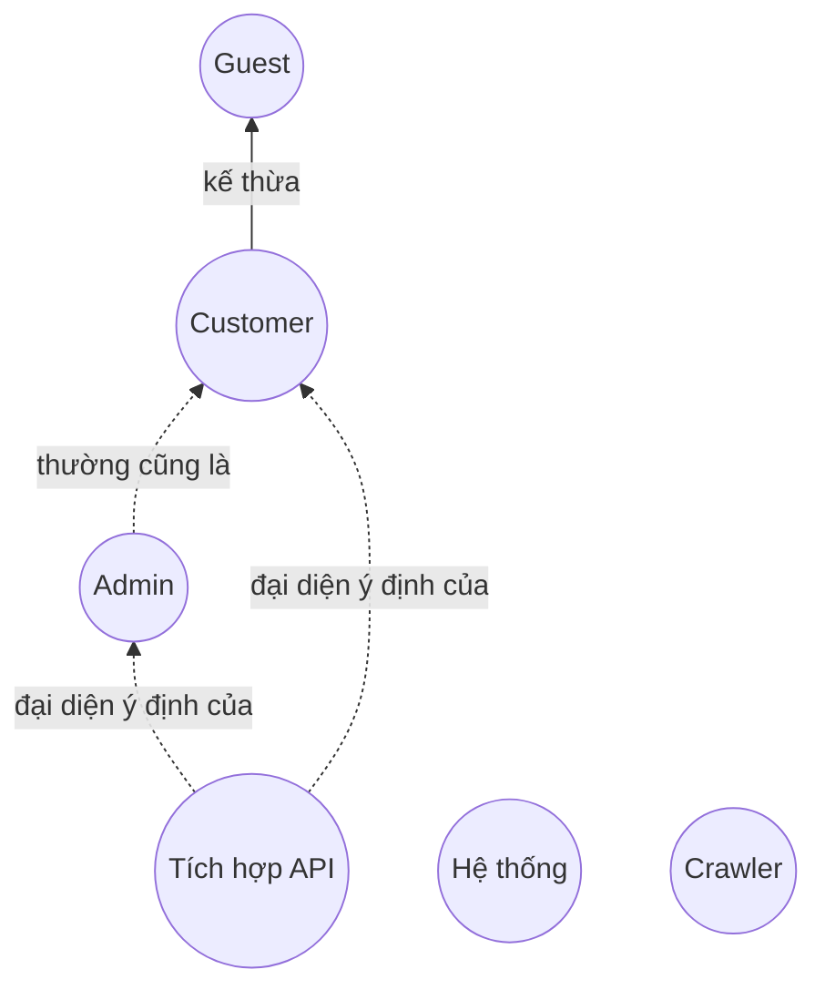
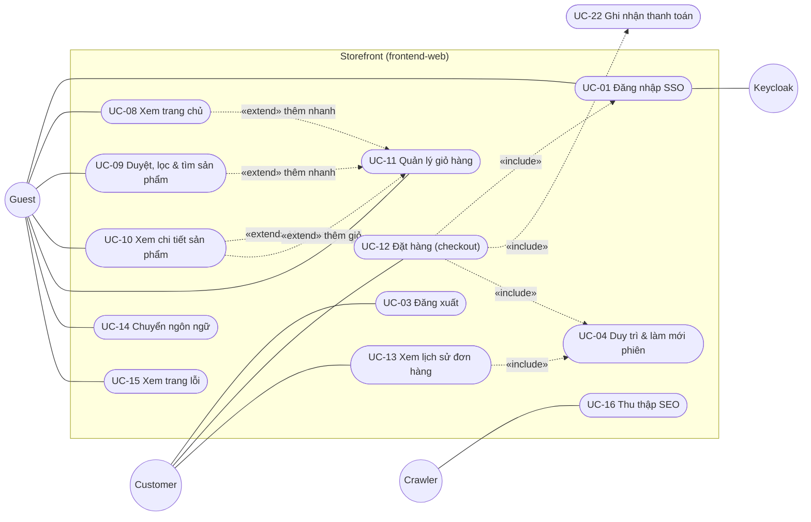
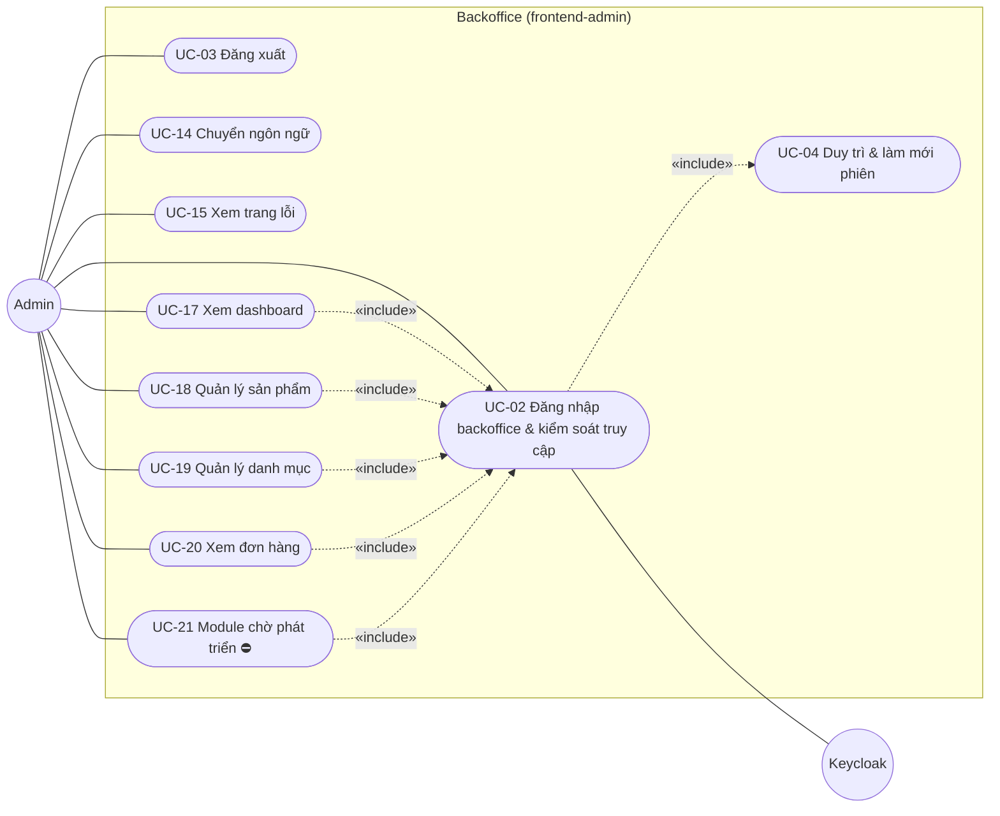
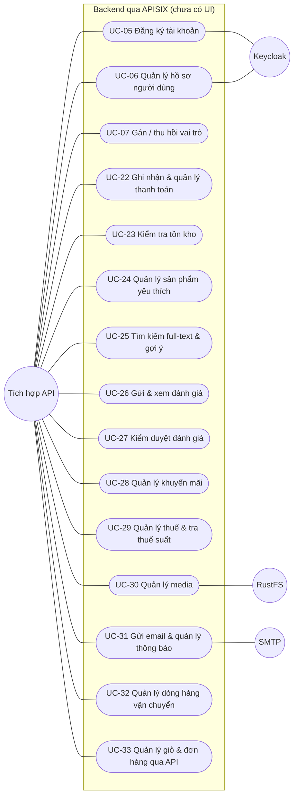
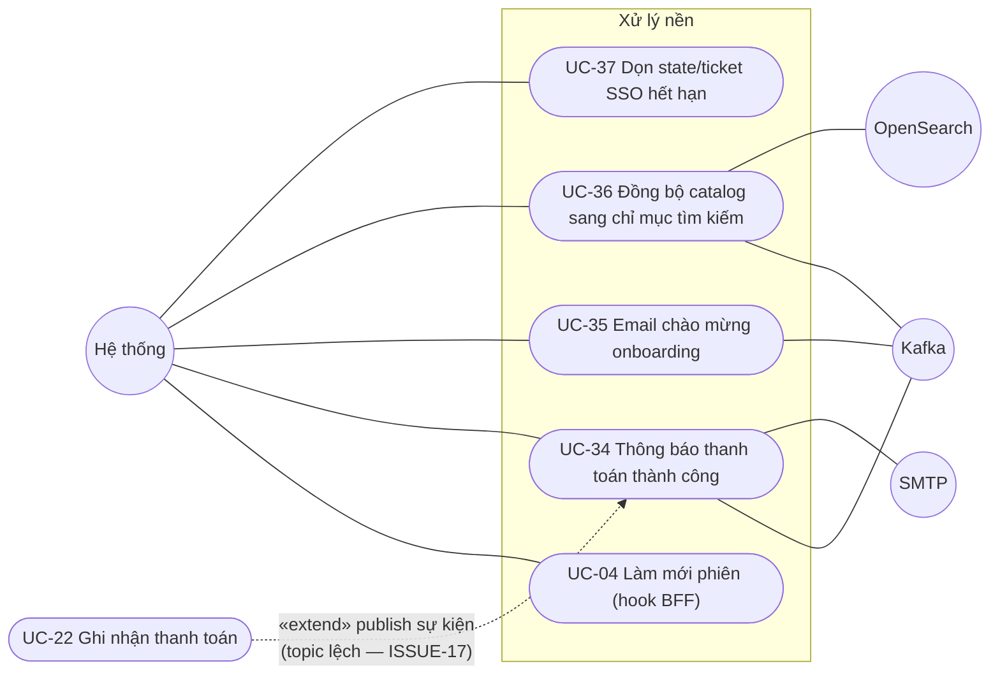

# Mô hình Use Case

> **Phiên bản:** 1.0 · **Trạng thái:** Final · **Cập nhật:** 2026-11-12 · **Phạm vi:** Ứng dụng (as-is)

> Mô hình use case theo phong cách ISO/IEC/IEEE 29148 + UML, **suy ra từ code hiện tại**. Mỗi use case `UC-xx` tóm tắt hành vi; chi tiết luồng, dòng code và acceptance criteria nằm trong tài liệu FEAT tương ứng (FEAT là nguồn chuẩn). Quy tắc nghiệp vụ `RULE-xx` lấy từ [brd.md §6](brd.md#6-quy-tắc-nghiệp-vụ-toàn-cục-đang-được-code-thực-thi); vấn đề `ISSUE-xx` từ [known-issues-tech-debt.md](../07-plan/known-issues-tech-debt.md). Ma trận truy vết đầy đủ: [requirements-traceability-matrix.md](requirements-traceability-matrix.md).

| Ký hiệu | Ý nghĩa |
| :--- | :--- |
| ✅ | Use case chạy được đầu-cuối theo mô tả |
| 🟡 | Có code nhưng thiếu bước, có lỗi chặn, hoặc chỉ có API |
| ⛔ | Chưa có (placeholder / stub) |
| «include» | Use case gốc **luôn** gọi use case được include |
| «extend» | Use case mở rộng chỉ xảy ra trong điều kiện nhất định |

---

## 1. Actor

### 1.1 Danh sách actor

| Actor | Loại | Mô tả | Nhận diện trong code | Kênh tương tác |
| :--- | :--- | :--- | :--- | :--- |
| **Guest** | Chính, người | Khách chưa đăng nhập | Không có cookie `session_user` hợp lệ → `locals.user = null` (`frontend/apps/web/src/hooks.server.ts:32-51`) | Storefront (web :3000) |
| **Customer** | Chính, người (kế thừa Guest) | Khách đã đăng nhập SSO | `locals.user` khác null (cookie `session_user`, `frontend/packages/lib/src/server/session.ts:70-80`) | Storefront |
| **Admin** | Chính, người | Nhân viên quản trị | `isAdmin(user)`: `roles` chứa `ADMIN` hoặc `ROLE_ADMIN` (`frontend/packages/lib/src/server/session.ts:23-25`) — **hiện luôn false** (ISSUE-100) | Backoffice (admin :3001) |
| **Tích hợp API** | Chính, hệ thống/người dùng kỹ thuật | Bất kỳ client nào gọi trực tiếp API qua APISIX (Postman/curl, hệ thống khác, hoặc nhân viên vận hành) cho các năng lực **chưa có UI**. Đại diện cho ý định nghiệp vụ của Admin/Customer khi chưa có màn hình. | Header `Authorization: Bearer <JWT Keycloak>` cho route `openid-connect`; route public không cần (xem [actors-and-permissions §4](actors-and-permissions.md#4-ma-trận-quyền--api-qua-gateway-thực-tế)) | APISIX :9080 |
| **Hệ thống** | Chính, tiến trình nội bộ | BFF hook làm mới phiên, Kafka producer/consumer, goroutine dọn SSO store | — | Nội bộ |
| **Crawler** | Chính, hệ thống ngoài | Bot công cụ tìm kiếm | User-agent bất kỳ, không phiên | Storefront (`/sitemap.xml`, `/robots.txt`) |
| **Keycloak** | Phụ (supporting) | IdP OIDC, realm `ecommerce` | `deploy/keycloak/import/ecommerce-realm.json` | auth-service |
| **SMTP** | Phụ | Máy chủ email | `MAIL_HOST` (notification-service) | notification-service |
| **Kafka / OpenSearch / RustFS** | Phụ (hạ tầng dữ liệu) | Broker sự kiện, chỉ mục tìm kiếm, object storage | — | payment, notification, search, media |

> Role `MANAGER` (Keycloak) và `PM` (DB `authservice`) **không** được code nào sử dụng → không mô hình hóa thành actor riêng ([actors-and-permissions §1](actors-and-permissions.md#1-actor)).

### 1.2 Quan hệ tổng quát hóa giữa actor

- **Customer** thực hiện được mọi use case của **Guest**.
- **Admin** và **Customer** dùng chung cơ chế đăng nhập (FEAT-01); cookie phiên trùng tên giữa hai app nên trên cùng host phiên được chia sẻ (ISSUE-11).
- **Tích hợp API** không bị phân biệt role ở backend (ISSUE-01): mọi token hợp lệ đều thực hiện được use case "quản trị" qua API.

---

## 2. Sơ đồ use case

Ký hiệu: hình tròn = actor; hình viên thuốc = use case; khung = ranh giới hệ thống.

### 2.1 Storefront — Guest / Customer / Crawler

> `UC-12 «include» UC-01` nghĩa là guard `/checkout` buộc đăng nhập (chuyển `/login?redirect=`) khi actor là Guest.

### 2.2 Backoffice — Admin

> Với backend hiện tại, `UC-02` luôn kết thúc ở `/access-denied` (ISSUE-100) nên UC-17 … UC-21 **không thực hiện được** qua UI.

### 2.3 API-only — Tích hợp API

### 2.4 Tiến trình hệ thống (bất đồng bộ / nền)

---

## 3. Danh mục use case (tổng hợp)

| UC | Tên | Actor chính | FEAT | BR | Trạng thái | Issue chặn chính |
| :--- | :--- | :--- | :--- | :--- | :---: | :--- |
| UC-01 | Đăng nhập SSO (storefront) | Guest | FEAT-01 | BR-01 | 🟡 | ISSUE-04, 67, 101 |
| UC-02 | Đăng nhập backoffice & kiểm soát truy cập | Admin | FEAT-01, FEAT-21 | BR-01, BR-21 | 🟡 | ISSUE-100, 68, 01 |
| UC-03 | Đăng xuất | Customer, Admin | FEAT-01 | BR-01 | ✅ | — |
| UC-04 | Duy trì & làm mới phiên | Hệ thống (BFF) | FEAT-03 | BR-03 | 🟡 | ISSUE-69, 67 |
| UC-05 | Đăng ký tài khoản | Tích hợp API (Guest) | FEAT-02 | BR-02 | 🟡 | ISSUE-71, 53, 08 |
| UC-06 | Quản lý hồ sơ người dùng | Tích hợp API (Admin/Customer) | FEAT-04 | BR-04 | 🟡 | ISSUE-01, 07, 100 |
| UC-07 | Gán / thu hồi vai trò | Tích hợp API (Admin) | FEAT-04 | BR-04 | 🟡 | ISSUE-01, 08 |
| UC-08 | Xem trang chủ | Guest | FEAT-05 | BR-05 | 🟡 | ISSUE-38, 44 |
| UC-09 | Duyệt, lọc & tìm sản phẩm | Guest | FEAT-06 | BR-06 | 🟡 | ISSUE-48, 40, 78 |
| UC-10 | Xem chi tiết sản phẩm | Guest | FEAT-07 | BR-07 | ✅ | ISSUE-50, 82 |
| UC-11 | Quản lý giỏ hàng | Guest | FEAT-08 | BR-08 | ✅ | ISSUE-79 |
| UC-12 | Đặt hàng (checkout) | Customer | FEAT-09 | BR-09 | 🟡 | ISSUE-20, 22, 23, 75, 76 |
| UC-13 | Xem lịch sử đơn hàng | Customer | FEAT-10 | BR-10 | 🟡 | ISSUE-48, 49, 41 |
| UC-14 | Chuyển ngôn ngữ | Guest, Customer, Admin | FEAT-27 | BR-27 | ✅ | ISSUE-39, 83 |
| UC-15 | Xem trang lỗi | Guest, Customer, Admin | FEAT-28 | BR-28 | ✅ | ISSUE-82 |
| UC-16 | Thu thập SEO (sitemap, robots, canonical) | Crawler | FEAT-28 | BR-28 | ✅ | ISSUE-82 |
| UC-17 | Xem dashboard | Admin | FEAT-22 | BR-22 | 🟡 | ISSUE-48, 100 |
| UC-18 | Quản lý sản phẩm | Admin | FEAT-23 | BR-23 | 🟡 | ISSUE-48, 60, 102 |
| UC-19 | Quản lý danh mục | Admin | FEAT-24 | BR-24 | 🟡 | ISSUE-48, 102 |
| UC-20 | Xem đơn hàng | Admin | FEAT-25 | BR-25 | 🟡 | ISSUE-48, 41, 40 |
| UC-21 | Truy cập module chờ phát triển | Admin | FEAT-26 | BR-26 | ⛔ | — |
| UC-22 | Ghi nhận & quản lý thanh toán | Tích hợp API (BFF checkout) | FEAT-11 | BR-11 | 🟡 | ISSUE-18, 25, 75 |
| UC-23 | Kiểm tra tồn kho | Tích hợp API | FEAT-12 | BR-12 | 🟡 | ISSUE-26, 51 |
| UC-24 | Quản lý sản phẩm yêu thích | Tích hợp API (Customer) | FEAT-13 | BR-13 | 🟡 | ISSUE-13, 56, 74 |
| UC-25 | Tìm kiếm full-text & gợi ý | Tích hợp API (Guest) | FEAT-14 | BR-14 | 🟡 | ISSUE-19, 34, 58 |
| UC-26 | Gửi & xem đánh giá | Tích hợp API (Customer) | FEAT-15 | BR-15 | 🟡 | ISSUE-03, 62 |
| UC-27 | Kiểm duyệt đánh giá | Tích hợp API (Admin) | FEAT-15 | BR-15 | 🟡 | ISSUE-01, 15 |
| UC-28 | Quản lý khuyến mãi | Tích hợp API (Admin) | FEAT-16 | BR-16 | 🟡 | ISSUE-15, 30 |
| UC-29 | Quản lý thuế & tra thuế suất | Tích hợp API (Admin) | FEAT-17 | BR-17 | 🟡 | ISSUE-13, 31 |
| UC-30 | Quản lý media | Tích hợp API (Admin) | FEAT-18 | BR-18 | 🟡 | ISSUE-15, 32, 63 |
| UC-31 | Gửi email & quản lý thông báo | Tích hợp API | FEAT-19 | BR-19 | 🟡 | ISSUE-64, 33 |
| UC-32 | Quản lý dòng hàng vận chuyển | Tích hợp API | FEAT-20 | BR-20 | 🟡 | ISSUE-15, 81 |
| UC-33 | Quản lý giỏ & đơn hàng qua API | Tích hợp API | FEAT-09, FEAT-10, FEAT-25 | BR-09, BR-10, BR-25 | 🟡 | ISSUE-49, 24 |
| UC-34 | Thông báo thanh toán thành công | Hệ thống | FEAT-11, FEAT-19 | BR-11, BR-19 | 🟡 | ISSUE-17, 18, 09 |
| UC-35 | Email chào mừng onboarding | Hệ thống | FEAT-19, FEAT-02 | BR-19, BR-02 | 🟡 | ISSUE-17 |
| UC-36 | Đồng bộ catalog sang chỉ mục tìm kiếm | Hệ thống | FEAT-14 | BR-14 | 🟡 | ISSUE-19 |
| UC-37 | Dọn state/ticket SSO hết hạn | Hệ thống | FEAT-01 | BR-01 | ✅ | ISSUE-06 |

**Thống kê**: 37 use case — ✅ 7 · 🟡 29 · ⛔ 1. Thực hiện qua UI: 18 (UC-01 … UC-04, UC-08 … UC-21; UC-04 chạy ngầm trong hook BFF); chỉ API: 15 (UC-05 … UC-07, UC-22 … UC-33); nền/bất đồng bộ: 4 (UC-34 … UC-37).

---

## 4. Đặc tả use case

Mỗi đặc tả gồm: mục tiêu, trigger, tiền/hậu điều kiện, luồng chính, mở rộng (luồng thay thế/ngoại lệ, đánh số theo bước), quy tắc nghiệp vụ, liên kết. Đường dẫn source tính từ gốc repo.

### 4.1 Nhóm Định danh & truy cập

#### UC-01 — Đăng nhập SSO (storefront)

| Thuộc tính | Giá trị |
| :--- | :--- |
| Actor chính / phụ | Guest / Keycloak, auth-service |
| Mục tiêu | Khách xác thực bằng tài khoản tập trung và quay lại đúng trang đang xem |
| Trigger | Bấm "Đăng nhập" ở header (`frontend/apps/web/src/lib/components/header.svelte:134`) hoặc bị guard chuyển từ `/checkout`, `/orders` (`frontend/apps/web/src/routes/checkout/+page.server.ts:5-9`) |
| Tiền điều kiện | Keycloak realm `ecommerce` chạy; user tồn tại **cả** trong Keycloak **và** bảng `authservice.users` (ISSUE-101) |
| Hậu điều kiện (thành công) | 4 cookie httpOnly `access_token`, `refresh_token`, `session_expires`, `session_user`; `locals.user` khác null |
| Trạng thái | 🟡 — luồng có đủ bước nhưng thường thất bại do ISSUE-04 (đổi code sai `redirect_uri`), ISSUE-101/67 (profile 404 → vẫn là khách) |
| Liên kết | BR-01 · FEAT-01 · RULE-13 · ISSUE-04, 05, 06, 11, 52, 66, 67, 100, 101 · US-0103, US-0104, US-0105, US-0204 |

**Luồng chính**

1. Guest mở `/login?redirect=<path>`; BFF lọc `redirect` bằng `safeRedirect`, ghi cookie `auth_redirect` (600 s), dựng `ssoUrl` (`frontend/apps/web/src/routes/login/+page.server.ts:9-27`).
2. Guest bấm "Đăng nhập bằng SSO" → trình duyệt tới `GET /api/v1/auth/login?redirect_uri=<origin>/auth/callback` (APISIX → auth-service).
3. auth-service tạo `state` (TTL 5 phút, in-memory) và 302 tới Keycloak authorize (`services/auth-service/internal/handler/auth_handler.go:125-134`).
4. Guest nhập thông tin trên Keycloak; Keycloak gọi lại `/api/v1/auth/callback?code&state` của auth-service.
5. auth-service đổi `code` lấy token, sinh `ticket` một lần (TTL 2 phút), 302 tới `<origin>/auth/callback?ticket=` (`auth_handler.go:136-167`).
6. BFF đổi ticket qua `GET /api/v1/auth/session?ticket=`, lấy profile `GET /api/v1/users/me`, gọi `setSession` (`frontend/apps/web/src/routes/auth/callback/+page.server.ts:10-40`).
7. BFF đọc và xóa `auth_redirect`, redirect 303 tới `localizeHref(target)`; header hiển thị menu tài khoản.

**Mở rộng**

- 1a. Đã đăng nhập → 303 ngay tới đích.
- 3a. `redirect_uri` không được kiểm allowlist (ISSUE-05).
- 5a. `state` không hợp lệ/hết hạn → vẫn tiếp tục với redirect mặc định (ISSUE-52).
- 5b. Đổi code thất bại → auth-service cấp **mock token**; bước 6 nhận 401 từ `/users/me` → không có phiên (ISSUE-04).
- 5c. Keycloak trả `?error=` → luôn redirect về `SSO_DEFAULT_FRONTEND_REDIRECT` (web).
- 6a. Ticket hết hạn/đã dùng/khác replica → 401 → trang "Đăng nhập không thành công" (ISSUE-06).
- 6b. `/users/me` lỗi (404 do ISSUE-101) → `session_user` bị xóa, chỉ còn token → người dùng vẫn là khách, không thông báo (ISSUE-67).
- 6c. `/users/me` thành công nhưng không có `roles`, key `fullname` → `fullName` rỗng, header hiển thị `username` (ISSUE-100).

**Quy tắc**: RULE-13 (chỉ redirect nội bộ).

#### UC-02 — Đăng nhập backoffice & kiểm soát truy cập

| Thuộc tính | Giá trị |
| :--- | :--- |
| Actor chính / phụ | Admin / Keycloak, auth-service |
| Mục tiêu | Chỉ người có vai trò quản trị vào được backoffice; người khác thấy trang từ chối |
| Trigger | Mở bất kỳ route admin nào (trừ `/login`, `/auth/callback`, `/access-denied`) |
| Tiền điều kiện | Như UC-01; bản ghi `authservice.users` có role `ADMIN` **và** `/users/me` trả `roles` (hiện không trả — ISSUE-100) |
| Hậu điều kiện | Được phép: render trang; Guest: 303 `/login?redirect=`; không phải admin: 303 `/access-denied` |
| Trạng thái | 🟡 — guard hoạt động nhưng **chặn mọi người** (ISSUE-100); bypass được qua `/_app/remote` (ISSUE-68); backend không kiểm role (ISSUE-01) |
| Liên kết | BR-01, BR-21 · FEAT-01, FEAT-21 · RULE-12, RULE-13 · ISSUE-01, 11, 66, 68, 100, 101 · US-0103, US-0201, US-0203 |

**Luồng chính**

1. Hook `handleAdminGuard` bỏ prefix locale, kiểm path public (`frontend/apps/admin/src/hooks.server.ts:58-65`).
2. Không có `locals.user` → 303 `/login?redirect=<path+query>` (`hooks.server.ts:67-70`).
3. Admin thực hiện các bước 1–6 của UC-01 trên app admin (`frontend/apps/admin/src/routes/login/+page.server.ts:8-24`, `auth/callback/+page.server.ts:9-34`).
4. Request kế tiếp: `isAdmin(user)` đúng → render trang đích (mặc định `/` → 303 `/dashboard`, `frontend/apps/admin/src/routes/+page.server.ts:5-7`).

**Mở rộng**

- 4a. `isAdmin` sai → 303 `/access-denied` (`hooks.server.ts:72-74`); trang này chỉ có nút "Đăng xuất" (UC-03). **Hiện là kết quả duy nhất** vì `roles = []` (ISSUE-100).
- 3a. Profile 404 → không có `session_user` → quay lại `/login` không thông báo (ISSUE-101, ISSUE-67).
- 1a. Path bắt đầu `/_app/` hoặc chứa `.` → coi là public → remote function ghi dữ liệu chạy không qua guard (ISSUE-68).
- 1b. Web và admin cùng host → dùng chung cookie phiên (ISSUE-11).

**Quy tắc**: RULE-12, RULE-13.

#### UC-03 — Đăng xuất

| Thuộc tính | Giá trị |
| :--- | :--- |
| Actor chính | Customer (web), Admin (admin) |
| Mục tiêu | Kết thúc phiên an toàn kể cả khi IdP lỗi |
| Trigger | Menu tài khoản "Đăng xuất" (`frontend/apps/web/src/lib/components/header.svelte:123-130`); nút đăng xuất sidebar/header admin (`frontend/apps/admin/src/routes/+layout.svelte:55-65`) hoặc `/access-denied` |
| Tiền điều kiện | Có cookie phiên |
| Hậu điều kiện | 4 cookie phiên bị xóa; refresh token bị Keycloak thu hồi (nếu tới được); giỏ hàng **không** bị xóa |
| Trạng thái | ✅ |
| Liên kết | BR-01 · FEAT-01 · E2E-10 |

**Luồng chính**

1. UI gọi remote command `logout` (chống bấm lặp bằng cờ `loggingOut`).
2. BFF gửi `POST /api/v1/auth/logout {refreshToken}` nếu có refresh token (`frontend/apps/web/src/lib/remote/auth.remote.ts:6-19`).
3. auth-service gọi Keycloak logout, **luôn** trả 200 (`auth_handler.go:201-208`).
4. BFF `clearSession`; UI `invalidateAll()` rồi về `/` (web) hoặc `/login` (admin).

**Mở rộng**: 2a/3a. Gateway/Keycloak lỗi → lỗi bị nuốt, cookie vẫn bị xóa (NFR-REL-06).

#### UC-04 — Duy trì & làm mới phiên

| Thuộc tính | Giá trị |
| :--- | :--- |
| Actor chính | Hệ thống (hook `handleSession` của BFF), thay mặt Customer/Admin |
| Mục tiêu | Phiên được gia hạn liên tục; hết hạn thì coi như đăng xuất |
| Trigger | Mọi request tới web/admin khi có `session_user` và access token còn < 30 giây hoặc không còn |
| Tiền điều kiện | Có cookie `session_user` và `refresh_token` |
| Hậu điều kiện | Thành công: cookie token mới; `session_user` **không** được gia hạn. Thất bại: xóa phiên, `locals.user = null` |
| Trạng thái | 🟡 — `session_user` hết hạn theo lần đăng nhập đầu (ISSUE-69) |
| Liên kết | BR-03 · FEAT-03 · ISSUE-06, 11, 66, 67, 69 · US-0105 · E2E-09 |

**Luồng chính**

1. `session(cookies)` đọc `session_user` (`frontend/packages/lib/src/server/session.ts:70-80`).
2. `shouldRefresh` đúng (`session.ts:87-91`) → `POST /api/v1/auth/refresh {refreshToken}` (`frontend/apps/web/src/hooks.server.ts:32-51`, admin `hooks.server.ts:32-51`).
3. auth-service gọi Keycloak `grant_type=refresh_token` (`auth_handler.go:185-199`).
4. BFF `setSession(cookies, tokens)` (giữ nguyên `session_user`), gán `locals.user`.

**Mở rộng**

- 2a. Token còn hạn → bỏ qua refresh.
- 2b. Không có `session_user` (khách hoặc ISSUE-67) → không refresh dù còn token.
- 3a. Keycloak từ chối/gateway lỗi → `clearSession`; route bảo vệ tự redirect `/login`.
- 4a. `session_user` hết hạn trước refresh token → bị coi là khách (ISSUE-69).

#### UC-05 — Đăng ký tài khoản

| Thuộc tính | Giá trị |
| :--- | :--- |
| Actor chính / phụ | Tích hợp API (thay mặt Guest) / Keycloak Admin API |
| Mục tiêu | Tạo tài khoản mới với username, email, mật khẩu không trùng |
| Trigger | `POST /api/v1/auth/signup` (route public) |
| Tiền điều kiện | DB `authservice` và Keycloak admin truy cập được |
| Hậu điều kiện | User trên Keycloak + bản ghi `users`, `user_role` (mặc định `USER`); **không** phát sự kiện onboarding |
| Trạng thái | 🟡 — chỉ có API; nút "Đăng ký qua SSO" ở `/login` chỉ mở lại SSO, realm tắt registration (ISSUE-71) |
| Liên kết | BR-02 · FEAT-02 · RULE-08 · ISSUE-08, 53, 71, 101 · US-0402 |

**Luồng chính**

1. Client gửi `RegisterRequest {username*, password*, email*, fullName, gender, phone, avatar, roles}` (`auth_handler.go:100-123`).
2. Service kiểm trùng username, email, phone (`services/auth-service/internal/service/user_service.go:34-88`).
3. Tạo user Keycloak qua Admin API (`services/auth-service/internal/service/keycloak_client.go:177-239`).
4. Ghi `users` + `user_role` trong transaction (`services/auth-service/internal/repository/user_repository.go:217-270`).
5. Trả 200 `"User <username> registered successfully"`.

**Mở rộng**

- 1a. Thiếu trường bắt buộc → 400 `VALIDATION_FAILED`.
- 2a. Trùng → 409 `CONFLICT` (RULE-08).
- 1b. Client gửi `roles: ["ADMIN"]` → được ghi thẳng (ISSUE-53).
- 3a. Không lấy được admin token / lỗi mạng → id giả `kc-<username>`, user không đăng nhập được (ISSUE-08).
- 4a. Ghi DB lỗi → xóa user Keycloak (bù trừ), trả 400 `REGISTRATION_FAILED`.

#### UC-06 — Quản lý hồ sơ người dùng

| Thuộc tính | Giá trị |
| :--- | :--- |
| Actor chính | Tích hợp API (Admin cho CRUD; Customer cho `/me`) |
| Mục tiêu | Xem/sửa/xóa người dùng; xem hồ sơ bản thân; đổi mật khẩu |
| Trigger | `GET /api/v1/users/me`, `/users/all`, `/users/{id}`, `/users?username=`, `PUT/DELETE /users/{id}`, `PUT /users/me/password` |
| Tiền điều kiện | Bearer JWT hợp lệ (route `auth-users`); **không** yêu cầu role |
| Hậu điều kiện | Thay đổi chỉ trên DB `authservice` (DELETE xóa thêm user Keycloak); role Keycloak không đổi |
| Trạng thái | 🟡 — chỉ API; đổi mật khẩu là stub (⛔); ai có token cũng xóa được user khác (ISSUE-01) |
| Liên kết | BR-04 · FEAT-04 · RULE-08 · ISSUE-01, 02, 07, 100 · US-0201, US-0208, US-0606 |

**Luồng chính** (xem danh sách và cập nhật)

1. Client gọi `GET /api/v1/users/all?page&size&sortBy&sortOrder` → `PageResponse<UserResponse>` (`auth_handler.go:303-316`).
2. Client gọi `GET /api/v1/users/{id}` (`auth_handler.go:283-301`).
3. Client gửi `PUT /api/v1/users/{id}` với trường cần đổi → merge và `UPDATE users` (`auth_handler.go:214-238`).

**Mở rộng**

- 1a. `GET /users/me`: tra theo `preferred_username` (claim parse **không verify** — ISSUE-02); trả `UserResponse` không có `roles` (ISSUE-100); 404 nếu user chỉ ở Keycloak (ISSUE-101).
- 3a. `DELETE /users/{id}` → xóa user Keycloak (lỗi bị nuốt) rồi xóa DB (`auth_handler.go:244-261`).
- 3b. `PUT /users/me/password` → luôn 200, không đổi gì (ISSUE-07, `auth_handler.go:240-242`).
- 2a. id không phải số → 400 `INVALID_ID`; không tồn tại → 404.

#### UC-07 — Gán / thu hồi vai trò

| Thuộc tính | Giá trị |
| :--- | :--- |
| Actor chính | Tích hợp API (thay mặt Admin) |
| Mục tiêu | Cấp hoặc thu hồi role `USER`/`PM`/`ADMIN` cho người dùng |
| Trigger | `POST /api/v1/roles/users/{userId}/assign` hoặc `/revoke` (body text thô = tên role); `GET /api/v1/roles/users/{userId}` |
| Tiền điều kiện | Bearer JWT bất kỳ (không kiểm role) |
| Hậu điều kiện | Bảng `user_role` thay đổi; **không** đồng bộ sang Keycloak; phiên đang mở không cập nhật role tới khi đăng nhập lại |
| Trạng thái | 🟡 — mọi user tự nâng quyền được (ISSUE-01); role không tới được frontend (ISSUE-100) |
| Liên kết | BR-04 · FEAT-04 · RULE-12 · ISSUE-01, 08, 100 · US-0201, US-0606 |

**Luồng chính**

1. Client gửi tên role → `UPPER(TRIM)` → `INSERT INTO user_role ... ON CONFLICT DO NOTHING` (`auth_handler.go:345-370`, `user_repository.go:331-354`).
2. Thu hồi: `DELETE FROM user_role WHERE ...` (`auth_handler.go:372-397`).
3. Xem: mảng tên role (`auth_handler.go:399-413`).

**Mở rộng**: 1a. Role đã có / role không tồn tại → 409; user không tồn tại → 500 (vi phạm FK). 2a. User không có role → 409.

### 4.2 Nhóm Storefront

#### UC-08 — Xem trang chủ

| Thuộc tính | Giá trị |
| :--- | :--- |
| Actor chính | Guest |
| Mục tiêu | Giới thiệu banner, deal, flash sale, sản phẩm nổi bật, danh mục, thương hiệu |
| Trigger | Mở `/` hoặc `/en` |
| Tiền điều kiện | Không |
| Hậu điều kiện | Không đổi dữ liệu; nếu "thêm nhanh" → giỏ chứa `productId` mock |
| Trạng thái | 🟡 — toàn bộ dữ liệu mock (`frontend/apps/web/src/lib/data/home-mock.ts`) |
| Liên kết | BR-05 · FEAT-05 · ISSUE-38, 39, 44, 79 · US-0108, US-0610 |

**Luồng chính**

1. Layout render header/footer, `cart.hydrate()` khi mount (`frontend/apps/web/src/routes/+layout.svelte:15`).
2. Trang render hero, quick deals, 10 icon danh mục, flash sale có đồng hồ đếm ngược, sản phẩm hot, khối điện thoại/laptop, thương hiệu, USP (`frontend/apps/web/src/routes/+page.svelte:104-288`).
3. Guest bấm một liên kết danh mục/deal → chuyển UC-09 với query tương ứng.

**Mở rộng**

- 3a. Bấm "Thêm vào giỏ" trên card → «extend» UC-11 với sản phẩm mock; checkout sau đó lỗi 404 (ISSUE-38).
- 3b. Bấm card → `/products/{id}` không qua `localizeHref` (ISSUE-39) → UC-10 trả "Không tìm thấy" vì id mock.

#### UC-09 — Duyệt, lọc & tìm sản phẩm

| Thuộc tính | Giá trị |
| :--- | :--- |
| Actor chính | Guest |
| Mục tiêu | Tìm sản phẩm theo danh mục, từ khóa, sắp xếp, khoảng giá, phân trang |
| Trigger | Mở `/products` (từ header, footer, trang chủ, form tìm kiếm `GET /products?search=`) |
| Tiền điều kiện | product-service có dữ liệu |
| Hậu điều kiện | Không đổi dữ liệu |
| Trạng thái | 🟡 — backend trả mảng thô, bỏ qua `page/size/sort/categoryId/search` → UI hiển thị "Không tìm thấy" (ISSUE-48) |
| Liên kết | BR-06 · FEAT-06 · RULE-01 · ISSUE-40, 44, 48, 78, 102 · US-0101, US-0308, US-0603 · E2E-01 |

**Luồng chính**

1. UI đọc `page`, `search`, `categoryId`, `sort` từ URL; `size = 12` (`frontend/apps/web/src/routes/products/+page.svelte:30-41`).
2. Remote query `getProducts` validate `productQuerySchema` → `GET /api/products?...` (`frontend/apps/web/src/routes/products/catalog.remote.ts:13`).
3. Remote query `getCategories` → `GET /api/categories?page=0&size=50` cho sidebar (`catalog.remote.ts:16-19`).
4. UI hiển thị lưới `ProductCard`, tổng số, phân trang tối đa 5 số trang (theo hợp đồng `Page`).

**Mở rộng**

- 1a. Chọn danh mục / sắp xếp / trang → cập nhật URL, quay lại bước 2.
- 4a. Chọn khoảng giá → lọc **phía client** trên trang hiện tại (ISSUE-40).
- 1b. Nhập từ khóa → gửi `search` tới product-service (bị bỏ qua); không dùng search-service (ISSUE-78).
- 2a. Validate/gateway lỗi → "Không thể tải sản phẩm" + "Thử lại".
- 4b. Thêm nhanh → «extend» UC-11.

#### UC-10 — Xem chi tiết sản phẩm

| Thuộc tính | Giá trị |
| :--- | :--- |
| Actor chính | Guest |
| Mục tiêu | Xem ảnh, giá, tồn, chọn số lượng, thêm giỏ hoặc mua ngay |
| Trigger | Mở `/products/{id}` |
| Tiền điều kiện | Sản phẩm tồn tại |
| Hậu điều kiện | Giỏ cập nhật (nếu thêm) |
| Trạng thái | ✅ (không có mô tả sản phẩm — ISSUE-50; không có `<title>`, soft-404 — ISSUE-82) |
| Liên kết | BR-07 · FEAT-07 · RULE-01 · ISSUE-39, 50, 82 · US-0601 |

**Luồng chính**

1. Remote query `getProduct(id)` → `GET /api/products/{id}` (`frontend/apps/web/src/routes/products/[id]/product.remote.ts:5`).
2. UI hiển thị breadcrumb, ảnh, tên, SKU, giá "đã gồm VAT", badge còn/hết hàng (`frontend/apps/web/src/routes/products/[id]/+page.svelte:46-86`).
3. Guest chọn số lượng (1 … `quantity || 99`) và bấm "Thêm vào giỏ" → «extend» UC-11, toast.

**Mở rộng**

- 3a. "Mua ngay" → thêm giỏ rồi `/checkout` → «extend» UC-12 (Guest bị chuyển UC-01).
- 2a. Hết hàng → hai nút disabled.
- 1a. id không hợp lệ / không tồn tại / lỗi 5xx → "Không tìm thấy sản phẩm" với HTTP 200.

#### UC-11 — Quản lý giỏ hàng

| Thuộc tính | Giá trị |
| :--- | :--- |
| Actor chính | Guest (kể cả Customer) |
| Mục tiêu | Thêm, đổi số lượng, xóa, xem tạm tính/phí ship/tổng; giữ giỏ khi tải lại |
| Trigger | Thêm từ card/PDP; mở `/cart` |
| Tiền điều kiện | JavaScript bật; `localStorage` khả dụng |
| Hậu điều kiện | `localStorage["ecommerce-cart"]` phản ánh giỏ |
| Trạng thái | ✅ (giỏ chỉ ở trình duyệt; không giới hạn số lượng — ISSUE-79) |
| Liên kết | BR-08 · FEAT-08 · RULE-01, RULE-02 · ISSUE-42, 79 · US-0612 · E2E-02 |

**Luồng chính**

1. `cart.add(product, quantity)` cộng dồn theo `productId`, `persist()` (`frontend/apps/web/src/lib/stores/cart.svelte.ts:46-54`).
2. Header hiển thị badge tổng số lượng.
3. Guest mở `/cart`: danh sách dòng, nút −/+, xóa, "Xóa tất cả", tóm tắt (`frontend/apps/web/src/routes/cart/+page.svelte`).
4. Hệ thống tính phí ship theo RULE-02 (`frontend/packages/lib/src/cart.ts:1-26`) và gợi ý "mua thêm X để miễn phí".
5. Guest bấm "Tiến hành thanh toán" → UC-12.

**Mở rộng**: 3a. Số lượng về 0 → xóa dòng. 3b. Giỏ rỗng → empty state. 1a. Số lượng > 99 → không chặn, checkout sẽ lỗi (RULE-03, ISSUE-79). 1b. Đăng xuất không xóa giỏ.

#### UC-12 — Đặt hàng (checkout)

| Thuộc tính | Giá trị |
| :--- | :--- |
| Actor chính / phụ | Customer / product-service, order-service, payment-service |
| Mục tiêu | Nhập thông tin giao hàng, chọn COD/ONLINE, xác nhận; tạo đơn với giá tính lại phía server |
| Trigger | "Tiến hành thanh toán" ở `/cart` hoặc "Mua ngay" ở PDP |
| Tiền điều kiện | `locals.user` khác null (nếu không → UC-01); cookie `access_token`; giỏ ≥ 1 dòng, mọi `productId` tồn tại |
| Hậu điều kiện | 1 bản ghi `orders` (chỉ `product_id` dòng đầu, `cart_id` NULL), 1 bản ghi `payments`, 2 message Kafka; giỏ bị xóa; màn thành công có mã đơn |
| Trạng thái | 🟡 — đơn mất dòng hàng, địa chỉ, danh tính người đặt (ISSUE-20, 22, 76); ONLINE ghi "đã trả" (ISSUE-75); không idempotency (ISSUE-23) |
| Liên kết | BR-09 · FEAT-09 (+ FEAT-11) · RULE-02 … RULE-06 · ISSUE-20, 21, 22, 23, 38, 75, 76, 79 · US-0301 … US-0306 · E2E-03, E2E-04 |

**Luồng chính**

1. Guard `load` kiểm `locals.user` (`frontend/apps/web/src/routes/checkout/+page.server.ts:5-11`).
2. Bước 1 — Customer nhập họ tên, SĐT, địa chỉ, thành phố, quận, ghi chú; client validate `shippingSchema` (RULE-04).
3. Bước 2 — chọn COD hoặc ONLINE ("Chuyển khoản").
4. Bước 3 — xem lại và bấm "Đặt hàng ngay" → remote command `placeOrder` (`frontend/apps/web/src/routes/checkout/+page.svelte:46-66`).
5. Server validate `checkoutSchema` (RULE-03), lấy giá từng sản phẩm `GET /api/products/{id}` (RULE-05), tính tổng + phí ship (RULE-02) (`frontend/apps/web/src/routes/checkout/checkout.remote.ts:13-26`).
6. Server tạo đơn `POST /api/orders` (`checkout.remote.ts:30-35`).
7. Server «include» UC-22: `POST /api/payments` theo RULE-06 (`checkout.remote.ts:37-41`).
8. Client xóa giỏ, hiển thị bước 4 "Đặt hàng thành công" với mã đơn.

**Mở rộng**

- 1a. Chưa đăng nhập → 303 `/login?redirect=/checkout` (UC-01).
- 2a. Thông tin giao hàng không hợp lệ → ở lại bước 1, thông báo chung.
- 5a. Giỏ có sản phẩm mock/đã xóa → 404 → toast chung, không tạo đơn (ISSUE-38).
- 5b. Không có `access_token` → 401 → toast chung (không chuyển `/login` — ISSUE-122).
- 7a. Tạo payment lỗi → đơn đã tạo **không** có payment, giỏ còn nguyên → bấm lại sinh đơn trùng (ISSUE-23).
- 7b. ONLINE → `isPayed=true`, `IN_PROGRESS` dù chưa nhận tiền (ISSUE-75).
- 8a. Giỏ rỗng khi vào trang → empty state.

#### UC-13 — Xem lịch sử đơn hàng

| Thuộc tính | Giá trị |
| :--- | :--- |
| Actor chính | Customer |
| Mục tiêu | Xem danh sách đơn của chính mình |
| Trigger | Mở `/orders` (header "Theo dõi đơn hàng", menu "Đơn hàng của tôi", màn thành công) |
| Tiền điều kiện | Đã đăng nhập; access token hợp lệ |
| Hậu điều kiện | Chỉ đọc |
| Trạng thái | 🟡 — API trả mọi đơn của mọi người (ISSUE-49), dạng mảng → UI rơi vào lỗi (ISSUE-48); trạng thái cố định "Đang xử lý" (ISSUE-41) |
| Liên kết | BR-10 · FEAT-10 · RULE-01 · ISSUE-41, 48, 49, 76 · US-0202, US-0303 · E2E-05 |

**Luồng chính**

1. Guard `load` (`frontend/apps/web/src/routes/orders/+page.server.ts:5-11`).
2. Remote query `getOrders({page, size: 10})` → `GET /api/orders?page&size` (`frontend/apps/web/src/routes/orders/orders.remote.ts:6-8`).
3. UI hiển thị card mỗi đơn: badge trạng thái, mã, ngày, tổng, mô tả; phân trang Trước/Sau.

**Mở rộng**: 2a. Lỗi/401 → "Đã xảy ra lỗi" + "Thử lại". 3a. Không có đơn → empty state "Mua sắm ngay". 3b. Không có trang chi tiết đơn.

#### UC-14 — Chuyển ngôn ngữ

| Thuộc tính | Giá trị |
| :--- | :--- |
| Actor chính | Guest, Customer, Admin |
| Mục tiêu | Dùng giao diện tiếng Việt (mặc định) hoặc tiếng Anh với URL thân thiện |
| Trigger | Bấm `VI`/`EN` ở header web (`frontend/apps/web/src/lib/components/header.svelte:63-77`) hoặc header admin (`frontend/apps/admin/src/routes/+layout.svelte:123-137`) |
| Tiền điều kiện | Không |
| Hậu điều kiện | Trang tải lại ở `/…` (vi) hoặc `/en/…` (en); `<html lang>` cập nhật |
| Trạng thái | ✅ |
| Liên kết | BR-27 · FEAT-27 · ISSUE-39, 43, 83 · US-0611 · E2E-08 |

**Luồng chính**: 1. Link `localizeHref(pathname, {locale})` với `data-sveltekit-reload`. 2. `reroute` bỏ prefix locale (`src/hooks.ts:4`). 3. `paraglideMiddleware` xác định locale theo `url → cookie → baseLocale`, thay `lang/dir`.

**Mở rộng**: 1a. Query string bị mất khi đổi ngôn ngữ (ISSUE-83). 1b. Link không qua `localizeHref` đưa người dùng `en` về `vi` (ISSUE-39). 3a. Giá/ngày vẫn định dạng `vi-VN` (RULE-01, ISSUE-83).

#### UC-15 — Xem trang lỗi

| Thuộc tính | Giá trị |
| :--- | :--- |
| Actor chính | Guest, Customer, Admin |
| Mục tiêu | Nhận thông báo thân thiện khi trang không tồn tại hoặc lỗi |
| Trigger | Route không khớp hoặc load/render ném lỗi |
| Hậu điều kiện | Không |
| Trạng thái | ✅ |
| Liên kết | BR-28 · FEAT-28 · ISSUE-82 |

**Luồng chính**: 1. SvelteKit render `+error.svelte` (`frontend/apps/web/src/routes/+error.svelte:9-29`, `frontend/apps/admin/src/routes/+error.svelte`). 2. 404 → "Không tìm thấy trang"; khác → "Đã xảy ra lỗi". 3. Người dùng chọn "Về trang chủ" hoặc "Thử lại".

**Mở rộng**: 1a. Lỗi API trong `{#await}` được hiển thị inline với HTTP 200 (soft-404 — ISSUE-82).

#### UC-16 — Thu thập SEO

| Thuộc tính | Giá trị |
| :--- | :--- |
| Actor chính | Crawler |
| Mục tiêu | Index trang công khai, bỏ qua trang riêng tư |
| Trigger | Crawler đọc `/robots.txt`, `/sitemap.xml`, thẻ `<link rel=canonical/alternate>` |
| Trạng thái | ✅ (mức cơ bản; sitemap không có URL sản phẩm — ISSUE-82) |
| Liên kết | BR-28 · FEAT-28 · NFR-SEC-10 · ISSUE-82 |

**Luồng chính**: 1. `robots.txt` web cho phép `/`, chặn `/cart`, `/checkout`, `/orders`, `/auth/` (`frontend/apps/web/static/robots.txt:1-11`); admin `Disallow: /`. 2. `GET /sitemap.xml` trả 4 URL (`/`, `/en`, `/products`, `/en/products`) (`frontend/apps/web/src/routes/sitemap.xml/+server.ts:5-21`). 3. Mỗi trang có canonical (gồm query) + hreflang `vi`/`en`/`x-default` (`frontend/apps/web/src/routes/+layout.svelte:17-34`).

### 4.3 Nhóm Backoffice

> Mọi use case trong nhóm này «include» UC-02. Với backend hiện tại UC-02 luôn chuyển tới `/access-denied` (ISSUE-100) → các luồng dưới đây mô tả **hành vi của code** khi qua được guard.

#### UC-17 — Xem dashboard

| Thuộc tính | Giá trị |
| :--- | :--- |
| Actor chính | Admin |
| Mục tiêu | Xem tổng số sản phẩm, đơn, danh mục và đơn/sản phẩm mới nhất |
| Trigger | Mở `/dashboard` (hoặc `/` → 303) |
| Tiền điều kiện | Qua guard UC-02 |
| Hậu điều kiện | Chỉ đọc |
| Trạng thái | 🟡 — đọc `.totalElements/.content` trên mảng thô → khối lỗi (ISSUE-48); không có doanh thu |
| Liên kết | BR-22 · FEAT-22 · RULE-01 · ISSUE-48, 49, 100 · US-0102 |

**Luồng chính**: 1. Remote query `getDashboard` gọi song song `GET /api/products?page=0&size=5`, `GET /api/categories?page=0&size=1`, `GET /api/orders?page=0&size=5` (`frontend/apps/admin/src/routes/dashboard/dashboard.remote.ts:9-24`). 2. UI hiển thị 3 thẻ số liệu (link tới trang tương ứng), bảng "Đơn hàng gần đây", danh sách "Sản phẩm gần đây".

**Mở rộng**: 1a. Một request lỗi → khối `common_noData` màu đỏ. 2a. Không có đơn/sản phẩm → thông điệp rỗng tương ứng.

#### UC-18 — Quản lý sản phẩm

| Thuộc tính | Giá trị |
| :--- | :--- |
| Actor chính | Admin (qua UI) — Tích hợp API thực hiện được trực tiếp, **kể cả không token** (ISSUE-102) |
| Mục tiêu | Tìm, xem, thêm, sửa, xóa sản phẩm |
| Trigger | Mở `/products` |
| Tiền điều kiện | Qua guard UC-02 |
| Hậu điều kiện | Bảng `products` thay đổi; danh sách làm mới |
| Trạng thái | 🟡 — danh mục luôn bị bỏ khi lưu (ISSUE-60); danh sách lỗi hợp đồng (ISSUE-48) |
| Liên kết | BR-23 · FEAT-23 · RULE-01, RULE-09 · ISSUE-01, 48, 60, 68, 102 · US-0102, US-0106, US-0201, US-0609 · E2E-06 |

**Luồng chính**

1. Remote query `getProducts({page, size: 10, search})` → `GET /api/products` (`frontend/apps/admin/src/routes/products/products.remote.ts:6-8`); bảng 6 cột.
2. Admin bấm "Thêm sản phẩm" hoặc biểu tượng sửa → dialog form (select danh mục nạp từ `getCategoryOptions`, `products.remote.ts:10-13`).
3. Remote form `saveProduct` validate `productUpsertSchema`; có `productId` → `PUT /api/products/{id}`, không → `POST /api/products` (`products.remote.ts:16-34`).
4. Đóng dialog, toast, làm mới danh sách.
5. Xóa: dialog xác nhận → command `deleteProduct` → `DELETE /api/products/{id}` → refresh (`products.remote.ts:36-39`).

**Mở rộng**: 3a. Validate lỗi → thông điệp tiếng Anh dưới trường (ISSUE-83). 3b. SKU trùng (RULE-09) / quá dài → 500 → toast "Chưa có dữ liệu". 3c. Danh mục chọn bị ghi NULL (ISSUE-60). 1a. Phân trang làm mất `search`.

#### UC-19 — Quản lý danh mục

| Thuộc tính | Giá trị |
| :--- | :--- |
| Actor chính | Admin (Tích hợp API thực hiện được không cần token — ISSUE-102) |
| Mục tiêu | Thêm, sửa, xóa danh mục |
| Trigger | Mở `/categories` |
| Hậu điều kiện | Bảng `categories` thay đổi; storefront header/footer **không** phản ánh (ISSUE-44) |
| Trạng thái | 🟡 |
| Liên kết | BR-24 · FEAT-24 · ISSUE-01, 44, 48, 102 · US-0102, US-0201 |

**Luồng chính**: 1. `getCategories({page, size: 12})` → `GET /api/categories` (`frontend/apps/admin/src/routes/categories/categories.remote.ts:6-8`); lưới thẻ. 2. Dialog thêm/sửa → `saveCategory` → `POST`/`PUT /api/categories[/{id}]` (`categories.remote.ts:10-21`). 3. Xóa có xác nhận → `DELETE /api/categories/{id}` (`categories.remote.ts:23-26`).

**Mở rộng**: 3a. Danh mục đang có sản phẩm/danh mục con → vi phạm FK → 500 → toast lỗi. 2a. Sửa danh mục con làm mất `parent_category_id`.

#### UC-20 — Xem đơn hàng (admin)

| Thuộc tính | Giá trị |
| :--- | :--- |
| Actor chính | Admin |
| Mục tiêu | Xem danh sách và chi tiết đơn hàng |
| Trigger | Mở `/orders` |
| Hậu điều kiện | Chỉ đọc (không có cập nhật trạng thái) |
| Trạng thái | 🟡 |
| Liên kết | BR-25 · FEAT-25 · RULE-01 · ISSUE-20, 40, 41, 48, 49 · US-0102, US-0303, US-0308 |

**Luồng chính**: 1. `getOrders({page, size: 10})` → `GET /api/orders` (`frontend/apps/admin/src/routes/orders/orders.remote.ts:5-7`). 2. Bảng mã, ngày, mô tả, tổng, trạng thái (cố định "Đang xử lý"). 3. Bấm "Xem" → dialog chi tiết (sản phẩm, giỏ, người dùng).

**Mở rộng**: 2a. Ô tìm lọc chuỗi con mã đơn **trên trang hiện tại** (ISSUE-40). 1a. Lỗi → `common_noData`.

#### UC-21 — Truy cập module chờ phát triển

| Thuộc tính | Giá trị |
| :--- | :--- |
| Actor chính | Admin |
| Mục tiêu | (Dự kiến) quản lý người dùng, tồn kho, vận chuyển, cấu hình |
| Trigger | Mục sidebar Users / Inventory / Shipping / Settings |
| Trạng thái | ⛔ — chỉ render `ComingSoon` (`frontend/apps/admin/src/lib/components/coming-soon.svelte`) |
| Liên kết | BR-26 · FEAT-26 · US-0606, US-0607 |

**Luồng chính**: 1. Điều hướng tới `/users` (hoặc `/inventory`, `/shipping`, `/settings`). 2. Trang hiển thị "Tính năng đang phát triển". Năng lực tương ứng chỉ có qua API: UC-06/07, UC-23, UC-32.

### 4.4 Nhóm API-only (Tích hợp API)

> Các use case này không có UI. "Tích hợp API" gọi qua APISIX; route `openid-connect` yêu cầu Bearer hợp lệ nhưng **không kiểm role** (ISSUE-01). Một số route không tới được service trên compose (ISSUE-13, ISSUE-15) — ghi ở mục mở rộng.

#### UC-22 — Ghi nhận & quản lý thanh toán

| Thuộc tính | Giá trị |
| :--- | :--- |
| Actor chính | Tích hợp API (BFF `placeOrder` trong UC-12; hoặc client trực tiếp) |
| Mục tiêu | Ghi nhận thanh toán cho đơn, không cho thanh toán trùng đơn đã trả |
| Trigger | `POST /api/payments`; các thao tác `GET/PUT/DELETE /api/payments*` |
| Tiền điều kiện | Bearer JWT; DB `paymentservice` |
| Hậu điều kiện | 1 bản ghi `payments`; publish 2 message Kafka (UC-34) |
| Trạng thái | 🟡 |
| Liên kết | BR-11 · FEAT-11 · RULE-06, RULE-07 · ISSUE-17, 18, 25, 57, 59, 75 · US-0307, US-0401 · E2E-04 |

**Luồng chính**: 1. Client gửi `PaymentDto {isPayed, paymentStatus, orderId}` (`services/payment-service/internal/handler/payment_handler.go:108-125`). 2. Service kiểm đơn đã có payment `is_payed = TRUE` (RULE-07) (`services/payment-service/internal/service/payment_service.go:87-96`). 3. Insert bản ghi. 4. Publish `SUCCESSFUL` và `paymentCompleted` **mỗi lần** (ISSUE-18). 5. Trả 200 `PaymentDto`.

**Mở rộng**: 2a. Đã trả → **404** "Order has already been paid." (ISSUE-25). 3a. `paymentStatus` rỗng → ghi `''` (ISSUE-59). 4a. Kafka lỗi → bị bỏ qua, request chậm (ISSUE-57). 1a. `GET /api/payments/getOrder/{id}` là stub.

#### UC-23 — Kiểm tra tồn kho

| Thuộc tính | Giá trị |
| :--- | :--- |
| Actor chính | Tích hợp API |
| Mục tiêu | Biết sản phẩm còn hàng hay không |
| Trigger | `GET /api/inventory?productName=A&productName=B` hoặc `/api/inventory/{A,B}` |
| Tiền điều kiện | Bearer JWT; bảng `inventory` được nạp thủ công (không có API ghi) |
| Trạng thái | 🟡 — định danh theo tên, tách biệt `products.quantity` (ISSUE-26) |
| Liên kết | BR-12 · FEAT-12 · RULE-11 · ISSUE-26, 28, 51 · US-0304, US-0607 |

**Luồng chính**: 1. Handler tách danh sách tên (`services/inventory-service/internal/handler/inventory_handler.go:39-63`). 2. Truy vấn `product_name = ANY($1)`. 3. Trả `[{productName, isInStock, quantity}]` theo RULE-11.

**Mở rộng**: 1a. Client frontend `checkStock` gửi `skuCode` → luôn rỗng (ISSUE-51). 2a. DB không kết nối → mọi tên `isInStock:false` (ISSUE-28).

#### UC-24 — Quản lý sản phẩm yêu thích

| Thuộc tính | Giá trị |
| :--- | :--- |
| Actor chính | Tích hợp API (thay mặt Customer) |
| Mục tiêu | Lưu, xem, bỏ sản phẩm yêu thích |
| Trigger | `POST/GET/DELETE /api/favourites*` |
| Tiền điều kiện | Bearer JWT; route gateway hoạt động (local **không** — ISSUE-13) |
| Trạng thái | 🟡 — không gắn danh tính token, ai cũng xóa được của người khác (ISSUE-56) |
| Liên kết | BR-13 · FEAT-13 · ISSUE-13, 35, 56, 74 · US-0602 |

**Luồng chính**: 1. `POST /api/favourites {userId, productId, likeDate?}` → upsert (`services/product-service/internal/handler/favourite_handler.go:103-116`). 2. `GET /api/favourites` → mọi bản ghi (`favourite_handler.go:46-53`). 3. `DELETE /api/favourites/{userId}/{productId}/{likeDate}` → luôn `true` (`favourite_handler.go:137-160`).

**Mở rộng**: 1a. Không gửi `likeDate` → tạo bản ghi mới mỗi lần (ISSUE-74). 3a. `likeDate` sai định dạng → 500.

#### UC-25 — Tìm kiếm full-text & gợi ý

| Thuộc tính | Giá trị |
| :--- | :--- |
| Actor chính | Tích hợp API (thay mặt Guest; route public) |
| Mục tiêu | Tìm có sai chính tả, lọc thương hiệu/danh mục/giá, gợi ý khi gõ |
| Trigger | `GET /storefront/catalog-search?keyword&...`, `GET /storefront/search_suggest?keyword` |
| Tiền điều kiện | OpenSearch có index `product` được nạp (UC-36) |
| Trạng thái | 🟡 — index rỗng (ISSUE-19); storefront không dùng (ISSUE-78) |
| Liên kết | BR-14 · FEAT-14 · ISSUE-19, 34, 58, 78 · US-0403, US-0404, US-0603 |

**Luồng chính**: 1. Handler parse tham số (`services/search-service/internal/handler/search_handler.go:50-84`). 2. Dựng bool query `multi_match` fuzziness AUTO + filter. 3. Trả `ProductListGetVm`. Gợi ý: `match_phrase_prefix` 10 kết quả (`search_handler.go:86-94`).

**Mở rộng**: 2a. Có filter → keyword không còn lọc (ISSUE-58). 2b. `sortType` bị bỏ qua, aggregations rỗng (ISSUE-34). 2c. Lỗi OpenSearch → trang rỗng 200.

#### UC-26 — Gửi & xem đánh giá

| Thuộc tính | Giá trị |
| :--- | :--- |
| Actor chính | Tích hợp API (thay mặt Customer; route public) |
| Mục tiêu | Đánh giá 1–5 sao + nội dung; xem danh sách và điểm trung bình |
| Trigger | `POST /storefront/ratings`; `GET /storefront/ratings/products/{id}`; `GET /storefront/ratings/product/{id}/average-star` |
| Trạng thái | 🟡 — chấp nhận đánh giá ẩn danh (ISSUE-03) |
| Liên kết | BR-15 · FEAT-15 · RULE-10 · ISSUE-03, 62 · US-0206, US-0601 |

**Luồng chính**: 1. Validate `RatingPostVmSchema` (RULE-10) (`services/rating-service/src/index.ts:119-125`). 2. `extractUser` decode token **không verify** (`index.ts:39-58`). 3. Insert, trả `RatingVm`. 4. Xem danh sách phân trang `created_on DESC` (`index.ts:102-116`); điểm TB làm tròn 2 số (`index.ts:136-147`).

**Mở rộng**: 2a. Không token → `created_by = anonymous`. 1a. `star` ngoài 1–5 → 400. 1b. `content` > 255 → 500 (ISSUE-62).

#### UC-27 — Kiểm duyệt đánh giá

| Thuộc tính | Giá trị |
| :--- | :--- |
| Actor chính | Tích hợp API (thay mặt Admin) |
| Mục tiêu | Lọc và xóa đánh giá xấu |
| Trigger | `GET /rating/backoffice/ratings?...`, `DELETE /rating/backoffice/ratings/{id}` |
| Trạng thái | 🟡 — list không tới được qua gateway (ISSUE-15); mọi token xóa được (ISSUE-01) |
| Liên kết | BR-15 · FEAT-15 · ISSUE-01, 15 · US-0608 |

**Luồng chính**: 1. Lọc theo tên sản phẩm, tên khách, nội dung, khoảng ngày (`services/rating-service/src/index.ts:62-85`). 2. Xóa vật lý theo id, luôn trả "successfully" (`index.ts:88-99`).

#### UC-28 — Quản lý khuyến mãi

| Thuộc tính | Giá trị |
| :--- | :--- |
| Actor chính | Tích hợp API (thay mặt Admin) |
| Mục tiêu | Tạo/sửa/xóa/xem chương trình khuyến mãi, coupon, giới hạn, thời gian |
| Trigger | `/promotion/backoffice/promotions[/{id}]` |
| Trạng thái | 🟡 — không áp dụng vào giá đơn (ISSUE-30); list/create/update không tới qua gateway (ISSUE-15) |
| Liên kết | BR-16 · FEAT-16 · ISSUE-15, 30, 62, 65 · US-0604, US-0608 |

**Luồng chính**: 1. `POST` với `name` bắt buộc; slug tự sinh (`services/promotion-service/src/index.ts:85-97`). 2. `GET` list lọc tên/coupon, phân trang (`index.ts:47-68`). 3. `PUT` cập nhật toàn bộ trường. 4. `DELETE /{id}` (`index.ts:115-125`).

**Mở rộng**: 1a. `startDate > endDate`, coupon trùng → vẫn lưu. 3a. id không tồn tại → 500. 2a. Lọc ngày bị bỏ qua.

#### UC-29 — Quản lý thuế & tra thuế suất

| Thuộc tính | Giá trị |
| :--- | :--- |
| Actor chính | Tích hợp API (Admin cấu hình; Hệ thống tra cứu) |
| Mục tiêu | Cấu hình nhóm thuế, mức thuế theo quốc gia/vùng; tra % thuế |
| Trigger | `/tax/backoffice/tax-classes*`, `/tax/backoffice/tax-rates*` |
| Trạng thái | 🟡 — route local trỏ upstream không tồn tại (ISSUE-13); bỏ qua vùng/zip (ISSUE-31) |
| Liên kết | BR-17 · FEAT-17 · ISSUE-13, 31, 62, 94 · US-0605 |

**Luồng chính**: 1. Tạo tax class `{name}` → 201 + `Location` (`services/promotion-service/src/index.ts:152-159`). 2. Tạo tax rate `{rate, countryId, stateOrProvinceId?, zipCode?, taxClassId}` (`index.ts:226-233`). 3. Tra `tax-percent?taxClassId&countryId` → rate mới nhất hoặc 0 (`index.ts:188-198`). 4. Tra hàng loạt `location-based-batch` (`index.ts:200-211`).

**Mở rộng**: 2a. Tên class trùng / xóa class đang dùng → 500 text. 3a. `stateOrProvinceId`, `zipCode` bị bỏ qua.

#### UC-30 — Quản lý media

| Thuộc tính | Giá trị |
| :--- | :--- |
| Actor chính / phụ | Tích hợp API (Admin) / RustFS |
| Mục tiêu | Lưu trữ và phục vụ file (ảnh sản phẩm…) |
| Trigger | `POST /media/medias` (multipart), `GET /media/medias/{id}`, `GET .../file/{name}`, `DELETE /media/medias/{id}` |
| Trạng thái | 🟡 — upload qua gateway 404 (ISSUE-15); URL không dùng được trong `` (ISSUE-63); chưa gắn với sản phẩm |
| Liên kết | BR-18 · FEAT-18 · ISSUE-15, 32, 63 · US-0507, US-0609 |

**Luồng chính**: 1. Upload field `multipartFile`/`file`, đọc toàn bộ vào RAM, ghi S3 key `<uuid>-<tên>` (`services/media-service/src/index.ts:42-57`). 2. Insert `media`, trả metadata. 3. Lấy metadata có `url`; stream file với `Content-Disposition: attachment` (`index.ts:113-130`). 4. Xóa object + bản ghi → 204.

**Mở rộng**: 1a. Không giới hạn kích thước/loại (ISSUE-32). 2a. Insert DB lỗi → object mồ côi.

#### UC-31 — Gửi email & quản lý thông báo

| Thuộc tính | Giá trị |
| :--- | :--- |
| Actor chính / phụ | Tích hợp API / SMTP |
| Mục tiêu | Gửi email giao dịch; tạo/xem/xóa thông báo in-app và thông báo thanh toán |
| Trigger | `/notification/api/email/*`, `/notification/api/notifications/*`, `/notification/api/payment-notifications/*` |
| Trạng thái | 🟡 — email "open relay" (ISSUE-64); list không lọc user (ISSUE-33) |
| Liên kết | BR-19 · FEAT-19 · ISSUE-15, 33, 64, 65 · US-0207 |

**Luồng chính**: 1. `POST /api/email/sendSimpleMail {recipient, subject, msgBody}` → SMTP (`services/notification-service/src/index.ts:42-72`). 2. `POST /api/notifications` → 201; `GET/DELETE /{id}` (`index.ts:75-122`). 3. CRUD `payment-notifications` (`index.ts:125-185`).

**Mở rộng**: 1a. Không cấu hình SMTP → mock, chỉ log. 1b. SMTP lỗi → vẫn HTTP 200 (ISSUE-65). 2a. `GET /api/notifications` (không id) không tới qua gateway (ISSUE-15).

#### UC-32 — Quản lý dòng hàng vận chuyển

| Thuộc tính | Giá trị |
| :--- | :--- |
| Actor chính | Tích hợp API (Hệ thống/Admin) |
| Mục tiêu | Ghi nhận dòng hàng (sản phẩm, số lượng) của mỗi đơn để giao hàng |
| Trigger | `/shipping/api/shippings/*` |
| Trạng thái | 🟡 — không được checkout dùng; POST/PUT không tới qua gateway (ISSUE-15); không validate (ISSUE-81) |
| Liên kết | BR-20 · FEAT-20 · ISSUE-15, 20, 81 |

**Luồng chính**: 1. `POST {orderId, productId, orderedQuantity}` → upsert theo khóa ghép (`services/shipping-service/internal/handler/shipping_handler.go:28-42`). 2. `GET /{orderId}/{productId}` → 200/404 (`shipping_handler.go:59-81`). 3. `DELETE /{orderId}/{productId}` → luôn `true` (`shipping_handler.go:132-165`).

**Mở rộng**: 1a. Thiếu `orderedQuantity` → lưu 0. 1b. PUT trên khóa chưa có → tạo mới.

#### UC-33 — Quản lý giỏ & đơn hàng qua API

| Thuộc tính | Giá trị |
| :--- | :--- |
| Actor chính | Tích hợp API |
| Mục tiêu | Truy cập trực tiếp CRUD `carts`/`orders` (ngoài các lời gọi của BFF) |
| Trigger | `/api/carts*`, `/api/orders*` (`all`, `{id}`, `existOrderId`, PUT, DELETE) |
| Tiền điều kiện | Bearer JWT (không kiểm chủ sở hữu) |
| Trạng thái | 🟡 — đọc/sửa/xóa đơn của người khác (ISSUE-49); `SaveCart` bỏ qua lỗi đơn lồng (ISSUE-24) |
| Liên kết | BR-09, BR-10, BR-25 · FEAT-09, FEAT-10, FEAT-25 · ISSUE-24, 49, 59 · US-0202 |

**Luồng chính**: 1. `GET /api/orders/all?page&size&sortBy&sortOrder` → `PageResponse` (`services/order-service/internal/handler/order_handler.go:189`). 2. `PUT /api/orders/{orderId}` cập nhật (`order_handler.go:193`). 3. `POST /api/carts` tạo giỏ kèm đơn lồng (`order_handler.go:58`).

**Mở rộng**: 2a. Bỏ trống `orderDesc` → bị xóa thành `''` (ISSUE-59).

### 4.5 Nhóm Hệ thống (nền / bất đồng bộ)

#### UC-34 — Thông báo thanh toán thành công

| Thuộc tính | Giá trị |
| :--- | :--- |
| Actor chính / phụ | Hệ thống (payment-service producer, notification-service consumer) / Kafka, SMTP |
| Mục tiêu | Khi thanh toán thành công: lưu `payment_notifications` và gửi email cho khách |
| Trigger | UC-22 publish `SUCCESSFUL`, `paymentCompleted` |
| Tiền điều kiện | Kafka sẵn sàng; consumer subscribe đúng topic |
| Trạng thái | 🟡 — **không chạy đầu-cuối**: consumer nghe `status-payment-successful` (ISSUE-17); nếu chạy, email tới địa chỉ hard-code (ISSUE-09) |
| Liên kết | BR-11, BR-19 · FEAT-11, FEAT-19 · ISSUE-09, 17, 18, 80 · US-0401, US-0207 |

**Luồng chính (thiết kế trong code)**: 1. payment-service gửi `KafkaPaymentDto` (`services/payment-service/internal/service/payment_service.go:103-113`). 2. notification-service nhận trên topic `status-payment-successful`, insert `payment_notifications` (`services/notification-service/src/kafka.ts:27-56`). 3. Gửi email.

**Mở rộng**: 2a. Lỗi xử lý → chỉ log, offset vẫn commit (ISSUE-80). 1a. COD cũng phát "thành công" (ISSUE-18).

#### UC-35 — Email chào mừng onboarding

| Thuộc tính | Giá trị |
| :--- | :--- |
| Actor chính | Hệ thống (notification-service consumer) |
| Mục tiêu | Gửi email chào mừng khi có người dùng mới |
| Trigger | Message trên `profile-onboarding-topic` |
| Trạng thái | 🟡 — consumer có, **không có producer** (UC-05 không phát sự kiện) |
| Liên kết | BR-19, BR-02 · FEAT-19, FEAT-02 · ISSUE-17 · US-0402 |

**Luồng chính**: 1. Consumer nhận payload `{recipient|email, subject?, body?}` (`services/notification-service/src/kafka.ts:27-56`). 2. Gửi email "Welcome to Ecommerce!".

#### UC-36 — Đồng bộ catalog sang chỉ mục tìm kiếm

| Thuộc tính | Giá trị |
| :--- | :--- |
| Actor chính / phụ | Hệ thống (search-service consumer) / Kafka, OpenSearch |
| Mục tiêu | Mọi thay đổi sản phẩm xuất hiện trong index `product` |
| Trigger | Message Debezium trên `dbproduct.public.product` |
| Trạng thái | 🟡 — không có connector Debezium, schema mong đợi không khớp `products` (ISSUE-19) |
| Liên kết | BR-14 · FEAT-14 · ISSUE-19 · US-0403 |

**Luồng chính**: 1. `kafka.Reader` group `search-group` đọc message (`services/search-service/internal/consumer/product_sync_consumer.go:30-87`). 2. `op = d` → xóa document; ngược lại index `{id, name, slug, price}` từ `after`.

**Mở rộng**: 1a. Message có envelope `{schema, payload}` → bị bỏ qua. 2a. Lỗi index → bỏ qua, offset vẫn commit.

#### UC-37 — Dọn state/ticket SSO hết hạn

| Thuộc tính | Giá trị |
| :--- | :--- |
| Actor chính | Hệ thống (goroutine trong auth-service) |
| Mục tiêu | Không giữ state (5 phút) / ticket (2 phút) quá hạn trong bộ nhớ |
| Trigger | Ticker mỗi 1 phút |
| Trạng thái | ✅ (store in-memory, mất khi restart, không chia sẻ giữa replica — ISSUE-06) |
| Liên kết | BR-01 · FEAT-01 · NFR-SEC-05, NFR-SEC-06 · ISSUE-06 · US-0205 · test `TestSSOSessionStore` |

**Luồng chính**: 1. `time.NewTicker(1 * time.Minute)` (`services/auth-service/internal/service/sso_store.go:38-42`). 2. `purge()` xóa mục hết hạn (`sso_store.go:49`).

---

## 5. Ma trận use case ↔ quy tắc nghiệp vụ

| RULE | Nội dung (tóm tắt — [brd.md §6](brd.md#6-quy-tắc-nghiệp-vụ-toàn-cục-đang-được-code-thực-thi)) | Use case áp dụng |
| :--- | :--- | :--- |
| RULE-01 | Tiền VND, ngày `vi-VN` | UC-09, 10, 11, 12, 13, 17, 18, 20, 14 |
| RULE-02 | Phí ship 0 nếu ≥ 500.000, ngược lại 30.000 | UC-11, 12 |
| RULE-03 | Số lượng mỗi dòng checkout 1–99 | UC-12 (UC-11 không thực thi — ISSUE-79) |
| RULE-04 | Ràng buộc thông tin giao hàng | UC-12 |
| RULE-05 | Giá lấy lại từ product-service | UC-12 |
| RULE-06 | COD → `NOT_STARTED`/`isPayed=false`; ONLINE → `IN_PROGRESS`/`isPayed=true` | UC-12, 22 |
| RULE-07 | Không thanh toán mới cho đơn đã `is_payed` | UC-22 |
| RULE-08 | Username/email/phone duy nhất | UC-05, 06 |
| RULE-09 | SKU duy nhất | UC-18 |
| RULE-10 | Sao 1–5 nguyên | UC-26 |
| RULE-11 | Còn hàng khi `quantity > 0` | UC-23 |
| RULE-12 | Chỉ `ADMIN`/`ROLE_ADMIN` vào backoffice (UI) | UC-02, 07, 17 … 21 |
| RULE-13 | Redirect sau đăng nhập chỉ path nội bộ | UC-01, 02 |

## 6. Ghi chú truy vết

- Mỗi `BR-xx` có ít nhất một UC; ánh xạ đầy đủ BR → UC → FEAT → route → API → bảng → test → issue → backlog: [requirements-traceability-matrix.md](requirements-traceability-matrix.md).
- Màn hình tương ứng từng UC (SCR-xx): [04-features/screen-catalog.md](../04-features/screen-catalog.md).
- ISSUE-122 (checkout không phân biệt lỗi 401/404/400) là phát hiện mới khi viết tài liệu này; xem báo cáo của nhóm biên soạn để đăng ký vào [known-issues-tech-debt.md](../07-plan/known-issues-tech-debt.md).
