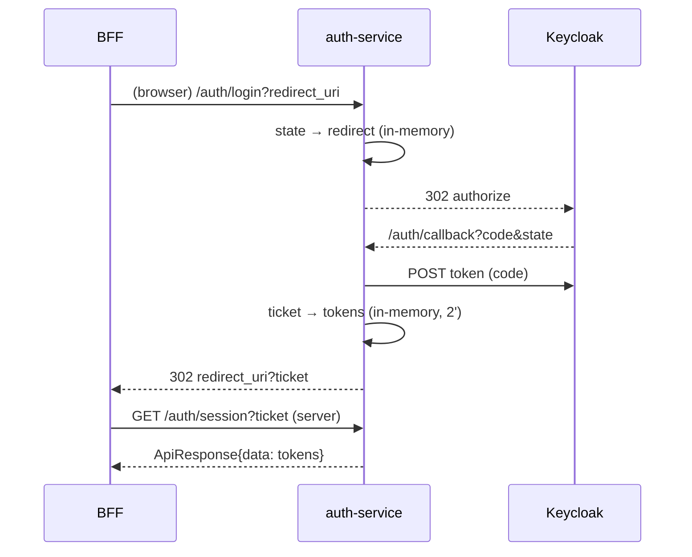

# ADR-002 — Keycloak làm IdP, auth-service trung gian SSO bằng ticket

> **Phiên bản:** 1.0 · **Trạng thái:** Final · **Cập nhật:** 2026-11-12 · **Phạm vi:** Ứng dụng (as-is)

| Thuộc tính | Giá trị |
| :--- | :--- |
| Trạng thái | **Accepted (đang hiện diện trong code)** |
| Phạm vi | auth-service, Keycloak realm `ecommerce`, frontend web/admin |
| Liên quan | [auth-service](../../03-services/auth-service.md), [FEAT-01](../../04-features/FEAT-01-sso-login-logout.md), [FEAT-03](../../04-features/FEAT-03-session-refresh.md), [ADR-006](ADR-006-sveltekit-bff-httponly-session.md) |

## Bối cảnh

Cần đăng nhập một lần (SSO) cho storefront và backoffice, không tự quản mật khẩu, và không để authorization code / token đi qua URL của frontend. Frontend là BFF SvelteKit, gateway cần xác minh JWT chuẩn OIDC.

## Quyết định

- **Keycloak 26** là Identity Provider (realm `ecommerce`, client public `ecommerce-client`, realm role `ADMIN`, `USER`, `MANAGER`).
- **auth-service** đóng vai trò "SSO broker" theo Authorization Code flow:
  1. `GET /api/v1/auth/login?redirect_uri=` → tạo `state` (lưu cùng redirect, TTL 5 phút) → 302 tới Keycloak authorize với `redirect_uri = SSO_BACKEND_CALLBACK_URL`.
  2. `GET /api/v1/auth/callback?code&state` → đổi code lấy token, lưu token dưới một **ticket** ngẫu nhiên (TTL 2 phút, dùng 1 lần) → 302 về `frontendRedirect?ticket=...`.
  3. BFF gọi server-to-server `GET /api/v1/auth/session?ticket=` để lấy token.
  4. `POST /api/v1/auth/refresh`, `POST /api/v1/auth/logout` proxy tới Keycloak token/logout endpoint.
- auth-service cũng giữ DB `authservice` (users, roles, user_role) và gọi Keycloak Admin API khi đăng ký (`/signup`).

## Hệ quả tích cực

- Token không xuất hiện trong URL trình duyệt (chỉ ticket ngắn hạn, dùng 1 lần).
- Frontend không cần client OIDC; chỉ biết 4 endpoint REST của auth-service.
- Gateway xác minh JWT do Keycloak ký bằng JWKS ([ADR-003](ADR-003-gateway-authentication.md)).

## Hệ quả tiêu cực

- State/ticket nằm **trong bộ nhớ** tiến trình → không scale ngang, mất khi restart ([ISSUE-06](../../07-plan/known-issues-tech-debt.md)).
- `redirect_uri` khi đổi code khác với khi authorize; lỗi đổi code bị che bằng **mock token** ([ISSUE-04](../../07-plan/known-issues-tech-debt.md)).
- `redirect_uri` không kiểm allowlist → open redirect đánh cắp ticket ([ISSUE-05](../../07-plan/known-issues-tech-debt.md)).
- Hai nguồn danh tính: Keycloak (đăng nhập, role trong token) và DB `authservice` (profile, role riêng) không đồng bộ ([ISSUE-08](../../07-plan/known-issues-tech-debt.md)); người dùng seed chỉ có trong Keycloak nên `/users/me` trả 404 và profile không có `roles` (ISSUE-100).
- Đổi mật khẩu là stub ([ISSUE-07](../../07-plan/known-issues-tech-debt.md)).

## Bằng chứng trong code

- `services/auth-service/main.go:74-92` — `KeycloakConfig`, `NewSsoSessionStore`.
- `services/auth-service/internal/handler/auth_handler.go:125-183` — `Login`, `Callback` (mock token tại `:149-157`), `Session`.
- `services/auth-service/internal/service/sso_store.go:30-36` — TTL state 5′, ticket 2′; `:98-120` — `StoreTokens`/`ConsumeTokens`.
- `services/auth-service/internal/service/keycloak_client.go:101-135` — authorize URL, đổi code, refresh.
- `deploy/keycloak/import/ecommerce-realm.json` — realm, client `ecommerce-client` (public), role `ADMIN/USER/MANAGER` (không ghi credential ở đây).
- `frontend/apps/web/src/routes/login/+page.server.ts:23-26`, `frontend/apps/web/src/routes/auth/callback/+page.server.ts:21-33` — phía BFF.

## Issue liên quan

[ISSUE-04](../../07-plan/known-issues-tech-debt.md), ISSUE-05, ISSUE-06, ISSUE-07, ISSUE-08, ISSUE-12, ISSUE-100.
