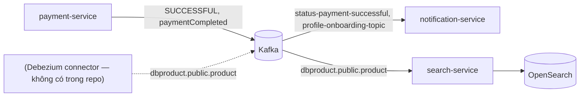

# ADR-005 — Kafka cho sự kiện bất đồng bộ

> **Phiên bản:** 1.0 · **Trạng thái:** Final · **Cập nhật:** 2026-11-12 · **Phạm vi:** Ứng dụng (as-is)

| Thuộc tính | Giá trị |
| :--- | :--- |
| Trạng thái | **Accepted (đang hiện diện trong code)** — luồng chưa thông đầu-cuối |
| Phạm vi | payment-service (producer), notification-service (consumer), search-service (consumer) |
| Liên quan | [integration-messaging](../system/integration-messaging.md), [payment-service](../../03-services/payment-service.md), [notification-service](../../03-services/notification-service.md), [search-service](../../03-services/search-service.md) |

## Bối cảnh

Một số phản ứng không cần đồng bộ với request người dùng: gửi email/ghi thông báo khi thanh toán, đồng bộ dữ liệu sản phẩm sang chỉ mục tìm kiếm. Các service không gọi nhau qua HTTP.

## Quyết định

- Dùng **Apache Kafka 3.9** (KRaft, 1 broker trong compose) làm message broker.
- **payment → notification**: payment-service publish JSON `KafkaPaymentDto` mỗi khi tạo payment (thư viện `segmentio/kafka-go`); notification-service consume bằng `kafkajs`, ghi bảng `payment_notifications` và gửi email.
- **product CDC → search**: search-service consume topic dạng Debezium (`dbproduct.public.product`, payload `op/before/after`) và index vào OpenSearch.
- Consumer dùng consumer group (`search-group`, `notification-group`), at-least-once, không DLQ.

## Hệ quả tích cực

- Tách rời payment khỏi việc gửi email; search không phụ thuộc runtime vào product-service.
- Consumer có thể replay theo offset.

## Hệ quả tiêu cực

- **Tên topic không khớp** giữa producer và consumer → không có email thanh toán nào được tạo; không ai produce `profile-onboarding-topic` ([ISSUE-17](../../07-plan/known-issues-tech-debt.md)).
- Publish đồng bộ trong request, mỗi lần tạo payment bất kể trạng thái, lỗi bị bỏ qua, không outbox ([ISSUE-18](../../07-plan/known-issues-tech-debt.md)).
- Không có Debezium connector và schema payload không khớp bảng `products` → index search luôn rỗng ([ISSUE-19](../../07-plan/known-issues-tech-debt.md)).
- Lỗi xử lý message chỉ log, offset vẫn commit → mất sự kiện; notification không reconnect nếu Kafka chưa sẵn sàng lúc khởi động.
- order-service được cấu hình `KAFKA_SERVERS` nhưng không dùng ([ISSUE-37](../../07-plan/known-issues-tech-debt.md)).

## Bằng chứng trong code

- `services/payment-service/internal/service/kafka_producer.go:15-49` — `kafka.Writer`.
- `services/payment-service/internal/service/payment_service.go:18-21,103-113` — topic và publish.
- `services/notification-service/src/kafka.ts:6-65` — consumer kafkajs, topic subscribe tại `:23`.
- `services/search-service/main.go:31-32,58-60` — cấu hình và start consumer.
- `services/search-service/internal/consumer/product_sync_consumer.go:30-87` — xử lý payload Debezium.
- `docker-compose.yml:41-67` — Kafka KRaft.

## Issue liên quan

[ISSUE-09](../../07-plan/known-issues-tech-debt.md), ISSUE-17, ISSUE-18, ISSUE-19, ISSUE-37.
