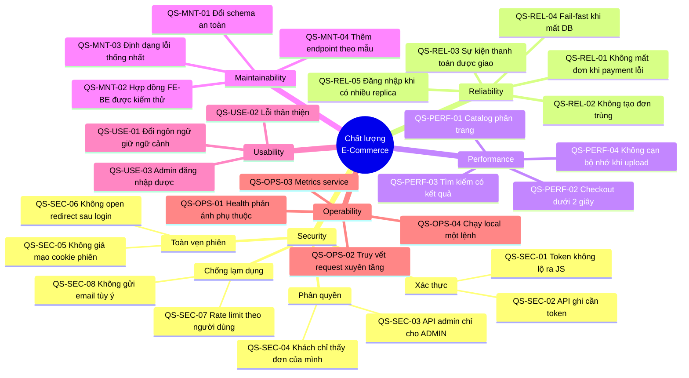

# Quality Requirements & Quality Scenarios (arc42 §10)

> **Phiên bản:** 1.0 · **Trạng thái:** Final · **Cập nhật:** 2026-11-12 · **Phạm vi:** Ứng dụng (as-is)

> Cây chất lượng (quality tree) và các **kịch bản chất lượng cụ thể** theo mẫu 6 phần của SEI/arc42: *Nguồn kích thích (Source) · Kích thích (Stimulus) · Môi trường (Environment) · Thành phần bị tác động (Artifact) · Phản ứng mong đợi (Response) · Thước đo (Response measure)*. Mỗi kịch bản ghi rõ **hệ thống hiện tại có đáp ứng hay không**, kèm bằng chứng trong code và liên kết ISSUE.
>
> Không có SLO/SLA hay benchmark nào trong repo. Các thước đo dưới đây là **mục tiêu đề xuất** dùng để đánh giá; cột "Hiện trạng" chỉ dựa trên việc đọc code/cấu hình. Yêu cầu phi chức năng gốc: [non-functional-requirements.md](../01-brd/non-functional-requirements.md).

## 1. Mục tiêu chất lượng ưu tiên

| Ưu tiên | Thuộc tính | Lý do (từ BRD / kiến trúc) |
| :---: | :--- | :--- |
| 1 | **Security** | Hệ thống xử lý danh tính khách hàng, đơn hàng, thanh toán; có backoffice quản trị catalog. |
| 2 | **Reliability / Data integrity** | Đơn hàng và thanh toán phải nhất quán; luồng checkout gọi nhiều service không có giao dịch. |
| 3 | **Maintainability** | Polyglot (Go + Bun + SvelteKit), 11 service, nhóm nhỏ — chi phí thay đổi phải thấp. |
| 4 | **Operability** | Phải phát hiện được service hỏng và truy vết lỗi xuyên tầng. |
| 5 | **Performance / Scalability** | Storefront SSR công khai, cần chịu tải đọc catalog. |
| 6 | **Usability** | Storefront song ngữ vi/en, backoffice responsive. |

## 2. Cây chất lượng (Quality tree)

## 3. Thang đánh giá

| Ký hiệu | Ý nghĩa |
| :--- | :--- |
| ✅ Đáp ứng | Code hiện tại thỏa thước đo |
| 🟡 Một phần | Có cơ chế nhưng có lỗ hổng/ngoại lệ đã biết |
| ⛔ Không đáp ứng | Không có cơ chế hoặc hành vi ngược thước đo |

## 4. Kịch bản — Security

| ID | Source | Stimulus | Environment | Artifact | Response | Response measure | Hiện trạng | Bằng chứng | ISSUE |
| :--- | :--- | :--- | :--- | :--- | :--- | :--- | :---: | :--- | :--- |
| QS-SEC-01 | Script độc hại chạy trong trang storefront (XSS) | Đọc token phiên | Vận hành bình thường | Cookie phiên BFF | Token không truy cập được từ JS | 0 token trong `document.cookie`/`localStorage` | ✅ | Cookie `httpOnly`, `SameSite=Lax` (`frontend/packages/lib/src/server/session.ts:9,37-48`); không có CSP để giảm thiểu XSS | ISSUE-11, ISSUE-139 |
| QS-SEC-02 | Người dùng ẩn danh trên Internet | Gửi `POST/PUT/DELETE /api/products` | Production | APISIX + product-service | Từ chối 401 | 100% request ghi không token bị chặn | ⛔ | Route `product-catalog` không có `openid-connect`, không giới hạn method (`deploy/apisix/apisix.yaml:71-82`) | ISSUE-102 |
| QS-SEC-03 | Customer đã đăng nhập (role `USER`) | Gọi `DELETE /api/v1/users/{id}`, `POST /api/v1/roles/users/{id}/assign` | Production | APISIX, auth-service | 403 | 0 thao tác quản trị thành công với role ≠ ADMIN | ⛔ | Gateway chỉ `bearer_only` (`deploy/apisix/apisix.yaml:142-177`); handler không kiểm role (`services/auth-service/internal/handler/auth_handler.go:244-397`) | ISSUE-01 |
| QS-SEC-04 | Customer A | `GET /api/orders` | Production | order-service | Chỉ trả đơn của A | 0 đơn của người khác trong response | ⛔ | `FindAllOrders` không lọc (`services/order-service/internal/handler/order_handler.go:198-205`); đơn không lưu user (ISSUE-76) | ISSUE-49, ISSUE-76 |
| QS-SEC-05 | Customer tự sửa cookie | Đặt `session_user.roles=["ADMIN"]` | Production | admin BFF | Bị từ chối | Danh tính chỉ lấy từ token đã verify | ⛔ | `session()` tin JSON cookie không ký (`frontend/packages/lib/src/server/session.ts:70-80`); guard dùng `isAdmin(locals.user)` (`frontend/apps/admin/src/hooks.server.ts:72`) | ISSUE-66, ISSUE-68 |
| QS-SEC-06 | Kẻ tấn công gửi link đăng nhập | `redirect_uri` / `redirect` trỏ domain ngoài | Production | auth-service, BFF login | Chỉ chuyển hướng tới allowlist | 0 redirect ra domain ngoài | ⛔ | auth-service không kiểm `redirect_uri` (`auth_handler.go:125-134`); BFF `safeRedirect` chặn `//` nhưng không chặn `/\` (`frontend/packages/lib/src/server/redirect.ts:2-5`) | ISSUE-05, ISSUE-130 |
| QS-SEC-07 | Một khách gửi 2.000 req/phút | Lạm dụng API qua storefront | Tải cao | APISIX `limit-count` | Chỉ khách đó bị 429 | Khách khác không bị ảnh hưởng | ⛔ | Key `remote_addr` = IP của BFF (`deploy/apisix/apisix.yaml:55-61`) → mọi khách chung quota | ISSUE-61 |
| QS-SEC-08 | Bất kỳ ai có token hợp lệ | `POST /notification/api/email/sendMail?to=...` | Production | notification-service | Từ chối (chỉ hệ thống) | 0 email tới người nhận tùy ý | ⛔ | `services/notification-service/src/index.ts:42-72`; route bearer bất kỳ (`deploy/apisix/apisix.yaml:280-291`) | ISSUE-64 |
| QS-SEC-09 | Kẻ tấn công trong mạng nội bộ / host | Gọi thẳng `:8084/api/orders` không token | Môi trường compose | Service Go | Từ chối | Service xác minh JWT độc lập | ⛔ | `UserClaims` dùng `ParseUnverified` (`services/shared/middleware/middleware.go:51-52`); port publish ra host (`docker-compose.yml:177-390`) | ISSUE-02, ISSUE-134 |
| QS-SEC-10 | Kẻ tấn công đoán mật khẩu | 1.000 lần thử grant `password` vào Keycloak | Production | Keycloak realm | Khóa tài khoản / làm chậm | ≤ 10 lần thử / tài khoản / 15 phút | ⛔ | Realm không đặt `bruteForceProtected`, `passwordPolicy`; client bật `directAccessGrantsEnabled` (`deploy/keycloak/import/ecommerce-realm.json:31-32`) | ISSUE-133 |
| QS-SEC-11 | Lỗi DB bất kỳ | Request gây lỗi SQL | Production | Service Go/Bun | Thông điệp lỗi chung + correlation id | 0 chi tiết SQL trong response | ⛔ | `response.InternalError(w, r, err.Error())` (vd `services/product-service/internal/handler/product_handler.go:54`) | ISSUE-93 |

## 5. Kịch bản — Reliability

| ID | Source | Stimulus | Environment | Artifact | Response | Response measure | Hiện trạng | Bằng chứng | ISSUE |
| :--- | :--- | :--- | :--- | :--- | :--- | :--- | :---: | :--- | :--- |
| QS-REL-01 | payment-service | Trả 5xx sau khi order đã tạo | Checkout | `placeOrder` | Đơn được hủy/bù trừ hoặc retry an toàn | 0 order "mồ côi" không payment | ⛔ | Tạo order rồi payment tuần tự, không bù trừ (`frontend/apps/web/src/routes/checkout/checkout.remote.ts:30-41`) | ISSUE-23 |
| QS-REL-02 | Khách bấm "Đặt hàng" 2 lần / mạng retry | 2 request `placeOrder` giống nhau | Checkout | BFF, order-service | Chỉ 1 đơn | Idempotency key | ⛔ | Không có idempotency key (`checkout.remote.ts:13-44`) | ISSUE-23 |
| QS-REL-03 | payment-service | Tạo payment thành công | Kafka hoạt động | payment → notification | Sự kiện tới consumer, email gửi khách | ≥ 99,9% sự kiện được xử lý | ⛔ | Lệch topic (`services/payment-service/internal/service/payment_service.go:18-21` vs `services/notification-service/src/kafka.ts:23`); lỗi gửi bị nuốt (`payment_service.go:110-113`); consumer không retry/DLQ (`kafka.ts:57-59`) | ISSUE-17, ISSUE-18, ISSUE-80 |
| QS-REL-04 | Hạ tầng | PostgreSQL không truy cập được lúc khởi động | Deploy | Mọi service | Service fail-fast / readiness DOWN | Orchestrator không route traffic tới service hỏng | ⛔ | Ping lỗi chỉ log (`services/shared/database/postgres.go:37-41`); `_ = repo.InitSchema(ctx)` (`services/auth-service/main.go:71-72`); health luôn UP | ISSUE-28, ISSUE-36 |
| QS-REL-05 | Ops | Scale auth-service lên 2 replica | Production | `SsoSessionStore` | Đăng nhập thành công bất kể replica | 100% callback thành công | ⛔ | State/ticket trong map tiến trình (`services/auth-service/internal/service/sso_store.go:22-47`) | ISSUE-06 |
| QS-REL-06 | Keycloak | Token endpoint lỗi khi đổi code | Đăng nhập | auth-service | Báo lỗi đăng nhập rõ ràng | 0 token giả được cấp | ⛔ | Mock token khi lỗi (`services/auth-service/internal/handler/auth_handler.go:153-162`) | ISSUE-04 |
| QS-REL-07 | Người dùng | Đăng xuất khi gateway lỗi | Bất kỳ | BFF logout | Phiên local vẫn bị xóa | Cookie bị xóa 100% | ✅ | `frontend/apps/web/src/lib/remote/auth.remote.ts:10-18` | — |
| QS-REL-08 | Panic trong handler Go | Lỗi runtime | Bất kỳ | chi router | Trả 500, tiến trình sống | Không crash | ✅ | `chimiddleware.Recoverer` (`services/auth-service/main.go:95`) | — |
| QS-REL-09 | Backend chậm/treo | Gateway giữ kết nối | Tải cao | BFF `fetch`, Go `http.Server` | Timeout & trả lỗi | Request SSR kết thúc ≤ 10 s | ⛔ | `fetch` không timeout (`frontend/packages/lib/src/server/api.ts:50`); server Go không timeout | ISSUE-96 |

## 6. Kịch bản — Performance & Scalability

| ID | Source | Stimulus | Environment | Artifact | Response | Response measure | Hiện trạng | Bằng chứng | ISSUE |
| :--- | :--- | :--- | :--- | :--- | :--- | :--- | :---: | :--- | :--- |
| QS-PERF-01 | Khách | Mở `/products?page=3` khi catalog có 10.000 sản phẩm | Tải thường | product-service | Trả 1 trang | Payload ≤ 60 bản ghi; p95 < 300 ms | ⛔ | `ListProducts` trả toàn bộ, bỏ qua query (`services/product-service/internal/handler/product_handler.go:149-156`) | ISSUE-48 |
| QS-PERF-02 | Customer | `placeOrder` giỏ 3 dòng | Kafka hoạt động | BFF → product/order/payment | Hoàn tất | p95 < 2 s | 🟡 | N+1 gọi product song song (`checkout.remote.ts:19`); payment publish đồng bộ 2 lần, mỗi lần chờ `BatchTimeout` ~1 s (`services/payment-service/internal/service/kafka_producer.go:20-25`) | ISSUE-57 |
| QS-PERF-03 | Khách | Tìm "áo" | Có dữ liệu catalog | search-service | Trả kết quả liên quan | ≥ 1 kết quả khi có sản phẩm khớp | ⛔ | Index không bao giờ được nạp; storefront không gọi search-service | ISSUE-19, ISSUE-78 |
| QS-PERF-04 | Client có token | Upload file 2 GB | Production | media-service | Từ chối file quá lớn | Bộ nhớ tiến trình không tăng quá giới hạn upload | ⛔ | `file.arrayBuffer()` toàn bộ (`services/media-service/src/service.ts:38`); không giới hạn size | ISSUE-32, ISSUE-138 |
| QS-PERF-05 | Client có token | `GET /api/v1/users/all?size=1000000` | Production | auth-service | Giới hạn kích thước trang | `size` ≤ 100 | ⛔ | Không cận trên (`services/auth-service/internal/service/user_service.go:139-146`) | ISSUE-138 |
| QS-PERF-06 | Ops | Thêm replica service stateless (product/order…) | Tải tăng | Service Go/Bun | Throughput tăng tuyến tính | Không trạng thái cục bộ | ✅ | Chỉ auth-service có state cục bộ; pool DB cấu hình được (`services/shared/database/postgres.go:27-30`) | ISSUE-06 |
| QS-PERF-07 | Khách | Mở trang chủ | Lần đầu | web SSR | HTML đầy đủ cho SEO | TTFB < 500 ms (đề xuất) | 🟡 | SSR + remote query; trang chủ dùng dữ liệu mock (`frontend/apps/web/src/lib/data/home-mock.ts`) | ISSUE-38 |

## 7. Kịch bản — Maintainability

| ID | Source | Stimulus | Environment | Artifact | Response | Response measure | Hiện trạng | Bằng chứng | ISSUE |
| :--- | :--- | :--- | :--- | :--- | :--- | :--- | :---: | :--- | :--- |
| QS-MNT-01 | Developer | Thêm cột `order_status` | Có dữ liệu production | `orderservice` DB | Migration có version, rollback được | Thay đổi trong < 1 ngày, 0 mất dữ liệu | ⛔ | Chỉ `CREATE TABLE IF NOT EXISTS` (`services/order-service/internal/repository/order_repository.go:32-56`) | ISSUE-28 |
| QS-MNT-02 | Developer | Đổi shape response `GET /api/products` | CI | BFF ↔ product-service | Test hợp đồng thất bại | 100% endpoint BFF dùng có contract test | ⛔ | Test chỉ gọi router với DB `nil`; lệch Page vs mảng không bị phát hiện | ISSUE-46, ISSUE-48 |
| QS-MNT-03 | Client developer | Xử lý lỗi từ nhiều service | Tích hợp | API | Một định dạng lỗi | 1 schema lỗi | ⛔ | `ErrorVm`, `ApiResponse`, Bun riêng (`services/shared/response/*`) | ISSUE-29, ISSUE-94 |
| QS-MNT-04 | Developer | Thêm endpoint CRUD vào service Go | Dev | Service Go | Theo mẫu handler → service → repository | < 0,5 ngày | ✅ | Cấu trúc đồng nhất ([go-service-architecture.md](software/go-service-architecture.md)); shared module | — |
| QS-MNT-05 | Developer | Chạy kiểm tra trước commit | Dev | Repo | Lint/format/type-check tự động | 1 lệnh | ✅ | `make check`, `make web-check` (NFR-MNT-06) | — |
| QS-MNT-06 | Developer | Nâng cấp SvelteKit | Dev | web, admin | Build không vỡ | 0 API experimental | 🟡 | `experimental.remoteFunctions`, `compilerOptions.experimental.async` (`frontend/apps/web/vite.config.ts:12-18`) | ISSUE-47 |

## 8. Kịch bản — Usability

| ID | Source | Stimulus | Environment | Artifact | Response | Response measure | Hiện trạng | Bằng chứng | ISSUE |
| :--- | :--- | :--- | :--- | :--- | :--- | :--- | :---: | :--- | :--- |
| QS-USE-01 | Khách tiếng Anh | Bấm card sản phẩm từ `/en/products` | Duyệt | web | Ở lại `/en/...` | 100% link nội bộ giữ locale | 🟡 | Card dùng `href` không `localizeHref` | ISSUE-39, ISSUE-83 |
| QS-USE-02 | Khách | Truy cập trang không tồn tại / lỗi API | Bất kỳ | web `+error.svelte` | Trang lỗi thân thiện, đúng mã | 404 cho tài nguyên không tồn tại | 🟡 | `+error.svelte` có; `/products/[id]` không tồn tại trả 200 | ISSUE-82 |
| QS-USE-03 | Admin (role ADMIN trong Keycloak) | Đăng nhập backoffice | Production | admin BFF | Vào dashboard | 100% admin hợp lệ vào được | ⛔ | `/users/me` không trả `roles` → guard luôn `/access-denied` | ISSUE-100, ISSUE-101 |
| QS-USE-04 | Khách mới | Muốn tạo tài khoản | Storefront | web, Keycloak | Có luồng đăng ký | ≤ 3 bước | ⛔ | `registrationAllowed: false`; nút đăng ký dùng chung `ssoUrl` | ISSUE-71 |
| QS-USE-05 | Khách trên mobile | Duyệt và checkout | Màn hình 375 px | web | Bố cục không vỡ | Không cuộn ngang | ✅ | Tailwind 4 responsive (NFR-UX-02) | — |

## 9. Kịch bản — Operability

| ID | Source | Stimulus | Environment | Artifact | Response | Response measure | Hiện trạng | Bằng chứng | ISSUE |
| :--- | :--- | :--- | :--- | :--- | :--- | :--- | :---: | :--- | :--- |
| QS-OPS-01 | Orchestrator | Gọi `/actuator/health` khi DB/Kafka/S3 hỏng | Production | Mọi service | `DOWN` / 503 | Phát hiện trong ≤ 30 s | ⛔ | Bun health luôn `UP` (`services/rating-service/src/index.ts:28-37`); Go `response.Health` không kiểm pool | ISSUE-36 |
| QS-OPS-02 | Kỹ sư vận hành | Điều tra 1 đơn lỗi từ trình duyệt tới DB | Production | BFF, APISIX, service, Kafka | Một correlation id xuyên suốt | 100% log liên quan có cùng id | ⛔ | Gateway không sinh, BFF không gửi (`frontend/packages/lib/src/server/api.ts:45-50`), service không log id | ISSUE-98 |
| QS-OPS-03 | Ops | Xem error rate/latency từng service | Production | Service | Metrics chuẩn | RED metrics mỗi service | 🟡 | Chỉ APISIX `prometheus` (`deploy/apisix/apisix.yaml:49`, `deploy/apisix/config.yaml:12-16`); service không export | — |
| QS-OPS-04 | Developer mới | `docker compose up` lần đầu | Máy dev | Toàn stack | Mọi luồng chính chạy | < 15 phút, 0 bước thủ công | 🟡 | Bucket media phải tạo tay; upstream 7/13 thiếu; image frontend kéo từ ghcr | ISSUE-13, ISSUE-32, ISSUE-97 |
| QS-OPS-05 | Ops | Xoay vòng secret (DB, S3, Keycloak admin) | Production | Cấu hình | Secret chỉ từ Secret store, thiếu thì fail | 0 default credential trong code | ⛔ | Default credential trong code (`services/auth-service/internal/service/keycloak_client.go:53-58`, `services/media-service/src/storage.ts:5-6`) | ISSUE-10, ISSUE-135 |
| QS-OPS-06 | Ops | Kiểm toán ai đã xóa sản phẩm / đổi role | Production | Service, Keycloak | Có audit log | 100% thao tác quản trị có actor + thời gian | ⛔ | Không audit log; Keycloak `eventsEnabled` không bật trong realm import | ISSUE-01 |

## 10. Tổng hợp mức đáp ứng

| Thuộc tính | Số kịch bản | ✅ | 🟡 | ⛔ |
| :--- | :---: | :---: | :---: | :---: |
| Security | 11 | 1 | 0 | 10 |
| Reliability | 9 | 2 | 0 | 7 |
| Performance | 7 | 1 | 2 | 4 |
| Maintainability | 6 | 2 | 1 | 3 |
| Usability | 5 | 1 | 2 | 2 |
| Operability | 6 | 0 | 2 | 4 |
| **Tổng** | **44** | **7** | **7** | **30** |

Kết luận: các kịch bản **Security** và **Reliability** — hai mục tiêu ưu tiên cao nhất — gần như đều chưa đạt. Thứ tự khắc phục đề xuất bám theo [project-plan.md](../07-plan/project-plan.md) (P1 bảo mật & định danh trước). Rủi ro chi tiết: [threat-model.md](system/threat-model.md); dữ liệu cá nhân: [data-privacy-pii.md](../06-data/data-privacy-pii.md).
