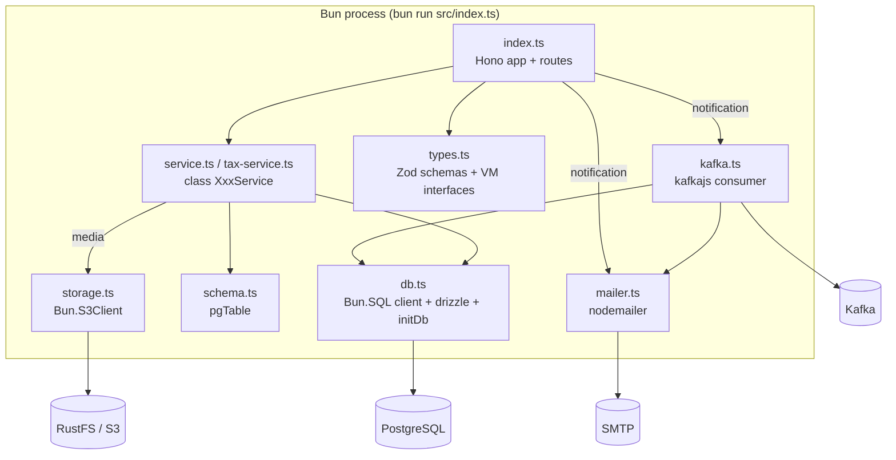
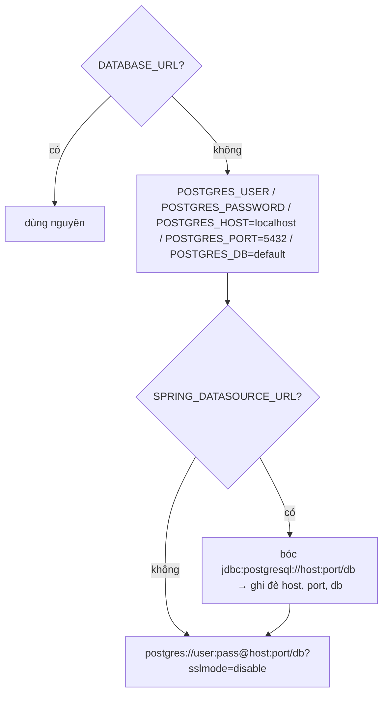
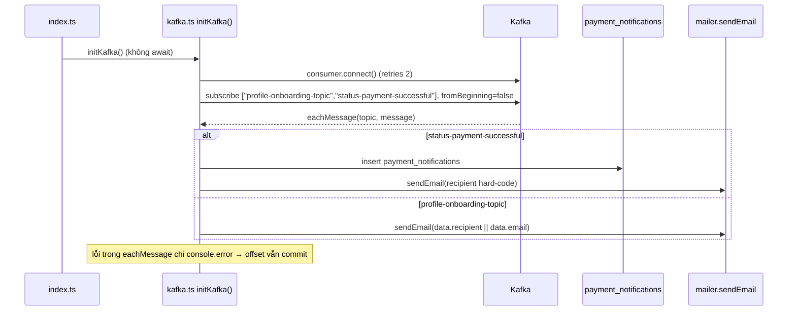

# Kiến trúc phần mềm — Bun / TypeScript services

> **Phiên bản:** 1.0 · **Trạng thái:** Final · **Cập nhật:** 2026-11-12 · **Phạm vi:** Ứng dụng (as-is)

> Phạm vi: 4 service `promotion-service` (kèm Tax), `rating-service`, `media-service`, `notification-service`. Mô tả **as-is**. Chi tiết nghiệp vụ: [promotion](../../03-services/promotion-service.md), [rating](../../03-services/rating-service.md), [media](../../03-services/media-service.md), [notification](../../03-services/notification-service.md).

## 1. Tech stack

| Thành phần | Phiên bản / thư viện | Bằng chứng |
| :--- | :--- | :--- |
| Runtime | Bun `oven/bun:1.4-alpine` (CI: 1.4.3) | `services/rating-service/Dockerfile:1`, `.github/workflows/ci.yml` job `bun-check` |
| HTTP framework | `hono ^4.13.13` (+ `hono/cors`, `hono/logger`) | `services/rating-service/package.json:13`, `src/index.ts:1-3` |
| ORM | `drizzle-orm 1.0.0-rc.4`, adapter `drizzle-orm/bun-sql` | `services/rating-service/src/db.ts:2,44` |
| Driver Postgres | `Bun.SQL` (built-in) | `services/rating-service/src/db.ts:1,36-42` |
| Validation | `zod ^4.6.5` (chỉ promotion, rating) | `services/promotion-service/package.json:14` |
| Kafka | `kafkajs ^2.2.4` (chỉ notification) | `services/notification-service/package.json:14` |
| Email | `nodemailer ^10.1.0` (chỉ notification) | `services/notification-service/package.json:15` |
| Object storage | `Bun.S3Client` (built-in, chỉ media) | `services/media-service/src/storage.ts:1,9-16` |
| Test | `bun:test` | `services/rating-service/src/index.test.ts:1` |
| Type check | `typescript ^7.0.2`, `tsc --noEmit` (`strict`, `verbatimModuleSyntax`) | `services/rating-service/tsconfig.json:8-12` |

Mỗi service là **một package độc lập** (không có workspace chung, không chia sẻ code) — `package.json` riêng, `bun.lock` riêng, build context Docker là thư mục service (`docker-compose.yml:299-301`).

## 2. Cấu trúc thư mục & vai trò file

```text
services/<svc>-service/
├── Dockerfile
├── package.json        # scripts: dev (bun --watch), start, test, typecheck
├── tsconfig.json
└── src/
    ├── index.ts        # Hono app: middleware, health, routes, mount kép, initDb(), export default {port, fetch}
    ├── service.ts      # Lớp nghiệp vụ (class XxxService) gọi Drizzle
    ├── db.ts           # getDatabaseUrl(), Bun.SQL client, drizzle(), initDb() (CREATE TABLE IF NOT EXISTS)
    ├── schema.ts       # Drizzle pgTable definitions (+ $inferSelect/$inferInsert types)
    ├── types.ts        # Zod schema request + interface ViewModel response
    └── index.test.ts   # bun:test gọi app.fetch(Request)
```

| File | promotion | rating | media | notification |
| :--- | :---: | :---: | :---: | :---: |
| `index.ts` | ✅ (promotion + tax routes) | ✅ | ✅ | ✅ (route gọi Drizzle **trực tiếp**, không có service.ts) |
| `service.ts` | ✅ + `tax-service.ts` | ✅ | ✅ | — |
| `db.ts` / `schema.ts` | ✅ | ✅ | ✅ | ✅ |
| `types.ts` (Zod) | ✅ + `tax-types.ts` | ✅ | — (interface nằm trong `service.ts`) | — |
| Tích hợp ngoài | — | — | `storage.ts` (S3) | `kafka.ts`, `mailer.ts` |

## 3. Kiến trúc thành phần



## 4. Hono app (`index.ts`)

### 4.1 Middleware

Giống nhau ở cả 4 service (ví dụ `services/rating-service/src/index.ts:8-25`):

| Thứ tự | Middleware | Ghi chú |
| :--- | :--- | :--- |
| 1 | `logger()` | Log `<-- GET /path` / `--> GET /path 200 3ms` ra stdout |
| 2 | `cors({ origin: "*", allowHeaders: [Authorization, Content-Type, X-Correlation-Id, X-Request-Id], allowMethods: [GET,POST,PUT,DELETE,OPTIONS] })` | Mở cho mọi origin |
| 3 | Correlation id inline: đọc `X-Correlation-Id` hoặc `crypto.randomUUID()`, set response header | Không lưu vào context, không log |

Không có middleware xác thực. rating-service tự decode payload JWT (base64, **không verify**) trong `extractUser` (`services/rating-service/src/index.ts:39-58`, [ISSUE-03](../../07-plan/known-issues-tech-debt.md)); 3 service còn lại không đọc token.

### 4.2 Mount route kép (prefix + root)

Mỗi service đóng gói route vào `function registerXxxRoutes(router: Hono)` rồi đăng ký **hai lần**: vào một sub-app mount dưới prefix context (`/rating`, `/promotion`, `/tax`, `/media`, `/notification`) và trực tiếp vào root app.

```ts
// services/rating-service/src/index.ts:150-154
const ratingGroup = new Hono();
registerRatingRoutes(ratingGroup);
app.route("/rating", ratingGroup);
registerRatingRoutes(app);
```

promotion-service đăng ký **cả** promotion và tax routes, mỗi nhóm dưới prefix riêng và root (`services/promotion-service/src/index.ts:255-265`). Lý do: APISIX rewrite `/storefront/ratings` → `/rating/storefront/ratings` (`deploy/apisix/apisix.yaml:83-92`) còn một số route gateway truyền nguyên path có prefix (`/promotion/backoffice/promotions/*`, `apisix.yaml:340-351`). Xem [`gateway-routing.md`](../../05-api/gateway-routing.md).

### 4.3 Health

`healthHandler` trả cứng `{status:"UP", components:{db:{status:"UP"}}}` (media thêm `storage`) tại `/actuator/health` và `/<svc>/actuator/health` (+ `/tax/actuator/health`) — không kiểm phụ thuộc ([ISSUE-36](../../07-plan/known-issues-tech-debt.md)). Nguồn: `services/media-service/src/index.ts:28-38`.

### 4.4 Khởi động

```ts
// services/rating-service/src/index.ts:156-164
const PORT = parseInt(process.env.PORT || "8089", 10);
await initDb();                       // top-level await
export default { port: PORT, fetch: app.fetch };   // Bun tự Bun.serve() từ default export
```

- media: `await initDb(); await initStorage();` (`services/media-service/src/index.ts:142-143`).
- notification: `await initDb(); initKafka();` — `initKafka` **không await**, consumer chạy nền (`services/notification-service/src/index.ts:197-198`).
- Không có xử lý SIGTERM/graceful shutdown riêng; Kafka consumer không được `disconnect()`.

Port mặc định: promotion 8093, rating 8089, media 8083, notification 8090.

## 5. Truy cập dữ liệu: Drizzle + `Bun.sql`

### 5.1 Giải quyết DB URL

`getDatabaseUrl()` trong `db.ts` (giống hệt logic Go, ví dụ `services/rating-service/src/db.ts:4-32`):



| Service | `POSTGRES_DB` mặc định | Compose truyền DB bằng |
| :--- | :--- | :--- |
| promotion | `promotionservice` | `SPRING_DATASOURCE_URL` (`docker-compose.yml:352`) |
| rating | `ratingservice` | `SPRING_DATASOURCE_URL` (`docker-compose.yml:308`) |
| media | `mediaservice` | `SPRING_DATASOURCE_URL` (`docker-compose.yml:327`) |
| notification | `ecommerce` (DB chung) | `POSTGRES_HOST/PORT/DB` (`docker-compose.yml:393-395`, [ISSUE-33](../../07-plan/known-issues-tech-debt.md)) |

### 5.2 Client & ORM

```ts
// services/rating-service/src/db.ts:36-44
export const client = new SQL(connectionString, {
  max: 20, idleTimeout: 30, connectionTimeout: 5,
  prepare: false,          // tương thích PgBouncer transaction mode
});
export const db = drizzle({ client });
```

- `schema.ts` khai báo bảng bằng `pgTable` với tên cột snake_case và thuộc tính camelCase (`services/rating-service/src/schema.ts:4-16`); `id` là `bigserial(..., { mode: 'number' })`.
- Service dùng query builder Drizzle (`db.select().from().where().orderBy().limit().offset()`, `insert().values().returning()`), đôi khi `sql\`...\`` thô cho `LOWER(... ) LIKE` (`services/rating-service/src/service.ts:67-73`).
- Phân trang: hai truy vấn `count()` + `limit/offset` (`services/rating-service/src/service.ts:28-41`). Không có transaction.

### 5.3 `initDb()`

Chạy `client\`CREATE TABLE IF NOT EXISTS ...\`` (DDL viết tay, **trùng lặp** với `schema.ts`) trong `try/catch`, lỗi chỉ `console.warn` (`services/rating-service/src/db.ts:46-67`). Không dùng `drizzle-kit` (thư mục `drizzle/` bị `.dockerignore` loại — `services/.dockerignore:5`, nhưng không tồn tại). Xem [ISSUE-28](../../07-plan/known-issues-tech-debt.md), [ADR-004](../adr/ADR-004-database-per-service-runtime-ddl.md).

Không có "nil-pool mode" như Go: `Bun.SQL` kết nối lười; khi DB không truy cập được, mỗi truy vấn ném lỗi và route trả 500 (hoặc giá trị rỗng ở những route tự nuốt lỗi — mục 7).

## 6. Validation với Zod

Mẫu chuẩn trong promotion/rating:

```ts
// services/rating-service/src/index.ts:119-126
const body = await c.req.json();
const parsed = RatingPostVmSchema.safeParse(body);
if (!parsed.success) {
  return c.json({ statusCode: "400", message: "Validation error", errors: parsed.error.issues }, 400);
}
```

| Schema | Nguồn | Ghi chú |
| :--- | :--- | :--- |
| `RatingPostVmSchema` | `services/rating-service/src/types.ts:3-8` | `star` int 1..5, `productId` int |
| `PromotionPostVmSchema` / `PromotionPutVmSchema` | `services/promotion-service/src/types.ts:3-23` | Các trường "enum" là `z.string()` tự do ([ISSUE-30](../../07-plan/known-issues-tech-debt.md)) |
| `TaxClassPostVmSchema`, `TaxRatePostVmSchema` | `services/promotion-service/src/tax-types.ts` | Lỗi trả `{message:"Invalid payload"}` **không** kèm issues |

Không dùng `@hono/zod-validator`. Query/path param chỉ `parseInt` + `isNaN`. media và notification **không có** validation (notification nhận `body.userId || ''`… — `services/notification-service/src/index.ts:97-107`).

## 7. Định dạng response & lỗi

Không có envelope chung; mỗi route tự `c.json(...)`:

| Trường hợp | Định dạng | Ví dụ nguồn |
| :--- | :--- | :--- |
| Thành công | JSON thô (VM / mảng / số / `true`) | `rating index.ts:81,146` |
| Lỗi (promotion, rating, media) | `{ "statusCode": "400"\|"404"\|"500", "message": "..." [, "errors": ZodIssue[]] }` | `services/rating-service/src/index.ts:83,92,124` |
| Lỗi tax routes | `{ "message": "..." }`; exception không bắt → Hono trả **text/plain** `Internal Server Error` 500 | `services/promotion-service/src/index.ts:130-253` (ISSUE-94) |
| notification email | **text/plain** `"Mail Sent Successfully..."` hoặc `"Error: ..."` | `services/notification-service/src/index.ts:42-72` |
| notification CRUD | lỗi → `{error: msg}` 500, `c.body(null, 404/500)`, hoặc nuốt lỗi trả `[]` 200 | `notification index.ts:75-82,108-111` |
| Xóa | `c.body(null, 200\|204)` hoặc VM `ResponeStatusVm` | `promotion index.ts:121`, `rating service.ts:118-125` |

Đặc điểm chung: `try/catch` bọc từng route, trả `err.message` thô (ISSUE-93); JSON body sai cú pháp làm `c.req.json()` ném lỗi → rơi vào nhánh 500 thay vì 400 (ISSUE-94). Không service nào khai báo `app.onError` / `app.notFound`. Danh mục chi tiết: [`api-conventions.md`](api-conventions.md).

## 8. Tích hợp ngoài

### 8.1 Kafka (kafkajs) — notification-service



- Cấu hình: `KAFKA_SERVERS` (split `,`), `clientId: "notification-service"`, `groupId = PAYMENT_KAFKA_CONSUMER_GROUP_ID || "notification-group"` (`services/notification-service/src/kafka.ts:6-23`).
- Kafka offline lúc khởi động → chỉ warn, service chạy tiếp **không có consumer** và không tự kết nối lại (`kafka.ts:62-64`).
- Lệch topic với payment-service: [ISSUE-17](../../07-plan/known-issues-tech-debt.md); email hard-code: [ISSUE-09](../../07-plan/known-issues-tech-debt.md).

### 8.2 Email (nodemailer)

`MAIL_HOST` (default `smtp.gmail.com`), `MAIL_PORT` (`587`, `secure` khi 465), `MAIL_USERNAME`, `MAIL_PASSWORD`. Thiếu user/pass → transporter `null` → **mock**: chỉ log và trả `"Mail Sent Successfully (Mock)"`. Lỗi SMTP được trả về dưới dạng chuỗi, không ném (`services/notification-service/src/mailer.ts:4-47`).

### 8.3 Object storage (`Bun.S3Client`) — media-service

- Env: `STORAGE_ENDPOINT` (default `http://localhost:9000`), `STORAGE_REGION`, `STORAGE_ACCESS_KEY`, `STORAGE_SECRET_KEY`, `STORAGE_BUCKET` (default `ecommerce-media`), path-style (`virtualHostedStyle: false`) — `services/media-service/src/storage.ts:3-16`.
- `initStorage()` thử `s3.list({maxKeys:1})`, lỗi chỉ cảnh báo và nhắc chạy `storage-init` (service không tồn tại trong compose — [ISSUE-32](../../07-plan/known-issues-tech-debt.md)).
- Upload: `file.arrayBuffer()` toàn bộ vào RAM → `s3.write(key, bytes, {type})`; key = `uuid-<tên đã sanitize>`; download: `s3.file(key).stream()` trả qua `c.body(stream)` (`services/media-service/src/service.ts:34-58`, `storage.ts:33-51`).

## 9. Kiểm thử

```ts
// services/rating-service/src/index.test.ts:1-10
import { describe, expect, it } from "bun:test";
import appObj from "./index";                       // import default {port, fetch}
const res = await appObj.fetch(new Request("http://localhost:8089/actuator/health"));
expect(res.status).toBe(200);
```

- Gọi trực tiếp `app.fetch` của default export, **không** khởi động server, **không** mock DB. Import `index.ts` sẽ chạy `await initDb()` → lỗi kết nối chỉ warn.
- Các case kiểm: health ở cả 2 path, 400 cho param/payload sai, route tồn tại. Những route cần DB thật sẽ trả 500 hoặc giá trị fallback; test chỉ assert status ([ISSUE-46](../../07-plan/known-issues-tech-debt.md)). Tổng ~27 case trên 4 service.
- Chạy: `make bun-test` (lặp `bun install && bun test` cho 4 service, `Makefile:76-81`); CI job `bun-check` chạy ma trận 4 service.

## 10. Dockerfile

```dockerfile
# services/rating-service/Dockerfile:1-12
FROM oven/bun:1.4-alpine AS base
WORKDIR /app
COPY package.json bun.lock* ./
RUN bun install --frozen-lockfile || bun install   # fallback nếu lockfile lệch
COPY src ./src
EXPOSE 8089
ENTRYPOINT ["bun", "run", "src/index.ts"]
```

- Một stage, chạy thẳng TypeScript (không bundle/compile), cài **cả devDependencies**, chạy bằng root.
- `|| bun install` khiến build không thất bại khi lockfile lệch → build không tái lập hoàn toàn.
- `.dockerignore` mỗi service loại `node_modules`, `.env`, `*.log`.

## 11. So sánh 4 service Bun

| | promotion | rating | media | notification |
| :--- | :--- | :--- | :--- | :--- |
| Port | 8093 | 8089 | 8083 | 8090 |
| Prefix mount | `/promotion`, `/tax` | `/rating` | `/media` | `/notification` |
| Nhóm route | `/backoffice/promotions`, `/backoffice/tax-classes`, `/backoffice/tax-rates` | `/backoffice/ratings`, `/storefront/ratings` | `/medias` | `/api/email`, `/api/notifications`, `/api/payment-notifications` |
| Zod | ✅ | ✅ | ❌ | ❌ |
| Phân trang | `pageNo`/`pageSize` (default 5 / tax 10) | `pageNo`/`pageSize` (default 5) | — | — |
| Đọc JWT | ❌ | `extractUser` (không verify) | ❌ | ❌ |
| Tích hợp | — | — | S3 (RustFS) | Kafka consumer, SMTP |
| Layer service | `PromotionService`, `TaxService` | `RatingService` | `MediaService` | (không — logic trong route) |

## 12. Vấn đề liên quan

[ISSUE-03](../../07-plan/known-issues-tech-debt.md), ISSUE-09, ISSUE-17, ISSUE-28, ISSUE-29, ISSUE-30, ISSUE-32, ISSUE-33, ISSUE-36, ISSUE-46; mới: ISSUE-93 (lộ thông điệp lỗi), ISSUE-94 (lỗi chưa bắt / JSON sai → 500).

Xem thêm: [`go-service-architecture.md`](go-service-architecture.md), [`api-conventions.md`](api-conventions.md), [`cross-cutting-concerns.md`](cross-cutting-concerns.md).
