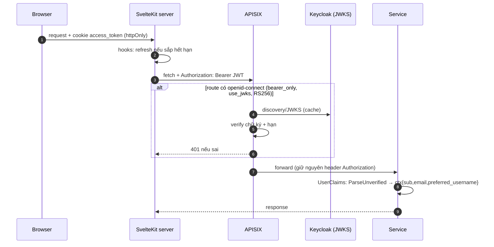

# Cross-cutting concerns (as-is)

> **Phiên bản:** 1.0 · **Trạng thái:** Final · **Cập nhật:** 2026-11-12 · **Phạm vi:** Ứng dụng (as-is)

> Các mối quan tâm xuyên suốt toàn hệ thống và cách code **hiện tại** xử lý chúng. Kiến trúc chi tiết theo stack: [Go](go-service-architecture.md) · [Bun](bun-service-architecture.md) · [Frontend](frontend-architecture.md). Bảo mật tổng thể: [`security-architecture.md`](../system/security-architecture.md).

## 1. Bảng tóm tắt

| Concern | Go services | Bun services | Frontend (BFF) | Gateway (APISIX) |
| :--- | :--- | :--- | :--- | :--- |
| Cấu hình | `config.GetEnv(key, default)` | `process.env.X \|\| default` | `process.env` (`API_INTERNAL_URL`…) | file YAML tĩnh |
| Logging | `log.Printf` + `chimiddleware.Logger` | `console.*` + `hono/logger` | không có logger riêng | access log mặc định |
| Lỗi | sentinel → `ErrorVm`/`ApiResponse` | try/catch → `{statusCode,message}` | `ApiError`, `error()` của Kit, toast | 401/404/429/5xx |
| CORS | `*` | `*` | không cần (same-origin) | allowlist 3 origin |
| AuthN | tin gateway, parse JWT không verify | rating parse JWT không verify | cookie httpOnly → Bearer | `openid-connect bearer_only` |
| AuthZ (role) | ❌ | ❌ | chỉ admin guard (cookie) | ❌ |
| Validation | thủ công tối thiểu | Zod (promotion, rating) | Zod (schemas dùng chung) | — |
| i18n | ❌ (message tiếng Anh) | ❌ | Paraglide vi/en | — |
| Cache | ❌ | ❌ | ❌ (localStorage cart) | — |
| Transaction | ❌ | ❌ | ❌ (2 lời gọi tuần tự) | — |
| Idempotency | ❌ | ❌ | ❌ | — |
| Correlation id | sinh/echo | sinh/echo | không gửi | không sinh |
| Metrics | ❌ | ❌ | ❌ | `prometheus` plugin :9091 |
| Health | `/actuator/health` luôn UP | luôn UP | — | — |

## 2. Cấu hình & biến môi trường

### 2.1 Cơ chế

- **Go**: `config.GetEnv(key, defaultValue)` trả default khi biến rỗng/không có (`services/shared/config/config.go:5-10`); đọc trực tiếp trong `main.go`, không có struct config tập trung (trừ `KeycloakConfig` ở auth — `services/auth-service/main.go:74-87`). Không nạp file `.env`.
- **Bun**: `process.env.X || "default"` rải rác ở `db.ts`, `storage.ts`, `kafka.ts`, `mailer.ts`, `index.ts` (ví dụ `services/media-service/src/storage.ts:3-7`). Bun tự nạp `.env` trong **thư mục làm việc** (thư mục service) — file `.env` ở gốc repo không được nạp khi chạy `bun run dev` trong `services/<svc>`.
- **Frontend**: `process.env.API_INTERNAL_URL`, `API_PUBLIC_URL` (`frontend/packages/lib/src/server/env.ts:11-27`) + biến của adapter-bun (`PORT`, `HOST`, `ORIGIN`, `PROTOCOL_HEADER`).
- **Docker compose**: tự đọc `.env` gốc để **nội suy** `${VAR}`; mỗi container chỉ nhận các biến khai báo trong `environment:` (`docker-compose.yml`).
- **Gateway**: secret client qua `$env://KEYCLOAK_CLIENT_SECRET` (`deploy/apisix/apisix.yaml:150`).

### 2.2 Thứ tự giải quyết kết nối DB (Go & Bun giống nhau)

`DATABASE_URL` → `POSTGRES_USER/PASSWORD/HOST/PORT/DB` (default theo service) → ghi đè host/port/db từ `SPRING_DATASOURCE_URL` (dạng JDBC di sản) → `?sslmode=disable` (`services/product-service/main.go:26-54`, `services/rating-service/src/db.ts:4-32`).

### 2.3 Danh mục biến chính

| Nhóm | Biến | Dùng bởi |
| :--- | :--- | :--- |
| Chung | `PORT` | mọi service |
| DB | `DATABASE_URL`, `POSTGRES_USER`, `POSTGRES_PASSWORD`, `POSTGRES_HOST`, `POSTGRES_PORT`, `POSTGRES_DB`, `SPRING_DATASOURCE_URL` | 10 service có DB |
| Keycloak / SSO | `KEYCLOAK_SERVER_URL`, `KEYCLOAK_PUBLIC_SERVER_URL`, `KEYCLOAK_REALM`, `KEYCLOAK_CLIENT_ID`, `KEYCLOAK_CLIENT_SECRET`, `KEYCLOAK_ADMIN_REALM`, `KEYCLOAK_ADMIN_CLIENT_ID`, `KEYCLOAK_ADMIN_USERNAME`, `KEYCLOAK_ADMIN_PASSWORD`, `SSO_BACKEND_CALLBACK_URL`, `SSO_DEFAULT_FRONTEND_REDIRECT`, `SSO_SCOPE` | auth-service |
| Kafka | `KAFKA_SERVERS`, `PRODUCT_TOPIC_NAME`, `PAYMENT_KAFKA_CONSUMER_GROUP_ID` | payment, search, notification |
| OpenSearch | `OPENSEARCH_URL`, `OPENSEARCH_USERNAME`, `OPENSEARCH_PASSWORD` | search |
| Storage | `STORAGE_ENDPOINT`, `STORAGE_REGION`, `STORAGE_ACCESS_KEY`, `STORAGE_SECRET_KEY`, `STORAGE_BUCKET`, `PUBLIC_URL` | media |
| Mail | `MAIL_HOST`, `MAIL_PORT`, `MAIL_USERNAME`, `MAIL_PASSWORD` | notification |
| Frontend | `API_INTERNAL_URL`, `API_PUBLIC_URL`, `ORIGIN`, `PROTOCOL_HEADER`, `HOST`, `PORT` | web, admin |

Biến khai báo nhưng không được code đọc: `JWT_ISSUER_URI` (mọi service), `SSO_ALLOWED_REDIRECT_URIS`, `KAFKA_SERVERS` ở order, cùng nhiều biến di sản Spring/Eureka trong `.env` (`EUREKA_URI`, `HTTP_LOG_*`, `REST_CLIENT_*`, `ECOMMERCE_SECURITY_*`, `CORS_*`, `I18N_*`, `WEB_*`…) — [ISSUE-37](../../07-plan/known-issues-tech-debt.md). Default của một số biến nhạy cảm là giá trị yếu hard-code trong code (ví dụ mật khẩu Postgres/admin Keycloak/S3 key mặc định) — không ghi giá trị ở đây; xem `services/auth-service/main.go:83`, `services/media-service/src/storage.ts:5-6`.

## 3. Logging

| Nơi | Cách log | Định dạng |
| :--- | :--- | :--- |
| Go – request | `chimiddleware.Logger` | 1 dòng text/request (method, URL, status, bytes, thời gian) |
| Go – ứng dụng | `log.Printf("[Product Service] ...")` | text, prefix tên service (`services/product-service/main.go:60`) |
| Bun – request | `hono/logger` | `<-- GET /path` / `--> GET /path 200 3ms` |
| Bun – ứng dụng | `console.log/warn/error("[Rating Service] ...")` | text |
| Kafka message | notification log **toàn bộ payload** nhận được (`services/notification-service/src/kafka.ts:31`); payment log thành công/thất bại gửi | text |
| Frontend | không log có chủ đích; lỗi bị nuốt trong `catch {}` ở hooks/callback | — |

Không có log có cấu trúc (JSON), không log level, không gắn correlation id/user id vào log, không tập trung log trong phạm vi app (ISSUE-98). Lỗi DB/SQL thô được log và cũng trả ra client (ISSUE-93).

## 4. Xử lý lỗi

- **Go**: repository trả `(nil, nil)` cho not-found; service bọc sentinel (`ErrNotFound`…); handler `errors.Is` → 400/404/409, còn lại 500 với `err.Error()`. Panic được `Recoverer` chặn. Chi tiết: [`go-service-architecture.md` §7](go-service-architecture.md#7-xử-lý-lỗi-sentinel-error--http).
- **Bun**: `try/catch` từng route; một số route nuốt lỗi trả giá trị mặc định (rating average-star → `0.0`, notification list → `[]`, tax paging → trang rỗng — `services/promotion-service/src/tax-service.ts:96-105`); tax CRUD không bắt lỗi (ISSUE-94).
- **Frontend**: `ApiError(status, message, body)` (`frontend/packages/lib/src/server/api.ts:18-28`) ném ra từ remote function → client nhận lỗi; UI bắt bằng `try/catch` + `toast.error(m.xxx())` (ví dụ `frontend/apps/web/src/routes/checkout/+page.svelte:61-62`) hoặc `{:catch}` trong `{#await}`; trang lỗi chung `+error.svelte`.
- Lỗi bị nuốt có chủ đích: refresh token lỗi → `clearSession` (`frontend/apps/web/src/hooks.server.ts:42-45`); logout gateway lỗi → bỏ qua; Kafka publish lỗi → bỏ qua ([ISSUE-18](../../07-plan/known-issues-tech-debt.md)); Kafka consume lỗi → log ([ISSUE-17](../../07-plan/known-issues-tech-debt.md)).

Định dạng lỗi chi tiết: [`api-conventions.md` §4](api-conventions.md#4-định-dạng-lỗi).

## 5. CORS

| Tầng | Cấu hình | Nguồn |
| :--- | :--- | :--- |
| Gateway (global rule) | `allow_origins: http://localhost:3000,http://ecommerce.local,http://ecommerce.local:9090`; methods `GET,POST,PUT,DELETE,PATCH,OPTIONS`; headers `Authorization,Content-Type,X-Requested-With`; `max_age 3600` | `deploy/apisix/apisix.yaml:50-54` |
| Go service | `AllowedOrigins: ["*"]`, không credentials | `services/product-service/main.go:84-88` |
| Bun service | `origin: "*"` | `services/rating-service/src/index.ts:12-19` |

Do kiến trúc BFF, trình duyệt **không** gọi gateway bằng XHR (chỉ điều hướng tới `/api/v1/auth/login`), nên CORS gần như không có tác dụng thực tế; thiếu origin admin `:3001` ([ISSUE-14](../../07-plan/known-issues-tech-debt.md)). CORS `*` ở service kết hợp với việc publish port service ra host (compose) cho phép gọi trực tiếp bỏ qua gateway ([ISSUE-02](../../07-plan/known-issues-tech-debt.md)).

## 6. Xác thực & lan truyền danh tính

- Gateway: `openid-connect` với `bearer_only: true`, `use_jwks: true`, `token_signing_alg_values_expected: RS256` trên các route bảo vệ (`deploy/apisix/apisix.yaml:142-375`). Không có kiểm tra role/scope ([ISSUE-01](../../07-plan/known-issues-tech-debt.md)). Route product/category không có plugin → ghi cũng công khai (ISSUE-102).
- Service Go: `UserClaims` đặt `sub`, `email`, `preferred_username` vào context (`services/shared/middleware/middleware.go:45-69`); **chỉ** auth-service đọc lại (`GetCurrentUser` — `services/auth-service/internal/handler/auth_handler.go:318-321`). Order/payment/favourite **không** lọc theo user ([ISSUE-49](../../07-plan/known-issues-tech-debt.md)).
- rating-service: `extractUser` base64-decode payload, fallback `anonymous` ([ISSUE-03](../../07-plan/known-issues-tech-debt.md)).
- Không có service-to-service call nên không có token propagation nội bộ; Kafka message không mang danh tính.
- Frontend: token chỉ nằm trong cookie httpOnly ([ADR-006](../adr/ADR-006-sveltekit-bff-httponly-session.md)); vai trò cho UI lấy từ cookie `session_user` không ký (ISSUE-66), dữ liệu từ `/api/v1/users/me` (ISSUE-100).

Quyết định kiến trúc: [ADR-002](../adr/ADR-002-keycloak-sso-ticket-exchange.md), [ADR-003](../adr/ADR-003-gateway-authentication.md).

## 7. Validation

| Tầng | Cơ chế | Ví dụ |
| :--- | :--- | :--- |
| Frontend (server) | Zod schema dùng chung trong `@ecommerce/lib/schemas`, gắn vào `query/form/command` — chạy trên server trước khi gọi gateway | `checkoutSchema`, `productUpsertSchema` (`frontend/packages/lib/src/schemas.ts:32-82`) |
| Frontend (client) | cùng schema dùng để hiển thị lỗi form (checkout dùng `shippingSchema.safeParse` phía client) | `frontend/apps/web/src/routes/checkout/+page.svelte` |
| Bun | Zod `safeParse` cho body promotion/tax/rating; query/path chỉ `parseInt` | `services/rating-service/src/types.ts:3-8` |
| Go | Không thư viện validate; chỉ decode JSON + `strconv.Atoi`; vài check thủ công (signup thiếu field, `cartId/orderId required for update`) | `services/auth-service/internal/handler/auth_handler.go:107-110`, `services/order-service/internal/handler/order_handler.go:127-129` |
| DB | `NOT NULL`, `UNIQUE`, FK ở một số bảng | [`data-dictionary.md`](../../06-data/data-dictionary.md) |

Hệ quả: API mở cho mọi client có token chỉ được bảo vệ bởi ràng buộc DB ([ISSUE-35](../../07-plan/known-issues-tech-debt.md), [ISSUE-21](../../07-plan/known-issues-tech-debt.md), [ISSUE-30](../../07-plan/known-issues-tech-debt.md)).

## 8. i18n

- Chỉ ở frontend: Paraglide, locale `vi` (base, không prefix URL) và `en` (`/en/...`), chiến lược `url → cookie → baseLocale` (`frontend/apps/web/vite.config.ts:27-33`). Chi tiết: [FEAT-27](../../04-features/FEAT-27-i18n.md).
- Backend không có i18n: message lỗi tiếng Anh cố định; frontend không hiển thị message backend mà dùng key `m.*` riêng.
- Dữ liệu nghiệp vụ (tên sản phẩm, danh mục) không đa ngôn ngữ.
- Số/tiền/ngày định dạng cố định `vi-VN`/VND bất kể locale (`frontend/packages/lib/src/format.ts:1-16`).

## 9. Caching

- **Redis** có trong compose (`docker-compose.yml:25-39`) và trong `make infra-up`, nhưng **không** service hay app nào dùng Redis (không có client Redis trong `go.mod`/`package.json`). Trên k8s, Redis được cấu hình cho plugin gateway ([ISSUE-10](../../07-plan/known-issues-tech-debt.md)); ở compose, `limit-count` dùng `policy: local`.
- Không có HTTP cache header (`Cache-Control`, `ETag`) ở service hay BFF; remote `query` của SvelteKit chỉ cache trong phạm vi một request/trang.
- Store trong bộ nhớ duy nhất: SSO state/ticket của auth-service ([ISSUE-06](../../07-plan/known-issues-tech-debt.md)).
- OpenSearch đóng vai trò read model cho search, không phải cache ([ADR-007](../adr/ADR-007-opensearch-catalog-search.md)).

## 10. Transaction & nhất quán dữ liệu

- Không có `BEGIN/COMMIT` trong code Go (bob chỉ dùng `Exec/One/All` trên pool) và không có `db.transaction()` trong Bun.
- Các thao tác nhiều bước không nguyên tử:
  - `SaveCart` insert cart rồi từng order, bỏ qua lỗi ([ISSUE-24](../../07-plan/known-issues-tech-debt.md)).
  - Payment: insert DB rồi publish Kafka, lỗi publish bị bỏ qua — không outbox ([ISSUE-18](../../07-plan/known-issues-tech-debt.md)).
  - Checkout: BFF gọi `POST /api/orders` rồi `POST /api/payments` tuần tự, không bù trừ ([ISSUE-23](../../07-plan/known-issues-tech-debt.md)).
  - Media: upload S3 rồi insert DB; insert lỗi để lại object mồ côi.
- Database-per-service, không có saga/2PC ([ADR-004](../adr/ADR-004-database-per-service-runtime-ddl.md)); tồn kho hai nguồn ([ISSUE-26](../../07-plan/known-issues-tech-debt.md)).

## 11. Idempotency

Không có idempotency key, không dedupe message. Duy nhất: favourites insert dùng `ON CONFLICT (user_id, product_id, like_date)` (`services/product-service/internal/repository/favourite_repo.go:137`) và payment chặn thanh toán lần 2 cho order đã `is_payed` (`services/payment-service/internal/service/payment_service.go:88-96`). Double-submit checkout tạo đơn trùng ([ISSUE-23](../../07-plan/known-issues-tech-debt.md)); Kafka consumer xử lý at-least-once không dedupe.

## 12. Timeout, retry, rate limit

| Điểm | Giá trị | Nguồn |
| :--- | :--- | :--- |
| Go `http.Server` | không đặt timeout | ISSUE-96 |
| auth → Keycloak HTTP client | 10 s | `services/auth-service/internal/service/keycloak_client.go:72` |
| payment Kafka writer | `WriteTimeout` 3 s, đồng bộ trong request | `services/payment-service/internal/service/kafka_producer.go:20-25` |
| search Kafka reader | lỗi đọc → sleep 2 s, lặp vô hạn | `services/search-service/internal/consumer/product_sync_consumer.go:48-52` |
| notification kafkajs | `retries: 2`, `initialRetryTime: 300` ms; không reconnect sau khi khởi động thất bại | `services/notification-service/src/kafka.ts:12-19` |
| Bun.SQL | `connectionTimeout: 5`, `idleTimeout: 30`, `max: 20` | `services/rating-service/src/db.ts:36-42` |
| pgxpool | `MaxConns 25`, ping 5 s | `services/shared/database/postgres.go:27-38` |
| BFF `fetch` → gateway | không timeout, không retry | `frontend/packages/lib/src/server/api.ts:50` |
| Gateway rate limit | `limit-count` 1200 req / 60 s theo `remote_addr`, `policy: local` | `deploy/apisix/apisix.yaml:55-61` — vì mọi request đi qua BFF nên giới hạn áp cho **cả** server BFF (ISSUE-61) |

## 13. Observability

- **Metrics**: plugin `prometheus` bật toàn cục ở APISIX, export tại `0.0.0.0:9091` (`deploy/apisix/apisix.yaml:49`, `deploy/apisix/config.yaml` `plugin_attr.prometheus`; compose publish `9091`). Service và BFF không expose metrics.
- **Health**: `/actuator/health` luôn `UP` ([ISSUE-36](../../07-plan/known-issues-tech-debt.md)); compose healthcheck chỉ có cho hạ tầng, không cho service.
- **Tracing**: không có OpenTelemetry/trace context. `X-Correlation-Id` được sinh/echo ở từng service độc lập nhưng gateway không sinh, BFF không gửi, service không log và không đưa vào Kafka → không nối được request xuyên tầng (ISSUE-98).
- Stack observability (Prometheus/Grafana/Loki…) thuộc bộ tài liệu hạ tầng riêng (nguyên tắc P-7 trong [`conventions-and-ids.md`](../../00-overview/conventions-and-ids.md)).

## 14. Chiến lược kiểm thử (tóm tắt)

| Tầng | Có gì | Cách chạy | Thiếu |
| :--- | :--- | :--- | :--- |
| Go | `main_test.go` mỗi service: router + repo pool `nil` + `httptest`, assert status | `make go-test` / CI `go-check` (kèm `gofmt`, `go vet`) | DB thật, Kafka, OpenSearch, Keycloak |
| Bun | `src/index.test.ts`: `app.fetch(new Request(...))`, assert status | `make bun-test` / CI `bun-check` | DB/S3/Kafka thật, mock |
| Frontend | `packages/lib` unit test (cart, format, schemas, api, redirect, session) | `cd frontend && bun test` / CI | Test component, E2E, test remote function |
| Tĩnh | `svelte-check`, `tsc --noEmit`, ESLint, Prettier, i18n parity | `bun run check/lint/i18n:check` | — |
| Hợp đồng FE↔BE | không có | — | Lỗi kiểu [ISSUE-48](../../07-plan/known-issues-tech-debt.md)…51, ISSUE-100, ISSUE-60 lọt qua |

Tổng quan: [ISSUE-46](../../07-plan/known-issues-tech-debt.md); kế hoạch: `07-plan/test-plan.md`.
