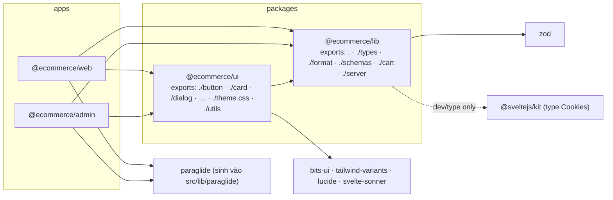
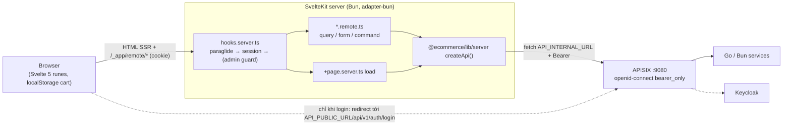
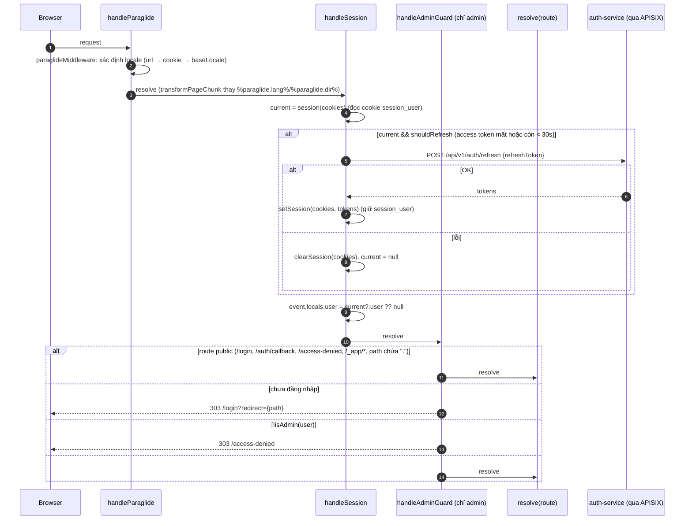
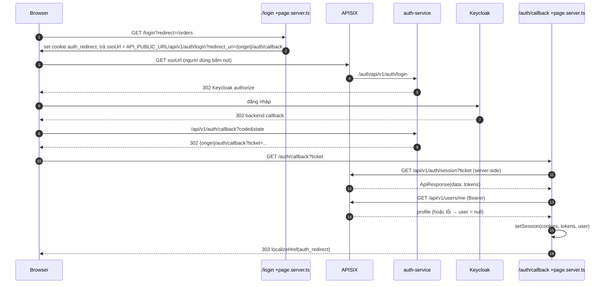
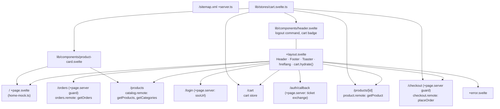
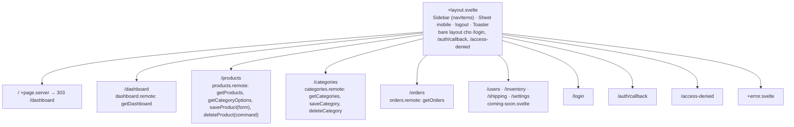

# Kiến trúc phần mềm — Frontend (SvelteKit BFF)

> **Phiên bản:** 1.0 · **Trạng thái:** Final · **Cập nhật:** 2026-11-12 · **Phạm vi:** Ứng dụng (as-is)

> Phạm vi: Bun workspace `frontend/` gồm 2 app SvelteKit (`apps/web` storefront, `apps/admin` backoffice) và 2 package (`packages/lib`, `packages/ui`). Mô tả **as-is**. Chi tiết màn hình: [frontend-web](../../03-services/frontend-web.md), [frontend-admin](../../03-services/frontend-admin.md), [frontend-packages](../../03-services/frontend-packages.md).

## 1. Tech stack

| Thành phần | Phiên bản | Bằng chứng |
| :--- | :--- | :--- |
| Package manager / runtime | Bun `1.4.2` (`engines.bun >= 1.4.0`), workspace `apps/*`, `packages/*` | `frontend/package.json:4-11` |
| Framework | `@sveltejs/kit ^3.0.0`, `svelte ^5.57.1` (runes bắt buộc) | `frontend/apps/web/package.json`, `frontend/apps/web/vite.config.ts:21-23` |
| Build | `vite ^8.3.0`, `@sveltejs/adapter-bun ^1.0.0` | `frontend/apps/web/vite.config.ts:2,25` |
| Tính năng experimental | `experimental.remoteFunctions`, `compilerOptions.experimental.async` | `frontend/apps/web/vite.config.ts:13-19` ([ISSUE-47](../../07-plan/known-issues-tech-debt.md)) |
| i18n | `@inlang/paraglide-js ^2.18.2`, locale `vi` (base) + `en` | `frontend/apps/web/project.inlang/settings.json:10-11` |
| CSS / UI | Tailwind CSS 4 (`@tailwindcss/vite`), shadcn-svelte trên `bits-ui ^2.18`, `tailwind-variants`, `@lucide/svelte`, `svelte-sonner`, font Geist | `frontend/packages/ui/package.json`, `frontend/apps/web/src/routes/layout.css:1-4` |
| Validation | `zod ^4.6.5` (import alias `* as v`) | `frontend/packages/lib/src/schemas.ts:1` |
| Lint / format | ESLint 10 flat config + typescript-eslint + eslint-plugin-svelte, Prettier 3 (+svelte, tailwind plugin) | `frontend/apps/web/eslint.config.js`, `frontend/prettier.config.js` |

> Lưu ý: SvelteKit 3 cấu hình trong `vite.config.ts` (truyền option vào plugin `sveltekit({...})`), **không có** `svelte.config.js`.

## 2. Monorepo & phụ thuộc module

```text
frontend/
├── package.json            # workspace scripts: dev, build, check, lint, format, i18n:check, test
├── prettier.config.js
├── scripts/locale-parity.ts
├── apps/
│   ├── web/   (@ecommerce/web,   port 3000)
│   └── admin/ (@ecommerce/admin, port 3001)
└── packages/
    ├── lib/   (@ecommerce/lib)  types · schemas · cart · format · server/{api,env,session,redirect}
    └── ui/    (@ecommerce/ui)   shadcn-svelte components · theme.css · utils (cn)
```



- Package **không build**: `exports` trỏ thẳng file `.ts`/`.svelte` (`frontend/packages/lib/package.json:6-13`, `frontend/packages/ui/package.json`), Vite của app biên dịch trực tiếp.
- `@ecommerce/lib/server` chỉ được import trong code server (`hooks.server.ts`, `*.remote.ts`, `+page.server.ts`, `$lib/server/*`) vì đọc `process.env` và cookie.
- Alias `#lib` / `#lib/*` → `./src/lib/*` qua trường `imports` của `package.json` (`frontend/apps/web/package.json` `"imports"`) và `paths` trong `tsconfig.json`.

## 3. Mô hình BFF & luồng request

Trình duyệt **không bao giờ** gọi gateway hay giữ token trong JS ([ADR-006](../adr/ADR-006-sveltekit-bff-httponly-session.md)). Mọi dữ liệu đi qua server SvelteKit (SSR `load` hoặc remote function), server gọi APISIX bằng `API_INTERNAL_URL` và gắn `Authorization: Bearer <access_token>` lấy từ cookie httpOnly.



Biến môi trường (`frontend/packages/lib/src/server/env.ts:11-27`):

| Biến | Mặc định | Dùng cho |
| :--- | :--- | :--- |
| `API_INTERNAL_URL` | `http://localhost:9080` | Server → gateway (compose: `http://apisix:9080`, `docker-compose.yml:422`) |
| `API_PUBLIC_URL` | = `API_INTERNAL_URL` | URL trình duyệt dùng cho redirect SSO `/api/v1/auth/login` |
| `PORT`, `HOST`, `ORIGIN`, `PROTOCOL_HEADER` | adapter-bun | Server build (`frontend/apps/web/.env.example`) |

## 4. Hooks

### 4.1 `hooks.ts` (universal)

`reroute = (request) => deLocalizeUrl(request.url).pathname` — bỏ prefix `/en` để chung một cây route (`frontend/apps/web/src/hooks.ts:1-4`, giống ở admin).

### 4.2 `hooks.server.ts`



Nguồn: `frontend/apps/web/src/hooks.server.ts:14-53` (`sequence(handleParaglide, handleSession)`), `frontend/apps/admin/src/hooks.server.ts:17-79` (`sequence(handleParaglide, handleSession, handleAdminGuard)`).

- Web không có guard toàn cục; từng trang cần đăng nhập tự kiểm trong `+page.server.ts` (`/checkout`, `/orders` — `frontend/apps/web/src/routes/checkout/+page.server.ts:5-11`).
- Admin guard dựa **hoàn toàn** vào `locals.user.roles` đọc từ cookie `session_user` (không ký) — ISSUE-66; roles trong cookie đến từ `/api/v1/users/me` vốn không trả roles — ISSUE-100.

## 5. Mô hình session cookie

`frontend/packages/lib/src/server/session.ts`:

| Cookie | Nội dung | maxAge | Thuộc tính |
| :--- | :--- | :--- | :--- |
| `access_token` | JWT Keycloak | `expires_in` (fallback 300 s) | `path=/`, `httpOnly`, `sameSite=lax` |
| `refresh_token` | Refresh token | `refresh_expires_in` (fallback 1800 s) | như trên |
| `session_expires` | epoch giây hết hạn access | = refresh | như trên |
| `session_user` | JSON `SessionUser {id, username, fullName, email, roles[]}` | = refresh | như trên, **không ký/mã hóa** |
| `auth_redirect` | đích sau login (do `/login` set) | 600 s | `httpOnly`, `lax` |

- `secure` không đặt tường minh; web & admin dùng cùng tên cookie → chia sẻ phiên khi cùng host ([ISSUE-11](../../07-plan/known-issues-tech-debt.md)).
- `session()` chỉ coi là đã đăng nhập khi `session_user` parse được và có `username` (`session.ts:70-80`). `shouldRefresh()` = không có access token hoặc còn < 30 s (`session.ts:87-91`).
- `isAdmin(user)` = roles chứa `ADMIN` hoặc `ROLE_ADMIN` (`session.ts:23-25`).
- `safeRedirect()` chỉ chấp nhận path bắt đầu bằng `/` và không phải `//` (`frontend/packages/lib/src/server/redirect.ts:2-5`).

### 5.1 Luồng đăng nhập (BFF)



Nguồn: `frontend/apps/web/src/routes/login/+page.server.ts:9-27`, `frontend/apps/web/src/routes/auth/callback/+page.server.ts:10-40`. Chi tiết backend & lỗi đã biết ([ISSUE-04](../../07-plan/known-issues-tech-debt.md), ISSUE-05, ISSUE-06): [FEAT-01](../../04-features/FEAT-01-sso-login-logout.md), [ADR-002](../adr/ADR-002-keycloak-sso-ticket-exchange.md).

> ⚠️ Khi `/users/me` lỗi (ví dụ user chỉ tồn tại trong Keycloak), `setSession(..., null)` **xóa** `session_user` → người dùng không được coi là đã đăng nhập dù token đã lưu (ISSUE-100).

## 6. API client (`createApi`)

`frontend/packages/lib/src/server/api.ts`:

- `request<T>(base, path, init, token)` — set `accept: application/json`, `content-type` khi có body, `authorization: Bearer` khi có token; đọc text → thử `JSON.parse` (`api.ts:39-60`).
- Lỗi HTTP → `throw new ApiError(status, message, body)`; `message` lấy từ `body.message` nếu có (`api.ts:62-69`). Lưu ý: `ErrorVm` của Go dùng `detail`/`title` nên message thường rơi về `"<status> <statusText>"`.
- **Tự unwrap envelope**: nếu body là object có key `data` → trả `body.data` (`api.ts:71-75`) — phục vụ `ApiResponse` của auth-service; JSON thô đi thẳng.
- `createApi({token, baseUrl})` trả object theo domain: `products`, `categories`, `orders`, `payments`, `inventory`, `auth` (`api.ts:116-161`). Mỗi app bọc thêm `api()` request-scoped đọc token từ cookie qua `getRequestEvent()` (`frontend/apps/web/src/lib/server/api.ts:10-13`).
- Kỳ vọng `PaginatedResponse` (`content,totalElements,totalPages,size,number,first,last`) cho list products/categories/orders — backend trả mảng thô ([ISSUE-48](../../07-plan/known-issues-tech-debt.md)).

## 7. Remote functions

Quy ước (quan sát từ code):

| Loại | Dùng cho | Đặt ở | Ví dụ |
| :--- | :--- | :--- | :--- |
| `query(schema?, fn)` | Đọc dữ liệu; gọi trong template bằng `{#await getX(args)}` | `routes/<feature>/<feature>.remote.ts` | `getProducts` — `frontend/apps/web/src/routes/products/catalog.remote.ts:13` |
| `form(schema, fn)` | Form tạo/sửa (progressive enhancement), `.fields.x.as(...)`, `.fields.x.issues()`, `.enhance()`, `.pending` | admin `products.remote.ts`, `categories.remote.ts` | `saveProduct` — `frontend/apps/admin/src/routes/products/products.remote.ts:16-34`; UI `frontend/apps/admin/src/routes/products/+page.svelte:195-294` |
| `command(schema?, fn)` | Mutation gọi từ JS (`await placeOrder(...)`), có thể `.updates(query)` / `requested(query).refreshAll()` | `checkout.remote.ts`, `auth.remote.ts` | `placeOrder` — `frontend/apps/web/src/routes/checkout/checkout.remote.ts:13-44`; `deleteProduct` — `products.remote.ts:36-39` |

- Đối số luôn được validate bằng Zod schema từ `@ecommerce/lib/schemas` (hoặc `v.coerce.number()` inline — `frontend/apps/web/src/routes/products/[id]/product.remote.ts:5`). Remote form không chấp nhận `z.coerce` nên dùng helper `formNumber`/`optionalId` (`frontend/packages/lib/src/schemas.ts:3-30`).
- Remote function **không** tự kiểm đăng nhập (trừ `placeOrder` kiểm access token → `error(401)` — `checkout.remote.ts:14-16`); bảo vệ thực tế dựa vào gateway trả 401.
- Remote dùng chung cho cả app nằm ở `src/lib/remote/` (chỉ `logout`).

## 8. State phía client

- **Svelte 5 runes**: `$state`, `$derived`, `$props`, `$effect`; runes bị ép bật cho mọi file ngoài `node_modules` (`frontend/apps/web/vite.config.ts:21-23`).
- **Cart store** (chỉ web): class `CartStore` với field `$state`/`$derived`, singleton `cart`, lưu `localStorage['ecommerce-cart']` dạng `{state:{items}, version:0}` (tương thích zustand cũ), `hydrate()` gọi trong `onMount` của root layout (`frontend/apps/web/src/lib/stores/cart.svelte.ts:4-91`, `frontend/apps/web/src/routes/+layout.svelte:15`). Tổng tiền tính bằng `computeTotals` dùng chung với server (`frontend/packages/lib/src/cart.ts:22-26`). Xem [ADR-008](../adr/ADR-008-client-side-cart-localstorage.md), [FEAT-08](../../04-features/FEAT-08-shopping-cart.md).
- Không có store toàn cục khác; `user` truyền qua `data` của root `+layout.server.ts` (`frontend/apps/web/src/routes/+layout.server.ts:3-5`).

## 9. i18n (Paraglide)

- `paraglideVitePlugin({ project: './project.inlang', outdir: './src/lib/paraglide', strategy: ['url','cookie','baseLocale'] })` — `/` = `vi`, `/en/...` = `en` (`frontend/apps/web/vite.config.ts:27-33`).
- Message ở `apps/<app>/messages/{vi,en}.json` (web ~300 key, admin ~125 key); dùng `m.key()` từ `#lib/paraglide/messages.js`, link qua `localizeHref()` từ `#lib/paraglide/runtime.js`.
- `app.html` có `%paraglide.lang%` / `%paraglide.dir%` được thay trong `handleParaglide`.
- Kiểm parity key: `bun run i18n:check` → `frontend/scripts/locale-parity.ts`. Chi tiết: [FEAT-27](../../04-features/FEAT-27-i18n.md).

## 10. UI kit (`@ecommerce/ui`)

- Sinh bằng shadcn-svelte (`frontend/packages/ui/components.json`), mỗi component một sub-path export (`@ecommerce/ui/button`, `@ecommerce/ui/dialog`, … 20 nhóm) + `EmptyState`, `TableSkeleton` tự viết.
- `utils.ts` re-export `cn` từ `tailwind-variants` và type helper cho bits-ui.
- Theme: `theme.css` (CSS variables) được `@import` trong `layout.css` của từng app; app phải khai báo `@source '../../../../packages/ui/src'` để Tailwind quét class trong package (`frontend/apps/web/src/routes/layout.css:1-4`).

## 11. Component diagram

### 11.1 Web (storefront)



### 11.2 Admin (backoffice)



Nguồn: cây `frontend/apps/{web,admin}/src/routes/`, `frontend/apps/admin/src/routes/+layout.svelte:26-49`, `frontend/apps/admin/src/routes/+page.server.ts`. Placeholder: [FEAT-26](../../04-features/FEAT-26-admin-placeholder-modules.md).

## 12. Build & đóng gói

- `bun run --bun vite build` (adapter-bun yêu cầu Vite chạy dưới Bun) → thư mục `build/`, chạy bằng `bun ./build`.
- Dockerfile 2 stage, **build context là `frontend/`**: copy manifest của mọi workspace → `bun install --frozen-lockfile` → copy source → `bun run --filter @ecommerce/web build` → runtime `oven/bun:1` chỉ copy `apps/web/build`, chạy `USER bun`, `EXPOSE 3000` (`frontend/apps/web/Dockerfile`; admin tương tự port 3001).
- `docker-compose.yml` **không build** frontend mà kéo image `ghcr.io/ecommerce-int/frontend-{web,admin}:latest` với `pull_policy: always` (`docker-compose.yml:412-449`) — thay đổi code local không có hiệu lực trong compose (ISSUE-97).

## 13. Kiểm thử & chất lượng

| Lệnh (trong `frontend/`) | Nội dung |
| :--- | :--- |
| `bun test` | Unit test `packages/lib` (`cart`, `format`, `schemas`, `server/api`, `server/redirect`, `server/session`) — stub `fetch`, không có test component/E2E ([ISSUE-46](../../07-plan/known-issues-tech-debt.md)) |
| `bun run check` | `paraglide-js compile` + `svelte-kit sync` + `svelte-check` từng app; `tsc --noEmit` ở lib |
| `bun run lint` | `prettier --check .` + `eslint .` |
| `bun run i18n:check` | Parity `vi.json` ↔ `en.json` |

CI job frontend chạy đủ 4 bước trên (`.github/workflows/ci.yml`).

## 14. Vấn đề liên quan

[ISSUE-11](../../07-plan/known-issues-tech-debt.md), ISSUE-38…ISSUE-47, ISSUE-48, ISSUE-49, ISSUE-50, ISSUE-51; mới: ISSUE-100 (profile `/users/me` không có roles / lệch field), ISSUE-66 (cookie `session_user` không ký, admin guard tin cookie), ISSUE-60 (admin gửi `categoryId` phẳng), ISSUE-97 (compose dùng image frontend dựng sẵn).
