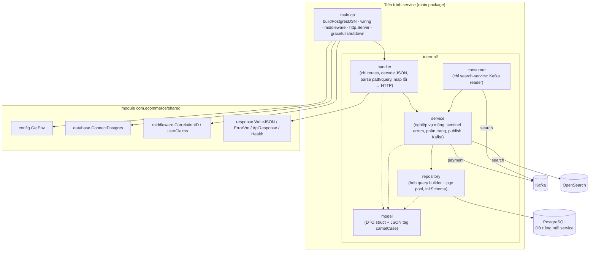
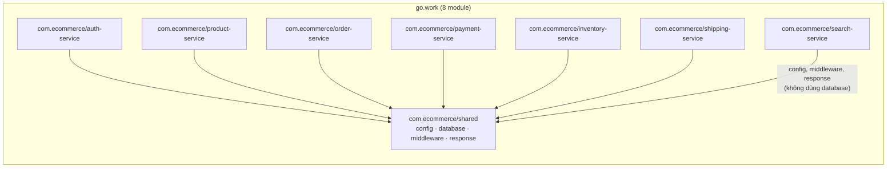
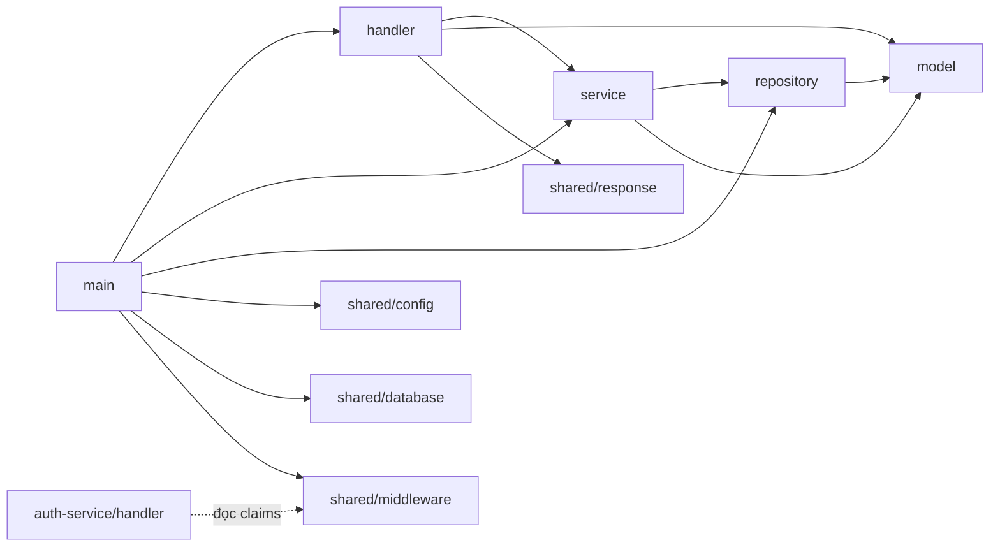
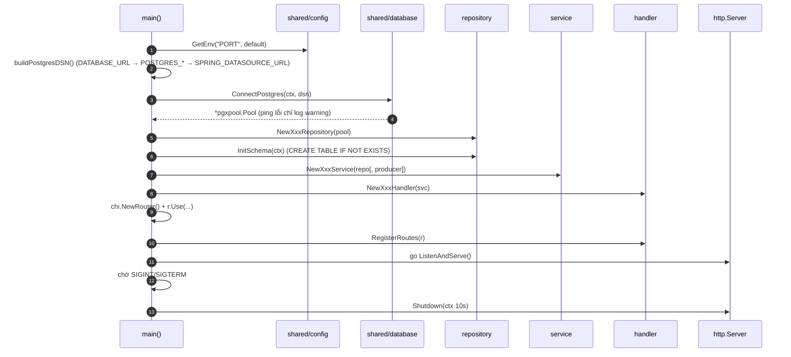
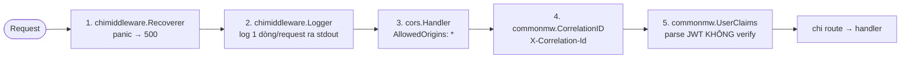
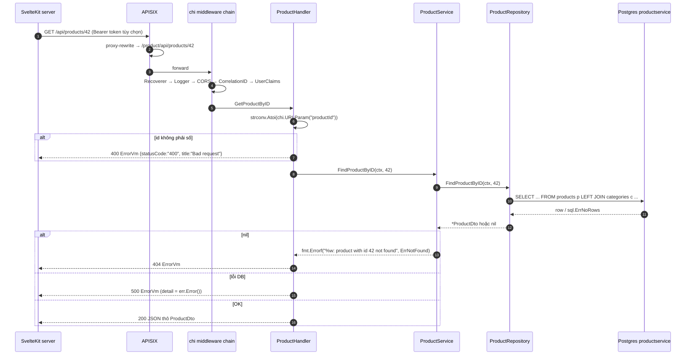
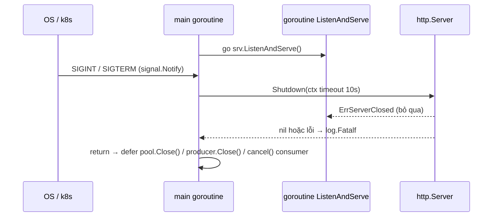
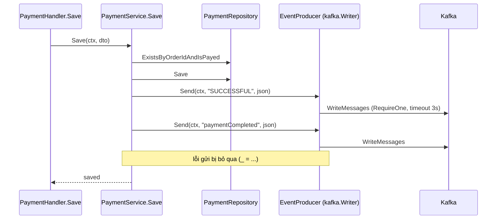

# Kiến trúc phần mềm — Go services

> **Phiên bản:** 1.0 · **Trạng thái:** Final · **Cập nhật:** 2026-11-12 · **Phạm vi:** Ứng dụng (as-is)

> Phạm vi: 7 service Go (`auth`, `product`, `order`, `payment`, `inventory`, `shipping`, `search`) và module dùng chung `services/shared`. Mô tả **đúng code hiện tại** (as-is). Chi tiết nghiệp vụ từng service xem [`03-services/`](../../03-services/), hợp đồng API xem [`api-catalog.md`](../../05-api/api-catalog.md).

## 1. Tổng quan

Mọi service Go dùng **cùng một khuôn** (gần như copy-paste giữa các service):

| Thành phần | Thư viện | Bằng chứng |
| :--- | :--- | :--- |
| Ngôn ngữ / toolchain | Go `1.27.0` (go.work + từng go.mod) | `go.work:1`, `services/product-service/go.mod:3` |
| HTTP router | `github.com/go-chi/chi/v5 v5.3.2` | `services/*/go.mod` |
| CORS | `github.com/go-chi/cors v1.2.2` | `services/product-service/main.go:84-88` |
| Truy cập DB | `github.com/stephenafamo/bob v0.50.0` (query builder) + driver `bob/drivers/pgx` trên `pgx/v5` `pgxpool` | `services/product-service/internal/repository/product_repo.go:10-28` |
| Scan kết quả | `github.com/stephenafamo/scan` (`StructMapper`, `SingleColumnMapper`) | `product_repo.go:89,137` |
| JWT (parse không verify) | `github.com/golang-jwt/jwt/v5` (chỉ trong `shared`) | `services/shared/middleware/middleware.go:10,51-52` |
| Kafka | `github.com/segmentio/kafka-go v0.4.47` (payment: producer, search: consumer) | `services/payment-service/internal/service/kafka_producer.go:8`, `services/search-service/internal/consumer/product_sync_consumer.go:11` |
| OpenSearch | `opensearch-go/v5 v5.0.3` (chỉ search-service) | `services/search-service/main.go:22-23` |
| Test | `net/http/httptest` + `stretchr/testify` | `services/product-service/main_test.go:7,14` |

Không có: DI container, framework config (viper…), logger có cấu trúc, migration tool, OpenAPI generator, ORM model generation (bob chỉ dùng như query builder viết tay).

## 2. Kiến trúc phân lớp



| Lớp | Trách nhiệm thực tế | Không làm |
| :--- | :--- | :--- |
| `main.go` | Đọc env, dựng DSN, mở pool, gọi `InitSchema`, khởi tạo repo → service → handler bằng constructor, gắn middleware, chạy `http.Server`, chờ SIGINT/SIGTERM | Không có health/readiness thật, không có server timeout |
| `handler` | Đăng ký route (cả path có prefix và không prefix), `json.NewDecoder(r.Body).Decode`, `strconv.Atoi(chi.URLParam…)`, map sentinel error → status | Không validate nội dung (trừ vài check rỗng ở auth) |
| `service` | Gọi repo, chuyển `nil` → sentinel `ErrNotFound`, tính `PageResponse`, publish Kafka (payment) | Không có transaction, không gọi service khác qua HTTP |
| `repository` | Viết SQL bằng bob (`psql.Select/Insert/Update/Delete`), map row → DTO, `CREATE TABLE IF NOT EXISTS` | Không migration, không transaction |
| `model` | DTO dùng chung cho JSON và (một phần) cho scan | Không có validation tag |

Search-service **không có** `repository` (dữ liệu nằm ở OpenSearch, service gọi trực tiếp `opensearchapi`) và có thêm package `consumer` (`services/search-service/internal/consumer/product_sync_consumer.go`).

## 3. Package diagram



Bên trong một service (ví dụ product-service):



Quy tắc phụ thuộc (quan sát được, không có linter ép buộc):

1. `handler → service → repository → model`; không có import ngược.
2. Handler phụ thuộc **kiểu cụ thể** `*service.XxxService` (không có interface) — ví dụ `ProductHandler{svc *service.ProductService}` (`services/product-service/internal/handler/product_handler.go:15-21`). Service phụ thuộc `*repository.XxxRepository` cụ thể (`services/product-service/internal/service/product_service.go:14-20`).
3. Chỉ `handler` import `shared/response`; chỉ `main` import `shared/database`. Riêng auth-service handler import `shared/middleware` để đọc `Username/UserID` từ context (`services/auth-service/internal/handler/auth_handler.go:15,318-321`).
4. Thư mục `internal/` ngăn module khác import — các service không chia sẻ code ngoài `shared`. Hệ quả: `PageResponse[T]` được **định nghĩa lặp** trong auth/order/payment (`services/order-service/internal/model/order.go:36-46`, `services/payment-service/internal/model/payment.go:36-46`, `services/auth-service/internal/model/user.go:63-73`), `buildPostgresDSN` lặp trong 6 `main.go`.

## 4. Khởi tạo & wiring (DI thủ công)

Trình tự trong `main()` (ví dụ `services/product-service/main.go:56-117`):



### 4.1 Giải quyết DSN Postgres

`buildPostgresDSN()` (giống hệt nhau ở 6 service có DB, ví dụ `services/product-service/main.go:26-54`):

1. Nếu có `DATABASE_URL` → dùng nguyên.
2. Ngược lại lấy `POSTGRES_USER`, `POSTGRES_PASSWORD`, `POSTGRES_HOST` (default `localhost`), `POSTGRES_PORT` (`5432`), `POSTGRES_DB` (default theo service: `authservice`, `productservice`, `orderservice`, `paymentservice`, `inventoryservice`, `shippingservice`).
3. Nếu có `SPRING_DATASOURCE_URL` (di sản Spring, **đang là cách docker-compose truyền DB**: `docker-compose.yml:186,207,226,248,270,289`) → bóc `jdbc:postgresql://host:port/db` để ghi đè host/port/db.
4. Luôn thêm `?sslmode=disable`.

### 4.2 Pool & "chế độ suy giảm" khi pool `nil`

- `ConnectPostgres` cấu hình `MaxConns=25`, `MinConns=2`, `MaxConnLifetime=1h`, `MaxConnIdleTime=30m` (`services/shared/database/postgres.go:27-30`).
- Ping thất bại **chỉ log warning**, vẫn trả pool (`postgres.go:37-41`). `pgxpool.NewWithConfig` kết nối lười, nên trong thực tế hàm chỉ trả lỗi khi DSN sai cú pháp.
- `main` khi gặp lỗi chỉ log và **tiếp tục** với `pool == nil` (`services/product-service/main.go:63-69`).
- Mỗi method repository kiểm `if r.db.Pool == nil` và trả **dữ liệu rỗng/stub** — ví dụ danh sách rỗng, `SaveCategory` trả id `1`, `Delete` trả `nil` (`services/product-service/internal/repository/product_repo.go:81-83,119-121,163-165`). auth-service thì trả lỗi `"db not connected"` (`services/auth-service/internal/repository/user_repository.go:123`).

> ⚠️ Vì pool hầu như không bao giờ `nil` ngoài test, khi Postgres sập thực tế các truy vấn trả lỗi → HTTP 500 kèm thông điệp lỗi thô (xem ISSUE-93); nhánh `nil` chủ yếu phục vụ **unit test** (mục 10). Health check vẫn trả `UP` trong mọi trường hợp ([ISSUE-36](../../07-plan/known-issues-tech-debt.md)). Xem thêm [ISSUE-28](../../07-plan/known-issues-tech-debt.md).

### 4.3 Khởi tạo schema

`InitSchema(ctx)` chạy **một lần** lúc khởi động với một chuỗi DDL `CREATE TABLE IF NOT EXISTS …` (kèm seed role ở auth: `user_repository.go:60-62`). Có hai biến thể chữ ký:

| Biến thể | Service | Xử lý lỗi |
| :--- | :--- | :--- |
| `InitSchema(ctx) error` | auth, order, payment | `main` gọi `_ = repo.InitSchema(ctx)` → lỗi bị **nuốt im lặng** (`services/order-service/main.go:72`) |
| `InitSchema(ctx)` (không trả lỗi) | product, inventory, shipping | Log `Notice during schema verification` (`product_repo.go:65-67`) |

DDL chỉ chạy lúc start: nếu Postgres chưa sẵn sàng tại thời điểm đó, bảng không được tạo cho tới lần restart sau (compose giảm rủi ro nhờ `depends_on: service_healthy`). Không có bảng version, không có migration ([ISSUE-28](../../07-plan/known-issues-tech-debt.md), [ADR-004](../adr/ADR-004-database-per-service-runtime-ddl.md)). Lược đồ chi tiết: [`data-dictionary.md`](../../06-data/data-dictionary.md).

## 5. Middleware chain

Thứ tự `r.Use(...)` giống nhau ở cả 7 service (`services/auth-service/main.go:95-103`, `services/search-service/main.go:63-71`):



| # | Middleware | Hành vi | Nguồn |
| :--- | :--- | :--- | :--- |
| 1 | `Recoverer` | Bắt panic, in stack, trả 500 | chi |
| 2 | `Logger` | Log method/path/status/thời gian; **không** in correlation id (không dùng `chimiddleware.RequestID`) | chi |
| 3 | `cors.Handler` | `AllowedOrigins: ["*"]`, methods `GET,POST,PUT,DELETE,OPTIONS`, headers `Origin, Content-Type, Accept, Authorization, X-Correlation-Id` | `services/product-service/main.go:84-88` |
| 4 | `CorrelationID` | Lấy `X-Correlation-Id` từ request hoặc sinh 16 byte hex, ghi vào response header và context | `services/shared/middleware/middleware.go:25-36` |
| 5 | `UserClaims` | Nếu có `Authorization: Bearer`, `ParseUnverified` và đặt `sub`, `email`, `preferred_username` vào context; **không bao giờ chặn** request | `middleware.go:45-69` ([ISSUE-02](../../07-plan/known-issues-tech-debt.md)) |

Vì CORS đứng trước CorrelationID, response preflight `OPTIONS` không có header correlation. Không service nào có middleware kiểm role ([ISSUE-01](../../07-plan/known-issues-tech-debt.md)); xác thực do APISIX thực hiện ([ADR-003](../adr/ADR-003-gateway-authentication.md)).

## 6. Vòng đời một request

Ví dụ `GET /api/products/42` từ BFF qua gateway:



Nguồn: `services/product-service/internal/handler/product_handler.go:159-175`, `services/product-service/internal/service/product_service.go:67-76`, `product_repo.go:242-260`, route gateway `deploy/apisix/apisix.yaml:71-82`. Chi tiết routing: [`gateway-routing.md`](../../05-api/gateway-routing.md).

### 6.1 Đăng ký route kép (prefix + root)

Mỗi handler đăng ký **cùng một handler func** cho nhiều base path để vừa phục vụ path đã rewrite bởi gateway (`/product/api/...`) vừa phục vụ gọi trực tiếp (`/api/...`):

| Service | Base path đăng ký | Nguồn |
| :--- | :--- | :--- |
| auth | `/api/v1/{auth,users,roles}`, `/auth/api/v1/{…}` | `services/auth-service/internal/handler/auth_handler.go:45-56` |
| product | `/product/api/{categories,products}`, `/api/{…}`; favourites: `/favourite/api/favourites`, `/product/api/favourites`, `/api/favourites` | `product_handler.go:28-31`, `favourite_handler.go:27-29` |
| order | `/api/{carts,orders}`, `/order/api/{…}` | `services/order-service/internal/handler/order_handler.go:29-36` |
| payment | `/api/payments`, `/payment/api/payments` | `services/payment-service/internal/handler/payment_handler.go:28` |
| inventory | `/inventory/api/inventory`, `/api/inventory` | `services/inventory-service/internal/handler/inventory_handler.go:25` |
| shipping | `/shipping/api/shippings`, `/api/shippings` | `services/shipping-service/internal/handler/shipping_handler.go:29` |
| search | `/search/storefront/...`, `/storefront/...` | `services/search-service/internal/handler/search_handler.go:25-33` |

Health: `/actuator/health`, `/<svc>/actuator/health` (+ `/health` ở auth/order/payment) — xem [`api-conventions.md`](api-conventions.md#9-health-endpoint).

## 7. Xử lý lỗi: sentinel error → HTTP

Mẫu chung: service định nghĩa `var ErrXxx = errors.New(...)`, có thể bọc bằng `fmt.Errorf("%w: ...")`; handler dùng `errors.Is` để chọn status. Mọi lỗi khác → 500.

| Service | Sentinel | HTTP | Format body | Nguồn |
| :--- | :--- | :--- | :--- | :--- |
| product | `ErrNotFound` | 404 | `ErrorVm` | `product_service.go:12,34`; `product_handler.go:68-70` |
| shipping | `ErrNotFound` | 404 | `ErrorVm` | `services/shipping-service/internal/service/shipping_service.go:12`; `shipping_handler.go:73-74` |
| order | `ErrCartNotFound`, `ErrOrderNotFound` | 404 | `ErrorVm` | `services/order-service/internal/service/order_service.go:13-14`; `order_handler.go:96-97,230-231` |
| payment | `ErrPaymentNotFound` | 404 | `ErrorVm` | `services/payment-service/internal/service/payment_service.go:14` |
| payment | `ErrOrderAlreadyPaid` | **404** (nên là 409) | `ErrorVm` | `payment_handler.go:117-118` ([ISSUE-25](../../07-plan/known-issues-tech-debt.md)) |
| auth | `ErrUserNotFound` | 404 `NOT_FOUND` | `ApiResponse` | `services/auth-service/internal/service/user_service.go:14`; `auth_handler.go:229-231` |
| auth | `ErrUsernameExists`/`ErrEmailExists`/`ErrPhoneExists` | 409 `CONFLICT` | `ApiResponse` | `auth_handler.go:114-116` |
| auth | lỗi đăng ký khác | 400 `REGISTRATION_FAILED` | `ApiResponse` | `auth_handler.go:118` |
| (tất cả) | lỗi decode JSON / path param | 400 | `ErrorVm` hoặc `ApiResponse` | ví dụ `product_handler.go:80-82` |
| (tất cả) | lỗi khác | 500, `detail = err.Error()` | `ErrorVm` / `ApiResponse` `INTERNAL_ERROR` | `product_handler.go:54`; `auth_handler.go:233` |

Repository chuyển `sql.ErrNoRows` → `(nil, nil)` (`product_repo.go:110-112`) để service quyết định 404. Ngoại lệ: một số endpoint **không** phân biệt not-found (ví dụ `DELETE` luôn 200 `true` dù id không tồn tại — `product_handler.go:224-236`; inventory/search chỉ có 500).

Hai định dạng lỗi song song (`ErrorVm` vs `ApiResponse`) là [ISSUE-29](../../07-plan/known-issues-tech-debt.md); việc trả `err.Error()` thô cho client là ISSUE-93.

## 8. Graceful shutdown



- Nguồn: `services/product-service/main.go:100-117`, `services/payment-service/main.go:76-77` (`defer producer.Close()`), `services/search-service/main.go:55-56` (`defer cancel()` dừng consumer).
- `http.Server` chỉ đặt `Addr` và `Handler` — **không** có `ReadHeaderTimeout/ReadTimeout/WriteTimeout/IdleTimeout` (ISSUE-96).
- Nếu `Shutdown` lỗi, `log.Fatalf` gọi `os.Exit` → các `defer` (đóng pool, producer) **không chạy**.
- Ở search-service, context của consumer chỉ bị cancel sau khi `Shutdown` xong (defer), nên consumer có thể còn index message trong 10 s shutdown.

## 9. Mẫu Kafka

### 9.1 Producer (payment-service)



- `NewEventProducer(brokers)` tạo `kafka.Writer{Balancer: LeastBytes, WriteTimeout: 3s, RequiredAcks: RequireOne}`; nếu broker rỗng thì writer `nil` và `Send` chỉ log (`services/payment-service/internal/service/kafka_producer.go:15-34`).
- Publish **đồng bộ trong request** với `ctx` của request, mỗi lần tạo payment, tới 2 topic `SUCCESSFUL` và `paymentCompleted` (`payment_service.go:18-21,103-113`). Lỗi bị bỏ qua, không outbox, không key message → [ISSUE-17](../../07-plan/known-issues-tech-debt.md), [ISSUE-18](../../07-plan/known-issues-tech-debt.md).
- Payload `KafkaPaymentDto` (camelCase JSON: `paymentId,isPayed,paymentStatus,orderId,userId`) — `services/payment-service/internal/model/payment.go:28-34`.

### 9.2 Consumer (search-service)

- `ProductSyncConsumer.Start(ctx)` chạy goroutine với `kafka.NewReader{Brokers, Topic, GroupID: "search-group", MinBytes 10KB, MaxBytes 10MB}` (`services/search-service/internal/consumer/product_sync_consumer.go:30-41`). Topic mặc định `dbproduct.public.product` (`PRODUCT_TOPIC_NAME`, `services/search-service/main.go:32`).
- Vòng lặp `ReadMessage` (auto-commit theo consumer group); lỗi đọc → sleep 2 s; JSON lỗi → bỏ qua; payload dạng Debezium (`op`, `before`, `after`) → `DeleteProduct` hoặc `IndexProduct` (`product_sync_consumer.go:43-84`). Lỗi index bị bỏ qua — không DLQ, không retry.
- Không có producer tương ứng trong repo ([ISSUE-19](../../07-plan/known-issues-tech-debt.md), [ADR-005](../adr/ADR-005-kafka-async-events.md)).

## 10. Mẫu kiểm thử

Mỗi service có đúng một file `main_test.go` (package `main`) — tổng 528 dòng:

```go
// services/product-service/main_test.go:17-31
r := chi.NewRouter()
repo := repository.NewProductRepository(nil) // pool nil → nhánh stub
svc := service.NewProductService(repo)
h := handler.NewProductHandler(svc)
h.RegisterRoutes(r)
```

- Dựng router **không có middleware**, repository với pool `nil`, gửi request bằng `httptest.NewRequest` + `httptest.NewRecorder`, assert **status code** (`main_test.go:33-77`).
- Kiểm tra được: route tồn tại ở cả prefix và root, decode JSON, mã lỗi 400 cho path param sai. Không kiểm tra: SQL thật, Kafka, OpenSearch, Keycloak, body response chi tiết ([ISSUE-46](../../07-plan/known-issues-tech-debt.md)).
- auth-service còn test `SsoSessionStore` trực tiếp (`services/auth-service/main_test.go:92`).
- Chạy: `make go-test` (`go test ./services/<mod>/...` cho 8 module, `Makefile:56-57`); CI chạy `gofmt -l`, `go build`, `go vet`, `go test` từng module (`.github/workflows/ci.yml` job `go-check`).

## 11. Bố cục module & build

### 11.1 go.work và replace

- `go.work` liệt kê 8 module (`go.work:3-12`) để IDE/`go build` ở gốc repo resolve `com.ecommerce/shared` tại chỗ.
- Mỗi service còn có `replace com.ecommerce/shared => ../shared` trong `go.mod` (ví dụ `services/product-service/go.mod`, dòng cuối) để build **không cần** go.work (Docker build).

```text
services/
├── shared/                 # module com.ecommerce/shared
│   ├── config/config.go
│   ├── database/postgres.go
│   ├── middleware/middleware.go
│   └── response/{api_response.go,response.go}
└── <svc>-service/
    ├── Dockerfile
    ├── go.mod / go.sum      # replace → ../shared
    ├── main.go              # wiring + server
    ├── main_test.go
    └── internal/{handler,service,repository,model}/   (+ consumer/ ở search)
```

### 11.2 Dockerfile (multi-stage)

Build context là thư mục `services/` (`docker-compose.yml:172-174`) để copy được `shared`:

```dockerfile
# services/product-service/Dockerfile:1-23 (rút gọn)
FROM golang:1.27-alpine AS builder
COPY shared/go.mod shared/go.sum ./shared/
COPY product-service/go.mod product-service/go.sum ./product-service/
RUN cd product-service && go mod download          # cache layer dependency
COPY shared ./shared
COPY product-service ./product-service
RUN CGO_ENABLED=0 GOOS=linux go build -ldflags="-s -w" -o /product-service main.go
FROM alpine:latest
RUN apk --no-cache add ca-certificates tzdata
COPY --from=builder /product-service /product-service
EXPOSE 8086
ENTRYPOINT ["/product-service"]
```

Image chạy bằng user root (không có `USER`), base `alpine:latest` không pin. `services/search-service/wait-for-it.sh` tồn tại nhưng Dockerfile không dùng. `services/.dockerignore` loại `node_modules`, `.git`, `.env`, `*.log`.

## 12. So sánh giữa các service Go

| Service | Port | DB (default `POSTGRES_DB`) | Package internal | `InitSchema` trả lỗi | Response format | Phân trang server | Kafka | Phụ thuộc ngoài khác | Tài liệu |
| :--- | :--- | :--- | :--- | :---: | :--- | :--- | :--- | :--- | :--- |
| auth-service | 8088 | `authservice` | handler, service (+ keycloak_client, sso_store), repository, model | ✅ (bị bỏ qua) | `ApiResponse` envelope | `/users/all` (`page,size,sortBy,sortOrder`) | — | Keycloak (HTTP) | [auth-service](../../03-services/auth-service.md) |
| product-service | 8086 | `productservice` | handler ×2, service ×2, repository ×2, model | ❌ (log) | JSON thô + `ErrorVm`; favourites `{collection}` | ❌ (list trả mảng — [ISSUE-48](../../07-plan/known-issues-tech-debt.md)) | — | — | [product-service](../../03-services/product-service.md) |
| order-service | 8084 | `orderservice` | handler, service, repository, model | ✅ (bị bỏ qua) | JSON thô + `ErrorVm` | `/carts/all`, `/orders/all` (`PageResponse`) | — (`KAFKA_SERVERS` thừa, [ISSUE-37](../../07-plan/known-issues-tech-debt.md)) | — | [order-service](../../03-services/order-service.md) |
| payment-service | 8085 | `paymentservice` | handler, service (+ kafka_producer), repository, model | ✅ (bị bỏ qua) | JSON thô + `ErrorVm` | `/payments/all` (`PageResponse`) | Producer | — | [payment-service](../../03-services/payment-service.md) |
| inventory-service | 8082 | `inventoryservice` | handler, service, repository, model | ❌ (log) | JSON thô + `ErrorVm` | — | — | — | [inventory-service](../../03-services/inventory-service.md) |
| shipping-service | 8087 | `shippingservice` | handler, service, repository, model | ❌ (log) | JSON thô + `ErrorVm`; list `{collection}` | — | — | — | [shipping-service](../../03-services/shipping-service.md) |
| search-service | 8094 | — (không có DB) | handler, service, consumer, model | — | JSON thô + `ErrorVm` | `page,size` → `ProductListGetVm` | Consumer | OpenSearch | [search-service](../../03-services/search-service.md) |

Port mặc định: `config.GetEnv("PORT", …)` trong từng `main.go` (ví dụ `services/auth-service/main.go:57`).

## 13. Vấn đề liên quan

[ISSUE-01](../../07-plan/known-issues-tech-debt.md), ISSUE-02, ISSUE-17, ISSUE-18, ISSUE-19, ISSUE-25, ISSUE-28, ISSUE-29, ISSUE-36, ISSUE-37, ISSUE-46, ISSUE-48 và các phát hiện mới ISSUE-93 (lộ thông điệp lỗi nội bộ), ISSUE-96 (thiếu server timeout) — định nghĩa trong [`known-issues-tech-debt.md`](../../07-plan/known-issues-tech-debt.md).

Xem thêm: [`shared-go-module.md`](../../03-services/shared-go-module.md), [`cross-cutting-concerns.md`](cross-cutting-concerns.md), [`coding-conventions.md`](../../08-guides/coding-conventions.md).
