# Component View (C4 — Level 3)

> **Phiên bản:** 1.0 · **Trạng thái:** Final · **Cập nhật:** 2026-11-12 · **Phạm vi:** Ứng dụng (as-is)

> Phân rã **bên trong từng container** (11 service backend + 2 ứng dụng SvelteKit) thành các component thực tế trong code: router/handler, service, repository, consumer/producer, client ra ngoài, middleware, store. Mỗi mục có một sơ đồ Mermaid và một bảng component. Mức container: [container-view.md](container-view.md). Mẫu kiến trúc chung: [go-service-architecture.md](../software/go-service-architecture.md), [bun-service-architecture.md](../software/bun-service-architecture.md), [frontend-architecture.md](../software/frontend-architecture.md).

## 0. Quy ước sơ đồ

| Ký hiệu | Ý nghĩa |
| :--- | :--- |
| Hộp chữ nhật trong `subgraph` | Component thuộc container đang mô tả |
| `[( )]` | Kho dữ liệu ngoài container (PostgreSQL DB, OpenSearch index, S3 bucket) |
| Hộp ngoài `subgraph` | Container khác / hệ thống ngoài (APISIX, Kafka, Keycloak, SMTP…) |
| Mũi tên liền | Lời gọi đồng bộ (hàm, HTTP, SQL) |
| Mũi tên chấm | Bất đồng bộ (Kafka) hoặc phụ thuộc "dự kiến nhưng không hoạt động" |
| ⚠️ | Điểm có lỗi / nợ kỹ thuật đã đăng ký (ISSUE-xx) |

### 0.1 Khung chung cho 7 service Go

Mọi service Go dùng cùng chuỗi khởi tạo (DI thủ công trong `main.go`) và cùng module `services/shared`. Để tránh lặp, các component chung được mô tả **một lần** ở đây; sơ đồ từng service chỉ vẽ lại `chi Router` và middleware dưới dạng một hộp.

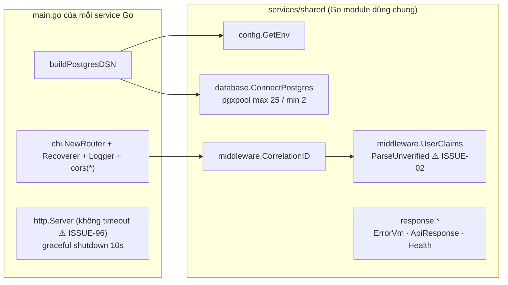

| Component | File | Trách nhiệm | Phụ thuộc |
| :--- | :--- | :--- | :--- |
| `config.GetEnv` | `services/shared/config/config.go:5-10` | Đọc biến môi trường với default | `os` |
| `database.ConnectPostgres` | `services/shared/database/postgres.go:21-44` | Tạo `pgxpool` (25/2, lifetime 1h, idle 30m); ping lỗi chỉ log warning → pool vẫn trả về (ISSUE-28) | PostgreSQL |
| `middleware.CorrelationID` | `services/shared/middleware/middleware.go:25-36` | Đọc/sinh `X-Correlation-Id` (hex 16 byte), echo ra response | — |
| `middleware.UserClaims` | `services/shared/middleware/middleware.go:45-69` | Parse JWT **không verify**, đưa `sub`, `email`, `preferred_username` vào context; không chặn request (ISSUE-02) | `golang-jwt/jwt/v5` |
| `response.*` | `services/shared/response/response.go:6-34`, `services/shared/response/api_response.go:12-75` | Ghi JSON: `ErrorVm` (product/order/payment/…), `ApiResponse` envelope (auth), `Health` | `middleware` (traceId) |
| chi stack | `services/<svc>/main.go` (vd `services/product-service/main.go:81-93`) | `Recoverer` → `Logger` (log cả query string) → `cors` `AllowedOrigins:*` → `CorrelationID` → `UserClaims` → handler | `go-chi/chi/v5`, `go-chi/cors` |
| `http.Server` | `services/<svc>/main.go` (vd `services/product-service/main.go:95-98`) | Lắng nghe `PORT`, shutdown khi SIGINT/SIGTERM (10 s) | — |

### 0.2 Khung chung cho 4 service Bun

| Component | File (ví dụ rating-service) | Trách nhiệm |
| :--- | :--- | :--- |
| Hono app + middleware | `services/rating-service/src/index.ts:8-25` | `logger()`, `cors({origin:'*'})`, middleware correlation id (UUID) |
| Health | `services/rating-service/src/index.ts:28-37` | Luôn `UP` (ISSUE-36) |
| Mount route kép | `services/rating-service/src/index.ts:150-154` | Cùng bộ route ở `/<prefix>` và ở gốc |
| `db.ts` | `services/rating-service/src/db.ts:4-67` | Giải quyết DB URL (`DATABASE_URL` / `POSTGRES_*` / `SPRING_DATASOURCE_URL`), `Bun.SQL` (max 20), `drizzle`, `initDb()` chạy `CREATE TABLE IF NOT EXISTS` |
| `schema.ts` | `services/rating-service/src/schema.ts` | Định nghĩa bảng Drizzle |
| `types.ts` | `services/rating-service/src/types.ts:3-34` | Zod schema + view model |

---

## 1. auth-service (Go · :8088)

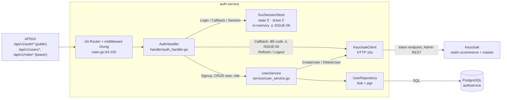

| Component | File | Trách nhiệm | Phụ thuộc |
| :--- | :--- | :--- | :--- |
| Wiring | `services/auth-service/main.go:56-105` | Đọc `KEYCLOAK_*`, `SSO_*`; tạo repo, `KeycloakClient`, `SsoSessionStore`, `UserService`, `AuthHandler`; `InitSchema` | shared |
| `AuthHandler` — route | `services/auth-service/internal/handler/auth_handler.go:39-87` | Đăng ký route kép `/api/v1/...` và `/auth/api/v1/...` cho auth, users, roles | chi |
| `AuthHandler` — SSO | `auth_handler.go:125-208` | `Login` tạo state + 302 Keycloak; `Callback` tiêu state (không bắt buộc hợp lệ — ISSUE-52), đổi code (mock token khi lỗi — ISSUE-04), cấp ticket; `Session` đổi ticket lấy token; `Refresh`; `Logout` best-effort | `SsoSessionStore`, `KeycloakClient` |
| `AuthHandler` — user/role | `auth_handler.go:214-413` | CRUD user, `/me` (tra theo `preferred_username` từ `UserClaims`), `ChangePassword` stub (ISSUE-07), assign/revoke/get role | `UserService`, `middleware.Username` |
| `SsoSessionStore` | `services/auth-service/internal/service/sso_store.go:22-123` | Map `states`, `tickets` có mutex; token ngẫu nhiên 32 byte; purge mỗi phút | — |
| `KeycloakClient` | `services/auth-service/internal/service/keycloak_client.go:32-289` | Build authorize URL (không PKCE), đổi code, refresh, logout, lấy admin token (password grant realm `master`), tạo/xóa user Keycloak (id giả khi lỗi — ISSUE-08) | Keycloak HTTP |
| `UserService` | `services/auth-service/internal/service/user_service.go:22-197` | Đăng ký (kiểm trùng username/email/phone, nhận `roles` từ client — ISSUE-53), cập nhật, xóa (xóa cả Keycloak), phân trang, role; map sang `UserResponse` (không có `roles` — ISSUE-100) | `UserRepository`, `KeycloakClient` |
| `UserRepository` | `services/auth-service/internal/repository/user_repository.go:23-433` | DDL `roles`, `users`, `user_role` + seed role (`:31-64`); truy vấn bob | PostgreSQL `authservice` |
| Model | `services/auth-service/internal/model/user.go:3-73` | `User`, `UserResponse`, `RegisterRequest`, `KeycloakTokenResponse`, `PageResponse` | — |

## 2. product-service (Go · :8086)

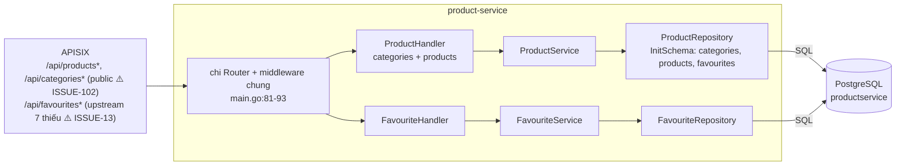

| Component | File | Trách nhiệm | Phụ thuộc |
| :--- | :--- | :--- | :--- |
| Wiring | `services/product-service/main.go:71-93` | Tạo 2 repo, 2 service, 2 handler; `InitSchema` | shared |
| `ProductHandler` | `services/product-service/internal/handler/product_handler.go:23-236` | Route `/product/api/...` và gốc; category (`:40-49`, `paging` = không phân trang — ISSUE-35), product (`:141-148`); trả mảng thô (ISSUE-48); 500 lộ `err.Error()` (ISSUE-93) | `ProductService` |
| `FavouriteHandler` | `services/product-service/internal/handler/favourite_handler.go:22-160` | Route `/favourite/api/favourites`, `/product/api/favourites`, `/api/favourites`; `user_id` lấy từ body/path, không từ token (ISSUE-56); GET/DELETE có body (ISSUE-35) | `FavouriteService` |
| `ProductService` | `services/product-service/internal/service/product_service.go:18-98` | Mỏng: chuyển tiếp CRUD, map not-found | `ProductRepository` |
| `FavouriteService` | `services/product-service/internal/service/favourite_service.go:14-32` | Chuyển tiếp CRUD favourites | `FavouriteRepository` |
| `ProductRepository` | `services/product-service/internal/repository/product_repo.go:26-322` | DDL 3 bảng (`:30-66`), JOIN product–category, ghi `categoryId` lồng nhau (ISSUE-60), `sku=''` (ISSUE-55) | PostgreSQL |
| `FavouriteRepository` | `services/product-service/internal/repository/favourite_repo.go:25-172` | Truy vấn/upsert/xóa favourites (PK 3 cột — ISSUE-74) | PostgreSQL |

## 3. order-service (Go · :8084)

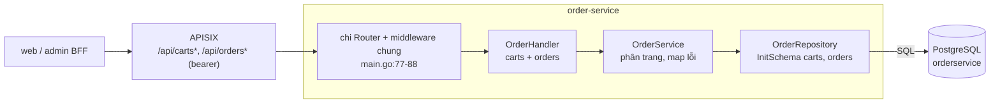

| Component | File | Trách nhiệm | Phụ thuộc |
| :--- | :--- | :--- | :--- |
| Wiring | `services/order-service/main.go:71-88` | Repo → service → handler; `KAFKA_SERVERS` có trong compose nhưng không dùng (ISSUE-37) | shared |
| `OrderHandler` | `services/order-service/internal/handler/order_handler.go:23-330` | Route kép `/api/...` và `/order/api/...`; cart (`:54-62`), order (`:187-196`); `GET /api/orders` trả **mọi đơn** không lọc user (ISSUE-49) | `OrderService` |
| `OrderService` | `services/order-service/internal/service/order_service.go:21-165` | CRUD cart/order, `FindAll*Paged` (không giới hạn `size`), tin `orderFee` client (ISSUE-21) | `OrderRepository` |
| `OrderRepository` | `services/order-service/internal/repository/order_repository.go:28-499` | DDL `carts`, `orders` (`:32-56`, không status — ISSUE-20); `SaveCart` nuốt lỗi (ISSUE-24); `COALESCE` chuỗi rỗng (ISSUE-59) | PostgreSQL |

## 4. payment-service (Go · :8085)

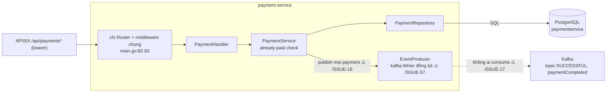

| Component | File | Trách nhiệm | Phụ thuộc |
| :--- | :--- | :--- | :--- |
| Wiring | `services/payment-service/main.go:71-93` | Repo, `EventProducer(KAFKA_SERVERS)`, service, handler | shared |
| `PaymentHandler` | `services/payment-service/internal/handler/payment_handler.go:23-183` | Route kép; `getOrder/{orderId}` stub; "already paid" → 404 (ISSUE-25) | `PaymentService` |
| `PaymentService` | `services/payment-service/internal/service/payment_service.go:23-138` | `Save` (`:87-117`): kiểm đơn đã trả, ghi DB, publish `KafkaPaymentDto` lên 2 topic, bỏ qua lỗi gửi | repo, producer |
| `EventProducer` | `services/payment-service/internal/service/kafka_producer.go:11-56` | `kafka.Writer` `RequireOne`, `WriteTimeout` 3 s; khi không có broker → log nội dung message và bỏ qua | Kafka |
| `PaymentRepository` | `services/payment-service/internal/repository/payment_repository.go:26-261` | DDL `payments` (`:30`), CRUD, `ExistsByOrderIdAndIsPayed` | PostgreSQL |
| Model | `services/payment-service/internal/model/payment.go:3-46` | `PaymentDto`, `KafkaPaymentDto` (không có `amount` — ISSUE-80) | — |

## 5. inventory-service (Go · :8082)

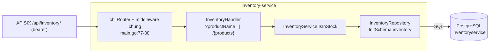

| Component | File | Trách nhiệm | Phụ thuộc |
| :--- | :--- | :--- | :--- |
| Wiring | `services/inventory-service/main.go:71-88` | Repo → service → handler | shared |
| `InventoryHandler` | `services/inventory-service/internal/handler/inventory_handler.go:20-74` | Route `/inventory/api/inventory`, `/api/inventory`; chỉ đọc; tham số `productName` (FE gửi `skuCode` — ISSUE-51) | `InventoryService` |
| `InventoryService` | `services/inventory-service/internal/service/inventory_service.go:14-40` | Map tên sản phẩm → còn hàng hay không | repo |
| `InventoryRepository` | `services/inventory-service/internal/repository/inventory_repo.go:20-62` | DDL `inventory` (`:24`), tra theo `product_name` (ISSUE-26) | PostgreSQL |

## 6. shipping-service (Go · :8087)

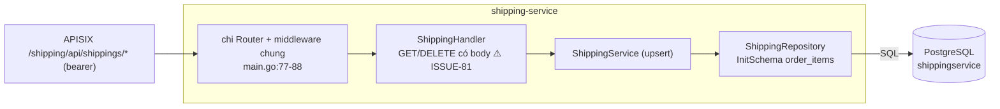

| Component | File | Trách nhiệm | Phụ thuộc |
| :--- | :--- | :--- | :--- |
| Wiring | `services/shipping-service/main.go:71-88` | Repo → service → handler | shared |
| `ShippingHandler` | `services/shipping-service/internal/handler/shipping_handler.go:22-165` | Route `/shipping/api/shippings`, `/api/shippings`; CRUD dòng hàng theo `(orderId, productId)` | `ShippingService` |
| `ShippingService` | `services/shipping-service/internal/service/shipping_service.go:18-51` | Save/Update đều upsert; không validate (ISSUE-81) | repo |
| `ShippingRepository` | `services/shipping-service/internal/repository/shipping_repo.go:24-134` | DDL `order_items` (`:28`), upsert, delete | PostgreSQL |

## 7. search-service (Go · :8094)

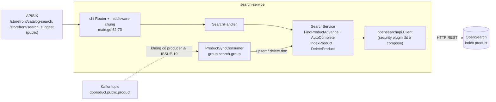

| Component | File | Trách nhiệm | Phụ thuộc |
| :--- | :--- | :--- | :--- |
| Wiring | `services/search-service/main.go:26-73` | Tạo OpenSearch client (`OPENSEARCH_*`), `SearchService`, handler; khởi động consumer nền với `PRODUCT_TOPIC_NAME` | shared |
| `SearchHandler` | `services/search-service/internal/handler/search_handler.go:16-94` | `GET /storefront/catalog-search`, `/storefront/search_suggest` (prefix `/search` và gốc) | `SearchService` |
| `SearchService` | `services/search-service/internal/service/search_service.go:20-274` | Query `bool` (should/must — ISSUE-58), suggest `match_phrase_prefix`, index/delete doc; lỗi OpenSearch → trang rỗng (ISSUE-34) | OpenSearch |
| `ProductSyncConsumer` | `services/search-service/internal/consumer/product_sync_consumer.go:14-87` | `kafka.Reader`, parse envelope Debezium (`op`, `before`, `after`), bỏ qua message lỗi; không xác thực nguồn message | Kafka, `SearchService` |
| Model | `services/search-service/internal/model/search.go:5-51` | `ProductDoc`, kết quả tìm kiếm | — |

## 8. promotion-service (Bun · :8093)

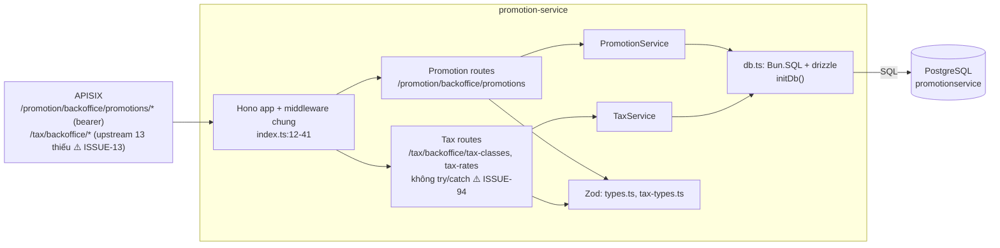

| Component | File | Trách nhiệm | Phụ thuộc |
| :--- | :--- | :--- | :--- |
| Hono app | `services/promotion-service/src/index.ts:12-41`, `:256-275` | Middleware, health (3 alias), mount `/promotion`, `/tax` và gốc | — |
| Promotion routes | `services/promotion-service/src/index.ts:47-128` | List/get/create/update/delete khuyến mãi | `PromotionService`, Zod |
| Tax routes | `services/promotion-service/src/index.ts:130-253` | CRUD tax class / tax rate, `tax-percent`, `location-based-batch` | `TaxService`, Zod |
| `PromotionService` | `services/promotion-service/src/service.ts:37-141` | Truy vấn có filter (bỏ qua ngày — ISSUE-30), tạo slug | `db` |
| `TaxService` | `services/promotion-service/src/tax-service.ts:41-232` | CRUD thuế, tính `tax-percent` theo `taxClassId`+`countryId` (ISSUE-31) | `db` |
| Zod schema | `services/promotion-service/src/types.ts:3-52`, `src/tax-types.ts:3-50` | Validate body (lỏng — ISSUE-62) | `zod` |
| `db.ts` / `schema.ts` | `services/promotion-service/src/db.ts:4-92`, `src/schema.ts:4-43` | Kết nối, DDL `promotion`, `tax_class`, `tax_rate` | PostgreSQL |

## 9. rating-service (Bun · :8089)

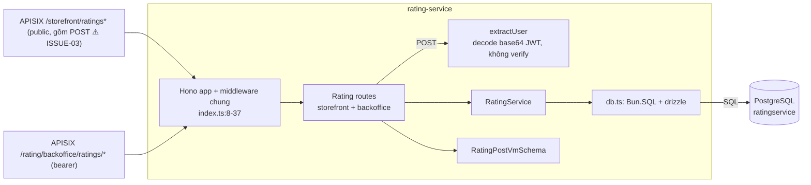

| Component | File | Trách nhiệm | Phụ thuộc |
| :--- | :--- | :--- | :--- |
| Hono app | `services/rating-service/src/index.ts:8-37`, `:150-164` | Middleware, health, mount `/rating` và gốc | — |
| `extractUser` | `services/rating-service/src/index.ts:39-58` | Lấy `sub`, `given_name`/`name`, `family_name` từ payload token không verify; mặc định `anonymous`/`Customer` | — |
| Rating routes | `services/rating-service/src/index.ts:60-148` | Backoffice filter + delete; storefront list theo sản phẩm (trả `createdBy`, họ tên), create, average-star | `RatingService` |
| `RatingService` | `services/rating-service/src/service.ts:21-145` | Phân trang (không giới hạn `pageSize`), filter theo tên sản phẩm/khách, tính trung bình | `db` |
| Zod / types | `services/rating-service/src/types.ts:3-34` | `star` 1–5, `content`, `productId`, `productName` | `zod` |
| `db.ts` / `schema.ts` | `services/rating-service/src/db.ts:4-67`, `src/schema.ts:4-16` | Kết nối, DDL `rating` | PostgreSQL |

## 10. media-service (Bun · :8083)

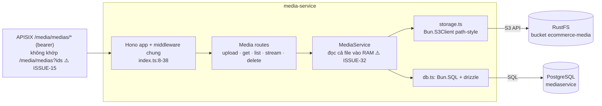

| Component | File | Trách nhiệm | Phụ thuộc |
| :--- | :--- | :--- | :--- |
| Hono app | `services/media-service/src/index.ts:8-38`, `:133-148` | Middleware, health (luôn UP cả `storage`), mount `/media` và gốc; `initStorage()` lúc khởi động | — |
| Media routes | `services/media-service/src/index.ts:40-131` | `POST /medias` (multipart `multipartFile`/`file`), `GET /medias/:id`, `GET /medias?ids=`, `GET /medias/:id/file/:fileName` (stream, `Content-Disposition: attachment`), `DELETE /medias/:id` | `MediaService` |
| `MediaService` | `services/media-service/src/service.ts:32-119` | Sinh object key `<uuid>-<tên an toàn>`, ghi S3 rồi DB (không bù trừ — ISSUE-65f), build URL từ `PUBLIC_URL` (ISSUE-63) | storage, `db` |
| `storage.ts` | `services/media-service/src/storage.ts:1-51` | `S3Client` (`STORAGE_*`, có default credential trong code — ISSUE-135), write/unlink/exists/stream | RustFS |
| `db.ts` / `schema.ts` | `services/media-service/src/db.ts:4-61`, `src/schema.ts:4-10` | DDL `media` | PostgreSQL |

## 11. notification-service (Bun · :8090)

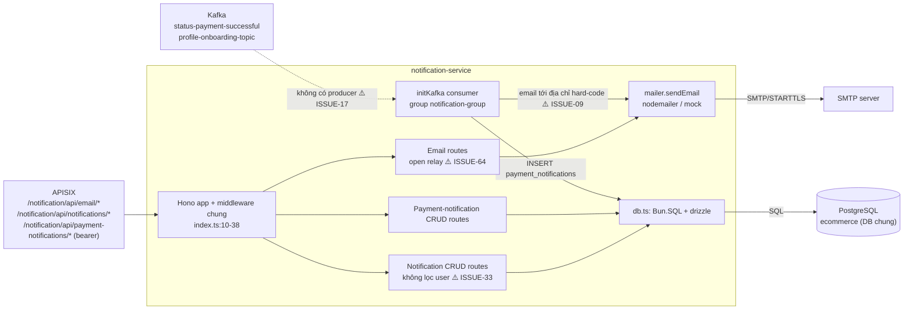

| Component | File | Trách nhiệm | Phụ thuộc |
| :--- | :--- | :--- | :--- |
| Hono app | `services/notification-service/src/index.ts:10-38`, `:188-203` | Middleware, health, mount `/notification` và gốc; `initDb()` rồi `initKafka()` | — |
| Email routes | `services/notification-service/src/index.ts:42-72` | `sendSimpleMail`, `sendMailWithAttachment` (bỏ qua file), `sendMail?to&subject&body` → gửi tới người nhận tùy ý | `mailer` |
| Notification routes | `services/notification-service/src/index.ts:75-122` | List (mọi user), get, create, delete | `db` |
| Payment-notification routes | `services/notification-service/src/index.ts:125-185` | List, get/delete theo `paymentId OR id` (ISSUE-65g), create | `db` |
| `initKafka` | `services/notification-service/src/kafka.ts:10-65` | kafkajs consumer; log toàn bộ payload (`:31`); onboarding → email; payment → insert + email | Kafka, `db`, `mailer` |
| `mailer` | `services/notification-service/src/mailer.ts:1-47` | Tạo transporter khi có `MAIL_USERNAME`/`MAIL_PASSWORD`; không có → mock; log người nhận (`:28`) | SMTP |
| `db.ts` / `schema.ts` | `services/notification-service/src/db.ts:4-75`, `src/schema.ts:4-23` | DDL `notifications`, `payment_notifications` | PostgreSQL `ecommerce` |

---

## 12. web — Storefront (SvelteKit BFF · :3000)

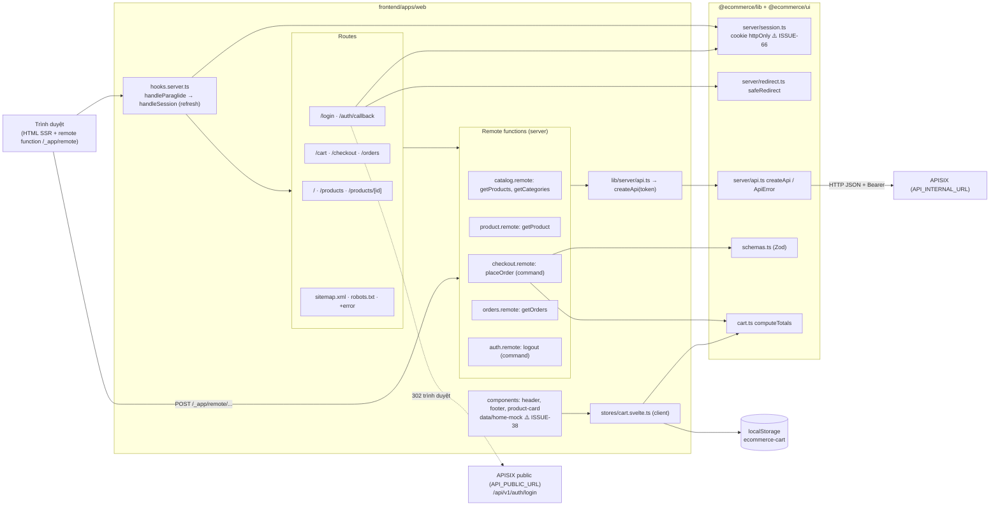

| Component | File | Trách nhiệm | Phụ thuộc |
| :--- | :--- | :--- | :--- |
| `hooks.server.ts` | `frontend/apps/web/src/hooks.server.ts:14-53` | Paraglide locale; `handleSession` đọc `session_user`, refresh khi access token gần hết hạn, gán `locals.user` | `@ecommerce/lib/server` |
| Login | `frontend/apps/web/src/routes/login/+page.server.ts:9-27` | Lưu `auth_redirect` (10'), dựng `ssoUrl` tới gateway public | `safeRedirect`, `apiPublicUrl` |
| Callback | `frontend/apps/web/src/routes/auth/callback/+page.server.ts:10-40` | Đổi ticket → token, gọi `/users/me`, `setSession`, 303 về đích (ISSUE-67) | `createApi`, session |
| Guard trang | `frontend/apps/web/src/routes/checkout/+page.server.ts:5-10`, `routes/orders/+page.server.ts:5-10` | Chưa đăng nhập → `/login?redirect=` | `locals.user` |
| `catalog.remote` / `product.remote` | `frontend/apps/web/src/routes/products/catalog.remote.ts:13-17`, `routes/products/[id]/product.remote.ts:5` | Query catalog/chi tiết (đọc `.content` — ISSUE-48) | `api()` |
| `checkout.remote.placeOrder` | `frontend/apps/web/src/routes/checkout/checkout.remote.ts:13-44` | Validate, đọc lại giá, tạo order rồi payment (không giao dịch — ISSUE-23); địa chỉ không lưu (ISSUE-22) | `createApi`, `computeTotals`, `checkoutSchema` |
| `orders.remote.getOrders` | `frontend/apps/web/src/routes/orders/orders.remote.ts:6-7` | Danh sách đơn (thực tế mọi đơn — ISSUE-49) | `api()` |
| `auth.remote.logout` | `frontend/apps/web/src/lib/remote/auth.remote.ts:6-19` | Gọi logout best-effort, xóa cookie | `createApi` |
| `api()` | `frontend/apps/web/src/lib/server/api.ts:10-13` | Client theo request, gắn access token từ cookie | `createApi` |
| `CartStore` | `frontend/apps/web/src/lib/stores/cart.svelte.ts:4-91` | Giỏ client-side, persist `localStorage` | `computeTotals` |
| UI components | `frontend/apps/web/src/lib/components/{header,footer,product-card}.svelte`, `src/lib/data/home-mock.ts` | Điều hướng, tìm kiếm (gửi tới product-service — ISSUE-78), card sản phẩm | `@ecommerce/ui` |
| Sitemap | `frontend/apps/web/src/routes/sitemap.xml/+server.ts:7-21` | Sitemap tĩnh `/`, `/products` theo locale | Paraglide |
| `createApi` / `ApiError` | `frontend/packages/lib/src/server/api.ts:18-160` | `fetch` tới gateway (không timeout), gắn `authorization`, ném `ApiError` | `env.ts` |
| Session | `frontend/packages/lib/src/server/session.ts:4-91` | Cookie `access_token`, `refresh_token`, `session_user` (JSON không ký — ISSUE-66), `session_expires`; `isAdmin`, `shouldRefresh` | SvelteKit `Cookies` |
| `safeRedirect` | `frontend/packages/lib/src/server/redirect.ts:2-5` | Chỉ nhận path bắt đầu `/` và không `//` (chưa chặn `/\` — ISSUE-130) | — |
| `env.ts` | `frontend/packages/lib/src/server/env.ts:11-27` | `API_INTERNAL_URL`, `API_PUBLIC_URL` | `process.env` |

## 13. admin — Backoffice (SvelteKit BFF · :3001)

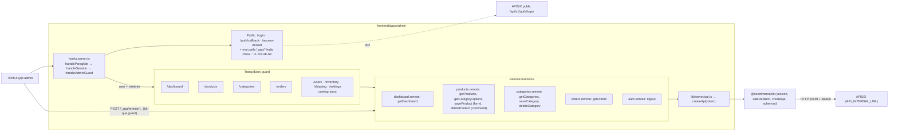

| Component | File | Trách nhiệm | Phụ thuộc |
| :--- | :--- | :--- | :--- |
| `hooks.server.ts` | `frontend/apps/admin/src/hooks.server.ts:16-79` | Như web + `handleAdminGuard` (`:58-77`): không user → `/login`, không `ADMIN`/`ROLE_ADMIN` → `/access-denied`; miễn guard cho `/_app/*` và path có `.` (ISSUE-68) | `isAdmin`, `session` |
| Root redirect | `frontend/apps/admin/src/routes/+page.server.ts:5-7` | `/` → `/dashboard` | — |
| Login / callback | `frontend/apps/admin/src/routes/login/+page.server.ts`, `routes/auth/callback/+page.server.ts` | Giống web; role lấy từ profile (luôn rỗng — ISSUE-100) | `@ecommerce/lib/server` |
| `dashboard.remote` | `frontend/apps/admin/src/routes/dashboard/dashboard.remote.ts:9-24` | Đếm qua `totalElements` của 3 endpoint list (ISSUE-48) | `api()` |
| `products.remote` | `frontend/apps/admin/src/routes/products/products.remote.ts:6-37` | List, options danh mục, upsert (gửi `categoryId` phẳng — ISSUE-60), delete; **không tự kiểm role** | `api()`, Zod |
| `categories.remote` | `frontend/apps/admin/src/routes/categories/categories.remote.ts:6-24` | List, upsert, delete | `api()` |
| `orders.remote` | `frontend/apps/admin/src/routes/orders/orders.remote.ts:5-6` | List đơn | `api()` |
| Placeholder | `frontend/apps/admin/src/lib/components/coming-soon.svelte`; `routes/{users,inventory,shipping,settings}/+page.svelte` | Chưa có chức năng (FEAT-26) | — |
| `api()` | `frontend/apps/admin/src/lib/server/api.ts:8-11` | Client theo request | `createApi` |

---

## 14. Tổng hợp phụ thuộc giữa component và container ngoài

| Container ngoài | Component gọi tới | Giao thức |
| :--- | :--- | :--- |
| Keycloak | `KeycloakClient` (auth-service); APISIX `openid-connect`; trình duyệt (redirect) | OIDC / Admin REST |
| PostgreSQL | Mọi `*Repository` Go, mọi `db.ts` Bun | SQL (một user chung) |
| Kafka | `EventProducer` (payment), `ProductSyncConsumer` (search), `initKafka` (notification) | Kafka PLAINTEXT |
| OpenSearch | `SearchService` | HTTP REST |
| RustFS | `storage.ts` (media) | S3 API |
| SMTP | `mailer` (notification) | SMTP |
| APISIX | `createApi` (web/admin BFF) | HTTP JSON |

Nhận xét kiến trúc ở mức component:

1. **Service Go là "CRUD mỏng"**: lớp `service` hầu như chỉ chuyển tiếp sang repository; quy tắc nghiệp vụ (tính tổng, điều phối) nằm ở BFF (`checkout.remote.ts`).
2. **Không component nào thực thi phân quyền** ở backend; `UserClaims` và `extractUser` chỉ đọc danh tính chưa xác minh (ISSUE-01, ISSUE-02, ISSUE-03).
3. **Component tích hợp bất đồng bộ tồn tại nhưng không nối với nhau** (producer/consumer lệch topic) — ISSUE-17, ISSUE-19.
4. **Store trạng thái trong bộ nhớ** duy nhất ở backend là `SsoSessionStore` (ISSUE-06, ISSUE-131).
