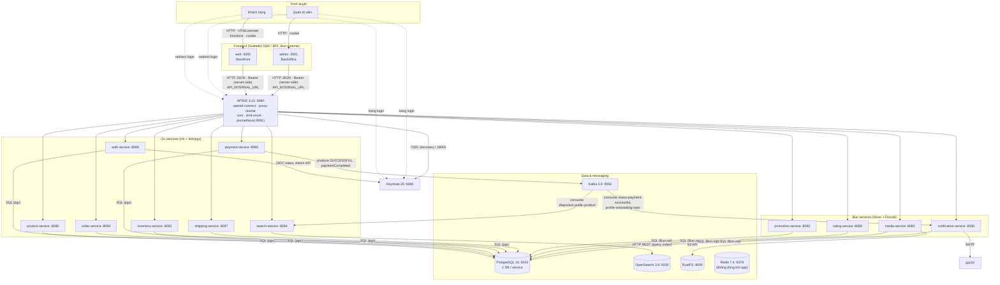

# Container View (C4 — Level 2)

> **Phiên bản:** 1.0 · **Trạng thái:** Final · **Cập nhật:** 2026-11-12 · **Phạm vi:** Ứng dụng (as-is)

> Mỗi hộp là một **tiến trình/container chạy độc lập**. Mũi tên ghi dữ liệu và giao thức. Phản ánh `docker-compose.yml`, `deploy/apisix/apisix.yaml` và code hiện tại.

## 1. Sơ đồ container

**Không có lời gọi HTTP đồng bộ giữa các service backend.** Mọi điều phối nhiều service (vd checkout tạo order rồi payment) được thực hiện bởi **BFF SvelteKit**.

## 2. Danh mục container

| Container | Công nghệ | Port | Trách nhiệm | Dữ liệu sở hữu | Gọi tới | Tài liệu |
| :--- | :--- | :---: | :--- | :--- | :--- | :--- |
| web | SvelteKit 3 / Bun | 3000 | Storefront SSR, BFF, giỏ hàng client | Cookie phiên, `localStorage` giỏ | APISIX | [frontend-web](../../03-services/frontend-web.md) |
| admin | SvelteKit 3 / Bun | 3001 | Backoffice SSR, BFF, admin guard | Cookie phiên | APISIX | [frontend-admin](../../03-services/frontend-admin.md) |
| APISIX | Apache APISIX 3.15 | 9080, 9091 | Điểm vào API, xác thực JWT, rewrite path, CORS, rate limit, metrics | — | Service, Keycloak | [gateway-routing](../../05-api/gateway-routing.md) |
| auth-service | Go | 8088 | SSO, đăng ký, user, role | DB `authservice` | Keycloak | [auth-service](../../03-services/auth-service.md) |
| product-service | Go | 8086 | Danh mục, sản phẩm, yêu thích | DB `productservice` | — | [product-service](../../03-services/product-service.md) |
| order-service | Go | 8084 | Cart, order | DB `orderservice` | — | [order-service](../../03-services/order-service.md) |
| payment-service | Go | 8085 | Bản ghi thanh toán, sự kiện | DB `paymentservice` | Kafka | [payment-service](../../03-services/payment-service.md) |
| inventory-service | Go | 8082 | Tra tồn kho | DB `inventoryservice` | — | [inventory-service](../../03-services/inventory-service.md) |
| shipping-service | Go | 8087 | Dòng hàng | DB `shippingservice` | — | [shipping-service](../../03-services/shipping-service.md) |
| search-service | Go | 8094 | Tìm kiếm, gợi ý, đồng bộ index | Index OpenSearch `product` | OpenSearch, Kafka | [search-service](../../03-services/search-service.md) |
| promotion-service | Bun | 8093 | Khuyến mãi, thuế | DB `promotionservice` | — | [promotion-service](../../03-services/promotion-service.md) |
| rating-service | Bun | 8089 | Đánh giá | DB `ratingservice` | — | [rating-service](../../03-services/rating-service.md) |
| media-service | Bun | 8083 | File media | DB `mediaservice`, bucket `ecommerce-media` | S3 | [media-service](../../03-services/media-service.md) |
| notification-service | Bun | 8090 | Email, thông báo | DB `ecommerce` | Kafka, SMTP | [notification-service](../../03-services/notification-service.md) |
| PostgreSQL | 16 | 5432 | Lưu trữ quan hệ | 12 database + `ecommerce` | — | [data-architecture](data-architecture.md) |
| Kafka | 3.9 KRaft | 9092 | Message broker | Topic | — | [integration-messaging](integration-messaging.md) |
| OpenSearch | 3.9 | 9200 | Full-text search | Index `product` | — | [search-service](../../03-services/search-service.md) |
| RustFS | latest | 9000/9001 | Object storage | Bucket | — | [media-service](../../03-services/media-service.md) |
| Keycloak | 26.0 | 8080 | IdP | Realm `ecommerce` (DB `keycloak`) | PostgreSQL | [security-architecture](security-architecture.md) |
| Redis | 7.4 | 6379 | (Dự phòng) | — | — | Không dùng bởi app |

## 3. Kiểu giao tiếp

| Loại | Từ → Tới | Giao thức | Định dạng | Ghi chú |
| :--- | :--- | :--- | :--- | :--- |
| Trình duyệt ↔ BFF | Browser → web/admin | HTTP | HTML (SSR), JSON (remote function), form POST | Cookie `httpOnly` |
| BFF → Gateway | web/admin → APISIX | HTTP | JSON | `Authorization: Bearer <access_token>` gắn phía server; base URL `API_INTERNAL_URL` |
| Gateway → Service | APISIX → service | HTTP | JSON | Path được rewrite (vd `/api/products` → `/product/api/products`) |
| Service → DB | service → PostgreSQL | TCP (pg wire) | SQL | Mỗi service một DB |
| Async | payment → Kafka → notification; Kafka → search | Kafka | JSON | Hiện không có luồng nào khớp đầu-cuối (ISSUE-17, ISSUE-19) |
| Service → Keycloak | auth-service | HTTP | form-urlencoded / JSON | Token endpoint, Admin API |

## 4. Điểm đáng chú ý của kiến trúc hiện tại

1. **BFF là orchestrator duy nhất** — checkout gọi tuần tự product → order → payment từ server SvelteKit; không có saga/transaction phân tán.
2. **Gateway là lớp bảo vệ duy nhất** — service không xác minh token (ISSUE-02), không kiểm role (ISSUE-01).
3. **Mỗi service độc lập dữ liệu** — không gọi nhau, không join chéo; hệ quả: tồn kho (`products.quantity` vs `inventory`) và order item (order-service vs shipping-service) bị phân mảnh.
4. **Hai stack backend** — Go cho service lõi, Bun cho service phụ trợ; dùng chung PostgreSQL nhưng không dùng chung code.

Xem thêm: [ADR](../adr/README.md), [runtime-flows.md](runtime-flows.md).
