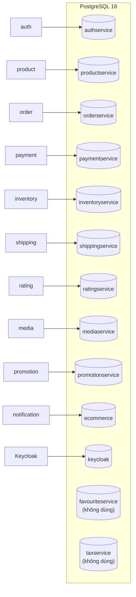
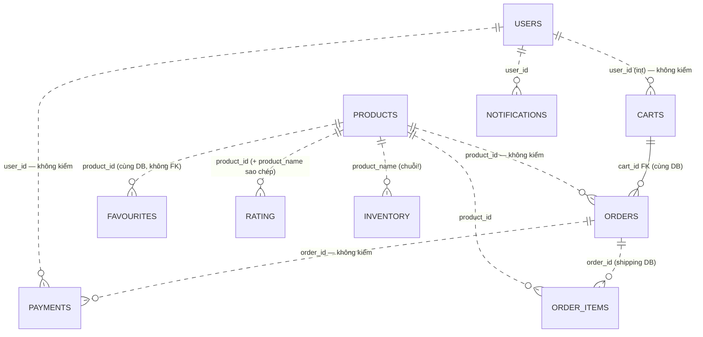

# Data Architecture

> **Phiên bản:** 1.0 · **Trạng thái:** Final · **Cập nhật:** 2026-11-12 · **Phạm vi:** Ứng dụng (as-is)

> Chiến lược dữ liệu, quyền sở hữu và vòng đời schema. Chi tiết từng cột: [data-dictionary.md](../../06-data/data-dictionary.md).

## 1. Mô hình: Database-per-service trên một PostgreSQL instance

- Một container `postgres:16` (`docker-compose.yml`), các database được tạo bởi `deploy/postgres/init/create-all-databases.sql` khi khởi tạo volume.
- Mỗi service kết nối **đúng một database** qua `SPRING_DATASOURCE_URL` (JDBC URL được parse lấy host/port/db) hoặc `DATABASE_URL` / `POSTGRES_*`.
- **Cùng một user PostgreSQL** (`POSTGRES_USER`) cho mọi service → về kỹ thuật service có thể đọc DB của service khác; ranh giới chỉ là quy ước.

## 2. Quyền sở hữu dữ liệu

| Domain | Service sở hữu | Database | Bảng | Kho phụ |
| :--- | :--- | :--- | :--- | :--- |
| Người dùng & vai trò | auth-service | `authservice` | `users`, `roles`, `user_role` | Keycloak (user, credential) |
| Catalog | product-service | `productservice` | `categories`, `products` | OpenSearch index `product` (search-service, chỉ đọc) |
| Yêu thích | product-service | `productservice` | `favourites` | — |
| Giỏ / đơn | order-service | `orderservice` | `carts`, `orders` | Giỏ client `localStorage` (web) |
| Thanh toán | payment-service | `paymentservice` | `payments` | — |
| Tồn kho | inventory-service | `inventoryservice` | `inventory` | `products.quantity` (trùng lặp — ISSUE-26) |
| Dòng hàng | shipping-service | `shippingservice` | `order_items` | — |
| Khuyến mãi & thuế | promotion-service | `promotionservice` | `promotion`, `tax_class`, `tax_rate` | — |
| Đánh giá | rating-service | `ratingservice` | `rating` | — |
| Media | media-service | `mediaservice` | `media` | RustFS bucket `ecommerce-media` |
| Thông báo | notification-service | `ecommerce` | `notifications`, `payment_notifications` | — |

## 3. Tham chiếu giữa các domain (logical foreign keys)

Không có FK xuyên DB; các ID tham chiếu được lưu dạng số nguyên/chuỗi và **không được kiểm tra tồn tại**.

Đường liền = FK thật trong cùng DB; đường chấm = tham chiếu logic.

**Lưu ý định danh người dùng:** token Keycloak có `sub` dạng UUID; các bảng `carts.user_id`, `payments.user_id`, `favourites.user_id` dùng **số nguyên**; rating lưu `created_by` = `sub`. Không có ánh xạ thống nhất giữa các định danh này.

## 4. Vòng đời schema

| Khía cạnh | Hiện trạng |
| :--- | :--- |
| Tạo schema | Lúc khởi động: Go `repository.InitSchema` / Bun `initDb()` chạy `CREATE TABLE IF NOT EXISTS` |
| Migration / versioning | Không có (không Flyway/goose/drizzle-kit migrate) — ISSUE-28 |
| Seed dữ liệu | Chỉ `roles` (USER, PM, ADMIN) ở auth-service; không seed sản phẩm |
| Lỗi tạo bảng | Chỉ log warning, service vẫn chạy |
| Xóa dữ liệu | Hard delete ở mọi service; `carts → orders` ON DELETE CASCADE; `users → user_role` CASCADE |
| Audit | Một số bảng có `created_at/updated_at` hoặc `created_by/created_on/last_modified_*` (promotion, rating) |

## 5. Kiểu dữ liệu đáng chú ý

| Khía cạnh | Hiện trạng | Issue |
| :--- | :--- | :--- |
| Khóa chính | `SERIAL`/`BIGSERIAL`/identity integer; favourites, order_items dùng khóa ghép | — |
| Tiền | `DECIMAL(12,2)` (products), `DOUBLE PRECISION` (orders.order_fee), `NUMERIC` (payment_notifications.amount), `BIGINT` (promotion discount); Go dùng `float64` | ISSUE-27 |
| Enum | Chuỗi tự do (`payment_status`, `discount_type`, `usage_type`, `apply_to`, notification `type/status`) | ISSUE-30 |
| Thời gian | `TIMESTAMP`/`TIMESTAMPTZ` lẫn lộn | — |

## 6. Dữ liệu ngoài PostgreSQL

| Kho | Dữ liệu | Ghi bởi | Đọc bởi |
| :--- | :--- | :--- | :--- |
| OpenSearch index `product` | `ProductDoc` (id, name, slug, price, isPublished, brand, categories, attributes, createdOn…) | search-service consumer | search-service |
| RustFS bucket `ecommerce-media` | Binary file, key `<uuid>-<tên file an toàn>` | media-service | media-service (stream) |
| Keycloak (DB `keycloak`) | User, credential, session | Keycloak | Keycloak |
| `localStorage` trình duyệt | Giỏ hàng `{state:{items}, version:0}` | web | web |
| Cookie trình duyệt | Phiên | web/admin BFF | web/admin BFF |
| Bộ nhớ auth-service | SSO state, ticket | auth-service | auth-service |
