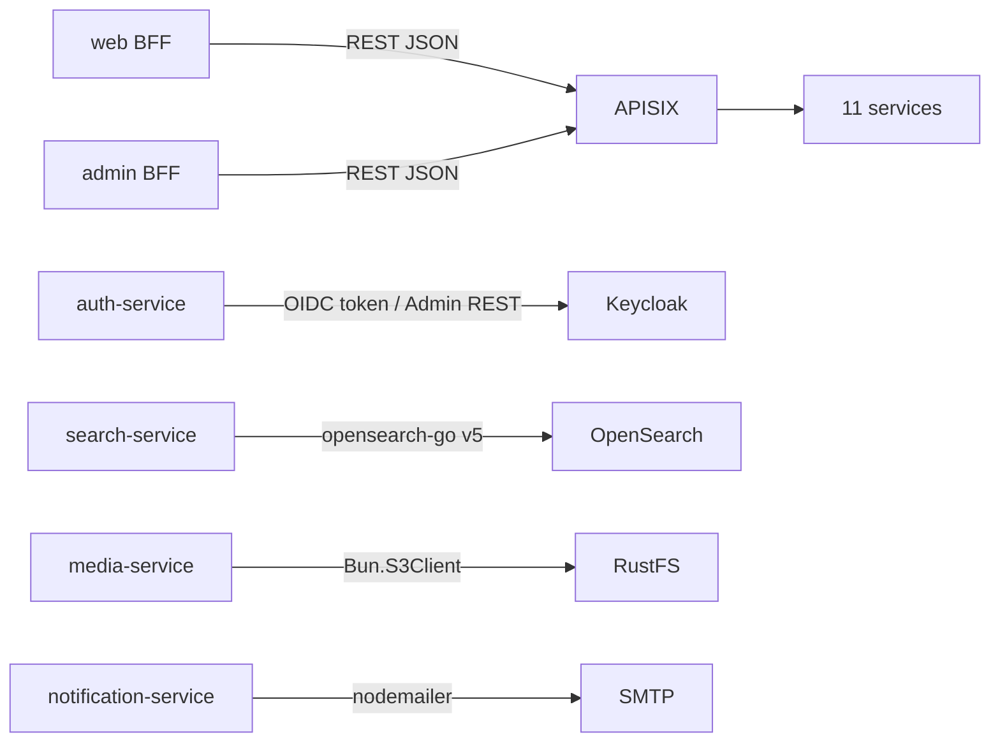
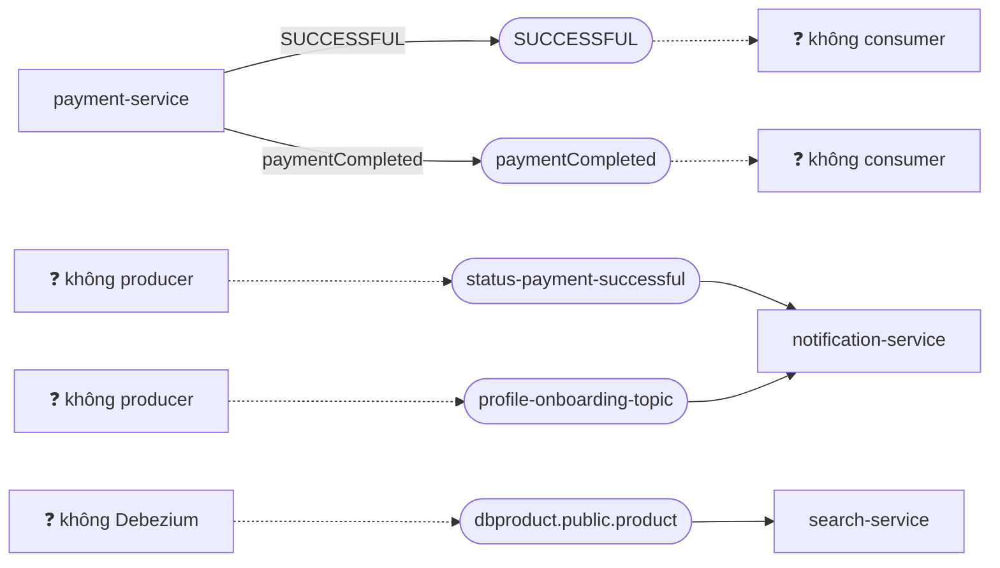

# Integration & Messaging

> **Phiên bản:** 1.0 · **Trạng thái:** Final · **Cập nhật:** 2026-11-12 · **Phạm vi:** Ứng dụng (as-is)

> Mô tả mọi kênh tích hợp giữa các thành phần: đồng bộ (HTTP) và bất đồng bộ (Kafka). Theo code hiện tại.

## 1. Nguyên tắc tích hợp hiện hành

| # | Nguyên tắc (quan sát từ code) | Bằng chứng |
| :--- | :--- | :--- |
| I-1 | **Không có service-to-service HTTP**. Không service backend nào gọi HTTP sang service khác. | Không có HTTP client nội bộ trong `services/*/internal` hay `services/*/src` (ngoại trừ gọi Keycloak, OpenSearch, S3, SMTP). |
| I-2 | **BFF điều phối** các thao tác nhiều bước. | `frontend/apps/web/src/routes/checkout/checkout.remote.ts` gọi product → order → payment. |
| I-3 | **Kafka cho sự kiện** giữa service; payload JSON; không có schema registry. | payment-service (producer), search-service & notification-service (consumer). |
| I-4 | **Gateway là cửa vào duy nhất** cho client. | `deploy/apisix/apisix.yaml` (compose vẫn publish port service — xem [security](security-architecture.md)). |

## 2. Tích hợp đồng bộ

| Nguồn | Đích | Mục đích | Timeout / retry | Xử lý lỗi |
| :--- | :--- | :--- | :--- | :--- |
| web/admin BFF | APISIX | Mọi API | `fetch` mặc định, không retry | `ApiError(status, message, body)`; message lấy từ `body.message` nếu có |
| auth-service | Keycloak token endpoint | authorization_code, refresh_token, logout | HTTP client Go | Lỗi đổi code → **mock token** (ISSUE-04); refresh lỗi → 401 |
| auth-service | Keycloak Admin API | Tạo / xóa user | — | Không kết nối được → id giả `kc-<username>` (ISSUE-08) |
| search-service | OpenSearch | Search, suggest, index, delete | — | Lỗi search → trang rỗng (ISSUE-34) |
| media-service | RustFS | put/get/delete object | — | Lỗi delete chỉ log |
| notification-service | SMTP | Gửi mail | — | Không có credential → mock "Mail Sent Successfully (Mock)" |

## 3. Tích hợp bất đồng bộ (Kafka)

### 3.1 Cấu hình broker

| Thuộc tính | Giá trị (compose) |
| :--- | :--- |
| Image | `apache/kafka:3.9.0` (KRaft, 1 node broker+controller) |
| Listener | `PLAINTEXT://kafka:9092` |
| Replication | 1 (offsets, transaction log) |
| Auto-create topic | Broker mặc định cho phép, nhưng `kafka.Writer` của `segmentio/kafka-go` **không yêu cầu** auto-create (`AllowAutoTopicCreation=false`) → publish của payment-service có thể lỗi "Unknown Topic" và bị nuốt (ISSUE-57). Không có bước tạo topic trong compose. |
| Biến môi trường ứng dụng | `KAFKA_SERVERS` |

### 3.2 Bảng topic

| Topic | Producer | Consumer | Payload | Trạng thái |
| :--- | :--- | :--- | :--- | :--- |
| `SUCCESSFUL` | payment-service (`segmentio/kafka-go`) | — | `{paymentId, isPayed, paymentStatus, orderId, userId}` | ⚠️ Không ai consume |
| `paymentCompleted` | payment-service | — | như trên | ⚠️ Không ai consume |
| `status-payment-successful` | — | notification-service (`kafkajs`, group `PAYMENT_KAFKA_CONSUMER_GROUP_ID` mặc định `notification-group`) | `{paymentId, userId, orderId, amount, isPayed, paymentStatus}` | ⚠️ Không ai produce |
| `profile-onboarding-topic` | — | notification-service | `{recipient\|email, subject, msgBody}` | ⚠️ Không ai produce |
| `dbproduct.public.product` (`PRODUCT_TOPIC_NAME`) | (dự kiến Debezium — không có trong repo) | search-service (`segmentio/kafka-go`, group `search-group`) | Debezium envelope `{op, before:{id}, after:{id,name,slug,price}}` | ⚠️ Không có producer; schema lệch bảng `products` |

Nguồn: `services/payment-service/internal/service/payment_service.go:18-21,108-118`, `services/notification-service/src/kafka.ts:23`, `services/search-service/internal/consumer/product_sync_consumer.go`.

### 3.3 Ngữ nghĩa giao nhận

| Khía cạnh | Hiện trạng |
| :--- | :--- |
| Thời điểm publish | payment-service publish **sau mỗi lần tạo payment thành công**, bất kể `paymentStatus` (ISSUE-18) |
| Đảm bảo giao | Fire-and-forget; lỗi gửi bị bỏ qua; không outbox → có thể mất sự kiện |
| Idempotency consumer | Không có; notification insert mới mỗi message |
| Thứ tự | Không xử lý |
| Bắt đầu đọc | notification: `fromBeginning: false` |
| Lỗi xử lý message | Log và bỏ qua (cả notification và search) |
| Khởi động khi Kafka down | notification: tiếp tục chạy không Kafka; search: consumer chạy nền |

### 3.4 Hệ quả

Hiện **không có luồng sự kiện nào hoạt động đầu-cuối**. Các khắc phục đề xuất: [ISSUE-17](../../07-plan/known-issues-tech-debt.md#3-messaging-kafka), [ISSUE-18](../../07-plan/known-issues-tech-debt.md#3-messaging-kafka), [ISSUE-19](../../07-plan/known-issues-tech-debt.md#3-messaging-kafka) và giai đoạn P3 trong [project-plan.md](../../07-plan/project-plan.md).

## 4. Hợp đồng HTTP Frontend ↔ Backend

Danh sách endpoint frontend gọi và các điểm lệch hợp đồng: [api-catalog.md](../../05-api/api-catalog.md). Tóm tắt các lệch quan trọng:

| Endpoint | Frontend mong đợi | Backend trả | Issue |
| :--- | :--- | :--- | :--- |
| `GET /api/products`, `/api/categories`, `/api/orders` | `Page<T>` + filter | Mảng thô, bỏ qua query | ISSUE-48 |
| `GET /api/orders` | Đơn của user hiện tại | Tất cả đơn | ISSUE-49 |
| `GET /api/v1/users/me` | `{fullName, roles:[{id,name}]}` | `{fullname, …}` không roles | ISSUE-100 |
| `GET /api/inventory` | `?skuCode=` | `?productName=` | ISSUE-51 |
