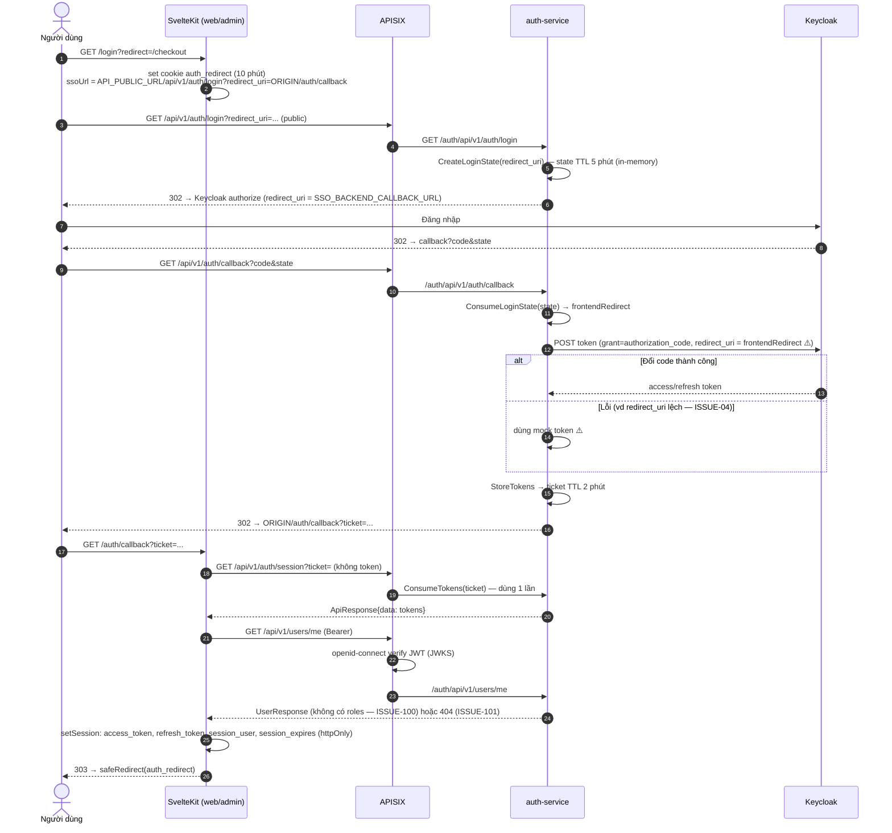
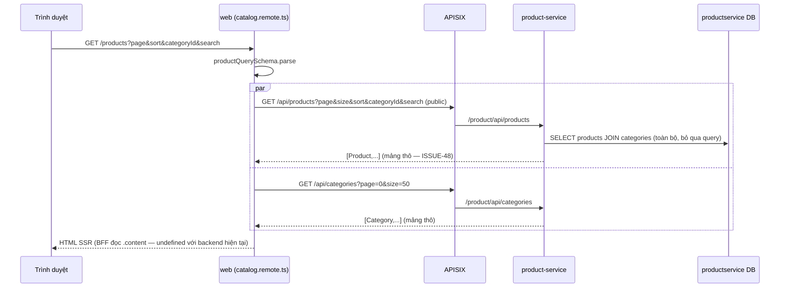
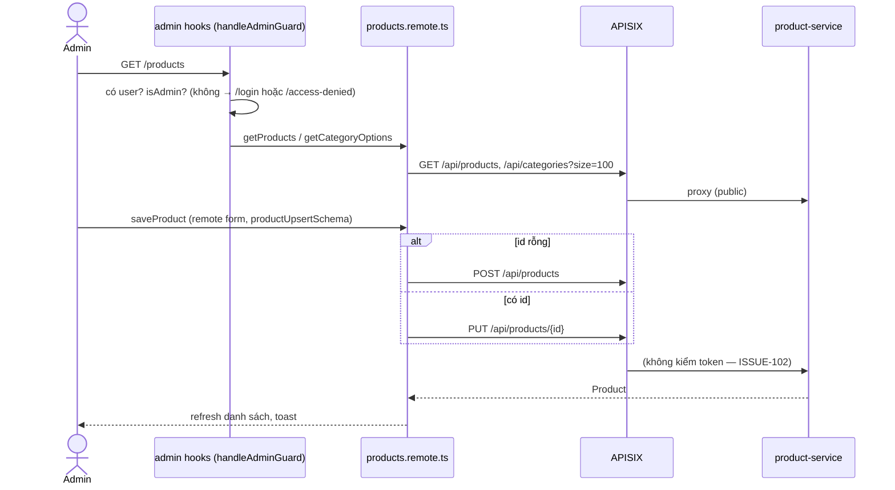
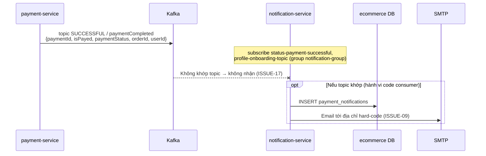
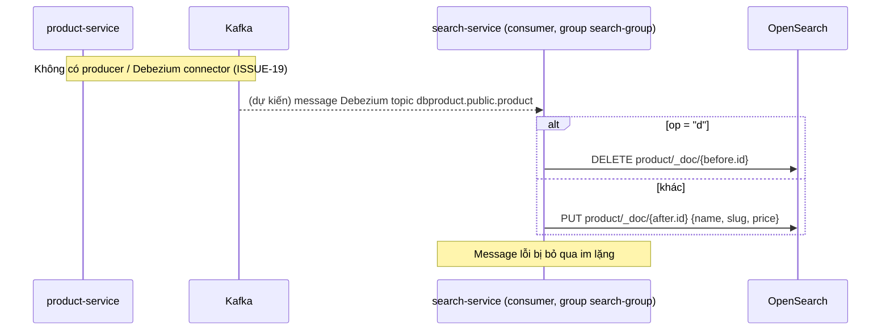

# Runtime Flows

> **Phiên bản:** 1.0 · **Trạng thái:** Final · **Cập nhật:** 2026-11-12 · **Phạm vi:** Ứng dụng (as-is)

> Sequence diagram cho các luồng có ý nghĩa kiến trúc, theo code hiện tại. Đường dẫn ghi theo **phía gateway** (`/api/...`) và phía service sau rewrite khi cần. Chi tiết nghiệp vụ nằm ở tài liệu FEAT tương ứng.

## RF-01 — Đăng nhập SSO (ticket exchange)

Tài liệu tính năng: [FEAT-01](../../04-features/FEAT-01-sso-login-logout.md).



## RF-02 — Làm mới phiên trên mỗi request

Tài liệu: [FEAT-03](../../04-features/FEAT-03-session-refresh.md).

```mermaid
sequenceDiagram
    participant U as Trình duyệt
    participant H as hooks.server.ts (handleSession)
    participant GW as APISIX → auth-service
    participant KC as Keycloak
    U->>H: Bất kỳ request
    H->>H: session(cookies); shouldRefresh? (không có access token hoặc còn < 30s)
    alt Cần refresh và có refresh_token
        H->>GW: POST /api/v1/auth/refresh {refreshToken}
        GW->>KC: grant=refresh_token
        alt Thành công
            KC-->>H: token mới
            H->>H: setSession(tokens) — giữ nguyên session_user
        else Lỗi
            H->>H: clearSession → locals.user = null (guest)
        end
    end
    H->>U: tiếp tục xử lý route với locals.user
```

## RF-03 — Duyệt catalog (SSR + remote query)

Tài liệu: [FEAT-06](../../04-features/FEAT-06-product-catalog.md).



## RF-04 — Checkout / đặt hàng

Tài liệu: [FEAT-09](../../04-features/FEAT-09-checkout-place-order.md).

```mermaid
sequenceDiagram
    autonumber
    actor C as Customer
    participant BFF as web (checkout.remote.ts placeOrder)
    participant GW as APISIX
    participant P as product-service
    participant O as order-service
    participant PAY as payment-service
    participant K as Kafka

    C->>BFF: placeOrder({shipping, paymentMethod, items[]})
    BFF->>BFF: checkoutSchema.parse; có access_token? (không → 401)
    loop mỗi dòng giỏ
        BFF->>GW: GET /api/products/{id}
        GW->>P: lấy giá thật
        P-->>BFF: Product
    end
    BFF->>BFF: computeTotals(lines) → subtotal, shippingFee, total
    BFF->>GW: POST /api/orders {orderDate, orderDesc, orderFee: total, productId: dòng đầu tiên}
    GW->>O: INSERT orders
    O-->>BFF: Order{orderId}
    BFF->>GW: POST /api/payments {orderId, isPayed: method≠COD, paymentStatus}
    GW->>PAY: kiểm tra đã trả? → INSERT payments
    PAY->>K: publish SUCCESSFUL, paymentCompleted (lỗi bị bỏ qua)
    PAY-->>BFF: Payment
    BFF-->>C: {orderId, total} → bước 4 "thành công", xóa giỏ
    Note over BFF,PAY: Không transaction: nếu payment lỗi, order đã tạo vẫn tồn tại (ISSUE-23)
```

## RF-05 — CRUD quản trị (vd sản phẩm)

Tài liệu: [FEAT-23](../../04-features/FEAT-23-admin-product-mgmt.md).



## RF-06 — Sự kiện thanh toán → thông báo (thiết kế)

Tài liệu: [FEAT-11](../../04-features/FEAT-11-payment.md), [FEAT-19](../../04-features/FEAT-19-notifications-email.md).



## RF-07 — Đồng bộ catalog sang OpenSearch (thiết kế)

Tài liệu: [FEAT-14](../../04-features/FEAT-14-catalog-search-suggest.md).



## RF-08 — Upload media

Tài liệu: [FEAT-18](../../04-features/FEAT-18-media-management.md).

```mermaid
sequenceDiagram
    participant C as Client (có token)
    participant GW as APISIX
    participant M as media-service
    participant S3 as RustFS
    participant DB as mediaservice DB
    C->>GW: POST /media/medias/... multipart (multipartFile|file, caption, fileNameOverride)
    GW->>M: verify token → proxy
    M->>M: đọc toàn bộ file vào RAM; key = uuid-tênfile
    M->>S3: PUT object (1 lần)
    M->>DB: INSERT media
    M-->>C: {id, caption, fileName, mediaType, url}
```

## RF-09 — Tìm kiếm

```mermaid
sequenceDiagram
    participant C as Client
    participant GW as APISIX
    participant S as search-service
    participant OS as OpenSearch
    C->>GW: GET /storefront/catalog-search?keyword&brand&category&minPrice&maxPrice&page&size
    GW->>S: /search/storefront/catalog-search (public)
    S->>OS: bool{should: multi_match fuzzy name^3, brand^2, categories; must: filters}
    alt OpenSearch lỗi
        S-->>C: trang rỗng (che lỗi — ISSUE-34)
    else
        OS-->>S: hits
        S-->>C: {products, pageNo, pageSize, totalElements, totalPages, isLast, aggregations: {}}
    end
```

> Storefront hiện **không** gọi search-service; ô tìm kiếm ở header chuyển tới `/products?search=` (product-service).
