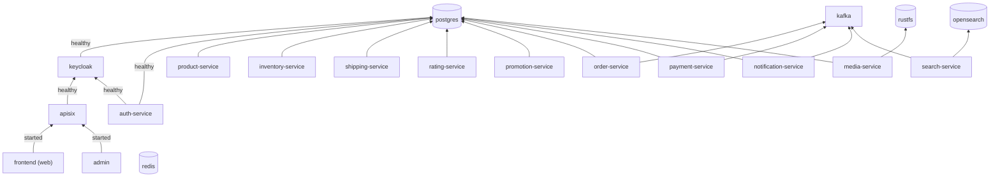

# Runtime View — Môi trường local (docker compose)

> **Phiên bản:** 1.0 · **Trạng thái:** Final · **Cập nhật:** 2026-11-12 · **Phạm vi:** Ứng dụng (as-is)

> Góc nhìn **ứng dụng** của `docker-compose.yml`: thành phần nào chạy, phụ thuộc khởi động, cấu hình ứng dụng. Kubernetes / k3d / CI/CD thuộc bộ tài liệu hạ tầng. Hướng dẫn chạy: [developer-guide.md](../../08-guides/developer-guide.md).

## 1. Sơ đồ phụ thuộc khởi động

Mũi tên = `depends_on` (điều kiện `service_healthy` trừ frontend dùng `service_started`). Redis không có service nào phụ thuộc.

## 2. Bảng container

| Container | Image | Port host | Database / cấu hình chính |
| :--- | :--- | :--- | :--- |
| postgres | `postgres:16` | 5432 | `POSTGRES_DB=ecommerce`; init script `deploy/postgres/init/` |
| redis | `redis:7.4-alpine` | 6379 | yêu cầu password, AOF |
| kafka | `apache/kafka:3.9.0` | 9092 | KRaft 1 node |
| opensearch | `opensearchproject/opensearch:3.9.0` | 9200, 9600 | security plugin tắt |
| rustfs | `rustfs/rustfs:latest` | 9000 (S3), 9001 (console) | |
| keycloak | `quay.io/keycloak/keycloak:26.0` | 8080 | dev mode, import realm, lưu DB `keycloak` |
| apisix | `apache/apisix:3.15.0-debian` | 9080 (proxy), 9091 (metrics) | `deploy/apisix/config.yaml`, `apisix.yaml` |
| auth-service | `ecommerce/auth-service:latest` (build) | 8088 | `authservice`, `KEYCLOAK_*`, `SSO_*` |
| product-service | build | 8086 | `productservice` |
| order-service | build | 8084 | `orderservice`, `KAFKA_SERVERS` (không dùng) |
| payment-service | build | 8085 | `paymentservice`, `KAFKA_SERVERS` |
| shipping-service | build | 8087 | `shippingservice` |
| inventory-service | build | 8082 | `inventoryservice` |
| rating-service | build | 8089 | `ratingservice` |
| media-service | build | 8083 | `mediaservice`, `STORAGE_*` |
| promotion-service | build | 8093 | `promotionservice` |
| search-service | build | 8094 | `OPENSEARCH_*`, `KAFKA_SERVERS` |
| notification-service | build | 8090 | `POSTGRES_DB=ecommerce`, `KAFKA_SERVERS` |
| frontend | `ghcr.io/ecommerce-int/frontend-web:latest` | 3000 | `API_INTERNAL_URL=http://apisix:9080`, `API_PUBLIC_URL=http://localhost:9080`, `ORIGIN=http://localhost:3000` |
| admin | `ghcr.io/ecommerce-int/frontend-admin:latest` | 3001 | như trên, `ORIGIN=http://localhost:3001` |

Mạng: `ecommerce-network` (bridge). Mọi service publish port ra host → có thể gọi trực tiếp bỏ qua gateway (xem [security-architecture.md](security-architecture.md)).

## 3. Biến môi trường ứng dụng (tên)

| Nhóm | Biến | Dùng bởi |
| :--- | :--- | :--- |
| Database | `DATABASE_URL`, `POSTGRES_HOST`, `POSTGRES_PORT`, `POSTGRES_USER`, `POSTGRES_PASSWORD`, `POSTGRES_DB`, `SPRING_DATASOURCE_URL` | Mọi service có DB |
| Port | `PORT` | Mọi service |
| Keycloak / SSO | `KEYCLOAK_SERVER_URL`, `KEYCLOAK_PUBLIC_SERVER_URL`, `KEYCLOAK_REALM`, `KEYCLOAK_CLIENT_ID`, `KEYCLOAK_CLIENT_SECRET`, `KEYCLOAK_ADMIN_REALM`, `KEYCLOAK_ADMIN_CLIENT_ID`, `KEYCLOAK_ADMIN_USERNAME`, `KEYCLOAK_ADMIN_PASSWORD`, `SSO_BACKEND_CALLBACK_URL`, `SSO_DEFAULT_FRONTEND_REDIRECT`, `SSO_SCOPE` | auth-service; `KEYCLOAK_CLIENT_SECRET` cũng dùng bởi APISIX |
| Kafka | `KAFKA_SERVERS`, `PRODUCT_TOPIC_NAME`, `PAYMENT_KAFKA_CONSUMER_GROUP_ID` | payment, search, notification |
| OpenSearch | `OPENSEARCH_URL`, `OPENSEARCH_USERNAME`, `OPENSEARCH_PASSWORD` | search |
| S3 | `STORAGE_ENDPOINT`, `STORAGE_REGION`, `STORAGE_ACCESS_KEY`, `STORAGE_SECRET_KEY`, `STORAGE_BUCKET`, `PUBLIC_URL` | media |
| Mail | `MAIL_HOST`, `MAIL_PORT`, `MAIL_USERNAME`, `MAIL_PASSWORD` | notification |
| Frontend | `API_INTERNAL_URL`, `API_PUBLIC_URL`, `ORIGIN`, `HOST`, `PORT`, `PROTOCOL_HEADER` | web, admin |
| Không dùng | `JWT_ISSUER_URI`, `SSO_ALLOWED_REDIRECT_URIS`, `EUREKA_URI`, `REST_CLIENT_*`, `HTTP_LOG_*`, `I18N_*`, `ECOMMERCE_SECURITY_*`, `CORS_*`, `WEB_*` | ISSUE-37 |

Giá trị: xem `.env` và `docker-compose.yml` (không chép vào tài liệu).

## 4. Lưu ý khi chạy

| Lưu ý | Issue |
| :--- | :--- |
| Bucket `ecommerce-media` không tự tạo (không có service `storage-init`) — tạo thủ công qua console RustFS `:9001` | ISSUE-32 |
| Route favourites / tax lỗi do thiếu upstream 7, 13 | ISSUE-13 |
| Service khởi động ngay cả khi DB lỗi — kiểm tra log "warning" | ISSUE-28 |
| Image frontend kéo từ ghcr (không build local trong compose) | — |
