# Security Architecture

> **Phiên bản:** 1.0 · **Trạng thái:** Final · **Cập nhật:** 2026-11-12 · **Phạm vi:** Ứng dụng (as-is)

> Kiến trúc bảo mật của ứng dụng như đang hiện thực: định danh, xác thực, phân quyền, quản lý phiên, bảo vệ API, và bề mặt tấn công đã biết. Mọi lỗ hổng tham chiếu tới [known-issues-tech-debt.md](../../07-plan/known-issues-tech-debt.md#1-bảo-mật--xác-thực).

## 1. Tổng quan các lớp bảo vệ

```mermaid
flowchart LR
    subgraph L1["Lớp 1 — Trình duyệt"]
        CK["Cookie httpOnly, SameSite=Lax<br/>Không token trong JS"]
    end
    subgraph L2["Lớp 2 — BFF SvelteKit"]
        HS["handleSession: refresh token"]
        AG["handleAdminGuard (chỉ admin app)"]
        ZV["Zod validate input remote function"]
        SR["safeRedirect"]
    end
    subgraph L3["Lớp 3 — APISIX"]
        OIDC["openid-connect bearer_only<br/>JWKS RS256"]
        RL["limit-count 1200/60s/IP"]
        CORS["cors"]
    end
    subgraph L4["Lớp 4 — Service"]
        UC["UserClaims: decode JWT<br/>KHÔNG verify"]
        NV["Không kiểm role"]
    end
    L1 --> L2 --> L3 --> L4
```

## 2. Định danh (Identity)

| Thành phần | Chi tiết |
| :--- | :--- |
| IdP | Keycloak 26.0, realm `ecommerce` (`deploy/keycloak/import/ecommerce-realm.json`) |
| Đăng ký tự do trên Keycloak | Tắt (`registrationAllowed: false`) |
| Đăng nhập bằng email | Bật; quên mật khẩu: bật |
| Client | `ecommerce-client` — **public client**, bật standard flow + direct access grants (password grant — rủi ro brute-force, ISSUE-133); redirect URI `http://localhost:*`, `http://127.0.0.1:*`, `http://api.ecommerce.local/*`; web origins `*` |
| Realm role | `ADMIN`, `USER`, `MANAGER` |
| Seed user (dev) | `testuser` (USER), `adminuser` (ADMIN, MANAGER) — thông tin đăng nhập xem file realm, **không dùng cho production** |
| Kho user thứ hai | DB `authservice` (bảng `users`, `roles`, `user_role`) do auth-service quản lý; liên kết qua `keycloak_user_id` |

**Hai nguồn sự thật cho user/role** (Keycloak và `authservice`) không được đồng bộ — xem [actors-and-permissions.md §2](../../01-brd/actors-and-permissions.md#2-nguồn-định-nghĩa-vai-trò), ISSUE-08, ISSUE-100, ISSUE-101.

## 3. Xác thực (Authentication)

### 3.1 Luồng đăng nhập người dùng

OIDC Authorization Code **qua trung gian auth-service**, sau đó trao token cho BFF bằng **ticket dùng một lần**. Sequence: [runtime-flows.md RF-01](runtime-flows.md#rf-01--đăng-nhập-sso-ticket-exchange).

| Cơ chế | Giá trị | Nguồn |
| :--- | :--- | :--- |
| `state` OIDC | 32 byte ngẫu nhiên base64url, TTL 5 phút, dùng 1 lần | `services/auth-service/internal/service/sso_store.go` |
| Ticket | 32 byte ngẫu nhiên, TTL 2 phút, dùng 1 lần | `sso_store.go` |
| Lưu trữ state/ticket | Bộ nhớ tiến trình, purge mỗi phút | ISSUE-06 |
| PKCE | Không dùng | `keycloak_client.go` `BuildAuthorizeURL` |
| Scope | `SSO_SCOPE` | `main.go` |

### 3.2 Xác thực API

| Lớp | Cơ chế |
| :--- | :--- |
| APISIX | Plugin `openid-connect`: `bearer_only: true`, `use_jwks: true`, `token_signing_alg_values_expected: RS256`, discovery `http://keycloak:8080/realms/ecommerce/.well-known/openid-configuration`, `client_id: ecommerce-client`, `client_secret` từ biến môi trường |
| Service Go | `services/shared/middleware.UserClaims` — parse JWT **không verify**, đưa `sub`, `email`, `preferred_username` vào context; không từ chối request |
| Service Bun | rating-service tự decode payload (không verify); các service Bun khác không đọc token |

Route public vs bảo vệ: [gateway-routing.md](../../05-api/gateway-routing.md).

## 4. Phân quyền (Authorization)

| Tầng | Có phân quyền? | Chi tiết |
| :--- | :--- | :--- |
| Admin BFF | ✅ | `handleAdminGuard`: không phiên → `303 /login?redirect=`; không `ADMIN`/`ROLE_ADMIN` → `303 /access-denied` |
| Web BFF | Theo đăng nhập | `/checkout`, `/orders` yêu cầu phiên |
| APISIX | ❌ | Chỉ kiểm token hợp lệ |
| Service | ❌ | Không đọc role; không kiểm quyền sở hữu dữ liệu (vd order của user) |

Hệ quả: [ISSUE-01](../../07-plan/known-issues-tech-debt.md#1-bảo-mật--xác-thực), [ISSUE-49](../../07-plan/known-issues-tech-debt.md#6-hợp-đồng-api-frontend--backend), [ISSUE-102](../../07-plan/known-issues-tech-debt.md#7f-phát-hiện-của-nhóm-biên-soạn-chính-issue-100).

## 5. Quản lý phiên (BFF)

| Cookie | Nội dung | maxAge | Thuộc tính |
| :--- | :--- | :--- | :--- |
| `access_token` | JWT access | `expires_in` (fallback 300s) | `httpOnly`, `SameSite=Lax`, `path=/` |
| `refresh_token` | Refresh token | `refresh_expires_in` (fallback 1800s) | như trên |
| `session_user` | JSON `SessionUser {id, username, fullName, email, roles[]}` | như refresh | như trên |
| `session_expires` | Epoch giây hết hạn access | như refresh | như trên |
| `auth_redirect` | Đường dẫn quay lại sau login | 10 phút | đặt ở `/login` |

Nguồn: `frontend/packages/lib/src/server/session.ts`. Không đặt `secure` tường minh; hai app dùng chung tên cookie (ISSUE-11).

Làm mới: khi không có access token hoặc còn < 30 giây → `POST /api/v1/auth/refresh`; thất bại → xóa phiên (RF-02).

Đăng xuất: `POST /api/v1/auth/logout {refreshToken}` (best-effort) + xóa cookie.

## 6. Bảo vệ đầu vào & đầu ra

| Kiểm soát | Hiện trạng |
| :--- | :--- |
| Validate input | Frontend: Zod (`frontend/packages/lib/src/schemas.ts`); Bun services: Zod (trừ media); Go services: **không validate** ngoài parse JSON/ID (ISSUE-35) |
| SQL injection | Query builder bob / Drizzle với tham số hóa |
| Upload file | Không giới hạn kích thước / MIME (ISSUE-32) |
| Open redirect | BFF có `safeRedirect`; auth-service không kiểm `redirect_uri` (ISSUE-05) |
| CORS | Gateway: `localhost:3000`, `ecommerce.local`, `ecommerce.local:9090`; Service: `*` |
| Rate limit | Gateway 1200/60s/IP |
| Lộ thông tin lỗi | Service Go trả `err.Error()` thô trong `detail` khi 500 |

## 7. Bí mật & cấu hình

| Bí mật | Nơi cấu hình | Ghi chú |
| :--- | :--- | :--- |
| DB password | `POSTGRES_PASSWORD` (`.env`) | Một user PostgreSQL chung cho mọi service |
| Keycloak client secret | `KEYCLOAK_CLIENT_SECRET` | Client là public — secret không có tác dụng (ISSUE-12) |
| Keycloak admin | `KEYCLOAK_ADMIN_*` | auth-service dùng để gọi Admin API |
| S3 | `STORAGE_ACCESS_KEY`, `STORAGE_SECRET_KEY` | |
| SMTP | `MAIL_USERNAME`, `MAIL_PASSWORD` | |
| Redis | `REDIS_PASSWORD` | Hard-code trong manifest k8s gateway (ISSUE-10) |

`.env` được commit trong repo — cần xem lại trong tài liệu hạ tầng.

## 8. Bề mặt tấn công — tóm tắt rủi ro

| Mức | Issue |
| :--- | :--- |
| Critical | ISSUE-01 (không phân quyền), ISSUE-04 (mock token), ISSUE-05 (open redirect), ISSUE-100 (role rỗng), ISSUE-102 (ghi catalog không cần token) |
| High | ISSUE-02, ISSUE-03, ISSUE-06, ISSUE-07, ISSUE-08, ISSUE-09, ISSUE-49, ISSUE-52, ISSUE-64, ISSUE-66, ISSUE-67, ISSUE-68, ISSUE-101, ISSUE-133, ISSUE-134 |
| Medium | ISSUE-10, ISSUE-11, ISSUE-32, ISSUE-33, ISSUE-53, ISSUE-61, ISSUE-93, ISSUE-130, ISSUE-131, ISSUE-132, ISSUE-135, ISSUE-136, ISSUE-138 |
| Low | ISSUE-12, ISSUE-137, ISSUE-139 |

Phân tích đầy đủ theo STRIDE: [threat-model.md](threat-model.md).

Lộ trình khắc phục: [project-plan.md — P1](../../07-plan/project-plan.md).
