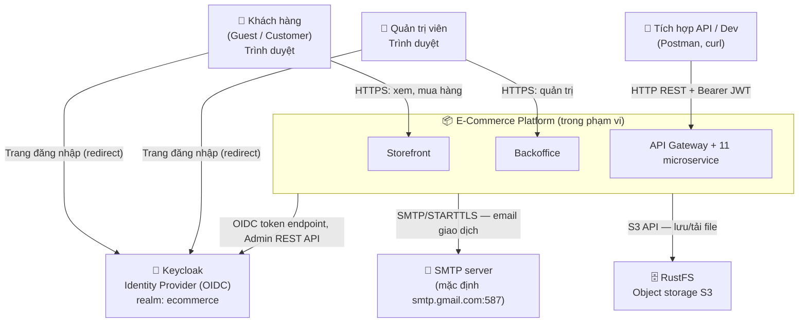

# System Context (C4 — Level 1)

> **Phiên bản:** 1.0 · **Trạng thái:** Final · **Cập nhật:** 2026-11-12 · **Phạm vi:** Ứng dụng (as-is)

> Góc nhìn ngoài cùng: hệ thống là một hộp đen; ai dùng nó và nó phụ thuộc vào hệ thống ngoài nào. Mô tả theo code hiện tại.

## 1. Sơ đồ ngữ cảnh

> Keycloak và RustFS chạy trong cùng docker compose nhưng về mặt logic là **hệ thống ngoài** (sản phẩm bên thứ ba, cấu hình chứ không lập trình).

## 2. Actor

| Actor | Mục đích | Kênh |
| :--- | :--- | :--- |
| Khách hàng | Duyệt, mua hàng, xem đơn | Storefront `:3000` |
| Quản trị viên | Quản lý catalog, xem đơn, dashboard | Backoffice `:3001` |
| Tích hợp API / Dev | Gọi các API chưa có UI (promotion, tax, rating, media, notification, shipping, inventory, user/role) | APISIX `:9080` |

Chi tiết quyền: [actors-and-permissions.md](../../01-brd/actors-and-permissions.md).

## 3. Hệ thống ngoài

| Hệ thống | Vai trò | Giao thức | Thành phần gọi | Cấu hình |
| :--- | :--- | :--- | :--- | :--- |
| **Keycloak 26** | Xác thực người dùng, cấp JWT, quản lý user | OIDC (authorize, token, logout), Admin REST API, JWKS/discovery | auth-service, APISIX (`openid-connect` discovery) | `KEYCLOAK_SERVER_URL`, `KEYCLOAK_PUBLIC_SERVER_URL`, `KEYCLOAK_REALM`, `KEYCLOAK_CLIENT_ID`, `KEYCLOAK_ADMIN_*`; realm import `deploy/keycloak/import/ecommerce-realm.json` |
| **SMTP** | Gửi email | SMTP (587 STARTTLS / 465 TLS) qua `nodemailer` | notification-service | `MAIL_HOST`, `MAIL_PORT`, `MAIL_USERNAME`, `MAIL_PASSWORD`; thiếu credential → gửi giả lập |
| **RustFS (S3)** | Lưu file media | S3 API path-style (`Bun.S3Client`) | media-service | `STORAGE_ENDPOINT`, `STORAGE_REGION`, `STORAGE_ACCESS_KEY`, `STORAGE_SECRET_KEY`, `STORAGE_BUCKET` |

**Không có** tích hợp với cổng thanh toán, đối tác vận chuyển, CDN, dịch vụ phân tích trong code hiện tại.

## 4. Ranh giới hệ thống

| Trong phạm vi | Ngoài phạm vi |
| :--- | :--- |
| 2 ứng dụng SvelteKit, APISIX config, 11 service, cấu hình DB/Kafka/OpenSearch mà ứng dụng dùng | Vận hành Keycloak, SMTP, S3; thanh toán thật; vận chuyển thật; hạ tầng k8s |

## 5. Xem tiếp

- Phân rã bên trong hệ thống: [container-view.md](container-view.md)
- Luồng runtime: [runtime-flows.md](runtime-flows.md)
