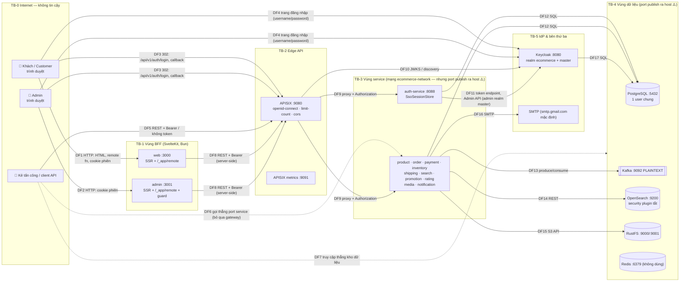

# Threat Model (STRIDE)

> **Phiên bản:** 1.0 · **Trạng thái:** Final · **Cập nhật:** 2026-11-12 · **Phạm vi:** Ứng dụng (as-is)

> Mô hình mối đe dọa của **ứng dụng như đang hiện thực**, theo phương pháp STRIDE trên sơ đồ luồng dữ liệu (DFD). Mọi biện pháp "đang có" đều được đối chiếu với code; không giả định các kiểm soát của hạ tầng production (k8s NetworkPolicy, WAF, TLS termination) vì chúng thuộc bộ tài liệu hạ tầng. Kiến trúc bảo mật tổng quan: [security-architecture.md](security-architecture.md). Danh sách lỗi: [known-issues-tech-debt.md](../../07-plan/known-issues-tech-debt.md).

## 1. Phạm vi & giả định

| # | Giả định / phạm vi |
| :--- | :--- |
| A-1 | Môi trường tham chiếu là `docker-compose.yml` + `deploy/apisix/*` + `deploy/keycloak/import/ecommerce-realm.json`. Manifest k8s chỉ được nhắc khi liên quan (ISSUE-10). |
| A-2 | Trình duyệt của khách/admin là **không tin cậy**; mọi input từ trình duyệt (query, body, cookie, header) có thể bị sửa. |
| A-3 | Mạng giữa BFF ↔ APISIX ↔ service là HTTP thuần (không TLS, không mTLS) trong compose. |
| A-4 | TLS phía Internet (HTTPS) do lớp ingress/hạ tầng đảm nhiệm — ngoài phạm vi; trong compose mọi URL là `http://`. |
| A-5 | Keycloak, SMTP, RustFS là sản phẩm bên thứ ba; chỉ đánh giá **cách ứng dụng cấu hình và dùng** chúng. |

## 2. Sơ đồ luồng dữ liệu & ranh giới tin cậy

| Ranh giới | Mô tả | Kiểm soát tại ranh giới (as-is) |
| :--- | :--- | :--- |
| TB-0 → TB-1 | Trình duyệt → BFF | Cookie `httpOnly`/`SameSite=Lax`; Zod validate remote function; admin guard (có lỗ hổng `/_app/`); **không** CSP/security header |
| TB-0 → TB-2 | Client → gateway | `openid-connect bearer_only` trên đa số route; `limit-count` theo IP; CORS allowlist |
| TB-1 → TB-2 | BFF → gateway | Bearer token của người dùng; không mTLS |
| TB-2 → TB-3 | Gateway → service | Không có — service tin mọi request (không verify JWT, không kiểm role) |
| TB-0 → TB-3/TB-4 | Bỏ qua gateway | **Không có** trong compose: mọi service và kho dữ liệu publish port ra host (`docker-compose.yml:12-13,29-30,44-45,86-88,109-111,177-390`) |
| TB-3 → TB-5 | auth-service → Keycloak | Tài khoản admin realm `master` qua password grant |

## 3. Tài sản (Assets)

| ID | Tài sản | Nơi lưu / đi qua | Phân loại | Giá trị với kẻ tấn công |
| :--- | :--- | :--- | :--- | :--- |
| AS-01 | Access token / refresh token Keycloak | Cookie BFF; `SsoSessionStore` (2'); body `POST /auth/refresh` | Credential | Chiếm phiên |
| AS-02 | SSO `state`, `ticket`, authorization `code` | Query string URL; bộ nhớ auth-service | Credential ngắn hạn | Chiếm phiên / login CSRF |
| AS-03 | Cookie `session_user` (id, username, fullName, email, roles) | Trình duyệt | PII + quyết định phân quyền | Leo thang lên ADMIN (ISSUE-66) |
| AS-04 | Hồ sơ người dùng (họ tên, email, SĐT, giới tính, avatar) | `authservice.users`; Keycloak | PII | Lộ dữ liệu cá nhân |
| AS-05 | Mật khẩu người dùng | Keycloak (hash); đi qua auth-service khi signup | Credential | Chiếm tài khoản |
| AS-06 | Đơn hàng, thanh toán | `orderservice`, `paymentservice`, `payment_notifications` | Giao dịch | Gian lận, lộ lịch sử mua |
| AS-07 | Catalog (sản phẩm, giá, danh mục) | `productservice`, OpenSearch | Toàn vẹn kinh doanh | Sửa giá, phá catalog |
| AS-08 | Khuyến mãi, thuế | `promotionservice` | Toàn vẹn kinh doanh | Tạo coupon / sửa thuế |
| AS-09 | Đánh giá sản phẩm | `ratingservice` | Uy tín | Spam/giả mạo đánh giá |
| AS-10 | File media | RustFS bucket, `mediaservice` | Nội dung | Lưu trữ mã độc, DoS |
| AS-11 | Danh tiếng gửi mail (SMTP account) | notification-service | Tài nguyên | Spam/phishing |
| AS-12 | Secret hạ tầng (DB, S3, Keycloak admin, SMTP, client secret) | `.env`, env container, default trong code | Credential | Chiếm toàn hệ thống |
| AS-13 | Quyền quản trị Keycloak (realm `master`) | Env auth-service | Credential tối cao | Kiểm soát mọi danh tính |
| AS-14 | Tính sẵn sàng của storefront/checkout | Toàn hệ thống | Availability | DoS, mất doanh thu |
| AS-15 | Log ứng dụng | stdout container | Có thể chứa PII/credential | Thu thập dữ liệu |

## 4. Entry points

| ID | Entry point | Truy cập | Xác thực hiện tại | Service đích | Tham chiếu |
| :--- | :--- | :--- | :--- | :--- | :--- |
| EP-01 | `GET/POST /api/v1/auth/*` (login, callback, session, refresh, logout, signup) | Internet | 🌐 public | auth-service | `deploy/apisix/apisix.yaml:63-70` |
| EP-02 | `/api/v1/users*`, `/api/v1/roles*` | Internet | 🔑 bearer bất kỳ | auth-service | `apisix.yaml:142-177` |
| EP-03 | `/api/products*`, `/api/categories*` (mọi method) | Internet | 🌐 public | product-service | `apisix.yaml:71-82` |
| EP-04 | `/api/favourites*` | Internet | 🔑 (upstream 7 không tồn tại) | — | `apisix.yaml:250-267` |
| EP-05 | `/api/carts*`, `/api/orders*` | Internet | 🔑 | order-service | `apisix.yaml:178-213` |
| EP-06 | `/api/payments*` | Internet | 🔑 | payment-service | `apisix.yaml:214-231` |
| EP-07 | `/api/inventory*` | Internet | 🔑 | inventory-service | `apisix.yaml:232-249` |
| EP-08 | `/shipping/api/shippings/*` | Internet | 🔑 | shipping-service | `apisix.yaml:268-279` |
| EP-09 | `/storefront/catalog-search`, `/storefront/search_suggest` | Internet | 🌐 | search-service | `apisix.yaml:93-102` |
| EP-10 | `/storefront/ratings*` (GET + **POST**) | Internet | 🌐 | rating-service | `apisix.yaml:83-92` |
| EP-11 | `/rating/backoffice/ratings/*`, `/promotion/backoffice/promotions/*`, `/tax/backoffice/*` | Internet | 🔑 (tax: upstream 13 không tồn tại) | rating, promotion | `apisix.yaml:328-375` |
| EP-12 | `/media/medias/*` (upload multipart, stream, delete) | Internet | 🔑 | media-service | `apisix.yaml:316-327` |
| EP-13 | `/notification/api/{email,notifications,payment-notifications}/*` | Internet | 🔑 | notification-service | `apisix.yaml:280-315` |
| EP-14 | `/<svc>/v3/api-docs/*` (13 route) | Internet | 🌐 (route chết) | các service | `apisix.yaml:103-141` |
| EP-15 | APISIX metrics `:9091` | Host/mạng | Không | APISIX | `deploy/apisix/config.yaml:12-16`, `docker-compose.yml:157-159` |
| EP-16 | Port trực tiếp service `:8082-:8094` | Host/mạng | Không (service không verify) | 11 service | `docker-compose.yml:177-390` |
| EP-17 | BFF trang SSR web: `/`, `/products`, `/products/[id]`, `/cart`, `/checkout`, `/orders`, `/login?redirect=`, `/auth/callback?ticket=`, `/sitemap.xml` | Internet | Cookie phiên (checkout, orders) | web | `frontend/apps/web/src/routes/**` |
| EP-18 | BFF remote function web `POST/GET /_app/remote/<hash>/...` (`getProducts`, `getProduct`, `getCategories`, `getOrders`, `placeOrder`, `logout`) | Internet | Cookie phiên (chỉ `placeOrder` tự kiểm token) | web | `frontend/apps/web/src/routes/**/*.remote.ts` |
| EP-19 | BFF trang admin `/dashboard`, `/products`, `/categories`, `/orders`, `/users`… và `/login`, `/auth/callback`, `/access-denied` | Internet | `handleAdminGuard` | admin | `frontend/apps/admin/src/hooks.server.ts:58-77` |
| EP-20 | BFF remote function admin `/_app/remote/...` (`saveProduct`, `deleteProduct`, `saveCategory`, `deleteCategory`, `getOrders`, `getDashboard`…) | Internet | **Không** (path `/_app/` được miễn guard) | admin | `frontend/apps/admin/src/hooks.server.ts:62`; ISSUE-68 |
| EP-21 | Keycloak `:8080` — trang login, token endpoint (grant `password` bật), admin console realm `master` | Internet/host | Keycloak | Keycloak | `docker-compose.yml:122-149`; `ecommerce-realm.json:31-32` |
| EP-22 | Keycloak redirect về `SSO_BACKEND_CALLBACK_URL` → auth-service → `redirect_uri` tùy ý | Internet | Không allowlist | auth-service | `auth_handler.go:125-167` |
| EP-23 | Kafka `:9092` — topic `profile-onboarding-topic`, `status-payment-successful`, `dbproduct.public.product`, `SUCCESSFUL`, `paymentCompleted` | Mạng compose / host | Không (PLAINTEXT) | notification, search | `docker-compose.yml:44-54` |
| EP-24 | OpenSearch `:9200`, PostgreSQL `:5432`, Redis `:6379`, RustFS `:9000/:9001` | Host | OpenSearch: không; còn lại: mật khẩu chung | Kho dữ liệu | `docker-compose.yml:12-13,29-30,77-88,109-111` |

## 5. Thang đánh giá rủi ro

| Khả năng (L) | Định nghĩa | Tác động (I) | Định nghĩa |
| :--- | :--- | :--- | :--- |
| **H** — Cao | Khai thác bằng 1 request/công cụ sẵn có, không cần điều kiện | **C** — Nghiêm trọng | Chiếm toàn quyền / lộ toàn bộ PII / sửa dữ liệu giao dịch hàng loạt |
| **M** — Trung bình | Cần token hợp lệ, vị trí mạng nội bộ, hoặc kết hợp lỗi | **H** — Cao | Lộ/sửa dữ liệu nhiều người dùng, gián đoạn chức năng chính |
| **L** — Thấp | Cần điều kiện hiếm / nội gián | **M** — Trung bình | Ảnh hưởng một người dùng / chức năng phụ |
| | | **L** — Thấp | Thông tin hạn chế, khó lợi dụng |

Ma trận xếp hạng: `H×C`, `H×H`, `M×C` → **Critical**; `H×M`, `M×H`, `L×C` → **High**; `H×L`, `M×M`, `L×H` → **Medium**; còn lại → **Low**.

## 6. Bảng mối đe dọa

Viết tắt STRIDE: **S** Spoofing · **T** Tampering · **R** Repudiation · **I** Information disclosure · **D** Denial of service · **E** Elevation of privilege.

| ID | STRIDE | Thành phần | Mô tả | Biện pháp hiện có | L | I | Rủi ro | ISSUE | Kiểm soát đề xuất |
| :--- | :---: | :--- | :--- | :--- | :---: | :---: | :---: | :--- | :--- |
| T-01 | E | APISIX + mọi service | Customer có token `USER` gọi API quản trị (CRUD user/role, promotion, tax, rating, shipping, payment) | `bearer_only` xác thực token | H | C | **Critical** | ISSUE-01 | RBAC tại gateway (`realm_access.roles`) + middleware `RequireRole` ở service |
| T-02 | T / E | EP-03 product-service | Khách ẩn danh `POST/PUT/DELETE /api/products`, `/api/categories` | Không | H | H | **Critical** | ISSUE-102 | Tách route GET public; ghi yêu cầu token + ADMIN |
| T-03 | S / E | admin BFF (EP-20) | Gọi remote function quản trị qua `/_app/remote/...` bỏ qua `handleAdminGuard`; backend chấp nhận token bất kỳ | Guard chỉ cho trang | H | H | **Critical** | ISSUE-68, ISSUE-01 | Chỉ miễn `/_app/immutable/`; kiểm `isAdmin` trong từng remote function |
| T-04 | S / E | Cookie `session_user` (AS-03) | Người dùng sửa JSON cookie (`roles:["ADMIN"]`, `username`) để vượt guard admin/checkout | Cookie `httpOnly` (không chống sửa phía client) | H | H | **Critical** | ISSUE-66 | Ký/mã hóa cookie hoặc dựng user từ access token đã verify |
| T-05 | S | auth-service callback (EP-22) | Open redirect: `redirect_uri` tùy ý → ticket gửi về domain kẻ tấn công → đổi ticket lấy token nạn nhân | `state` dùng 1 lần | H | C | **Critical** | ISSUE-05 | Allowlist `SSO_ALLOWED_REDIRECT_URIS`; ràng buộc ticket với client |
| T-06 | S | auth-service callback | Đổi code lỗi → **mock token** + ticket vẫn cấp; state không hợp lệ vẫn được chấp nhận (login CSRF) | Không | M | H | **High** | ISSUE-04, ISSUE-52 | Bỏ mock; từ chối khi state sai; thêm PKCE |
| T-07 | S / E | Service Go/Bun (EP-16) | Gọi thẳng port service với JWT tự chế / không token; `UserClaims`, `extractUser` không verify chữ ký | Không (compose publish port) | M | C | **Critical** | ISSUE-02, ISSUE-03 | Verify JWKS ở service hoặc chỉ cho phép traffic từ gateway (network policy, không publish port) |
| T-08 | S / T | rating-service (EP-10) | POST rating ẩn danh hoặc với token giả mạo `sub`/tên người khác | Zod validate body | H | M | **High** | ISSUE-03, ISSUE-62 | Bắt buộc token ở gateway; verify chữ ký; 1 rating/user/sản phẩm |
| T-09 | I | order-service (EP-05) | Customer đọc/sửa/xóa đơn, giỏ của người khác (`GET /api/orders`, `/api/orders/{id}`) | Không | H | H | **Critical** | ISSUE-49, ISSUE-76 | Lưu `user_id` từ `sub`; lọc và kiểm quyền sở hữu |
| T-10 | I | auth-service (EP-02) | Customer liệt kê toàn bộ user (`/users/all?size=…`, `/users?username=`) → lộ email, SĐT, giới tính | Bearer | H | H | **Critical** | ISSUE-01, ISSUE-138 | Chỉ ADMIN; giới hạn `size`; trả trường tối thiểu |
| T-11 | E | auth-service roles | Tự gán `ADMIN` qua `/api/v1/roles/users/{id}/assign` hoặc `roles` trong signup | Không | H | M | **High** | ISSUE-01, ISSUE-53 | Chỉ ADMIN được gán; signup luôn `USER`; đồng bộ role với Keycloak |
| T-12 | T | payment-service (EP-06) | Client tạo payment `isPayed:true`, sửa `paymentStatus` tùy ý; `orderFee` do client đặt | BFF tính lại giá khi checkout | H | H | **Critical** | ISSUE-21, ISSUE-75 | Payment chỉ do hệ thống/cổng thanh toán xác nhận; tính tổng phía server |
| T-13 | I / T | notification-service (EP-13) | Đọc/xóa mọi thông báo và payment-notification; tạo thông báo giả | Bearer | H | M | **High** | ISSUE-33, ISSUE-65 | Lọc theo `sub`; endpoint ghi chỉ cho hệ thống |
| T-14 | S / D | notification email (EP-13) | Open relay: gửi email tùy ý (phishing) bằng tài khoản SMTP hệ thống → SMTP bị khóa | Bearer | H | H | **Critical** | ISSUE-64 | Không expose qua gateway; template cố định; rate limit |
| T-15 | I | notification consumer | Email thanh toán gửi tới **một địa chỉ cá nhân hard-code** (bên thứ ba) | Không | M | M | **Medium** | ISSUE-09 | Lấy người nhận từ hồ sơ khách |
| T-16 | S / T | Kafka (EP-23) | Ai vào được mạng Kafka (PLAINTEXT, không ACL) produce `profile-onboarding-topic` → notification gửi email tùy ý; produce `dbproduct.public.product` → đầu độc/xóa index search | Không | M | H | **High** | ISSUE-134 | SASL/TLS + ACL; không publish 9092; validate nguồn message |
| T-17 | I / T | OpenSearch (EP-24) | Security plugin tắt + port 9200 publish → đọc/sửa/xóa index | Không | M | M | **Medium** | ISSUE-134 | Bật security plugin; không publish port |
| T-18 | I / T | PostgreSQL (EP-24) | Một user DB chung cho mọi service + port 5432 publish → lộ secret = truy cập mọi DB (kể cả `keycloak`) | Mật khẩu | L | C | **High** | ISSUE-134, ISSUE-135 | User DB riêng mỗi service, quyền tối thiểu; không publish port |
| T-19 | E | auth-service → Keycloak | auth-service giữ thông tin đăng nhập admin realm `master` (password grant `admin-cli`) → chiếm auth-service = chiếm toàn bộ Keycloak | Không | L | C | **High** | ISSUE-136 | Service account client-credentials trong realm `ecommerce`, role `manage-users` tối thiểu |
| T-20 | S | Keycloak (EP-21) | Brute-force / credential stuffing qua token endpoint `grant_type=password` (ROPC bật), không khóa tài khoản, không password policy | Không | H | H | **Critical** | ISSUE-133 | Bật brute-force detection, password policy; tắt direct access grants |
| T-21 | I | Log (AS-15) | `code`/`state`/`ticket` trong query string bị chi `Logger` ghi; email người nhận và payload Kafka bị log | Không | M | M | **Medium** | ISSUE-132 | Lọc query nhạy cảm khỏi log; log có cấu trúc + redaction |
| T-22 | I | Service Go/Bun | 500 trả nguyên `err.Error()` / `err.message` (SQL, tên bảng, body lỗi Keycloak) | Không | H | L | **Medium** | ISSUE-93 | Thông điệp chung + correlation id |
| T-23 | S | BFF login/callback | `safeRedirect` cho phép `/\evil.com` → trình duyệt chuẩn hóa thành `//evil.com` | Chặn `//` | M | M | **Medium** | ISSUE-130 | Từ chối `\`, parse bằng `URL` và so origin |
| T-24 | S | Cookie phiên (AS-01) | Web và admin dùng chung tên cookie trên cùng host → phiên lẫn nhau; không `secure` tường minh | `httpOnly`, `SameSite=Lax` | M | M | **Medium** | ISSUE-11 | Prefix `__Host-` theo app, `secure` |
| T-25 | S | web/admin | Clickjacking backoffice / thiếu CSP | Không | L | M | **Low** | ISSUE-139 | `frame-ancestors 'none'`, CSP qua `kit.csp` |
| T-26 | D | auth-service `SsoSessionStore` | Gọi `GET /api/v1/auth/login` hàng loạt (public, hoặc thẳng `:8088`) → map `states` phình không giới hạn trong 5 phút | Rate limit gateway (theo IP) | M | H | **High** | ISSUE-131 | Giới hạn kích thước store; chuyển Redis có TTL; rate limit endpoint |
| T-27 | D | media-service (EP-12) | Upload file rất lớn → `arrayBuffer()` toàn bộ → OOM | Bearer | M | H | **High** | ISSUE-32, ISSUE-138 | Giới hạn size/MIME tại gateway và service; stream |
| T-28 | D | Mọi service | Body JSON/`pageSize` không giới hạn; `http.Server` không timeout (slowloris) | Rate limit IP | M | M | **Medium** | ISSUE-96, ISSUE-138 | `MaxBytesReader`, cận trên `size`, timeout server |
| T-29 | D | APISIX `limit-count` | Quota chung theo IP BFF → một khách gây 429 cho mọi khách | `limit-count` local | H | M | **High** | ISSUE-61 | Key theo `sub`/XFF tin cậy; policy redis |
| T-30 | R | Mọi service | Không audit log thao tác quản trị (ai xóa sản phẩm, đổi role, xóa rating); Keycloak events không bật | Không | H | M | **High** | ISSUE-01, ISSUE-98 | Audit log có actor (`sub`), thời gian, đối tượng; bật Keycloak events |
| T-31 | R | payment / order | Payment không gắn người tạo; đơn không gắn `user_id` → không chứng minh được ai đặt/trả | Không | H | M | **High** | ISSUE-76 | Lưu `sub`, thời điểm, nguồn |
| T-32 | I | rating-service (EP-10) | API public trả `createdBy` (= `sub` Keycloak) và họ tên người đánh giá | Không | H | L | **Medium** | ISSUE-137 | Trả tên hiển thị rút gọn; không lộ `sub` |
| T-33 | T | favourites (product-service) | Sửa/xóa favourites của người khác (`user_id` từ body) | Không (route hỏng local) | L | L | **Low** | ISSUE-56, ISSUE-13 | Lấy user từ token |
| T-34 | I | APISIX metrics (EP-15) | `:9091` công khai, lộ route/upstream/tần suất | Không | M | L | **Low** | — | Không publish port; giới hạn IP |
| T-35 | T | media-service | Upload file độc hại (HTML/SVG/EXE), MIME do client khai báo; không quét virus | `Content-Disposition: attachment` khi stream | M | M | **Medium** | ISSUE-32 | Allowlist MIME, sniff nội dung, quét virus |
| T-36 | I | Secret (AS-12) | Default credential nằm trong code (Keycloak admin, DB, S3); `.env` commit; Redis password trong manifest k8s | Biến môi trường ghi đè | M | H | **High** | ISSUE-10, ISSUE-12, ISSUE-135 | Fail khi thiếu secret; secret manager; quét secret trong CI |
| T-37 | S | Keycloak client | `ecommerce-client` public, `webOrigins: *`, redirect `http://localhost:*`; không PKCE | Keycloak kiểm redirect URI pattern | M | M | **Medium** | ISSUE-12, ISSUE-133 | PKCE S256; thu hẹp redirect/web origins theo môi trường |
| T-38 | I | Kênh nội bộ | HTTP thuần BFF→gateway→service→Keycloak; SMTP/DB `sslmode=disable` | Mạng bridge docker | L | H | **Medium** | — | TLS/mTLS trong production (tài liệu hạ tầng) |

## 7. Heatmap tổng hợp

Số mối đe dọa theo **Khả năng × Tác động**:

| L \ I | Thấp (L) | Trung bình (M) | Cao (H) | Nghiêm trọng (C) |
| :--- | :---: | :---: | :---: | :---: |
| **Cao (H)** | 🟡 2 — T-22, T-32 | 🟠 6 — T-08, T-11, T-13, T-29, T-30, T-31 | 🔴 8 — T-02, T-03, T-04, T-09, T-10, T-12, T-14, T-20 | 🔴 2 — T-01, T-05 |
| **Trung bình (M)** | 🟢 1 — T-34 | 🟡 8 — T-15, T-17, T-21, T-23, T-24, T-28, T-35, T-37 | 🟠 5 — T-06, T-16, T-26, T-27, T-36 | 🔴 1 — T-07 |
| **Thấp (L)** | 🟢 1 — T-33 | 🟢 1 — T-25 | 🟡 1 — T-38 | 🟠 2 — T-18, T-19 |

> Mỗi threat thuộc đúng một ô. Tổng 38. Màu ô = mức rủi ro theo ma trận ở §5 (🔴 Critical · 🟠 High · 🟡 Medium · 🟢 Low).

Tổng theo mức rủi ro:

| Mức | Số lượng | Threat |
| :--- | :---: | :--- |
| 🔴 **Critical** | 11 | T-01, T-02, T-03, T-04, T-05, T-07, T-09, T-10, T-12, T-14, T-20 |
| 🟠 **High** | 13 | T-06, T-08, T-11, T-13, T-16, T-18, T-19, T-26, T-27, T-29, T-30, T-31, T-36 |
| 🟡 **Medium** | 11 | T-15, T-17, T-21, T-22, T-23, T-24, T-28, T-32, T-35, T-37, T-38 |
| 🟢 **Low** | 3 | T-25, T-33, T-34 |

Theo STRIDE (một threat có thể thuộc nhiều nhóm):

| STRIDE | Threat |
| :--- | :--- |
| Spoofing | T-03, T-04, T-05, T-06, T-07, T-08, T-14, T-16, T-20, T-23, T-24, T-25, T-37 |
| Tampering | T-02, T-08, T-12, T-13, T-16, T-17, T-18, T-33, T-35 |
| Repudiation | T-30, T-31 |
| Information disclosure | T-09, T-10, T-13, T-15, T-17, T-18, T-21, T-22, T-32, T-34, T-36, T-38 |
| Denial of service | T-14, T-26, T-27, T-28, T-29 |
| Elevation of privilege | T-01, T-02, T-03, T-04, T-07, T-11, T-19 |

## 8. Ưu tiên xử lý

1. **Đóng các đường leo thang đặc quyền** (T-01, T-02, T-03, T-04, T-07): RBAC ở gateway + service, verify JWT ở service, sửa guard `/_app/`, ký cookie. Tương ứng giai đoạn P1 của [project-plan.md](../../07-plan/project-plan.md).
2. **Bảo vệ luồng SSO** (T-05, T-06, T-20, T-23, T-37): allowlist redirect, bỏ mock token, PKCE, cấu hình Keycloak.
3. **Cô lập dữ liệu theo người dùng** (T-09, T-10, T-13, T-31): gắn `sub` vào dữ liệu, lọc theo chủ sở hữu.
4. **Thu hẹp bề mặt mạng** (T-16, T-17, T-18, T-34): không publish port kho dữ liệu/service; xác thực Kafka/OpenSearch.
5. **Chống lạm dụng & DoS** (T-14, T-26, T-27, T-28, T-29).
6. **Truy vết & audit** (T-21, T-30).

Xem thêm: [quality-scenarios.md](../quality-scenarios.md) (QS-SEC-*), [data-privacy-pii.md](../../06-data/data-privacy-pii.md).
