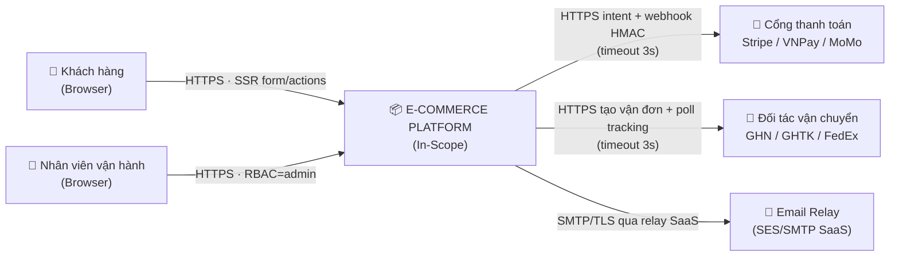
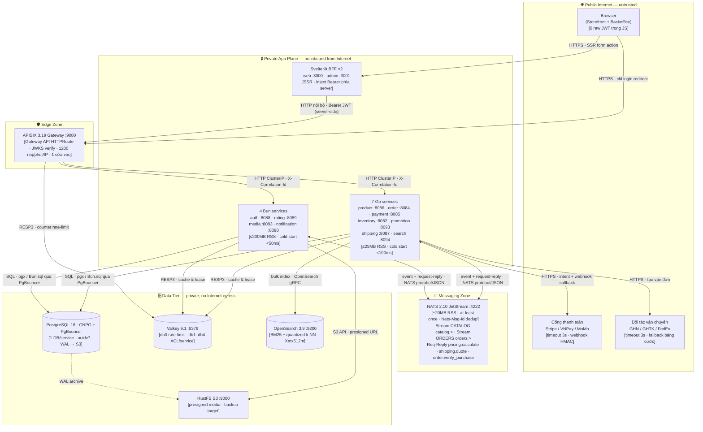
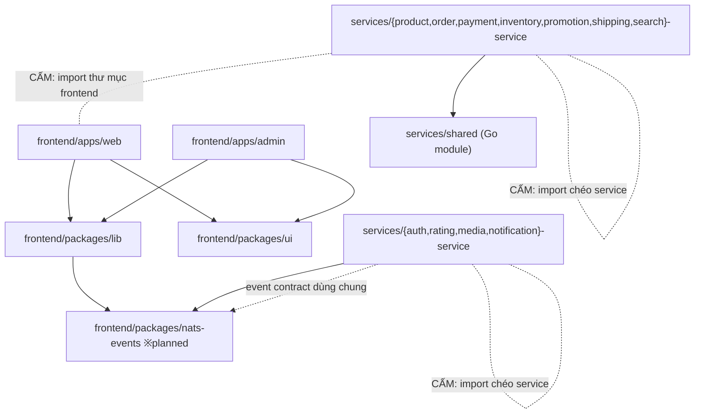
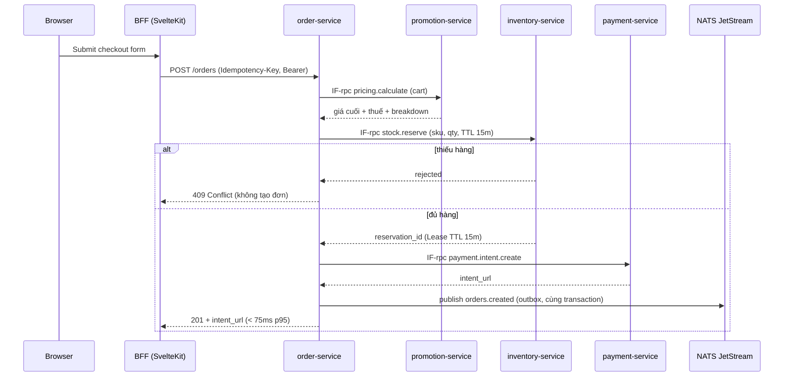
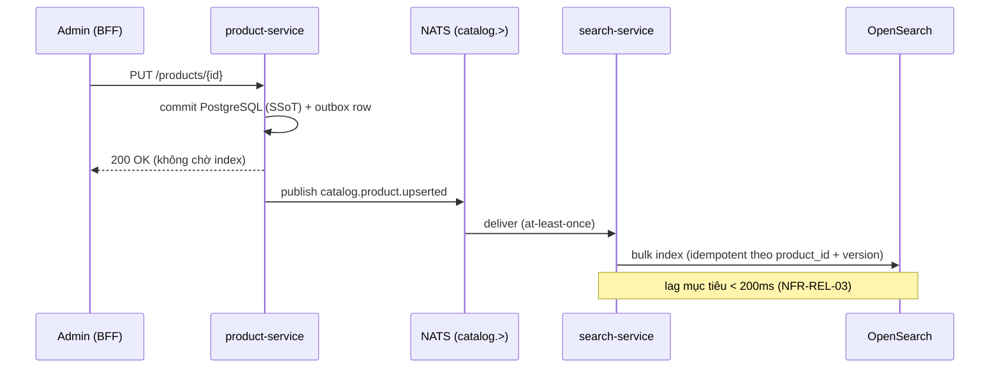

# ARCHITECTURE — E-COMMERCE PLATFORM

> **One-liner:** Nền tảng thương mại điện tử cloud-native gồm 11 microservice đa ngôn ngữ (7 Go + 4 Bun/TypeScript), 2 ứng dụng SvelteKit SSR làm BFF, định tuyến duy nhất qua Apache APISIX và cộng tác qua NATS JetStream.
>
> **Status:** `TARGET` (kiến trúc đích đã phê duyệt) · **Updated:** 2026-11-06 · **Style:** Modular Microservices trên Kubernetes, Database-per-Service, Event-Driven với async CQRS.
>
> **Đọc kèm:** `docs/architecture-revamp-plan.md` + mục **8.3 Target Delta** để biết phần nào **đã có trong code** và phần nào **còn là đích**.
>
> **Scope Rule:** Chỉ mô tả **Hộp đen** — Components, Interfaces, Nodes, Ràng buộc, Đánh đổi. DDL, payload API, tên hàm nằm trong source code và là SSoT của chính nó.

---

## 0. AOD — Bức tranh 60 giây (Architecture on a Page)

| Câu hỏi | Trả lời |
| :--- | :--- |
| **Hệ thống làm gì?** | Storefront + Backoffice cho bán hàng online: catalog, tìm kiếm, giỏ hàng, thanh toán, kho, vận chuyển, đánh giá. |
| **KHÔNG làm gì?** | Không giữ dữ liệu thẻ (PAN/CVV), không vận hành đội xe, không tự host MTA, không multi-tenant chung DB. |
| **Chạy ở đâu?** | Kubernetes (k3d local / cluster prod): 1 edge gateway, 2 BFF, 11 service pod, 4 datastore có trạng thái. |
| **3 ràng buộc khắt khe nhất** | `CON-01` Cấm JVM runtime · `CON-02` Toàn stack idle < 1.5 GB RAM · `CON-03` Zero PCI-DSS scope. |
| **3 mục tiêu chất lượng** | `NFR-PERF` p95 đọc cache < 15 ms · `NFR-REL` 0 oversell & 0 mất đơn · `NFR-COST` cold start < 100 ms, deploy 1 binary/pod. |
| **Chiến lược chính** | Bỏ JVM (Go/Bun) · NATS JetStream thay Kafka · Async CQRS cho search · Edge JWKS auth · Reservation có TTL thay distributed lock. |

---

## 1. Context, Scope & Non-Goals

### 1.1 Sơ đồ 1 — System Context (Level 0: toàn hệ thống là 1 hộp đen)



### 1.2 In-Scope (hệ thống tự xây)

Catalog & biến thể SKU · Tìm kiếm hybrid · Giỏ hàng & checkout · Thanh toán (chỉ intent + đối soát) · Kho & giữ hàng · Tính giá/khuyến mãi/thuế · Vận chuyển & tracking · Đánh giá · Media · Thông báo.

### 1.3 Explicit Non-Goals (Ranh giới âm — chặn scope creep)

| # | KHÔNG làm | Lý do / Ranh giới |
| :--- | :--- | :--- |
| NG-1 | **Không lưu, truyền hay xử lý PAN/CVV** | Đẩy 100% sang cổng thanh toán PCI-DSS. Hệ thống chỉ giữ `intent_id` + trạng thái. |
| NG-2 | **Không tự vận hành MTA / mail server** | Gửi qua relay SaaS; `notification-service` chỉ là producer. |
| NG-3 | **Không quản lý luồng xe, tuyến giao, hay GPS** | Chỉ tạo vận đơn và đọc tracking từ API đối tác. |
| NG-4 | **Không multi-tenant chung schema** | Một deployment = một doanh nghiệp; Database-per-Service, không tenant_id xuyên suốt. |
| NG-5 | **Không chạy JVM ở bất kỳ đâu** (`CON-01`) | Không Spring Boot, Keycloak, Kafka, Elasticsearch-Java. |
| NG-6 | **Không làm AI chat trong phạm vi tài liệu này** | `knowledge_base` index + Agent-v2 là hạng mục Phase 6, chưa thuộc kiến trúc hiện hành. |

### 1.4 External Interfaces

| Hệ thống ngoài | Chiều | Giao thức | Dữ liệu đi qua | Trust boundary |
| :--- | :--- | :--- | :--- | :--- |
| Cổng thanh toán | Out: tạo intent · In: webhook | HTTPS + chữ ký HMAC | Số tiền, mã đơn, trạng thái — **không** dữ liệu thẻ | Public Internet → Edge zone |
| Đối tác vận chuyển | Out: tạo vận đơn · In: poll trạng thái | HTTPS REST | Địa chỉ giao, khối lượng, mã vận đơn | Public Internet → Edge zone |
| Email relay | Out | SMTP over TLS | Nội dung email giao dịch | Public Internet → App plane |
| Object storage (RustFS) | In/Out | S3 API + presigned URL | Binary media, WAL backup | App plane → Data tier |

---

## 2. Architectural Drivers

### 2.1 Hard Constraints (`CON`)

| ID | Ràng buộc | Nguồn gốc | Hệ quả lên kiến trúc |
| :--- | :--- | :--- | :--- |
| `CON-01` | **Cấm JVM runtime** | 16 JVM từng ngốn 8–12 GB RAM khi idle | Go (static binary) + Bun (JSC). Không Spring, Keycloak, Kafka, Elasticsearch. |
| `CON-02` | **Toàn stack idle < 1.5 GB RAM, chạy được trên laptop** | Phát triển local bằng k3d | NATS (~20 MB) thay Kafka (~1.2 GB); OpenSearch `-Xmx512m`; Valkey 1 pod nhiều logical DB. |
| `CON-03` | **Zero PCI-DSS scope** | Không đủ nguồn lực audit | Không chạm dữ liệu thẻ; mọi luồng thẻ nằm ở iframe/redirect của gateway. |
| `CON-04` | **Một cửa vào duy nhất ở biên (APISIX)** | Loại bỏ double-proxy hop của `ingress-nginx` (EOL) | Gateway API v1 (`HTTPRoute`); service pod không expose public. |
| `CON-05` | **Cổng thanh toán VN chỉ hỗ trợ webhook/IPN** | Đặc thù VNPay/MoMo | Đối soát phải idempotent và chịu được thứ tự đến không xác định. |
| `CON-06` | **Không tin cậy thứ tự sự kiện** | NATS at-least-once | Mọi consumer phải idempotent bằng `Nats-Msg-Id` + khóa nghiệp vụ. |

### 2.2 Key Non-Functional Requirements (`NFR`)

| ID | Thuộc tính | Ngưỡng đo được (SLO) | Khối gánh vác |
| :--- | :--- | :--- | :--- |
| `NFR-PERF-01` | Độ trễ đọc đã cache | p95 < 15 ms · p99 < 35 ms | `product-service`, Valkey `db4` |
| `NFR-PERF-02` | Tìm kiếm hybrid + facet | p95 < 45 ms · p99 < 100 ms | `search-service`, OpenSearch |
| `NFR-PERF-03` | Tính giá + thuế + phí ship | p95 < 25 ms (NATS request-reply) | `promotion-service`, `shipping-service` |
| `NFR-PERF-04` | Tạo đơn (checkout) | p95 < 75 ms · p99 < 180 ms | `order-service` |
| `NFR-REL-01` | **Không oversell** | `oversell_count == 0` dưới 1.000 VU tranh 100 SKU | `inventory-service` |
| `NFR-REL-02` | Không mất đơn khi mạng lỗi | 0% mất bản ghi; saga hội tụ < 5 s | NATS JetStream, outbox |
| `NFR-REL-03` | Độ trễ phản chiếu chỉ mục | < 200 ms từ lúc ghi catalog đến lúc search thấy | `search-service` |
| `NFR-OPS-01` | Cold start & footprint | < 100 ms · Go ≤ 25 MB RSS · Bun ≤ 200 MB RSS | Toàn bộ service |
| `NFR-SEC-01` | Không lộ token ra JS phía client | 0 raw JWT trong `localStorage`/`sessionStorage` | SvelteKit BFF |
| `NFR-SEC-02` | Chống replay webhook | 100% webhook qua kiểm HMAC + khóa idempotency | `payment-service` |

### 2.3 Architecturally Significant Flows (`ASR`)

> Chỉ 4 luồng dưới đây định hình kiến trúc. Toàn bộ CRUD còn lại (xem sản phẩm, sửa profile, xem lịch sử đơn) đi thẳng `BFF → Gateway → service → PostgreSQL` và **không** xuất hiện trong tài liệu này.

* **`ASR-01` Flash-sale stock contention** — 1.000 người tranh 100 SKU cùng lúc, phải trả đúng 100 thành công và 900 `409`, không âm kho. Quyết định sự tồn tại của cơ chế reservation.
* **`ASR-02` Distributed checkout** — một lần đặt hàng chạm 6 service; phải hội tụ về `PAID` hoặc bù trừ sạch về `CANCELLED` mà không khóa chéo DB.
* **`ASR-03` Catalog → search propagation** — ghi catalog và đọc search là hai mô hình dữ liệu khác nhau; quyết định async CQRS.
* **`ASR-04` Idempotent payment webhook** — webhook đến lặp, sai thứ tự, hoặc đến sau khi user đã hủy.

---

## 3. Architecture Overview — AOD: Runtime & Allocation View

> **Quy ước đọc:** mỗi hộp là một **thực thể đang chạy**, không phải thư mục. Mọi mũi tên ghi rõ `[dữ liệu gì] · [qua giao thức gì]`. Thư mục code tương ứng nằm ở Mục 4. Số trong ngoặc vuông là ngân sách tài nguyên.



**Paradigm:** *Modular Microservices + Database-per-Service + Event-Driven Integration.* Mỗi service là một hộp đen sở hữu độc quyền dữ liệu của mình; tương tác chỉ diễn ra qua **biên giới tường minh** (HTTP tại gateway, hoặc NATS subject). Không có truy vấn xuyên DB, không có import xuyên service.

### 3.1 Node & Allocation (mỗi khối chạy ở đâu, ngân sách bao nhiêu)

| Node | Thành phần ký sinh | Runtime & quyền | Ngân sách tài nguyên | Zone |
| :--- | :--- | :--- | :--- | :--- |
| **`NODE-edge`** | APISIX Gateway | Container, non-root, 2 replica (prod) | ~150 MB · CPU 500m | Edge — nhận Internet |
| **`NODE-bff`** | `frontend/apps/web`, `frontend/apps/admin` | Bun runtime, non-root | ~120 MB/app · CPU 250m | App plane — không public |
| **`NODE-go`** | 7 Go service pod | Static binary, non-root, read-only FS | ≤ 25 MB RSS · CPU 250m–1 core | App plane |
| **`NODE-bun`** | 4 Bun service pod | Bun runtime, non-root | ≤ 200 MB RSS · CPU 250m–1 core | App plane |
| **`NODE-nats`** | NATS JetStream | StatefulSet, file-backed stream | ~20 MB · PVC cho JetStream | Messaging |
| **`NODE-pg`** | PostgreSQL 18 + PgBouncer | CNPG Cluster (1 instance local / 3 prod) | 512 Mi–2 Gi · PVC NVMe | Data tier — zero public |
| **`NODE-valkey`** | Valkey 9.1 | Single pod, ACL theo logical DB | ~20 MB | Data tier |
| **`NODE-search`** | OpenSearch 3.9 | Single node, `mmap` vector | `-Xmx512m` → ~700 MB | Data tier |
| **`NODE-object`** | RustFS S3 | Non-root | PVC, throughput-bound | Data tier |

**Ràng buộc allocation:** Data tier **không** có egress Internet; chỉ `NODE-go`/`NODE-bun` mới được gọi ra ngoài, và chỉ tới đúng 3 đích ở Mục 1.4 (được ép bằng `CiliumNetworkPolicy`). `NODE-edge` là node duy nhất có ingress từ Public Internet (`CON-04`).

---

## 4. Building Blocks — Static Module View (Code Map & Dependency Rules)

> **Đây là góc nhìn TĨNH lúc compile.** Mọi tên khối trùng khớp 1:1 với đường dẫn thật trong repository — mở đúng thư mục là thấy code. *Static view không vẽ luồng dữ liệu; luồng nằm ở Mục 3 và 5.*

### 4.1 Sơ đồ 2 — Static Dependency DAG (`allowed-to-import`)



**Không có mũi tên = cấm import.** Đặc biệt: `services/A` **không bao giờ** import `services/B`; mọi phối hợp giữa service là runtime (HTTP/NATS), không phải compile-time.

### 4.2 Component Catalog (hộp đen)

| Thư mục (1:1) | Runtime · Port | Trách nhiệm duy nhất | Sở hữu dữ liệu | Cấm kỵ (Negative boundary) |
| :--- | :--- | :--- | :--- | :--- |
| `frontend/apps/web/` | Bun · 3000 | Render Storefront SSR, giữ phiên cookie, gọi gateway phía server | Cookie phiên (`httpOnly`) | **CẤM** gọi gateway từ browser ngoài luồng login redirect. **CẤM** đọc/ghi DB. |
| `frontend/apps/admin/` | Bun · 3001 | Render Backoffice SSR cho vai trò `admin` | Cookie phiên admin | **CẤM** tái sử dụng phiên của Storefront. **CẤM** tự quyết định phân quyền phía client. |
| `frontend/packages/lib/` | — | API client, schema validate, format tiền/ngày, session helper | — (stateless) | **CẤM** chứa JSX/markup UI. **CẤM** hardcode URL — đọc `API_INTERNAL_URL`. |
| `frontend/packages/ui/` | — | Component Svelte 5 + Tailwind dùng chung | — | **CẤM** gọi API hay đọc session. |
| `frontend/packages/nats-events/` ※ | — | Kiểu dữ liệu event `catalog.*` / `orders.*` dùng chung TS | — | **CẤM** chứa logic nghiệp vụ. |
| `deploy/` | — | Route APISIX, manifest bootstrap, compose dev | — | **CẤM** mở kết nối SQL. **CẤM** nhét business logic vào plugin Lua/route. |
| `services/shared/` | — | Thư viện Go thuần: config, pool DB, middleware JWKS/correlation, response envelope | — | **CẤM** chứa domain model hay business rule của bất kỳ service nào. |
| `services/auth-service/` | Bun · 8088 | Định danh: OAuth/email, RBAC, phát hành & công bố JWKS, hồ sơ người dùng | `auth_db`, Valkey `db1` | **CẤM** trả `password_hash` / refresh token ra API public. |
| `services/product-service/` | Go · 8086 | Catalog: sản phẩm, biến thể SKU, danh mục, thương hiệu, wishlist | `product_db`, Valkey `db4` | **CẤM** đọc/ghi tồn kho. Wishlist không được join sang bảng đơn hàng. |
| `services/search-service/` | Go · 8094 | Duy trì chỉ mục tìm kiếm; phục vụ hybrid search, autocomplete, facet | OpenSearch index | **CẤM** mở kết nối SQL. **CẤM** là nguồn sự thật về giá/tồn — chỉ là bản chiếu. |
| `services/inventory-service/` | Go · 8082 | Quản lý tồn kho, giữ hàng nguyên tử có TTL, sổ cái biến động kho | `inventory_db`, Valkey `db3` | **CẤM** đọc bảng đơn hàng. `available_stock` **cấm** âm. |
| `services/promotion-service/` | Go · 8093 | Động cơ định giá: coupon, hạn mức, flash-sale rule, thuế | `promotion_db` | **CẤM** phụ thuộc client (không nhận giá từ request). Thuần compute, không side effect. |
| `services/order-service/` | Go · 8084 | Giỏ hàng, đơn, `order_items`, và máy trạng thái Checkout Saga | `order_db`, Valkey `db2` | **CẤM** tự trừ kho/tự trừ tiền trong transaction của mình. **CẤM** hard delete đơn. |
| `services/payment-service/` | Go · 8085 | Tạo payment intent, xác thực webhook, sổ cái giao dịch append-only | `payment_db` | **CẤM** lưu PAN/CVV (`CON-03`). **CẤM** `UPDATE`/`DELETE` giao dịch đã chốt. |
| `services/shipping-service/` | Go · 8087 | Báo giá cước, tạo vận đơn, vòng đời shipment, tracking | `shipping_db` | **CẤM** sở hữu `order_item` (đã chuyển về `order-service`). Gọi đối tác **phải** có timeout + fallback. |
| `services/rating-service/` | Bun · 8089 | Đánh giá, sao, phản hồi, cờ verified-purchase, tổng hợp điểm | `rating_db` | **CẤM** tự gắn `verified_purchase` khi chưa hỏi `order-service`. |
| `services/media-service/` | Bun · 8083 | Cấp presigned URL, validate MIME, resize/WebP | `media_db`, RustFS bucket | **CẤM** stream binary lớn qua RAM service. **CẤM** cấp URL không giới hạn thời gian. |
| `services/notification-service/` | Bun · 8090 | Consumer sự kiện: email giao dịch, inbox trong app, đẩy SSE | `notification_db` | **CẤM** block luồng xử lý khi SMTP chậm — phải hàng đợi + retry. |

**Interface giữa các khối:** `IF-http` (BFF → gateway → service; JSON; nội bộ, không public) · `IF-evt` (NATS stream `catalog.>` / `orders.>`; at-least-once) · `IF-rpc` (NATS request-reply; timeout ngắn) · `IF-s3` (presigned URL). Hợp đồng chi tiết nằm ở `frontend/packages/nats-events/` và handler của từng service.

---

## 5. Behavioural View — Core Runtime Flows & Selective White-box (Level 2)

> **Quy tắc phóng to:** toàn bộ CRUD dừng ở Level 1 (Mục 4). Chỉ **2 cơ chế** khó nhất được mở hộp trắng dưới đây. Các module còn lại **không** được mô tả chi tiết hơn.

### 5.1 Luồng 1 — Checkout phân tán: giữ hàng có TTL + Saga (`ASR-01`, `ASR-02`, `ASR-04`)



**Cơ chế cốt lõi (white-box của `inventory-service`):** giữ hàng là một **lease có hạn**, không phải khóa vĩnh viễn. Mỗi reservation ghi `{reservation_id, sku, qty, expires_at}` và trừ vào `available_stock` trong **một** câu lệnh có điều kiện `available_stock >= qty` — điều kiện này là thứ bảo đảm `NFR-REL-01` mà không cần distributed lock. Worker quét `expires_at < now()` để trả hàng về (chống găm hàng ảo).

**Nhánh bù trừ (compensation)** — bảng chuyển trạng thái hợp lệ là thứ duy nhất được phép thay đổi trạng thái:

| Sự kiện | Phản ứng |
| :--- | :--- |
| `orders.payment.succeeded` | `order-service`: `PENDING_PAYMENT → PAID` · `inventory-service`: `reserved → committed` · `promotion-service`: ghi lượt dùng voucher · `shipping-service`: tạo shipment `PACKING` · `notification-service`: email + SSE |
| `orders.cancelled` / webhook thất bại / lease hết hạn | `inventory-service`: `release` reservation · `order-service`: `PENDING_PAYMENT → CANCELLED` |
| Webhook lặp hoặc sai thứ tự (`ASR-04`) | `payment-service`: bỏ qua nếu `(intent_id, event_id)` đã xử lý; chỉ chuyển trạng thái theo bảng hợp lệ |

### 5.2 Luồng 2 — Catalog → Search: async CQRS (`ASR-03`)



**Cơ chế cốt lõi (white-box của `search-service`):** truy vấn hybrid = nhánh lexical (BM25 trên `name/brand/description`) **và** nhánh vector (`knn_vector` đã lượng tử hoá) được hợp nhất bằng chuẩn hoá RRF/Z-score, rồi lọc facet bằng Star-Tree index. Vector và BM25 **chỉ** được dùng để xếp hạng; `price` và `in_stock` luôn được trả về từ bản chiếu mới nhất kèm TTL, để AI/UI không gợi ý hàng đã hết.

### 5.3 State Invariants (bất biến — kiểm bằng test, không kiểm bằng review)

**Máy trạng thái đơn hàng (`order_db.orders`):**

```text
DRAFT ──> PENDING_PAYMENT ──> PAID ──> PACKING ──> SHIPPED ──> DELIVERED
              │                 │
              └──> CANCELLED    └──> REFUNDED
```

| # | Bất biến | Nơi cưỡng chế |
| :--- | :--- | :--- |
| INV-1 | `available_stock >= 0` tại **mọi** thời điểm | `inventory-service` (điều kiện trong câu lệnh trừ) |
| INV-2 | Đơn ở `PAID` trở đi **bất biến** về giá và số lượng dòng hàng | `order-service` (từ chối update) |
| INV-3 | Sổ cái thanh toán **append-only** | `payment-service` (không có UPDATE/DELETE) |
| INV-4 | Reservation **luôn** có `expires_at`; không tồn tại reservation vĩnh viễn | `inventory-service` |
| INV-5 | Mọi chuyển trạng thái phải nằm trong bảng chuyển hợp lệ ở trên | `order-service`, `shipping-service` |
| INV-6 | Tiền lưu bằng **số nguyên đơn vị nhỏ nhất** (`int64`), không dấu phẩy động | Toàn bộ service + DTO |

**Schema SSoT:** DDL và model nằm trong code, không chép vào đây — migration/khởi tạo ở `deploy/postgres/`, model ở `services/<name>-service/internal/model/` (Go) và `src/schema.ts` (Bun).

---

## 6. Cross-Cutting Rules & AI Guardrails

*Mọi người và mọi AI Coding Agent phải tuân thủ. Đây là luật **cấm**, không phải khuyến nghị.*

| # | Luật | Cưỡng chế |
| :--- | :--- | :--- |
| G-1 | **Zero cross-DB.** Không service nào được mở kết nối tới DB của service khác, không viết JOIN xuyên domain. Trao đổi dữ liệu chỉ qua `IF-http` / `IF-evt` / `IF-rpc`. | Review + một credential DB/service |
| G-2 | **Mọi network call ra ngoài phải có timeout ≤ 3 s + circuit breaker**; mọi call nội bộ qua NATS phải có deadline. Không có retry vô hạn. | `services/shared/`, lint config |
| G-3 | **Không `panic()` (Go), không `catch {}` rỗng (Bun).** Lỗi phải map về envelope chuẩn trong `services/shared/response/`. | `go vet` + review |
| G-4 | **Không trả raw entity/ORM record ra API.** Luôn map qua DTO để kiểm soát trường (không lộ `password_hash`, ID nội bộ, secret). | Review |
| G-5 | **Tiền = `int64` đơn vị nhỏ nhất. Thời gian = ISO-8601 UTC hoặc epoch ms.** Cấm `float`/`double` cho tiền. | Type-level + test |
| G-6 | **Không hardcode secret.** Đọc từ env qua `services/shared/config/`; cấm log mật khẩu, token, PII. | Secret scan |
| G-7 | **Token chỉ nằm trong cookie `HttpOnly; Secure; SameSite=Lax`.** Cấm `localStorage` / `sessionStorage` / URL query. | Review + CSP |
| G-8 | **Mọi consumer event phải idempotent** (`Nats-Msg-Id` + khóa nghiệp vụ). Mọi endpoint ghi của client phải nhận `Idempotency-Key`. | Test `ASR-04` |
| G-9 | **Không thêm JVM, không thêm thành phần stateful mới mà không có ADR** (`CON-01`, `CON-02`). | ADR gate |
| G-10 | **Muốn phá vỡ Mục 4 (dependency) hoặc Mục 5.3 (invariant) → DỪNG, đề xuất sửa tài liệu này trước khi viết code.** | Quy trình |

**Khi nào được cập nhật file này:** chỉ 3 trường hợp — (a) thêm/bớt thư mục cấp 1 trong `services/` hoặc `frontend/apps/`; (b) thay đổi FSM/invariant ở Mục 5.3 hoặc thêm hệ thống ngoài ở Mục 1.4; (c) thêm một dòng ADR ở Mục 7. Sửa bug hay thêm endpoint **không** được sửa file này.

---

## 7. Architecture Decision Log

| ID | Vấn đề (Dilemma) | Quyết định | Phương án đã bác bỏ & lý do | Đánh đổi phải chấp nhận |
| :--- | :--- | :--- | :--- | :--- |
| **AD-01** | Đa ngôn ngữ (Go + Bun) ⟷ chi phí vận hành & kỷ luật code | Polyglot theo thế mạnh: **Go** cho domain giao dịch/nặng dữ liệu, **Bun** cho định danh, media, notification, rating | *Một ngôn ngữ duy nhất (Go hết):* bác vì `Bun.S3Client`/`Bun.redis` và shared schema TS với frontend giảm mạnh code biên. *Java duy nhất:* bác vì `CON-01`. | (+) Đúng tool cho đúng việc, dùng chung kiểu dữ liệu với frontend.<br>(−) Hai toolchain, hai bộ CI, hai cách debug. |
| **AD-02** | Cần **cả** event stream bền vững **và** RPC đồng bộ ⟷ ngân sách RAM `CON-02` | **NATS 2.10 JetStream** cho cả hai vai trò | *Kafka 3.9:* bác vì ~1.2 GB RAM, không có request-reply, head-of-line blocking khi retry.<br>*RabbitMQ:* bác vì thiếu replay stream dài hạn.<br>*gRPC thuần:* bác vì mất khả năng replay cho index. | (+) 1 thành phần ~20 MB, `NakWithDelay` retry theo từng message, dedup sẵn.<br>(−) Hệ sinh thái nhỏ hơn Kafka; phải tự dựng pattern outbox. |
| **AD-03** | Cô lập dữ liệu từng service ⟷ chi phí 11 cụm DB | **Database-per-Service trên một CNPG Cluster**, mỗi service một DB + role riêng, pooling qua PgBouncer | *Shared schema:* bác vì tạo phụ thuộc bảng chéo, nghẽn migration.<br>*11 cụm vật lý riêng:* bác vì vượt `CON-02`. | (+) Ranh giới domain rõ, chi phí thấp, backup tập trung.<br>(−) Cần một credential/DB + review nghiêm để không query chéo (G-1). |
| **AD-04** | Xác thực tập trung ⟷ độ trễ & RAM | **Edge JWT validation** tại APISIX bằng JWKS của `auth-service` (Better-Auth), bỏ Keycloak | *Keycloak + introspection từng service:* bác vì ~1 GB RAM (`CON-01`) và +20–30 ms mỗi hop.<br>*Session DB lookup:* bác vì biến mọi request thành truy vấn DB. | (+) Service không tốn CPU verify; gateway chặn request giả mạo.<br>(−) Thu hồi token tức thời cần denylist trên Valkey `db1`. |
| **AD-05** | Tìm kiếm tức thì ⟷ toàn vẹn dữ liệu catalog (`ASR-03`) | **Async CQRS**: ghi vào PostgreSQL là SSoT, phát event, `search-service` index lại | *Dual-write đồng bộ:* bác vì partial failure (DB ok, index lỗi) và gấp đôi latency ghi.<br>*Query thẳng PostgreSQL:* bác vì không có BM25/facet/vector ở mức cần thiết. | (+) Ghi nhanh, OpenSearch bảo trì không ảnh hưởng bán hàng.<br>(−) Chấp nhận eventual consistency (~100–500 ms) và phải thiết kế idempotent index. |
| **AD-06** | Chống oversell khi flash-sale (`ASR-01`) ⟷ tránh găm hàng | **Pessimistic lease reservation có TTL 15 phút**, trừ kho bằng một câu lệnh có điều kiện | *Optimistic concurrency (version):* bác vì tỉ lệ abort rất cao khi 1.000 VU tranh 100 SKU.<br>*Khóa vĩnh viễn:* bác vì găm hàng ảo khi user bỏ giỏ.<br>*Khóa phân tán (lock service):* bác vì thêm SPOF và latency. | (+) `oversell == 0` tuyệt đối, user vào checkout là chắc có hàng.<br>(−) Phải có worker quét lease hết hạn; kho bị "giữ" tạm trong 15 phút. |
| **AD-07** | Tốc độ FCP/SEO ⟷ an toàn token (`NFR-SEC-01`) | **BFF SSR** bằng SvelteKit giữ phiên trong cookie `HttpOnly`; browser không giữ JWT | *SPA + JWT trong `localStorage`:* bác vì XSS lấy được token, FCP kém.<br>*Cookie thuần tại gateway:* bác vì khó kiểm soát refresh/RBAC phía render. | (+) Triệt tiêu rò rỉ token, SEO tốt, bundle client nhỏ.<br>(−) Phải duy trì runtime SSR (không host tĩnh miễn phí) và tăng tải CPU cho BFF. |
| **AD-08** | Search engine: license ⟷ tính năng ⟷ RAM | **OpenSearch 3.9** single node với quantized vector | *Elasticsearch 8/9:* bác vì giấy phép/paywall cho tính năng ngữ nghĩa.<br>*Vespa:* bác vì sàn RAM ~4 GB phá `CON-02`. | (+) Apache-2.0, BM25 + k-NN + facet trong 1 cụm ~700 MB.<br>(−) Không có HA ở môi trường local; phải scale dọc trước khi scale ngang. |
| **AD-09** | Vào cluster: `Ingress` ⟷ Gateway API (`CON-04`) | **APISIX + Gateway API v1 `HTTPRoute`**, bỏ `ingress-nginx` | *ingress-nginx:* bác vì EOL và tạo double-proxy hop.<br>*Giữ APISIX sau ingress-nginx:* bác vì 2 lớp cấu hình trùng lặp, khó debug route. | (+) Một lớp định tuyến, weighted split cho canary, rewrite native.<br>(−) Ràng buộc vào CRD `HTTPRoute`; k3d local cần bật Gateway API. |
| **AD-10** | Kho: Postgres tự dựng ⟷ operator | **CloudNativePG + PgBouncer**, DB/role per service bằng CRD | *Raw StatefulSet + `create-all-databases.sql`:* bác vì dùng chung 1 superuser, không pooler, không HA, không backup tự động.<br>*Managed cloud DB:* bác ở giai đoạn này vì chi phí. | (+) Credential cô lập, failover & WAL archive tự động, GitOps-friendly.<br>(−) Thêm operator phải vận hành; phụ thuộc CRD của CNPG. |

---

## 8. Viability — Risks, Assumptions & Migration Delta (RAID)

### 8.1 Assumptions

| ID | Giả định | Nếu sai thì sao (impact) |
| :--- | :--- | :--- |
| `ASM-1` | Lưu lượng 6 tháng đầu ≤ 500 concurrent user, DB tăng < 5 GB/năm | Phải tách `NODE-search` và `NODE-pg` ra node riêng, tăng chi phí |
| `ASM-2` | Cổng thanh toán gửi webhook trong ≤ 60 s, có retry | Phải thêm bước poll trạng thái chủ động trong `payment-service` |
| `ASM-3` | Một deployment = một doanh nghiệp (single-tenant) | Schema và phân quyền phải thêm `tenant_id` — phá `AD-03`, cần ADR mới |
| `ASM-4` | OpenSearch 3.9 single-node đủ cho catalog ≤ 1 M SKU | Cần cụm ≥ 3 node, vượt `CON-02` cho môi trường local |

### 8.2 Key Risks & Mitigation

| ID | Rủi ro | Ảnh hưởng | Phòng ngừa |
| :--- | :--- | :--- | :--- |
| `RISK-1` | **Data tier chạy chung node với app** → một node chết là mất cả DB lẫn service | SPOF toàn hệ thống | CNPG WAL archive → RustFS mỗi 6 h; mục tiêu RPO ≤ 6 h, RTO ≤ 30 phút; prod tách node |
| `RISK-2` | **NATS at-least-once → xử lý trùng** gây trừ kho/tiền hai lần | Sai lệch tài chính | Bắt buộc idempotency key ở consumer (G-8); test `ASR-04` trong CI |
| `RISK-3` | **Saga không hội tụ** khi compensation cũng thất bại | Đơn treo, kho bị giữ | Reservation TTL là lưới an toàn cuối; alert khi saga > 5 s; dead-letter stream |
| `RISK-4` | **Đường migration polyglot** (auth Go→Bun, promotion Bun→Go) làm đứt hợp đồng API | Frontend gãy trong lúc chuyển | Giữ `HTTPRoute` + contract test; chuyển theo phase, không big-bang |
| `RISK-5` | **Eventual consistency bị hiểu nhầm** là bug (vừa sửa giá, search chưa đổi) | Niềm tin vào hệ thống giảm | Ghi rõ `NFR-REL-03` trong UI/admin ("đang cập nhật chỉ mục"); đo lag bằng k6 scenario 06 |
| `RISK-6` | **Nợ kỹ thuật trong code hiện tại** (xem 8.3) bị đọc nhầm là đã xong | AI/dev xây tiếp trên nền sai | Cột trạng thái ở 8.3 + `Status: TARGET` ở đầu file |

### 8.3 Target Delta — khoảng cách giữa kiến trúc đích và code hiện tại

> Đọc bảng này **trước khi** tin bất kỳ mục nào ở trên là "đã có". Cập nhật bảng khi một dòng chuyển sang `DONE`.

| Hạng mục | Trong repository hiện tại | Đích (Mục liên quan) | Trạng thái |
| :--- | :--- | :--- | :--- |
| Frontend | SvelteKit 3 + Svelte 5 (runes), Bun workspace, cookie `httpOnly` | AD-07 | `DONE` |
| Gateway | APISIX, `openid-connect` bearer-only + JWKS | AD-09 (Gateway API) | `PARTIAL` |
| Broker | Kafka 3.9 (`kafka-go`, `kafkajs`) | AD-02 → NATS JetStream | `TODO` |
| Search | Elasticsearch 8.15, chỉ BM25 + `fuzziness` | AD-05/AD-08 → OpenSearch 3.9 + k-NN | `TODO` |
| Cache | Redis 7.4, **chỉ** dùng cho `limit-count` của APISIX | AD-02/AD-08 → Valkey 9.1 `db0–db4` | `TODO` |
| Auth | Keycloak 26 + `auth-service` (Go) | AD-04 → Better-Auth (Bun) | `TODO` |
| Database | PG 16, 1 superuser, `create-all-databases.sql` | AD-03/AD-10 → PG 18 CNPG, DB/role per service | `TODO` |
| Checkout | Chưa có `/checkout`, chưa có reservation/Saga/idempotency (`inventory-service` chỉ có `IsInStock`) | AD-06, Mục 5.1 | `TODO` |
| Payment webhook | Chưa có endpoint webhook hay xác thực HMAC | `ASR-04` | `TODO` |
| Tiền tệ | Model Go đang dùng `*float64` | INV-6, G-5 | `TODO` (vi phạm G-5) |
| Deploy | YAML thô `deploy/k8s/` + `ingress-nginx` + 26 initContainer `busybox` | AD-09/AD-10 → `ecommerce-gitops` | `TODO` |
| Frontend event contract | Chưa có `frontend/packages/nats-events/` | Mục 4.2 (`※`) | `TODO` |
