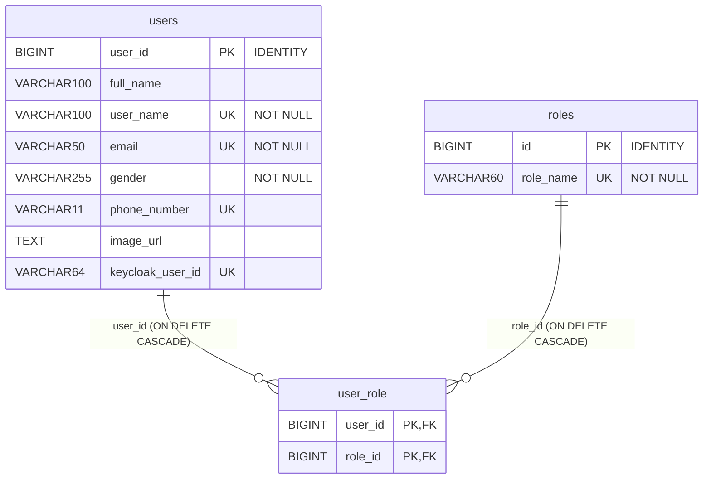

# auth-service

> **Phiên bản:** 1.0 · **Trạng thái:** Final · **Cập nhật:** 2026-11-12 · **Phạm vi:** Ứng dụng (as-is)

| Thuộc tính | Giá trị |
| :--- | :--- |
| Ngôn ngữ / stack | Go 1.27, router `go-chi/chi v5`, query builder `stephenafamo/bob` trên `pgx v5` |
| Port | `8088` (env `PORT`, `services/auth-service/main.go:57`; compose `docker-compose.yml:177-178`) |
| Database | PostgreSQL `authservice` (bảng `users`, `roles`, `user_role`) |
| Hệ thống ngoài | Keycloak realm `ecommerce` (OIDC authorization code, token, logout, Admin REST API) |
| Đường dẫn code | `services/auth-service/` |
| Prefix gateway | `/api/v1/auth/*` (public), `/api/v1/users[/*]` và `/api/v1/roles[/*]` (bearer) → rewrite thành `/auth/<path gốc>` (`deploy/apisix/apisix.yaml:63-70`, `142-177`) |
| Tính năng phục vụ | [FEAT-01](../04-features/FEAT-01-sso-login-logout.md), [FEAT-02](../04-features/FEAT-02-user-registration.md), [FEAT-03](../04-features/FEAT-03-session-refresh.md), [FEAT-04](../04-features/FEAT-04-user-role-management.md), gián tiếp [FEAT-21](../04-features/FEAT-21-admin-access-control.md) |

## 1. Tổng quan & trách nhiệm

auth-service là lớp **BFF xác thực** giữa frontend và Keycloak, đồng thời giữ một **bản sao hồ sơ người dùng** trong DB riêng:

1. **SSO (Authorization Code)**: tạo URL authorize Keycloak, nhận callback, đổi `code` lấy token, phát hành **ticket** dùng-một-lần để frontend server đổi lấy token (tránh đưa token lên URL).
2. **Quản lý phiên**: refresh token và logout (ủy quyền cho Keycloak).
3. **Đăng ký**: tạo user trên Keycloak qua Admin API rồi lưu hồ sơ + role vào DB `authservice`.
4. **Quản lý user/role (CRUD)** trên DB `authservice` — role chỉ tồn tại ở DB, **không đồng bộ** với realm role Keycloak (ISSUE-08).

Service không phát hành JWT riêng, không xác minh JWT (dựa vào APISIX — ISSUE-02) và không kiểm tra role (ISSUE-01).

## 2. Tech stack & thư viện

| Thư viện | Phiên bản | Vai trò |
| :--- | :--- | :--- |
| `github.com/go-chi/chi/v5` | v5.3.2 | Router, middleware `Recoverer`, `Logger` |
| `github.com/go-chi/cors` | v1.2.2 | CORS `*` |
| `github.com/jackc/pgx/v5` | v5.11.0 | Driver/pool PostgreSQL |
| `github.com/stephenafamo/bob` | v0.50.0 | Query builder SQL (dialect `psql`) |
| `github.com/stephenafamo/scan` | v0.9.0 | Map row → struct |
| `github.com/stretchr/testify` | v1.11.1 | Test |
| `com.ecommerce/shared` | local | config, database, middleware, response ([shared-go-module.md](shared-go-module.md)) |

Nguồn: `services/auth-service/go.mod:5-13`. Dockerfile build 2 stage (`golang:1.27-alpine` → `alpine:latest`), binary tĩnh `CGO_ENABLED=0`, `EXPOSE 8088` (`services/auth-service/Dockerfile:1-23`).

## 3. Cấu hình

Đọc tại `services/auth-service/main.go:26-87`.

| Biến | Default trong code | Compose (`docker-compose.yml:179-188`) | Ý nghĩa |
| :--- | :--- | :--- | :--- |
| `PORT` | `8088` | – | Cổng HTTP |
| `DATABASE_URL` | – | – | DSN đầy đủ; nếu có thì bỏ qua mọi biến DB khác |
| `SPRING_DATASOURCE_URL` | – | `jdbc:postgresql://postgres:5432/authservice` | Di sản Spring; được **parse thủ công** lấy host/port/db (`main.go:37-51`) |
| `POSTGRES_HOST` / `POSTGRES_PORT` / `POSTGRES_DB` | `localhost` / `5432` / `authservice` | (ghi đè bởi `SPRING_DATASOURCE_URL`) | Thông tin DB |
| `POSTGRES_USER` / `POSTGRES_PASSWORD` | có default trong code | `${POSTGRES_USER}` / `${POSTGRES_PASSWORD}` | Tài khoản DB (secret — xem `.env`) |
| `KEYCLOAK_SERVER_URL` | `http://localhost:8080` | `http://keycloak:8080` | URL nội bộ cho token/logout/admin API |
| `KEYCLOAK_PUBLIC_SERVER_URL` | `http://keycloak.ecommerce.local` | `${KEYCLOAK_PUBLIC_SERVER_URL:-http://localhost:8080}` | URL trình duyệt dùng cho trang authorize |
| `KEYCLOAK_REALM` | `ecommerce` | – | Realm |
| `KEYCLOAK_CLIENT_ID` | `ecommerce-client` | – | Client OIDC |
| `KEYCLOAK_CLIENT_SECRET` | `""` | **không set** | Nếu rỗng thì không gửi `client_secret` (client public) |
| `KEYCLOAK_ADMIN_REALM` | `master` | – | Realm lấy admin token |
| `KEYCLOAK_ADMIN_CLIENT_ID` | `admin-cli` | – | Client lấy admin token (password grant) |
| `KEYCLOAK_ADMIN_USERNAME` / `KEYCLOAK_ADMIN_PASSWORD` | có default hard-code trong code (`main.go:82-83`) | **không set** cho auth-service | Tài khoản admin Keycloak. Compose chỉ truyền `KEYCLOAK_ADMIN*` cho container keycloak (`docker-compose.yml:127-128`), không truyền cho auth-service → auth-service dùng default trong code; nếu không khớp, đăng ký rơi vào nhánh id giả (ISSUE-08) |
| `SSO_BACKEND_CALLBACK_URL` | `http://api.ecommerce.local/api/v1/auth/callback` | `http://localhost:8088/api/v1/auth/callback` | `redirect_uri` gửi Keycloak ở bước authorize. Compose trỏ **thẳng vào port service**, không qua gateway |
| `SSO_DEFAULT_FRONTEND_REDIRECT` | `http://ecommerce.local/auth/callback` | `http://localhost:3000/auth/callback` | Nơi trả ticket khi request không có `redirect_uri` hoặc state không hợp lệ |
| `SSO_SCOPE` | `openid profile email` | – | Scope OIDC |
| `SSO_ALLOWED_REDIRECT_URIS` | – | có set | **Không được code đọc** (ISSUE-05, ISSUE-37) |
| `JWT_ISSUER_URI` | – | có set | **Không được code đọc** (ISSUE-37) |

## 4. Phụ thuộc

| Phụ thuộc | Cách dùng | Nguồn |
| :--- | :--- | :--- |
| PostgreSQL `authservice` | CRUD `users`, `roles`, `user_role`; schema tạo lúc khởi động | `internal/repository/user_repository.go:31-66` |
| Keycloak `…/realms/{realm}/protocol/openid-connect/auth` | Redirect trình duyệt (dùng `PublicServerURL`) | `internal/service/keycloak_client.go:81-87` |
| Keycloak `…/protocol/openid-connect/token` | `authorization_code`, `refresh_token`, `password` (admin) | `keycloak_client.go:77-79`, `111-134`, `163-175` |
| Keycloak `…/protocol/openid-connect/logout` | Revoke refresh token | `keycloak_client.go:89-91`, `136-161` |
| Keycloak Admin `…/admin/realms/{realm}/users` | Tạo / xóa user | `keycloak_client.go:97-99`, `177-260` |
| Kafka, Redis, service khác | **Không dùng** (store SSO ở RAM — ISSUE-06) | – |

HTTP client Keycloak timeout 10s (`keycloak_client.go:71-73`).

## 5. Cấu trúc code

```
services/auth-service/
├── main.go                         # dựng DSN, kết nối DB, InitSchema, KeycloakConfig, router + middleware, graceful shutdown 10s
├── main_test.go                    # test router với DB nil
├── Dockerfile
├── go.mod
└── internal/
    ├── handler/auth_handler.go     # đăng ký route (2 prefix), 16 handler, helper appendQuery
    ├── model/user.go               # User, UserResponse, RegisterRequest, UpdateUserRequest, ChangePasswordRequest,
    │                               # RefreshTokenRequest, KeycloakTokenResponse, PageResponse[T]
    ├── repository/user_repository.go # schema + truy vấn bob cho users/roles/user_role
    └── service/
        ├── keycloak_client.go      # client HTTP tới Keycloak (authorize URL, token, refresh, logout, admin create/delete)
        ├── sso_store.go            # store in-memory state (TTL 5') và ticket (TTL 2'), purge mỗi phút
        └── user_service.go         # nghiệp vụ đăng ký/CRUD/role, lỗi sentinel
```

## 6. API endpoints

**Quy ước chung**

- Mọi route đăng ký ở **hai prefix**: `/api/v1/...` và `/auth/api/v1/...` (`auth_handler.go:45-57`). Gateway luôn rewrite `^/(.*)` → `/auth/$1`, nên request qua gateway rơi vào nhánh `/auth/api/v1/...`.
- Response dùng **envelope `ApiResponse`** ([shared-go-module.md §8.1](shared-go-module.md#81-hai-định-dạng-response-song-song-issue-29)) — trừ `login`/`callback` (302) và health.
- Cột "Auth": *Public* = gateway không kiểm token; *Bearer* = APISIX `openid-connect` `bearer_only` (chỉ xác thực, không kiểm role — ISSUE-01). Service tự nó không chặn request nào.

### 6.1 Bảng tổng hợp

| # | Method | Path trong service | Path qua gateway | Auth | Mô tả |
| :--- | :--- | :--- | :--- | :--- | :--- |
| 1 | GET | `/actuator/health`, `/auth/actuator/health`, `/health` | Không có route | – | Health (luôn UP) |
| 2 | POST | `/api/v1/auth/signup` | `/api/v1/auth/signup` | Public | Đăng ký user |
| 3 | GET | `/api/v1/auth/login` | `/api/v1/auth/login` | Public | 302 sang Keycloak authorize |
| 4 | GET | `/api/v1/auth/callback` | `/api/v1/auth/callback` (compose dùng thẳng `:8088`) | Public | Nhận code, đổi token, 302 về frontend kèm ticket |
| 5 | GET | `/api/v1/auth/session` | `/api/v1/auth/session` | Public | Đổi ticket → token |
| 6 | POST | `/api/v1/auth/refresh` | `/api/v1/auth/refresh` | Public | Làm mới token |
| 7 | POST | `/api/v1/auth/logout` | `/api/v1/auth/logout` | Public | Logout Keycloak |
| 8 | GET | `/api/v1/users/me` | `/api/v1/users/me` | Bearer | Hồ sơ user hiện tại |
| 9 | PUT | `/api/v1/users/me/password` | `/api/v1/users/me/password` | Bearer | **Stub** đổi mật khẩu (ISSUE-07) |
| 10 | GET | `/api/v1/users/all` | `/api/v1/users/all` | Bearer | Danh sách user phân trang |
| 11 | GET | `/api/v1/users/{id}` | `/api/v1/users/{id}` | Bearer | Lấy user theo id |
| 12 | PUT | `/api/v1/users/{id}` | `/api/v1/users/{id}` | Bearer | Cập nhật hồ sơ |
| 13 | DELETE | `/api/v1/users/{id}` | `/api/v1/users/{id}` | Bearer | Xóa user (DB + Keycloak) |
| 14 | GET | `/api/v1/users?username=` | `/api/v1/users?username=` | Bearer | Tìm theo username |
| 15 | POST | `/api/v1/roles/users/{userId}/assign` | `/api/v1/roles/users/{userId}/assign` | Bearer | Gán role (body text thuần) |
| 16 | POST | `/api/v1/roles/users/{userId}/revoke` | `/api/v1/roles/users/{userId}/revoke` | Bearer | Thu hồi role |
| 17 | GET | `/api/v1/roles/users/{userId}` | `/api/v1/roles/users/{userId}` | Bearer | Danh sách role của user |
| – | GET | – | `/auth/v3/api-docs/*` | Public | Route chết, service không phục vụ OpenAPI (ISSUE-16) |

### 6.2 Chi tiết

#### (2) `POST /api/v1/auth/signup` — `auth_handler.go:100-123`

Request body (`model.RegisterRequest`, `internal/model/user.go:25-34`):

```json
{
  "fullName": "Nguyen Van A",
  "username": "nva",
  "password": "********",
  "email": "nva@example.com",
  "gender": "MALE",
  "phone": "0901234567",
  "avatar": "https://cdn.example.com/a.png",
  "roles": ["USER"]
}
```

Response 200:

```json
{ "success": true, "code": "OK", "message": "User nva registered successfully", "traceId": "…", "timestamp": "…" }
```

| HTTP | `code` | Khi nào |
| :--- | :--- | :--- |
| 400 | `BAD_REQUEST` | Body không phải JSON hợp lệ |
| 400 | `VALIDATION_FAILED` | Thiếu `username`, `password` hoặc `email` |
| 409 | `CONFLICT` | Trùng username / email / phone (`message` dạng `username already exists: nva`) |
| 400 | `REGISTRATION_FAILED` | Lỗi khác: Keycloak trả ≥400, lỗi DB, `db not connected`… (lỗi DB cũng ra **400** thay vì 500) |

#### (3) `GET /api/v1/auth/login?redirect_uri=<url>` — `auth_handler.go:125-134`

- `redirect_uri` (tùy chọn) — URL frontend nhận ticket; **không kiểm tra allowlist** (ISSUE-05). Mặc định `SSO_DEFAULT_FRONTEND_REDIRECT`.
- Response: **302** `Location: {KEYCLOAK_PUBLIC_SERVER_URL}/realms/ecommerce/protocol/openid-connect/auth?client_id=ecommerce-client&redirect_uri={SSO_BACKEND_CALLBACK_URL}&response_type=code&scope=openid+profile+email&state=<random 43 ký tự>` (`keycloak_client.go:101-109`).
- Không có mã lỗi.

#### (4) `GET /api/v1/auth/callback?code=&state=[&error=]` — `auth_handler.go:136-167`

| Tình huống | Kết quả |
| :--- | :--- |
| Có `error` (Keycloak từ chối/người dùng hủy) | 302 → `SSO_DEFAULT_FRONTEND_REDIRECT?error=<error>` (luôn về default, không về `redirect_uri` ban đầu) |
| `state` không tồn tại/hết hạn | **Vẫn tiếp tục** với `frontendRedirect = default` (ISSUE-52) |
| Đổi code thành công | Lưu token vào store, 302 → `<frontendRedirect>?ticket=<random>` |
| Đổi code thất bại (bao gồm lỗi `redirect_uri` mismatch — ISSUE-04) | Lưu **mock token** (`mock-access-token`, `mock-refresh-token`, `expires_in` 3600) và vẫn 302 kèm ticket (ISSUE-04) |

#### (5) `GET /api/v1/auth/session?ticket=<ticket>` — `auth_handler.go:169-183`

Response 200 (`data` = `model.KeycloakTokenResponse`, `internal/model/user.go:54-61`):

```json
{
  "success": true,
  "code": "OK",
  "data": {
    "access_token": "eyJhbGciOiJSUzI1NiIs…",
    "refresh_token": "eyJhbGciOiJIUzUxMiIs…",
    "token_type": "Bearer",
    "expires_in": 300,
    "refresh_expires_in": 1800,
    "scope": "openid profile email"
  },
  "traceId": "…",
  "timestamp": "…"
}
```

| HTTP | `code` | Khi nào |
| :--- | :--- | :--- |
| 400 | `BAD_REQUEST` | Thiếu `ticket` ("Ticket is required") |
| 401 | `UNAUTHORIZED` | Ticket không tồn tại, đã dùng, hoặc quá 2 phút ("Invalid or expired ticket") |

#### (6) `POST /api/v1/auth/refresh` — `auth_handler.go:185-199`

Request: `{ "refreshToken": "eyJhbGciOi…" }` (`model.RefreshTokenRequest`). Response 200: giống (5). Lỗi: 400 `BAD_REQUEST` ("Refresh token is required"); 401 `UNAUTHORIZED` với `message` = lỗi Keycloak nguyên văn (vd `keycloak token error: {"error":"invalid_grant",…} (status 400)`).

#### (7) `POST /api/v1/auth/logout` — `auth_handler.go:201-208`

Request: `{ "refreshToken": "…" }` (tùy chọn). Gọi Keycloak logout nếu có token; **mọi lỗi bị bỏ qua**. Luôn trả 200 `{"success":true,"code":"OK","message":"Logout successful",…}`.

#### (8) `GET /api/v1/users/me` — `auth_handler.go:318-339`

Lấy `preferred_username` từ JWT (fallback `sub`) qua `middleware.UserClaims`, tìm `users.user_name`. Response 200 (`data` = `model.UserResponse`, `internal/model/user.go:15-23`):

```json
{
  "success": true,
  "code": "OK",
  "data": {
    "id": 12, "fullname": "Nguyen Van A", "username": "nva", "email": "nva@example.com",
    "gender": "MALE", "phone": "0901234567", "avatar": ""
  },
  "traceId": "…", "timestamp": "…"
}
```

| HTTP | `code` | Khi nào |
| :--- | :--- | :--- |
| 401 | `AUTH_TOKEN_INVALID` | Không có/không parse được JWT |
| 404 | `NOT_FOUND` | Username không có trong DB `authservice` — ví dụ user được tạo trực tiếp trên Keycloak (seed user trong realm import) mà chưa từng đi qua `/signup` (ISSUE-101) |
| 500 | `INTERNAL_ERROR` | Lỗi DB / `db not connected` |

> `UserResponse` **không** chứa `roles` dù model `User` có (`internal/service/user_service.go:187-197`), và tên field là `fullname` (chữ thường). Frontend lại kỳ vọng `fullName` + `roles: [{id, name}]` (`frontend/packages/lib/src/server/session.ts:13-21`, `frontend/packages/lib/src/types.ts:31-45`) → **lệch hợp đồng hồ sơ, guard admin luôn từ chối** (ISSUE-100). User chỉ tồn tại trong realm Keycloak (seed user) không có bản ghi trong DB `authservice` → endpoint trả 404 (ISSUE-101).

#### (9) `PUT /api/v1/users/me/password` — `auth_handler.go:240-242`

Body `model.ChangePasswordRequest` (`oldPassword`, `newPassword`, `confirmPassword`) **không được đọc**. Luôn 200 `"Password change request processed"` (ISSUE-07).

#### (10) `GET /api/v1/users/all?page=0&size=10&sortBy=id&sortOrder=ASC` — `auth_handler.go:303-316`

- `page` (default 0, âm → 0), `size` (default 10, ≤0 → 10), `sortBy` ∈ `username|user_name|email|fullname|full_name` (khác → `user_id`), `sortOrder` `DESC`/khác → `ASC` (`user_repository.go:172-187`). Tham số không phải số → 0 rồi áp default.
- Response 200, `data` = `PageResponse<UserResponse>` (`internal/model/user.go:63-73`):

```json
{
  "success": true, "code": "OK",
  "data": {
    "content": [ { "id": 1, "fullname": "Admin", "username": "admin", "email": "admin@example.com", "gender": "", "phone": "", "avatar": "" } ],
    "totalElements": 1, "totalPages": 1, "size": 10, "number": 0,
    "numberOfElements": 1, "first": true, "last": true, "empty": false
  },
  "traceId": "…", "timestamp": "…"
}
```

Khi không có user, `content` là `null` (slice nil, `user_service.go:152`). Lỗi: 500 `INTERNAL_ERROR`.

#### (11) `GET /api/v1/users/{id}` — `auth_handler.go:283-301`

Response giống (8). Lỗi: 400 `INVALID_ID` ("User ID must be numeric"), 404 `NOT_FOUND`, 500 `INTERNAL_ERROR`.

#### (12) `PUT /api/v1/users/{id}` — `auth_handler.go:214-238`

Request (`model.UpdateUserRequest`, mọi field tùy chọn; field vắng mặt giữ nguyên):

```json
{ "fullName": "Nguyen Van B", "email": "nvb@example.com", "gender": "FEMALE", "phone": "0912345678", "avatar": "" }
```

Response 200 `message: "User updated successfully"`, `data` = `UserResponse`. Lỗi: 400 `INVALID_ID`, 400 `BAD_REQUEST`, 404 `NOT_FOUND`, 500 `INTERNAL_ERROR` (gồm cả vi phạm UNIQUE email/phone — không map sang 409). Thay đổi **không đồng bộ sang Keycloak** (email trong token vẫn là email cũ).

#### (13) `DELETE /api/v1/users/{id}` — `auth_handler.go:244-261`

200 `message: "User 12 deleted successfully"`. Xóa user Keycloak trước (lỗi bị bỏ qua), sau đó xóa DB (cascade `user_role`). Lỗi: 400 `INVALID_ID`, 404 `NOT_FOUND`, 500 `INTERNAL_ERROR`.

#### (14) `GET /api/v1/users?username=nva` — `auth_handler.go:263-281`

Response như (8). Lỗi: 400 `BAD_REQUEST` ("username query parameter is required"), 404, 500.

#### (15)(16) `POST /api/v1/roles/users/{userId}/assign|revoke` — `auth_handler.go:345-397`

Body là **text thuần** (không JSON), ví dụ `ADMIN`. Service `TrimSpace` + `ToUpper`.

| HTTP | `code` | Khi nào |
| :--- | :--- | :--- |
| 200 | `OK` | `"Roles assigned to user 12"` / `"Roles revoked from user 12"` |
| 400 | `INVALID_ID` / `BAD_REQUEST` | userId không phải số / body rỗng ("Role name cannot be empty") |
| 409 | `CONFLICT` | assign: role đã gán **hoặc** role không tồn tại **hoặc** userId không tồn tại (FK lỗi → thực ra ra 500, xem dưới); revoke: role không có trên user |
| 500 | `INTERNAL_ERROR` | Lỗi DB, ví dụ userId không tồn tại → vi phạm FK `fk_user_role_user` |

#### (17) `GET /api/v1/roles/users/{userId}` — `auth_handler.go:399-413`

200 `data: ["USER","ADMIN"]` (sắp theo `roles.id`). Lỗi 400 `INVALID_ID`, 500. User không tồn tại → mảng rỗng, không 404.

## 7. Data model



DDL: `services/auth-service/internal/repository/user_repository.go:35-63`. Seed role: `1 USER`, `2 PM`, `3 ADMIN` (`ON CONFLICT (id) DO NOTHING`). Chi tiết từng cột: [data-dictionary.md §authservice](../06-data/data-dictionary.md#2-authservice-auth-service).

Ánh xạ cột ↔ JSON (`user_repository.go:68-103`): `user_id→id`, `full_name→fullname`, `user_name→username`, `email`, `gender`, `phone_number→phone`, `image_url→avatar`, `keycloak_user_id→keycloakUserId` (không xuất ra API). Các cột nullable được `COALESCE(...,'')` khi đọc.

Lưu ý ràng buộc:

- `gender NOT NULL` nhưng signup cho phép bỏ trống → lưu chuỗi rỗng `''`.
- `phone_number UNIQUE` + service ghi `''` khi không có phone → **user thứ hai không nhập phone sẽ vi phạm UNIQUE** (`''` ≠ NULL) → signup trả 400 `REGISTRATION_FAILED` (`user_repository.go:229-238`; `ExistsByPhone` chỉ kiểm khi phone khác rỗng, `user_service.go:51`) — ISSUE-55. Tương tự `phone_number VARCHAR(11)` → số dài hơn 11 ký tự (vd `+84…`) bị lỗi DB.

## 8. Business logic chi tiết

### 8.1 Luồng SSO (login → callback → ticket → session)

```mermaid
sequenceDiagram
  autonumber
  participant B as Browser
  participant FE as Frontend server (web/admin BFF)
  participant GW as APISIX :9080
  participant AS as auth-service :8088
  participant KC as Keycloak

  B->>GW: GET /api/v1/auth/login?redirect_uri=http://localhost:3000/auth/callback
  GW->>AS: GET /auth/api/v1/auth/login?redirect_uri=…
  AS->>AS: state = random(32B); states[state] = redirect_uri (TTL 5')
  AS-->>B: 302 KC /auth?client_id&redirect_uri=SSO_BACKEND_CALLBACK_URL&state
  B->>KC: Trang đăng nhập Keycloak
  KC-->>B: 302 SSO_BACKEND_CALLBACK_URL?code&state
  B->>AS: GET /api/v1/auth/callback?code&state (compose: thẳng :8088)
  AS->>AS: ConsumeLoginState(state) → frontendRedirect (sai/không có → default)
  AS->>KC: POST /token grant_type=authorization_code, redirect_uri=frontendRedirect
  alt Keycloak trả token
    KC-->>AS: access/refresh token
  else lỗi (vd redirect_uri mismatch — ISSUE-04)
    AS->>AS: tokens = mock-access-token / mock-refresh-token
  end
  AS->>AS: ticket = random(32B); tickets[ticket] = tokens (TTL 2')
  AS-->>B: 302 frontendRedirect?ticket=…
  B->>FE: GET /auth/callback?ticket=…
  FE->>GW: GET /api/v1/auth/session?ticket=…
  GW->>AS: GET /auth/api/v1/auth/session?ticket=…
  AS->>AS: ConsumeTokens(ticket) (xóa ngay, dùng 1 lần)
  AS-->>FE: 200 ApiResponse{data: KeycloakTokenResponse}
  FE-->>B: Set-Cookie phiên (httpOnly) + redirect
```

Điểm chính (nguồn `auth_handler.go:125-183`, `sso_store.go`, `keycloak_client.go:101-122`):

- **State / ticket**: 32 byte `crypto/rand`, base64url không padding (`sso_store.go:65-69`). State TTL 5 phút, ticket TTL 2 phút, đều **dùng một lần** (xóa khi consume kể cả khi hết hạn). Goroutine purge mỗi 1 phút (`sso_store.go:38-45`). Lưu trong `map` + `sync.RWMutex` → mất khi restart, không chia sẻ giữa replica (ISSUE-06).
- **redirect_uri không nhất quán**: authorize luôn dùng `BackendCallbackURL`, nhưng đổi code dùng `frontendRedirect` (ISSUE-04).
- **State không bắt buộc**: callback với state giả vẫn đổi code (ISSUE-52).
- **Mock token**: lỗi đổi code không báo cho người dùng (ISSUE-04).

### 8.2 Đăng ký (signup)

```mermaid
sequenceDiagram
  autonumber
  participant C as Client
  participant AS as auth-service
  participant DB as authservice DB
  participant KC as Keycloak

  C->>AS: POST /api/v1/auth/signup {username,password,email,...,roles}
  AS->>AS: Kiểm username/password/email khác rỗng
  AS->>DB: EXISTS user_name? EXISTS email? EXISTS phone_number (nếu phone≠"")?
  alt trùng
    AS-->>C: 409 CONFLICT
  end
  AS->>AS: roles = req.roles hoặc ["USER"]
  AS->>KC: POST /realms/master/token (password grant admin-cli)
  alt Không lấy được admin token
    AS->>AS: keycloakUserId = "kc-<username>" (ISSUE-08)
  else OK
    AS->>KC: POST /admin/realms/ecommerce/users {enabled, username, email, emailVerified:true, credentials, firstName, lastName}
    alt KC ≥400
      AS-->>C: 400 REGISTRATION_FAILED
    else lỗi mạng / thiếu Location
      AS->>AS: keycloakUserId = "kc-<username>"
    else 201 Location .../users/{uuid}
      AS->>AS: keycloakUserId = uuid
    end
  end
  AS->>DB: BEGIN; INSERT users …; INSERT user_role SELECT id FROM roles WHERE role_name=UPPER(r) ON CONFLICT DO NOTHING; COMMIT
  alt lỗi DB
    AS->>KC: DELETE /admin/realms/ecommerce/users/{keycloakUserId} (bù trừ, lỗi bỏ qua)
    AS-->>C: 400 REGISTRATION_FAILED
  end
  AS-->>C: 200 "User <username> registered successfully"
```

Quy tắc chi tiết (`user_service.go:34-88`, `keycloak_client.go:177-239`, `user_repository.go:217-270`):

| Quy tắc | Mô tả |
| :--- | :--- |
| Bắt buộc | `username`, `password`, `email` khác chuỗi rỗng. Không kiểm định dạng email, độ dài/độ mạnh mật khẩu, độ dài username (≤100), email (≤50), phone (≤11) — vượt quá → lỗi DB → 400. |
| Trùng lặp | Kiểm trước khi gọi Keycloak; khi DB không kết nối, `Exists*` trả `false` (bỏ qua kiểm tra) (`user_repository.go:393-433`). |
| Tách họ tên | `fullName` tách theo dấu cách: phần cuối → `lastName`, phần còn lại → `firstName`; một từ → `firstName = lastName = fullName`. |
| Role | `roles` do **client tự gửi** trên endpoint public, mặc định `["USER"]`; role không tồn tại bị bỏ qua im lặng; **cho phép tự gán `ADMIN`/`PM`** trong DB (ISSUE-53). Role **không** được gửi sang Keycloak (ISSUE-08). |
| Mật khẩu | Chỉ gửi sang Keycloak (`temporary: false`), không lưu ở DB. |
| Email | Đánh dấu `emailVerified: true` — không có bước xác minh email. |
| Sự kiện | Không publish sự kiện onboarding (notification-service chờ `profile-onboarding-topic` — ISSUE-17). |

### 8.3 Refresh / Logout

- Refresh: `grant_type=refresh_token`, kèm `client_secret` nếu cấu hình (`keycloak_client.go:124-134`). Lỗi Keycloak → 401.
- Logout: POST form `client_id`, `refresh_token` (+ secret) tới endpoint logout; lỗi bị bỏ qua (`auth_handler.go:201-208`). Không có blacklist access token: access token vẫn hợp lệ ở gateway tới khi hết hạn.

### 8.4 Quản lý user/role

- `Update`: đọc bản ghi, ghép field không-nil, `UPDATE` toàn bộ 5 cột (`user_repository.go:272-317`). Không kiểm trùng email/phone trước (lỗi UNIQUE → 500). Không cập nhật Keycloak.
- `Delete`: xóa Keycloak (nếu có `keycloak_user_id`, kể cả id giả `kc-…` → Keycloak 404, bỏ qua), rồi xóa DB.
- `AssignRole`: `INSERT … SELECT … ON CONFLICT DO NOTHING`; `RowsAffected = 0` → 409.
- `RevokeRole`: `DELETE … WHERE role_id IN (SELECT id FROM roles WHERE role_name = ?)`.
- Không có endpoint liệt kê/tạo role; danh sách role cố định từ seed.
- **Không có kiểm tra quyền**: mọi người dùng có token hợp lệ đều xem/sửa/xóa user khác và gán `ADMIN` (ISSUE-01).

## 9. Sự kiện (produce / consume)

Không produce, không consume Kafka.

## 10. Health check & observability

- `GET /actuator/health`, `/auth/actuator/health`, `/health` → luôn `{"status":"UP","components":{"db":{"status":"UP"}}}` (ISSUE-36).
- Log: `chi` Logger cho mỗi request; log khởi động/kết nối DB. `InitSchema` lỗi bị **bỏ qua hoàn toàn** (`main.go:72`: `_ = repo.InitSchema(ctx)`).
- `X-Correlation-Id` trả lại trong header và `traceId`.

## 11. Test

`services/auth-service/main_test.go` (chạy với DB `nil`, Keycloak không có thật):

| Test | Kiểm tra |
| :--- | :--- |
| `TestHealthCheck` (`:52-57`) | 2 route health trả 200 |
| `TestSSOFlow` (`:59-78`) | `login` 302 tới `openid-connect/auth` với `response_type=code`; `callback` với code/state giả vẫn 302 kèm `ticket=` (**khẳng định hành vi mock token của ISSUE-04**); `PUT /users/me/password` trả 200 (stub) |
| `TestSignupValidation` (`:80-90`) | Body `{}` → 400, `success=false` |
| `TestSSOSessionStore` (`:92-117`) | State dùng 1 lần; ticket lưu và lấy lại token |

Không có test cho CRUD user/role, refresh, logout, hay tích hợp Keycloak (ISSUE-46).

## 12. Vấn đề đã biết

| ID | Mức | Tóm tắt |
| :--- | :--- | :--- |
| ISSUE-01 | Critical | Không kiểm role — mọi token gọi được CRUD user/role |
| ISSUE-02 | High | Claim JWT đọc không xác minh chữ ký (`/users/me`) |
| ISSUE-04 | Critical | `redirect_uri` authorize ≠ exchange; mock token khi lỗi |
| ISSUE-05 | Critical | Open redirect `redirect_uri`, `SSO_ALLOWED_REDIRECT_URIS` không được đọc |
| ISSUE-06 | High | Store state/ticket in-memory |
| ISSUE-07 | High | Đổi mật khẩu là stub |
| ISSUE-08 | High | Id Keycloak giả `kc-<username>`, role không đồng bộ Keycloak; compose không truyền `KEYCLOAK_ADMIN_*` cho auth-service |
| ISSUE-16 | Low | Route `/auth/v3/api-docs/*` chết |
| ISSUE-17 | High | Không produce sự kiện onboarding |
| ISSUE-28 | High | Schema tạo lúc khởi động, lỗi bị bỏ qua |
| ISSUE-29 | Low | Envelope `ApiResponse` khác các service khác |
| ISSUE-36 | Low | Health luôn UP |
| ISSUE-37 | Low | `JWT_ISSUER_URI`, `SSO_ALLOWED_REDIRECT_URIS` không dùng |
| ISSUE-52 | High | Callback không bắt buộc `state` hợp lệ (login CSRF) |
| ISSUE-53 | Medium | Signup public cho phép client tự gán role `ADMIN`/`PM` |
| ISSUE-100 | Critical | `/users/me` trả `UserResponse` (`fullname`, không có `roles`) trong khi frontend chờ `fullName` + `roles[{id,name}]` → guard admin luôn từ chối |
| ISSUE-101 | High | User của realm Keycloak không có trong DB `authservice` → `/users/me` 404 |

| ISSUE-55 | Medium | Chuỗi rỗng `''` ghi vào cột UNIQUE: `users.phone_number` → user thứ hai không nhập số điện thoại không đăng ký được |

Ngoài ra: lỗi UNIQUE ở `PUT /users/{id}` trả 500 thay vì 409.

## 13. Tham chiếu source

- `services/auth-service/main.go:26-130`
- `services/auth-service/internal/handler/auth_handler.go:39-424`
- `services/auth-service/internal/service/keycloak_client.go:17-289`
- `services/auth-service/internal/service/sso_store.go:12-123`
- `services/auth-service/internal/service/user_service.go:13-197`
- `services/auth-service/internal/repository/user_repository.go:31-433`
- `services/auth-service/internal/model/user.go:3-73`
- `services/auth-service/main_test.go:19-117`
- `services/auth-service/Dockerfile:1-23`, `services/auth-service/go.mod:1-31`
- `docker-compose.yml:171-195`
- `deploy/apisix/apisix.yaml:63-70`, `103-105`, `142-177`
