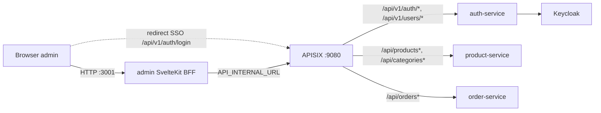
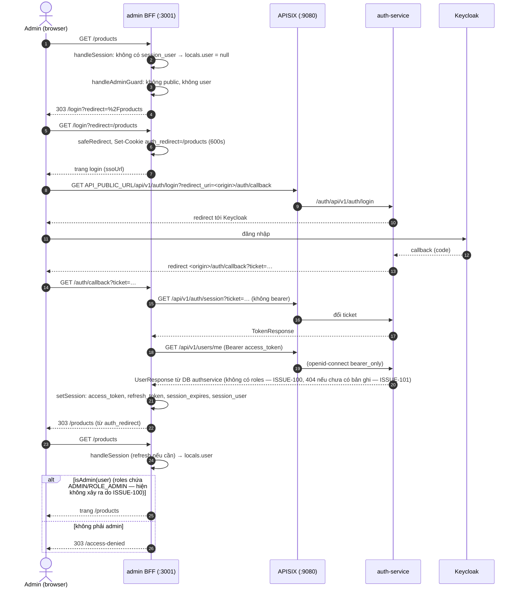
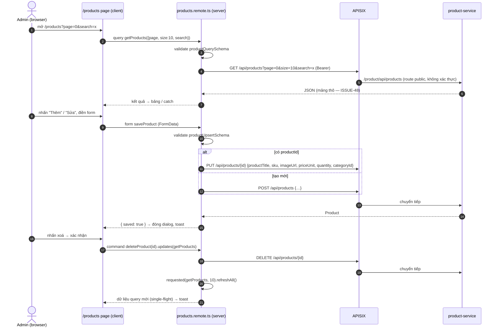

# frontend-admin (`@ecommerce/admin`)

> **Phiên bản:** 1.0 · **Trạng thái:** Final · **Cập nhật:** 2026-11-12 · **Phạm vi:** Ứng dụng (as-is)

| Thuộc tính | Giá trị |
| :--- | :--- |
| Loại | Ứng dụng backoffice (BFF: SvelteKit server + UI), chỉ dành cho người dùng có role `ADMIN` / `ROLE_ADMIN` |
| Ngôn ngữ / stack | TypeScript · SvelteKit `^3.0.0` · Svelte `^5.57.1` (runes) · Tailwind CSS 4 · Bun (`@sveltejs/adapter-bun`) · Paraglide JS (i18n) · Zod 4 |
| Port | `3001` (dev/preview: `frontend/apps/admin/vite.config.ts:8-9`; production: `PORT=3001` trong `frontend/apps/admin/Dockerfile:24`, `docker-compose.yml:438-441`) |
| Database | Không có. Trạng thái phiên lưu trong cookie (xem [mục 9](#9-session--cookies)). |
| Đường dẫn code | `frontend/apps/admin/` |
| Gọi tới | API Gateway APISIX (server-to-server qua `API_INTERNAL_URL`); browser chỉ được đẩy sang gateway ở bước SSO login (`API_PUBLIC_URL`) |
| Thư viện nội bộ | [`@ecommerce/lib`, `@ecommerce/ui`](frontend-packages.md) |
| Tính năng phục vụ | [FEAT-01](../04-features/FEAT-01-sso-login-logout.md) · [FEAT-03](../04-features/FEAT-03-session-refresh.md) · [FEAT-21](../04-features/FEAT-21-admin-access-control.md) · [FEAT-22](../04-features/FEAT-22-admin-dashboard.md) · [FEAT-23](../04-features/FEAT-23-admin-product-mgmt.md) · [FEAT-24](../04-features/FEAT-24-admin-category-mgmt.md) · [FEAT-25](../04-features/FEAT-25-admin-order-mgmt.md) · [FEAT-26](../04-features/FEAT-26-admin-placeholder-modules.md) · [FEAT-27](../04-features/FEAT-27-i18n.md) · [FEAT-28](../04-features/FEAT-28-seo-error-pages.md) |
| Issue liên quan | ISSUE-01, 04, 05, 08, 11, 14, 40, 41, 43, 45, 46, 47, 48, 49, 50, 60, 68, 69, 100, 101, 102 |

---

## 1. Tổng quan & trách nhiệm

`@ecommerce/admin` là ứng dụng quản trị (backoffice) theo mô hình **BFF (Backend-for-Frontend)**:

- Mọi lời gọi API đều chạy **phía server SvelteKit** thông qua *remote functions* (`query`, `form`, `command` từ `$app/server`) và client `createApi()` của `@ecommerce/lib/server`. Browser không bao giờ gọi gateway trực tiếp, ngoại trừ chuyển hướng tới endpoint SSO `/api/v1/auth/login` (`frontend/apps/admin/.env.example:1-8`, `frontend/apps/admin/src/routes/login/+page.server.ts:20-21`).
- Token Keycloak (access/refresh) được giữ trong cookie `httpOnly` do server đặt (`frontend/packages/lib/src/server/session.ts:32-49`).
- Một *guard* trong `hooks.server.ts` buộc mọi route (trừ `/login`, `/auth/callback`, `/access-denied`) phải có phiên và role admin (`frontend/apps/admin/src/hooks.server.ts:16-17,58-77`).

Chức năng thực tế đang có:

| Module | Trạng thái | Ghi chú |
| :--- | :--- | :--- |
| Đăng nhập SSO / đăng xuất | 🟡 | Phụ thuộc auth-service (ISSUE-04, ISSUE-05). |
| Guard admin | 🟡 | Chỉ ở frontend (ISSUE-01); với backend hiện tại `roles` luôn rỗng nên **mọi user đều bị đưa tới `/access-denied`** (ISSUE-100); có lỗ hổng bypass (ISSUE-68). |
| Dashboard | 🟡 | Đọc 3 endpoint dạng Page; lệch hợp đồng ISSUE-48. |
| Sản phẩm (list/search/create/update/delete) | 🟡 | ISSUE-48, ISSUE-60, ISSUE-102. |
| Danh mục (list/create/update/delete) | 🟡 | ISSUE-48, ISSUE-102. |
| Đơn hàng (list + xem chi tiết, chỉ đọc) | 🟡 | ISSUE-40, ISSUE-41, ISSUE-48. |
| Users / Inventory / Shipping / Settings | ⛔ | Chỉ là trang "Đang phát triển" (`frontend/apps/admin/src/lib/components/coming-soon.svelte`). |

> `frontend/apps/admin/README.md` mô tả trang `/orders` có "status filter và order line-item detail" — **không đúng** với code (chỉ có lọc theo mã đơn phía client và dialog chi tiết một dòng), xem ISSUE-45.

## 2. Tech stack & thư viện

Nguồn: `frontend/apps/admin/package.json:16-35`. Tất cả nằm ở `devDependencies` (adapter-bun đóng gói server vào `build/`).

| Thư viện | Phiên bản | Vai trò |
| :--- | :--- | :--- |
| `@sveltejs/kit` | `^3.0.0` | Framework; bật `experimental.remoteFunctions` (`vite.config.ts:13-15`) |
| `svelte` | `^5.57.1` | Runes mode bắt buộc cho code dự án; `compilerOptions.experimental.async: true` để dùng `{#await}` với remote query (`vite.config.ts:16-23`) — xem ISSUE-47 |
| `@sveltejs/adapter-bun` | `^1.0.0` | Adapter build server chạy bằng `bun ./build` (`vite.config.ts:24`, `Dockerfile:28`) |
| `@inlang/paraglide-js` | `^2.18.2` | i18n vi/en, strategy `url → cookie → baseLocale` (`vite.config.ts:26-32`) |
| `tailwindcss`, `@tailwindcss/vite`, `tw-animate-css` | `^4.3.0`, `^1.4.0` | CSS |
| `@fontsource-variable/geist` | `^5.3.0` | Font (import ở `src/routes/layout.css:1`) |
| `@lucide/svelte` | `^1.55.0` | Icon |
| `svelte-sonner` | `^1.2.0` | Toast (`toast.success/error`) |
| `zod` | `^4.6.5` | Schema cho remote functions (import dạng `* as v`) |
| `@ecommerce/lib`, `@ecommerce/ui` | `workspace:*` | Package dùng chung |
| `svelte-check`, `typescript ^6.0.3`, `@types/bun` | — | Type-check |

Đặc điểm cấu hình:

- **Không có `svelte.config.js`**: adapter, remote functions và compiler options khai báo trực tiếp trong plugin `sveltekit({...})` của Vite (`frontend/apps/admin/vite.config.ts:12-25`).
- Alias subpath import `#lib` / `#lib/*` → `./src/lib` (`package.json:36-39`, `tsconfig.json:6-8`).
- `.npmrc`: `engine-strict=true`.
- Script `check` compile Paraglide trước khi `svelte-check` (`package.json:11`). Thư mục `src/lib/paraglide` là file sinh, bị `.gitignore`.
- ESLint tắt rule `svelte/no-navigation-without-resolve` vì href được sinh bởi `localizeHref()` (`eslint.config.js:36-42`).

## 3. Cấu hình (biến môi trường)

| Biến | Default | Ý nghĩa | Đọc tại |
| :--- | :--- | :--- | :--- |
| `API_INTERNAL_URL` | `http://localhost:9080` | Origin gateway dùng cho mọi lời gọi server-side; dấu `/` cuối bị cắt | `frontend/packages/lib/src/server/env.ts:11-14` |
| `API_PUBLIC_URL` | = `API_INTERNAL_URL` | Origin gateway mà **browser** truy cập được; chỉ dùng để dựng URL SSO login | `frontend/packages/lib/src/server/env.ts:24-27`, `frontend/apps/admin/src/routes/login/+page.server.ts:21` |
| `PORT` | `3000` (adapter-bun) — image đặt `3001` | Port server production | `Dockerfile:23-24`, `.env.example:10-12` |
| `HOST` | (adapter) | Interface lắng nghe | `.env.example:12` |
| `ORIGIN` | — | Origin công khai khi chạy HTTP thuần / sau proxy; ảnh hưởng `url.origin` dùng để dựng `redirect_uri` | `.env.example:14-16`, `login/+page.server.ts:20` |
| `PROTOCOL_HEADER` | — | Header proxy (vd `x-forwarded-proto`) | `.env.example:16` |
| `NODE_ENV` | `production` trong image | — | `Dockerfile:23` |

Giá trị trên docker compose (`docker-compose.yml:433-449`, service `admin`, image `ghcr.io/ecommerce-int/frontend-admin:latest`, publish `3001:3001`, `depends_on: apisix`): `NODE_ENV`, `PORT`, `API_INTERNAL_URL` (trỏ `apisix:9080`), `API_PUBLIC_URL` (trỏ `localhost:9080`), `ORIGIN` (`http://localhost:3001`). Không có secret nào.

## 4. Phụ thuộc



| Phụ thuộc | Cách dùng | Route gateway (`deploy/apisix/apisix.yaml`) |
| :--- | :--- | :--- |
| auth-service | SSO login, đổi ticket, refresh, logout, profile | `auth-public` `:63-70` (public); `auth-users` `:160-177` (`openid-connect bearer_only`) |
| product-service | CRUD sản phẩm & danh mục | `product-catalog` `:71-82` — **không có plugin xác thực** (ISSUE-102) |
| order-service | Danh sách đơn | `order-orders` `:196-213` (`bearer_only`) |
| Keycloak | Gián tiếp qua auth-service (SSO) | — |

Không dùng DB, Kafka, Redis, S3. CORS của gateway không chứa origin `localhost:3001` (ISSUE-14) — không ảnh hưởng vì mọi API call là server-to-server; riêng bước SSO là điều hướng trình duyệt (top-level navigation), không phải XHR.

## 5. Cấu trúc code

```
frontend/apps/admin/
├── Dockerfile                 # multi-stage oven/bun:1, build context = frontend/
├── .env.example               # tên biến môi trường
├── package.json, vite.config.ts, tsconfig.json, eslint.config.js, prettier.config.js
├── project.inlang/settings.json   # baseLocale vi, locales [vi, en]
├── messages/{vi,en}.json      # 127 key mỗi file
├── static/robots.txt          # Disallow: /
└── src/
    ├── app.d.ts               # App.Locals.user: SessionUser | null
    ├── app.html               # %paraglide.lang% / %paraglide.dir%
    ├── hooks.server.ts        # paraglide → session refresh → admin guard
    ├── hooks.ts               # reroute: bỏ prefix locale
    ├── lib/
    │   ├── index.ts           # rỗng (placeholder alias #lib)
    │   ├── assets/favicon.svg # (không được tham chiếu trong code)
    │   ├── components/coming-soon.svelte
    │   ├── remote/auth.remote.ts   # command logout
    │   └── server/api.ts      # api(): createApi với access token của request
    └── routes/
        ├── layout.css         # tailwind + theme dùng chung, override --background
        ├── +layout.server.ts  # trả { user }
        ├── +layout.svelte     # sidebar, header, drawer mobile, đổi ngôn ngữ, logout, Toaster
        ├── +page.server.ts    # / → 303 /dashboard
        ├── +page.svelte       # template mặc định SvelteKit (dead code, ISSUE-43)
        ├── +error.svelte      # trang lỗi 404 / lỗi chung
        ├── login/             # +page.server.ts, +page.svelte
        ├── auth/callback/     # +page.server.ts, +page.svelte
        ├── access-denied/     # +page.svelte
        ├── dashboard/         # dashboard.remote.ts, +page.svelte
        ├── products/          # products.remote.ts, +page.svelte
        ├── categories/        # categories.remote.ts, +page.svelte
        ├── orders/            # orders.remote.ts, +page.svelte
        └── users/ inventory/ shipping/ settings/   # +page.svelte → ComingSoon
```

| File | Vai trò |
| :--- | :--- |
| `src/hooks.server.ts` | `handle = sequence(handleParaglide, handleSession, handleAdminGuard)` (`:79`) |
| `src/hooks.ts` | `reroute` trả `deLocalizeUrl(url).pathname` để `/en/products` khớp route `/products` (`:4`) |
| `src/lib/server/api.ts` | `api()` lấy cookie từ `getRequestEvent()` và gọi `createApi({ token: accessToken(cookies) })` (`:8-11`) |
| `src/lib/remote/auth.remote.ts` | `logout` command: gọi `auth.logout(refreshToken)` best-effort rồi `clearSession` (`:6-19`) |
| `src/lib/components/coming-soon.svelte` | Khối placeholder icon `Construction` + `m.common_developing()` |

## 6. Routes

Tất cả route trừ `/login`, `/auth/callback`, `/access-denied` đều qua guard ở [mục 8](#8-hooks). URL tiếng Anh có prefix `/en` (vd `/en/products`).

### 6.1 Bảng tổng hợp

| Route | Load / remote | Guard | API gateway | FEAT |
| :--- | :--- | :--- | :--- | :--- |
| `/` | `+page.server.ts` → `redirect(303, localizeHref('/dashboard'))` | admin | — | FEAT-22 |
| `/login` | `load` dựng `ssoUrl`, đặt cookie `auth_redirect` | public | (browser) `GET /api/v1/auth/login?redirect_uri=…` | FEAT-01 |
| `/auth/callback` | `load` đổi ticket, lấy profile, đặt phiên | public | `GET /api/v1/auth/session?ticket=`, `GET /api/v1/users/me` | FEAT-01 |
| `/access-denied` | — (chỉ UI + `logout`) | public | `POST /api/v1/auth/logout` | FEAT-21 |
| `/dashboard` | `query getDashboard` | admin | `GET /api/products?page=0&size=5`, `GET /api/categories?page=0&size=1`, `GET /api/orders?page=0&size=5` | FEAT-22 |
| `/products` | `query getProducts`, `query getCategoryOptions`, `form saveProduct`, `command deleteProduct` | admin | `GET /api/products`, `GET /api/categories?page=0&size=100`, `POST /api/products`, `PUT /api/products/{id}`, `DELETE /api/products/{id}` | FEAT-23 |
| `/categories` | `query getCategories`, `form saveCategory`, `command deleteCategory` | admin | `GET /api/categories`, `POST /api/categories`, `PUT /api/categories/{id}`, `DELETE /api/categories/{id}` | FEAT-24 |
| `/orders` | `query getOrders` | admin | `GET /api/orders?page=&size=` | FEAT-25 |
| `/users`, `/inventory`, `/shipping`, `/settings` | — | admin | — | FEAT-26 |
| (mọi lỗi) | `+error.svelte` | — | — | FEAT-28 |

### 6.2 `/` (root)

- `frontend/apps/admin/src/routes/+page.server.ts:5-7`: luôn `redirect(303, localizeHref('/dashboard'))`. Vì guard chạy trước, khách chưa đăng nhập sẽ bị đưa về `/login?redirect=%2F`.
- `+page.svelte` ("Welcome to SvelteKit") không bao giờ hiển thị — dead code (ISSUE-43).

### 6.3 `/login`

`frontend/apps/admin/src/routes/login/+page.server.ts:8-24`:

1. `target = safeRedirect(url.searchParams.get('redirect'))` — chỉ chấp nhận path bắt đầu bằng `/` và không bắt đầu bằng `//`, ngược lại `/` (`frontend/packages/lib/src/server/redirect.ts:2-5`).
2. Nếu đã có `locals.user` → `redirect(303, localizeHref(target))` (không kiểm role ở đây; nếu user không phải admin, guard sẽ chuyển tiếp tới `/access-denied`).
3. Đặt cookie `auth_redirect = target` (`path: '/'`, `httpOnly`, `sameSite: 'lax'`, `maxAge: 600`).
4. `redirectUri = ${url.origin}/auth/callback` (không có prefix locale) và `ssoUrl = ${apiPublicUrl()}/api/v1/auth/login?redirect_uri=<encoded>`.

UI (`login/+page.svelte`): thẻ có brand, tiêu đề `login_title`, ghi chú `login_note` và nút `Button href={data.ssoUrl}` (`login_btn`) — điều hướng toàn trang sang gateway. Layout ở chế độ "bare" (không sidebar).

### 6.4 `/auth/callback`

`frontend/apps/admin/src/routes/auth/callback/+page.server.ts:9-34`:

1. Đọc và xoá cookie `auth_redirect`, chuẩn hoá bằng `safeRedirect`.
2. Nếu không có `?ticket=` hoặc URL có `?error` → `clearSession` và trả `{ failed: true }`.
3. `createApi().auth.exchangeTicket(ticket)` → `GET /api/v1/auth/session?ticket=…` (không bearer) → `TokenResponse`.
4. `createApi({ token: access_token }).auth.profile()` → `GET /api/v1/users/me`; kết quả qua `toSessionUser`. Nếu lỗi → `user = null` (lỗi bị nuốt). Lưu ý: auth-service trả `model.UserResponse` **không có `roles`** và dùng key `fullname` (chữ thường) (`services/auth-service/internal/model/user.go:15-23`) → `toSessionUser` cho ra `roles: []`, `fullName: undefined` (ISSUE-100).
5. `setSession(cookies, tokens, user)`; với `user = null` cookie `session_user` bị **xoá** (`session.ts:44-45`).
6. Lỗi ở bước 3 → `clearSession` + `{ failed: true }`.
7. Thành công → `redirect(303, localizeHref(target))`.

UI (`auth/callback/+page.svelte`): `failed` → icon lỗi, `auth_callbackErrorTitle/Text`, nút "thử lại" về `/login`; ngược lại spinner `auth_callbackLoading` (thực tế hiếm khi thấy vì load redirect ngay).

> Hệ quả bước 4–5: nếu `/api/v1/users/me` lỗi (vd user có trong Keycloak nhưng chưa có bản ghi trong DB `authservice` → 404, `services/auth-service/internal/handler/auth_handler.go:318-339`, ISSUE-101, liên quan ISSUE-08), phiên chỉ có token mà không có `session_user` → `session()` trả `null` → guard đưa về `/login` lần nữa **không có thông báo lỗi**.

### 6.5 `/access-denied`

`frontend/apps/admin/src/routes/access-denied/+page.svelte`: trang bare với icon `CircleSlash`, `access_denied_title/text` và nút đăng xuất (`logout()` → `invalidateAll()` → `goto('/login')`). Lưu ý: guard dùng `redirect(303)`, **không** trả HTTP 403 (README nói "403" là không chính xác).

### 6.6 `/dashboard` — FEAT-22

Remote: `frontend/apps/admin/src/routes/dashboard/dashboard.remote.ts:9-24` — `query` không tham số, gọi song song:

| Lời gọi | Endpoint | Dùng cho |
| :--- | :--- | :--- |
| `products.list({ page: 0, size: 5 })` | `GET /api/products?page=0&size=5` | `productCount = totalElements`, `recentProducts = content` |
| `categories.list({ page: 0, size: 1 })` | `GET /api/categories?page=0&size=1` | `categoryCount = totalElements` |
| `orders.list({ page: 0, size: 5 })` | `GET /api/orders?page=0&size=5` | `orderCount`, `recentOrders` |

UI (`dashboard/+page.svelte`):
- `{#await getDashboard()}` → skeleton 3 thẻ + 1 khối.
- 3 thẻ thống kê (Products, Orders, Categories) dạng link tới trang tương ứng.
- "Đơn hàng gần đây": bảng mã đơn / `formatDate(orderDate)` / `formatPrice(orderFee)`; rỗng → `dashboard_noOrders`.
- "Sản phẩm gần đây": ảnh, tên, danh mục (hoặc `dashboard_uncategorized`), giá, badge tồn kho (`quantity > 0` → `dashboard_inStock`, ngược lại `dashboard_outOfStock`).
- `{:catch}` → `common_noData`.
- Không có doanh thu (comment `dashboard.remote.ts:4-8`; key `dashboard_revenue` không dùng).

> Với backend hiện tại, `GET /api/products|categories|orders` trả **mảng thô** và bỏ qua `page/size` (ISSUE-48) → `totalElements` = `undefined`, `content` = `undefined` → `data.recentOrders.length` ném lỗi → hiển thị nhánh `catch`. "Mới nhất trước" trong comment không được backend đảm bảo.

### 6.7 `/products` — FEAT-23

Remote (`frontend/apps/admin/src/routes/products/products.remote.ts`):

| Remote | Loại | Schema | Hành vi | Endpoint |
| :--- | :--- | :--- | :--- | :--- |
| `getProducts` (`:6-8`) | `query` | `productQuerySchema` (`page`, `size`, `sort?`, `categoryId?`, `search?`) | Chỉ chuyển `page`, `size`, `search` | `GET /api/products?page=&size=&search=` |
| `getCategoryOptions` (`:10-13`) | `query` | — | Lấy tối đa 100 danh mục cho `<select>`; trả `content` | `GET /api/categories?page=0&size=100` |
| `saveProduct` (`:16-34`) | `form` | `productUpsertSchema` | `productId` có → update, không → create. Payload: `productTitle`, `sku`, `imageUrl \|\| null`, `priceUnit`, `quantity`, `categoryId ?? null` (phẳng — product-service chỉ đọc `category.categoryId` lồng nên danh mục luôn bị bỏ, ISSUE-60). Trả `{ saved: true }` | `PUT /api/products/{id}` hoặc `POST /api/products` |
| `deleteProduct` (`:36-39`) | `command` | `z.number().int().positive()` | Xoá rồi `requested(getProducts, 10).refreshAll()` (single-flight refresh tối đa 10 instance query mà client yêu cầu) | `DELETE /api/products/{id}` |

Chi tiết `productUpsertSchema` (định nghĩa ở `frontend/packages/lib/src/schemas.ts:66-81`, xem [frontend-packages](frontend-packages.md#53-schemasts)): `productTitle` 1–200 ký tự, `sku` 1–64, `imageUrl` chuỗi (trim, có thể rỗng), `categoryId`/`productId` là `optionalId`, `priceUnit`/`quantity` là chuỗi chỉ gồm chữ số `^\d+$` → number (không chấp nhận số thập phân hoặc âm).

UI (`frontend/apps/admin/src/routes/products/+page.svelte`):
- Tham số URL: `page` (≥0, mặc định 0), `search` (trim, rỗng → bỏ). `size` cố định 10 (`:19-21`).
- Form tìm kiếm `method="get"` tới `/products` với input `search` (`:63-73`).
- `{#await getProducts(args)}` → `TableSkeleton` 6 dòng; bảng cột: Sản phẩm (ảnh + tên), SKU, Danh mục, Giá (`formatPrice`), Tồn kho (`quantity` hoặc badge hết hàng), Thao tác (sửa / xoá). Rỗng → `EmptyState` (`products_noProducts`).
- Phân trang Prev/Next khi `totalPages > 1`; link chỉ có `?page=` — **mất tham số `search`** khi chuyển trang (`:28-29`).
- Dialog thêm/sửa dùng `saveProduct.enhance(...)`: hidden `productId`, input `productTitle`, `sku`, `<select name="categoryId">` (nạp từ `getCategoryOptions`), `priceUnit`, `quantity` (`inputmode="numeric"`), `imageUrl`. Lỗi validate hiển thị `issue.message` của Zod — chuỗi **tiếng Anh cố định** từ `@ecommerce/lib` (vd "Please enter a price"), không qua i18n. Thành công → đóng dialog, `form.element.reset()`, `toast.success(m.common_save())`; exception → `toast.error(m.common_noData())`.
- Dialog xác nhận xoá → `deleteProduct(id).updates(getProducts)`; toast `common_delete` / `common_noData`.
- Không có ô `description` dù type `Product`/`ProductPayload` có (ISSUE-50).

### 6.8 `/categories` — FEAT-24

Remote (`frontend/apps/admin/src/routes/categories/categories.remote.ts`):

| Remote | Loại | Schema | Endpoint |
| :--- | :--- | :--- | :--- |
| `getCategories` (`:6-8`) | `query` | `pageQuerySchema` (`page` ≥0 mặc định 0, `size` 1–60 mặc định 12) | `GET /api/categories?page=&size=` |
| `saveCategory` (`:10-21`) | `form` | `categoryUpsertSchema` (`categoryTitle` 1–120, `imageUrl` chuỗi, `categoryId?`) | `PUT /api/categories/{id}` hoặc `POST /api/categories`; payload `{ categoryTitle, imageUrl \|\| null }` |
| `deleteCategory` (`:23-26`) | `command` | `z.number().int().positive()` | `DELETE /api/categories/{id}`, rồi `requested(getCategories, 5).refreshAll()` |

UI (`categories/+page.svelte`): tiêu đề `categories_title({count})` (gọi `getCategories(args)` lần thứ hai trong `<h1>`, `:56-62`), lưới thẻ (ảnh, tên, `ID: n`, nút sửa/xoá), `size` 12, phân trang Prev/Next, dialog thêm/sửa (tên, URL ảnh), dialog xác nhận xoá. Không hỗ trợ danh mục cha/con dù type `Category` có `parentCategory`/`subCategories`.

### 6.9 `/orders` — FEAT-25

Remote: `frontend/apps/admin/src/routes/orders/orders.remote.ts:5-7` — `getOrders = query(pageQuerySchema, …)` → `GET /api/orders?page=&size=`. Chỉ đọc, không có cập nhật trạng thái.

UI (`orders/+page.svelte`):
- `size` 10; ô tìm kiếm **lọc phía client** theo `String(orderId).includes(filter)` trên trang hiện tại (`:26-29`) — ISSUE-40.
- Bảng: Mã đơn, Ngày, Mô tả, Tổng (`orderFee`), Trạng thái (luôn badge `orders_processing` — ISSUE-41), nút xem.
- Dialog chi tiết: ngày, mô tả, tổng, `#productId`, `#cart.cartId`, `#cart.userId`, trạng thái (hằng "Đang xử lý"). Không có line item.
- Endpoint trả mọi đơn của mọi người dùng (ISSUE-49) — với admin là hành vi mong muốn, nhưng cùng endpoint đó cũng mở cho khách.

### 6.10 `/users`, `/inventory`, `/shipping`, `/settings` — FEAT-26

Mỗi trang chỉ render `<ComingSoon title=…>` với `<title>` tương ứng (`frontend/apps/admin/src/routes/{users,inventory,shipping,settings}/+page.svelte`). Không có remote function, không gọi API (kể cả `api.inventory.checkStock` — ISSUE-43, ISSUE-51).

### 6.11 Trang lỗi — FEAT-28

`frontend/apps/admin/src/routes/+error.svelte`: `page.status === 404` → icon `SearchX`, `error_notFoundTitle/Hint`; khác → `AlertTriangle`, `error_title/hint`. Nút về `/` và nút tải lại (`location.reload()`). `<title>` = `error_metaTitle({status})`. SEO: `static/robots.txt` chặn toàn bộ (`Disallow: /`); layout đặt `<title>`/`<meta name="description">` từ `meta_title`/`meta_description`, các trang dùng `meta_template({page})`.

## 7. Components & layout

`frontend/apps/admin/src/routes/+layout.svelte`:

- **Chế độ bare** (`:27-34`): nếu pathname (đã localize) là `/login`, `/auth/callback`, `/access-denied` hoặc con của chúng → chỉ render `children` (không sidebar).
- **Sidebar desktop** (`lg:flex`, rộng `w-60`, `:77-108`): brand `sidebar_brand` / `sidebar_brandSub`, 8 mục điều hướng, nút đăng xuất.

| # | href | Nhãn (key) | Icon | Trạng thái |
| :--- | :--- | :--- | :--- | :--- |
| 1 | `/dashboard` | `sidebar_dashboard` | `LayoutDashboard` | ✅ |
| 2 | `/products` | `sidebar_products` | `Package` | 🟡 |
| 3 | `/orders` | `sidebar_orders` | `ShoppingBag` | 🟡 |
| 4 | `/categories` | `sidebar_categories` | `Tags` | 🟡 |
| 5 | `/users` | `sidebar_users` | `Users` | ⛔ |
| 6 | `/inventory` | `sidebar_inventory` | `Boxes` | ⛔ |
| 7 | `/shipping` | `sidebar_shipping` | `Truck` | ⛔ |
| 8 | `/settings` | `sidebar_settings` | `Settings` | ⛔ |

  Mục active khi pathname bằng hoặc bắt đầu bằng `localizeHref(href) + '/'` (`:50-53`).
- **Header** (`:111-151`): nút menu (mobile) mở `Sheet` trái; brand (mobile); chuyển ngôn ngữ VI/EN (link `localizeHref(pathname, { locale })` với `data-sveltekit-reload`); tên người dùng `fullName || username`; nút đăng xuất.
- **Drawer mobile** (`:153-189`): `Sheet.Root/Content side="left"` lặp lại nav, đóng khi click mục.
- **Đăng xuất** (`handleLogout`, `:55-65`): chặn double-click bằng `loggingOut`; `await logout()` → `invalidateAll()` → `goto(localizeHref('/login'))`.
- `<Toaster richColors position="top-center" />` (`:198`).
- `layout.css`: import Geist, Tailwind, `@ecommerce/ui/theme.css`, `@source '../../../../packages/ui/src'` để Tailwind quét class của package UI; override `--background: #f9fafb`.

Component từ `@ecommerce/ui` được admin dùng: `button`, `sheet`, `sonner`, `badge`, `table`, `skeleton`, `table-skeleton`, `dialog`, `input`, `label`, `empty-state`.

## 8. Hooks

### 8.1 `hooks.server.ts`

```ts
export const handle = sequence(handleParaglide, handleSession, handleAdminGuard);
```

| Handle | Dòng | Hành vi |
| :--- | :--- | :--- |
| `handleParaglide` | `:19-30` | `paraglideMiddleware` xác định locale; thay `%paraglide.lang%`, `%paraglide.dir%` trong `app.html` |
| `handleSession` | `:32-51` | Đọc phiên (`session(cookies)`, tức cookie `session_user`). Nếu có phiên **và** `shouldRefresh` (không có access token hoặc còn < 30 s) **và** có refresh token → `auth.refresh(token)` → `setSession(cookies, tokens)` (giữ nguyên `session_user`). Refresh lỗi → `clearSession`, `user = null`. Gán `event.locals.user = current?.user ?? null` |
| `handleAdminGuard` | `:58-77` | Tính `pathname` đã bỏ locale. **Public** nếu: thuộc `PUBLIC_ROUTES` (`/login`, `/auth/callback`, `/access-denied` và con), hoặc bắt đầu bằng `/_app/`, hoặc chứa dấu `.`. Ngược lại: không có `locals.user` → `303 /login?redirect=<pathname+search>` (localized); có user nhưng `!isAdmin(user)` → `303 /access-denied` |

**Kiểm tra role** — `isAdmin` (`frontend/packages/lib/src/server/session.ts:23-25`): `true` nếu `user.roles` chứa `'ADMIN'` hoặc `'ROLE_ADMIN'`.

- **Nguồn role**: `user.roles` được lấy từ cookie JSON `session_user`, được tạo lúc callback từ `GET /api/v1/users/me` (`toSessionUser` map `roles[].name`, `session.ts:13-21`). auth-service trả user từ **DB `authservice`** theo `preferred_username` (`auth_handler.go:318-339`). Như vậy role **không được decode từ JWT Keycloak** (comment ở `hooks.server.ts:53-57` nói "token carries an ADMIN role" là không chính xác) và có thể lệch với role trong Keycloak (ISSUE-08). Hơn nữa, response `/users/me` hiện **không có trường `roles`** → `isAdmin` luôn `false` → mọi người dùng đã đăng nhập (kể cả admin) đều bị chuyển tới `/access-denied` (ISSUE-100).
- Cookie `session_user` là JSON thuần, **không ký/mã hoá**; server chỉ kiểm `typeof username === 'string'` (`session.ts:70-80`). Role không được xác minh lại ở mỗi request.
- Remote function của SvelteKit được gọi qua endpoint nội bộ dưới `/_app/remote/…`; điều kiện `pathname.startsWith('/_app/')` khiến các lời gọi này **bỏ qua guard** → kết hợp với cookie không ký là lỗ hổng ISSUE-68. Backend cũng không kiểm role (ISSUE-01).

### 8.2 `hooks.ts`

`reroute` (`frontend/apps/admin/src/hooks.ts:4`) trả `deLocalizeUrl(request.url).pathname` để một bộ route phục vụ cả `/…` (vi) và `/en/…`.

## 9. Session & cookies

Các cookie dùng chung từ `@ecommerce/lib/server` (`frontend/packages/lib/src/server/session.ts:4-11,32-49`) — chi tiết ở [frontend-packages §6.4](frontend-packages.md#64-serversessionts):

| Cookie | Nội dung | Tuổi thọ (`maxAge`) | Tuỳ chọn |
| :--- | :--- | :--- | :--- |
| `access_token` | JWT access token | `expires_in` (fallback 300 s) | `path=/`, `httpOnly`, `sameSite=lax` |
| `refresh_token` | Refresh token | `refresh_expires_in` (fallback 1800 s) | như trên |
| `session_expires` | epoch giây hết hạn access token | `refresh_expires_in` | như trên |
| `session_user` | JSON `SessionUser` (`id`, `username`, `fullName`, `email`, `roles[]`) | `refresh_expires_in` lúc đăng nhập — **không gia hạn khi refresh** | như trên |
| `auth_redirect` (riêng admin) | path quay lại sau login | 600 s | `path=/`, `httpOnly`, `sameSite=lax` (`login/+page.server.ts:13-18`) |

- Không đặt `secure` tường minh (dựa vào mặc định của SvelteKit) và **cùng tên cookie với app web** → trên cùng host (`localhost:3000` và `:3001`) hai app chia sẻ phiên (ISSUE-11): khách đã đăng nhập ở web mở admin sẽ được nhận diện ngay và bị đưa tới `/access-denied` nếu không phải admin.
- Vì `session_user` không được ghi lại khi refresh (`hooks.server.ts:40`, `session.ts:46-48`), cookie này hết hạn theo `refresh_expires_in` của lần đăng nhập đầu; sau đó `session()` trả `null` và người dùng bị coi là chưa đăng nhập dù refresh token còn hiệu lực (ISSUE-69).
- Nếu có `session_user` nhưng không có `refresh_token`, hook không refresh và vẫn coi là đã đăng nhập; các API cần bearer sẽ trả 401 (hiển thị nhánh lỗi `common_noData`).
- Logout (`auth.remote.ts:6-19`): `POST /api/v1/auth/logout` với body `{ refreshToken }` (lỗi bị bỏ qua) rồi xoá 4 cookie phiên.

## 10. i18n — FEAT-27

- Paraglide: `baseLocale: "vi"`, `locales: ["vi","en"]` (`frontend/apps/admin/project.inlang/settings.json:10-11`); catalog `messages/{locale}.json`.
- Strategy `['url','cookie','baseLocale']` (`vite.config.ts:30`): vi không prefix, en dùng `/en/...`; `hooks.ts` reroute bỏ prefix; mọi link dùng `localizeHref`.
- `messages/vi.json` và `messages/en.json` có **127 key**, đồng bộ (kiểm bằng `bun run i18n:check`, xem [frontend-packages §8](frontend-packages.md#8-script-locale-parityts)). Nhóm key: `products_*` 24, `orders_*` 18, `common_*` 17, `dashboard_*` 15, `sidebar_*` 13, `categories_*` 9, `error_*` 7, `auth_*` 5, `lang_*` 3, `login_*` 3, `meta_*` 3, `access_*` 2, `users_*`/`inventory_*`/`shipping_*`/`settings_*` mỗi nhóm 2.
- Key không được dùng trong code (ISSUE-43): `auth_redirecting`, `common_actions`, `common_add`, `common_confirm`, `dashboard_revenue`, `dashboard_users`, `lang_en`, `lang_switchLabel`, `lang_vi`, `sidebar_backToStore`.
- Chưa được dịch: thông báo validate Zod (tiếng Anh, từ `@ecommerce/lib/schemas`), `formatDate`/`formatPrice` luôn dùng locale `vi-VN` kể cả ở `/en`, nhãn `sr-only` "Close" trong dialog/sheet của `@ecommerce/ui`.

## 11. Sequence diagram

### 11.1 Đăng nhập admin & guard



### 11.2 CRUD sản phẩm



## 12. Build & triển khai

`frontend/apps/admin/Dockerfile`: build context là `frontend/` (`:3-4`); stage `build` copy manifest của mọi workspace, `bun install --frozen-lockfile`, rồi `bun run --filter @ecommerce/admin build`; stage `runtime` chỉ copy `apps/admin/build`, chạy `USER bun`, `EXPOSE 3001`, `CMD ["bun", "./build"]`.

Lệnh (từ `frontend/`): `bun run dev:admin`, `bun run --filter @ecommerce/admin {build,check,lint,format}` (`frontend/package.json:13-21`).

## 13. Test

- Admin **không có test riêng** (không có file `*.test.ts`, không có component/E2E test) — ISSUE-46.
- Logic dùng chung được test ở `@ecommerce/lib` (`bun test` ở `frontend/`): `isAdmin`, `toSessionUser`, `setSession`, `shouldRefresh`, `safeRedirect`, `createApi`, schema — xem [frontend-packages §10](frontend-packages.md#10-test).
- Kiểm tĩnh: `bun run --filter @ecommerce/admin check` (paraglide compile + `svelte-check`), `lint` (prettier + eslint), `bun run i18n:check`.

## 14. Vấn đề đã biết

| ID | Mức độ | Tóm tắt (phạm vi admin) |
| :--- | :--- | :--- |
| ISSUE-01 | Critical | Backend không kiểm role; guard admin chỉ có ở `hooks.server.ts`. |
| ISSUE-04 | Critical | SSO callback lệch `redirect_uri` / mock token ở auth-service → login admin có thể thất bại. |
| ISSUE-05 | Critical | `redirect_uri` của `/api/v1/auth/login` không được allowlist. |
| ISSUE-08 | High | Role trong DB auth-service lệch với Keycloak. |
| ISSUE-11 | Medium | Cookie phiên cùng tên với web, không `secure` tường minh → chia sẻ phiên trên cùng host. |
| ISSUE-14 | Medium | CORS gateway thiếu `localhost:3001` (không ảnh hưởng BFF). |
| ISSUE-40 | Medium | Lọc theo mã đơn ở `/orders` chỉ trên trang hiện tại. |
| ISSUE-41 | Medium | Trạng thái đơn luôn "Đang xử lý". |
| ISSUE-43 | Low | `+page.svelte` gốc không bao giờ hiển thị; 10 key i18n thừa; `favicon.svg`, `src/lib/index.ts` không dùng. |
| ISSUE-45 | Medium | `apps/admin/README.md` mô tả status filter / line-item cho orders, và 403 cho non-admin — không đúng. |
| ISSUE-46 | Medium | Không có test cho admin. |
| ISSUE-47 | Medium | Phụ thuộc `remoteFunctions` và `experimental.async`. |
| ISSUE-48 | Critical | Dashboard/products/categories/orders kỳ vọng Page nhưng backend trả mảng thô. |
| ISSUE-49 | High | `GET /api/orders` không lọc theo user (đúng với admin, sai với khách). |
| ISSUE-50 | Medium | Không quản lý được `description`. |
| ISSUE-100 | Critical | `/api/v1/users/me` không trả `roles` và dùng key `fullname` → `session_user.roles = []` → guard luôn từ chối, header không có tên đầy đủ. |
| ISSUE-101 | High | User Keycloak không có bản ghi DB `authservice` → `/users/me` 404 → callback tạo phiên không có `session_user` → quay lại `/login` không thông báo. |
| ISSUE-102 | Critical | Route gateway `product-catalog` không xác thực → `POST/PUT/DELETE /api/products*`, `/api/categories*` gọi được không cần token. |
| ISSUE-60 | High | `saveProduct` gửi `categoryId` phẳng; `ProductDto` chỉ đọc `category.categoryId` → danh mục luôn NULL khi tạo/sửa (`services/product-service/internal/model/product.go:10-18`). |
| ISSUE-68 | High | Guard admin có thể bị vượt qua: điều kiện public `/_app/` bao trùm endpoint remote function; role đọc từ cookie `session_user` không ký. |
| ISSUE-69 | Medium | Cookie `session_user` không được gia hạn khi refresh token → phiên bị coi là đã đăng xuất sau `refresh_expires_in` của lần đăng nhập đầu dù refresh token còn hiệu lực. |

Quan sát nhỏ (chưa cấp ID): phân trang `/products` làm mất `search` (`products/+page.svelte:28-29`); `priceUnit` chỉ nhận số nguyên nên sản phẩm có giá thập phân không sửa được nếu không đổi giá; toast thành công dùng nhãn nút (`common_delete`, `common_save`) và lỗi dùng `common_noData`.

## 15. Tham chiếu source

- `frontend/apps/admin/package.json`, `vite.config.ts`, `tsconfig.json`, `eslint.config.js`, `Dockerfile`, `.env.example`, `.npmrc`, `project.inlang/settings.json`, `static/robots.txt`
- `frontend/apps/admin/src/hooks.server.ts:16-79`, `frontend/apps/admin/src/hooks.ts:4`, `frontend/apps/admin/src/app.d.ts:5-7`, `frontend/apps/admin/src/app.html`
- `frontend/apps/admin/src/lib/server/api.ts:8-11`, `frontend/apps/admin/src/lib/remote/auth.remote.ts:6-19`, `frontend/apps/admin/src/lib/components/coming-soon.svelte`
- `frontend/apps/admin/src/routes/+layout.server.ts:3-5`, `+layout.svelte:27-198`, `+page.server.ts:5-7`, `+page.svelte`, `+error.svelte`, `layout.css`
- `frontend/apps/admin/src/routes/login/+page.server.ts:8-24`, `login/+page.svelte`
- `frontend/apps/admin/src/routes/auth/callback/+page.server.ts:9-34`, `auth/callback/+page.svelte`
- `frontend/apps/admin/src/routes/access-denied/+page.svelte`
- `frontend/apps/admin/src/routes/dashboard/dashboard.remote.ts:9-24`, `dashboard/+page.svelte`
- `frontend/apps/admin/src/routes/products/products.remote.ts:6-39`, `products/+page.svelte`
- `frontend/apps/admin/src/routes/categories/categories.remote.ts:6-26`, `categories/+page.svelte`
- `frontend/apps/admin/src/routes/orders/orders.remote.ts:5-7`, `orders/+page.svelte`
- `frontend/apps/admin/src/routes/{users,inventory,shipping,settings}/+page.svelte`
- `frontend/apps/admin/messages/vi.json`, `frontend/apps/admin/messages/en.json`
- `frontend/packages/lib/src/server/session.ts`, `frontend/packages/lib/src/server/api.ts`, `frontend/packages/lib/src/server/env.ts`, `frontend/packages/lib/src/server/redirect.ts`, `frontend/packages/lib/src/schemas.ts`
- `docker-compose.yml:433-449`; `deploy/apisix/apisix.yaml:50-51,63-82,160-177,196-213`
- `services/auth-service/internal/handler/auth_handler.go:64-75,318-339`; `services/auth-service/internal/model/user.go:15-23`; `services/product-service/internal/handler/product_handler.go:23-49,141-148`; `services/shared/middleware/middleware.go:45-69`
