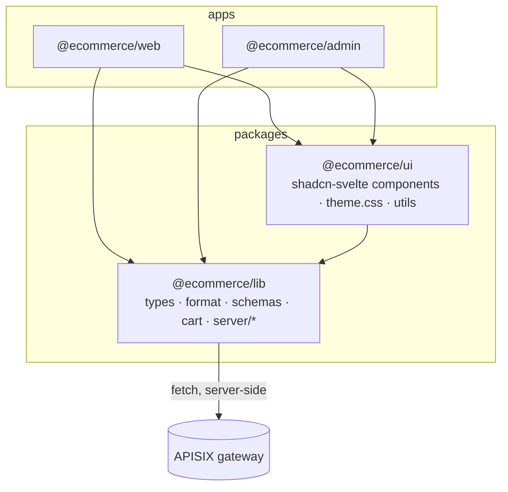
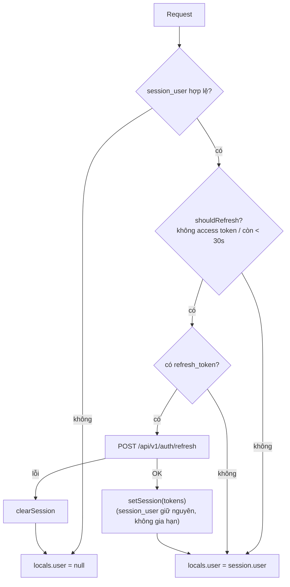

# frontend-packages (`@ecommerce/lib`, `@ecommerce/ui`, workspace root)

> **Phiên bản:** 1.0 · **Trạng thái:** Final · **Cập nhật:** 2026-11-12 · **Phạm vi:** Ứng dụng (as-is)

| Thuộc tính | Giá trị |
| :--- | :--- |
| Loại | Thư viện nội bộ của Bun workspace frontend (không chạy độc lập, không có port) |
| Ngôn ngữ / stack | TypeScript (source `.ts` được import trực tiếp, không build) · Zod 4 · Svelte 5 · bits-ui · tailwind-variants · Tailwind CSS 4 |
| Đường dẫn code | `frontend/package.json`, `frontend/packages/lib/`, `frontend/packages/ui/`, `frontend/scripts/locale-parity.ts` |
| Người dùng | `frontend/apps/web` (storefront), `frontend/apps/admin` (backoffice — xem [frontend-admin.md](frontend-admin.md)) |
| Tính năng phục vụ | [FEAT-01](../04-features/FEAT-01-sso-login-logout.md) · [FEAT-03](../04-features/FEAT-03-session-refresh.md) · [FEAT-08](../04-features/FEAT-08-shopping-cart.md) · [FEAT-09](../04-features/FEAT-09-checkout-place-order.md) · [FEAT-21](../04-features/FEAT-21-admin-access-control.md) · [FEAT-23](../04-features/FEAT-23-admin-product-mgmt.md) · [FEAT-24](../04-features/FEAT-24-admin-category-mgmt.md) · [FEAT-27](../04-features/FEAT-27-i18n.md) |
| Issue liên quan | ISSUE-11, 14, 27, 43, 46, 48, 49, 50, 51, 60, 68, 69, 100, 101, 102 |

---

## 1. Tổng quan

Frontend là một **Bun workspace** gồm 2 app và 2 package dùng chung:

- `@ecommerce/lib`: kiểu dữ liệu, helper định dạng, Zod schema, phép tính giỏ hàng (dùng được cả client lẫn server) và module `server/*` (API client tới gateway, cookie phiên, env, chống open-redirect) — **chỉ dùng phía server** vì đọc `process.env` và `Cookies` của SvelteKit.
- `@ecommerce/ui`: bộ component Svelte 5 theo phong cách **shadcn-svelte** (bits-ui + tailwind-variants), theme Tailwind 4 dùng chung.
- Không package nào có bước build: `exports` trỏ thẳng tới file `.ts`/`.svelte`, app (Vite) biên dịch trực tiếp.

## 2. Workspace root — `frontend/package.json`

| Trường | Giá trị | Dòng |
| :--- | :--- | :--- |
| `name` | `ecommerce-frontend` (private) | `:2-3` |
| `packageManager` / `engines.bun` | `bun@1.4.2` / `>=1.4.0` | `:4-7` |
| `workspaces` | `apps/*`, `packages/*` | `:8-11` |

Scripts (`frontend/package.json:12-22`):

| Script | Lệnh | Ý nghĩa |
| :--- | :--- | :--- |
| `dev` | `bun run --filter '*' dev` | Chạy dev mọi workspace có script `dev` (web, admin) |
| `dev:web` | `bun run --filter @ecommerce/web dev` | Chỉ storefront |
| `dev:admin` | `bun run --filter @ecommerce/admin dev` | Chỉ backoffice (`:3001`) |
| `build` / `check` / `lint` / `format` | `bun run --filter '*' <script>` | Chạy trên mọi workspace có script tương ứng |
| `i18n:check` | `bun scripts/locale-parity.ts` | Kiểm tra key i18n đồng bộ ([mục 8](#8-script-locale-parityts)) |
| `test` | `bun test` | Bun test runner — hiện chỉ có test trong `packages/lib/src` |

`devDependencies` dùng chung (`:23-33`): `eslint ^10.4.1`, `@eslint/js`, `typescript-eslint`, `eslint-plugin-svelte`, `eslint-config-prettier`, `globals`, `prettier ^3.8.3`, `prettier-plugin-svelte`, `prettier-plugin-tailwindcss`. Lockfile: `frontend/bun.lock`.

## 3. `@ecommerce/lib` — package.json & exports map

`frontend/packages/lib/package.json`:

| Subpath export | File | Dùng ở |
| :--- | :--- | :--- |
| `.` | `src/index.ts` (re-export `types`, `format`, `schemas`, `cart`) | Không app nào import gốc |
| `./types` | `src/types.ts` | web, admin |
| `./format` | `src/format.ts` | web, admin |
| `./schemas` | `src/schemas.ts` | web, admin |
| `./cart` | `src/cart.ts` | web |
| `./server` | `src/server/index.ts` | web, admin (chỉ trong file server/remote) |

- `dependencies`: `zod ^4.6.5`; `devDependencies`: `@sveltejs/kit ^3.0.0` (chỉ cho type `Cookies`), `@types/bun`, `typescript ^6.0.3` (`:20-27`).
- Scripts: `test` (`bun test`), `check` (`tsc --noEmit`), `lint`, `format` (`:14-19`).
- `tsconfig.json`: `ES2022`, `moduleResolution: bundler`, `strict`, `verbatimModuleSyntax`, `types: ["bun"]`.

## 4. `types.ts`

Nguồn: `frontend/packages/lib/src/types.ts`.

| Type | Dòng | Trường | Ghi chú |
| :--- | :--- | :--- | :--- |
| `ApiResponse<T>` | `:1-10` | `success`, `code`, `message?`, `data?`, `errors?`, `path?`, `traceId?`, `timestamp` | Envelope của auth-service; `request()` tự bóc `data` |
| `PaginatedResponse<T>` | `:12-20` | `content`, `totalElements`, `totalPages`, `size`, `number`, `first`, `last` | Kiểu Spring Page — backend Go hiện trả mảng thô (ISSUE-48) |
| `TokenResponse` | `:22-29` | `access_token`, `refresh_token`, `expires_in`, `refresh_expires_in`, `token_type`, `scope` | Từ `/auth/session`, `/auth/refresh` |
| `Role` | `:31-34` | `id`, `name` | |
| `UserResponse` | `:36-45` | `id`, `fullName`, `username`, `email`, `gender`, `phone?`, `avatar?`, `roles: Role[]` | **Lệch** với `model.UserResponse` của auth-service (key `fullname`, không có `roles`) — ISSUE-100 |
| `SessionUser` | `:48-54` | `id`, `username`, `fullName?`, `email?`, `roles: string[]` | Lưu trong cookie `session_user` |
| `Category` | `:56-63` | `categoryId`, `categoryTitle`, `imageUrl?`, `parentCategory?`, `subCategories?`, `products?` | |
| `Product` | `:65-74` | `productId`, `productTitle`, `imageUrl?`, `sku?`, `priceUnit`, `quantity`, `category?`, `description?` | `description` không có ở backend (ISSUE-50) |
| `Cart` | `:76-80` | `cartId`, `userId: number`, `orderItems?` | `userId` số nguyên vs `sub` UUID (ISSUE-49) |
| `OrderItem` | `:82-88` | `orderId`, `productId`, `quantity`, `unitPrice`, `product?` | Không endpoint nào trả |
| `Order` | `:90-97` | `orderId`, `orderDate`, `orderDesc?`, `orderFee`, `productId`, `cart?` | |
| `PaymentStatus` | `:99` | `'IN_PROGRESS' \| 'COMPLETED' \| 'NOT_STARTED' \| 'FAILED' \| 'CANCELLED'` | |
| `Payment` | `:101-106` | `paymentId`, `isPayed`, `paymentStatus`, `orderId` | |
| `InventoryItem` | `:108-112` | `id`, `skuCode`, `quantity` | Không dùng (ISSUE-43) |
| `Favourite` | `:114-118` | `userId`, `productId`, `product?` | Không dùng (ISSUE-43) |
| `Rating` | `:120-127` | `id`, `productId`, `userId: string`, `ratingValue`, `comment?`, `createdAt` | Không dùng (ISSUE-43) |
| `Notification` | `:129-135` | `id`, `userId`, `message`, `isRead`, `createdAt` | Không dùng (ISSUE-43) |
| `CartItem` | `:138-141` | `product`, `quantity` | Dòng giỏ client-side (localStorage) |
| `ProductPayload` | `:143-151` | `productTitle`, `sku`, `imageUrl?`, `priceUnit`, `quantity`, `categoryId?`, `description?` | Body POST/PUT sản phẩm; `categoryId` phẳng không được product-service đọc (cần `category.categoryId`) — ISSUE-60 |
| `CategoryPayload` | `:153-156` | `categoryTitle`, `imageUrl?` | |
| `CreateOrderPayload` | `:158-163` | `orderDate`, `orderDesc?`, `orderFee`, `productId` | |
| `CreatePaymentPayload` | `:165-169` | `isPayed`, `paymentStatus`, `orderId` | |
| `ProductListParams` | `:171-177` | `page?`, `size?`, `sort?`, `categoryId?`, `search?` | Query của `products.list` |

## 5. Module dùng chung client/server

### 5.1 `format.ts`

Nguồn: `frontend/packages/lib/src/format.ts`.

| Export | Dòng | Hành vi |
| :--- | :--- | :--- |
| `formatPrice(price, currency = 'VND')` | `:1-6` | `VND` → `Intl.NumberFormat('vi-VN', {style:'currency', currency:'VND'})` (vd `1.234.567 ₫`); mọi giá trị khác → **luôn định dạng USD** `en-US` (tham số `currency` chỉ phân biệt VND/không-VND) |
| `formatDate(date)` | `:8-16` | `Intl.DateTimeFormat('vi-VN', {day, month: 2-digit, year: numeric, hour, minute: 2-digit})` theo giờ local của tiến trình; test kỳ vọng dạng `21:30 05/03/2026` (`format.test.ts:16-18`). Locale cố định `vi-VN`, không theo ngôn ngữ UI |
| `truncateText(text, maxLength)` | `:18-21` | Cắt và thêm `...` nếu dài hơn `maxLength` — không app nào dùng |
| `getInitials(name)` | `:23-30` | Chữ cái đầu của tối đa 2 từ đầu, viết hoa — không app nào dùng |

### 5.2 `cart.ts`

Nguồn: `frontend/packages/lib/src/cart.ts`.

| Export | Dòng | Giá trị / hành vi |
| :--- | :--- | :--- |
| `FREE_SHIPPING_THRESHOLD` | `:2` | `500_000` |
| `SHIPPING_FEE` | `:5` | `30_000` |
| `CartLine` | `:7-10` | `{ priceUnit, quantity }` |
| `CartTotals` | `:12-16` | `{ subtotal, shippingFee, total }` |
| `computeTotals(lines)` | `:22-26` | `subtotal = Σ priceUnit × quantity`; `shippingFee = 0` nếu giỏ rỗng **hoặc** `subtotal >= 500000`, ngược lại `30000`; `total = subtotal + shippingFee` |

Được dùng chung bởi cart store phía client và lệnh checkout phía server của web để hai bên tính giống nhau (comment `:18-21`). Tính bằng `number` (float) — xem ISSUE-27. Backend không tính lại (ISSUE-21).

### 5.3 `schemas.ts`

Nguồn: `frontend/packages/lib/src/schemas.ts` (import `* as v from 'zod'`).

**Helper nội bộ (không export):**

| Helper | Dòng | Hành vi |
| :--- | :--- | :--- |
| `formNumber(message)` | `:8-14` | `string().trim().min(1, message).regex(/^\d+$/, message)` → `Number(value)`. Chỉ nhận số nguyên không âm; không dùng `z.coerce` vì input type `unknown` không thoả ràng buộc `RemoteFormInput` của SvelteKit (`:3-7`) |
| `optionalId` | `:21-30` | `union(literal(''), string().regex(/^\d+$/), number().int().positive()).optional()` → chuỗi số → `Number`, số → giữ nguyên, `''`/`undefined` → `undefined`. Lưu ý: chuỗi `"0"` được chấp nhận và thành `0` |

**Schema export:**

| Schema | Dòng | Trường | Dùng ở |
| :--- | :--- | :--- | :--- |
| `pageQuerySchema` | `:32-35` | `page`: `coerce.number().int().min(0).default(0)`; `size`: `coerce.number().int().min(1).max(60).default(12)` | admin `getCategories`, `getOrders`; web |
| `productQuerySchema` | `:37-41` | `pageQuerySchema` + `sort?`: enum `productId,asc` \| `productId,desc` \| `priceUnit,asc` \| `priceUnit,desc`; `categoryId`: `optionalId`; `search?`: `string().trim().min(1)` (chuỗi chỉ có khoảng trắng bị **từ chối**) | admin `getProducts`; web catalog |
| `shippingSchema` | `:43-53` | `fullName` trim ≥2; `phone` trim, regex `^[0-9+\-\s]{8,15}$`; `address` trim ≥5; `city` trim ≥1; `district` trim ≥1; `note?` trim ≤500 | web checkout |
| `checkoutLineSchema` | `:55-58` | `productId` int >0; `quantity` int 1–99 | (qua `checkoutSchema`) |
| `checkoutSchema` | `:60-64` | `shipping: shippingSchema`; `paymentMethod`: enum `COD` \| `ONLINE`; `items`: mảng `checkoutLineSchema` ≥1 phần tử | web checkout |
| `productFormSchema` | `:66-73` | `productTitle` trim 1–200; `sku` trim 1–64; `imageUrl` `string().trim()` (cho phép rỗng, không kiểm URL); `categoryId`: `optionalId`; `priceUnit`, `quantity`: `formNumber` | (qua upsert) |
| `categoryFormSchema` | `:75-78` | `categoryTitle` trim 1–120; `imageUrl` `string().trim()` | (qua upsert) |
| `productUpsertSchema` | `:81` | `productFormSchema` + `productId: optionalId` | admin `saveProduct` |
| `categoryUpsertSchema` | `:82` | `categoryFormSchema` + `categoryId: optionalId` | admin `saveCategory` |

Type suy ra (`:84-91`): `PageQuery`, `ProductQuery`, `ShippingInput`, `CheckoutInput`, `ProductFormInput`, `CategoryFormInput`, `ProductUpsertInput`, `CategoryUpsertInput`.

Thông báo lỗi validate là **chuỗi tiếng Anh cố định** (vd `'Please enter a price'`, `'Your cart is empty'`), app hiển thị nguyên văn `issue.message` → không theo i18n (FEAT-27).

## 6. Module `server/*` (`@ecommerce/lib/server`)

### 6.1 `server/index.ts` — export công khai

`frontend/packages/lib/src/server/index.ts:1-19`:

| Export | Từ file |
| :--- | :--- |
| `ApiError`, `createApi`, type `Api` | `api.ts` |
| `apiBaseUrl`, `apiPublicUrl` | `env.ts` |
| `safeRedirect` | `redirect.ts` |
| `ACCESS_COOKIE`, `REFRESH_COOKIE`, `USER_COOKIE`, `EXPIRES_COOKIE`, `accessToken`, `clearSession`, `isAdmin`, `refreshToken`, `session`, `setSession`, `shouldRefresh`, `toSessionUser`, type `Session` | `session.ts` |

### 6.2 `server/env.ts`

| Hàm | Dòng | Hành vi |
| :--- | :--- | :--- |
| `apiBaseUrl()` | `:11-14` | `process.env.API_INTERNAL_URL ?? 'http://localhost:9080'`, cắt `/` cuối. Dùng cho mọi request server-side |
| `apiPublicUrl()` | `:24-27` | `process.env.API_PUBLIC_URL ?? apiBaseUrl()`, cắt `/` cuối. Chỉ dùng dựng URL SSO login cho browser |

Đọc `process.env` mỗi lần gọi (không cache, không dùng `$env` của SvelteKit).

### 6.3 `server/redirect.ts`

`safeRedirect(target)` (`:2-5`): trả `target` nếu bắt đầu bằng `/` và **không** bắt đầu bằng `//`; ngược lại `'/'`. Chặn URL tuyệt đối và protocol-relative. (Chuỗi như `/\evil.example` vẫn qua kiểm tra vì chỉ so khớp prefix; trình duyệt hiện đại có thể hiểu `\` như `/` — rủi ro thấp vì app gọi `redirect(303, localizeHref(target))`.)

### 6.4 `server/session.ts`

Nguồn: `frontend/packages/lib/src/server/session.ts`.

**Hằng số & tuỳ chọn cookie:**

| Tên | Giá trị | Dòng |
| :--- | :--- | :--- |
| `ACCESS_COOKIE` | `access_token` | `:4` |
| `REFRESH_COOKIE` | `refresh_token` | `:5` |
| `USER_COOKIE` | `session_user` | `:6` |
| `EXPIRES_COOKIE` | `session_expires` | `:7` |
| `base` (options) | `{ path: '/', httpOnly: true, sameSite: 'lax' }` — không đặt `secure`, không `domain` | `:9` |
| `ACCESS_FALLBACK_SECONDS` | `300` | `:10` |
| `REFRESH_FALLBACK_SECONDS` | `1800` | `:11` |

Tên cookie giống nhau cho web và admin → chia sẻ phiên trên cùng host (ISSUE-11).

**Hàm:**

| Hàm | Dòng | Hành vi |
| :--- | :--- | :--- |
| `toSessionUser(profile: UserResponse)` | `:13-21` | Lấy `id`, `username`, `fullName`, `email`, `roles = (profile.roles ?? []).map(r => r.name)`. Với response thực của auth-service (không có `roles`, key `fullname`) → `roles: []`, `fullName: undefined` (ISSUE-100) |
| `isAdmin(user)` | `:23-25` | `true` nếu `roles` chứa `'ADMIN'` hoặc `'ROLE_ADMIN'`; `null`/`undefined` → `false` |
| `setSession(cookies, tokens, user?)` | `:32-49` | `accessMaxAge = expires_in > 0 ? expires_in : 300`; `refreshMaxAge = refresh_expires_in > 0 ? … : 1800`. Ghi `access_token` (maxAge access), `refresh_token` (maxAge refresh), `session_expires = now + accessMaxAge` (maxAge refresh). `user === null` → xoá `session_user`; `user` có giá trị → ghi JSON (maxAge refresh); `user === undefined` → **giữ nguyên** cookie cũ (dùng khi refresh) |
| `clearSession(cookies)` | `:51-55` | Xoá 4 cookie với `path: '/'` |
| `accessToken(cookies)` / `refreshToken(cookies)` | `:57-63` | Đọc cookie, `null` nếu không có |
| `session(cookies)` | `:70-80` | Parse JSON `session_user`; `null` nếu thiếu, JSON lỗi, hoặc `username` không phải string. **Không kiểm chữ ký**, không đối chiếu với token |
| `shouldRefresh(cookies)` | `:87-91` | `true` nếu không có access token, hoặc `session_expires` thiếu/0, hoặc còn **< 30 giây** |

**Logic refresh** (được gọi trong `hooks.server.ts` của từng app — vd `frontend/apps/admin/src/hooks.server.ts:32-51`):

Hệ quả thiết kế:
- Vì cookie `access_token` có `maxAge = expires_in`, việc access token "biến mất" là tín hiệu refresh bình thường (`:82-86`).
- `session_user` chỉ được ghi lúc đăng nhập với `maxAge = refresh_expires_in` ban đầu và **không được gia hạn khi refresh** → khi cookie này hết hạn, người dùng bị coi là chưa đăng nhập dù `refresh_token` đã xoay vòng vẫn còn hạn (ISSUE-69).
- Role trong `session_user` không bao giờ được làm mới cho tới khi đăng nhập lại.

### 6.5 `server/api.ts` — API client

Nguồn: `frontend/packages/lib/src/server/api.ts`.

**`ApiError`** (`:18-28`): `extends Error`, `name = 'ApiError'`, `status: number`, `body: unknown`. Được export nhưng không app nào bắt theo kiểu này (đều `catch {}` chung).

**`query(params)`** (`:30-37`, nội bộ): dựng query string, bỏ giá trị `undefined` và `''`.

**`request<T>(base, path, init, token?)`** (`:39-76`, nội bộ):
1. Header `accept: application/json`; nếu có body và chưa có `content-type` → `application/json`; có token → `authorization: Bearer <token>`.
2. `fetch(base + path)`; đọc text, thử `JSON.parse`, lỗi parse → giữ chuỗi.
3. `!response.ok` → `ApiError(status, message)`, `message` = `body.message` (nếu là string không rỗng) hoặc `"<status> <statusText>"`.
4. Nếu body là object có khoá `data` → trả `body.data` (bóc envelope `ApiResponse`); ngược lại trả body nguyên. Body rỗng → `undefined`.

Không có timeout, retry, hay log; không truyền correlation id.

**`createApi({ token?, baseUrl? })`** (`:116-161`): `base = baseUrl ?? apiBaseUrl()`. Helper `json(path, method, payload?)` gửi `JSON.stringify(payload)` kèm token.

**Bảng method → endpoint gateway:**

| Method client | HTTP | Path qua gateway | Query / body | Bearer | Route APISIX (`deploy/apisix/apisix.yaml`) | Dùng bởi |
| :--- | :--- | :--- | :--- | :--- | :--- | :--- |
| `products.list(params)` | GET | `/api/products` | `?page&size&sort&categoryId&search` (bỏ rỗng) | có nếu truyền | `product-catalog` `:71-82` (public, ISSUE-102) | web, admin |
| `products.get(id)` | GET | `/api/products/{id}` | — | có nếu truyền | `product-catalog` | web |
| `products.create(payload)` | POST | `/api/products` | `ProductPayload` | có | `product-catalog` (không xác thực — ISSUE-102) | admin |
| `products.update(id, payload)` | PUT | `/api/products/{id}` | `ProductPayload` | có | `product-catalog` | admin |
| `products.remove(id)` | DELETE | `/api/products/{id}` | — | có | `product-catalog` | admin |
| `categories.list(params)` | GET | `/api/categories` | `?page&size` | có nếu truyền | `product-catalog` | web, admin |
| `categories.get(id)` | GET | `/api/categories/{id}` | — | có nếu truyền | `product-catalog` | (không dùng) |
| `categories.create(payload)` | POST | `/api/categories` | `CategoryPayload` | có | `product-catalog` | admin |
| `categories.update(id, payload)` | PUT | `/api/categories/{id}` | `CategoryPayload` | có | `product-catalog` | admin |
| `categories.remove(id)` | DELETE | `/api/categories/{id}` | — | có | `product-catalog` | admin |
| `orders.list(params)` | GET | `/api/orders` | `?page&size` | bắt buộc | `order-orders` `:196-213` (`openid-connect bearer_only`) | web, admin |
| `orders.get(id)` | GET | `/api/orders/{id}` | — | bắt buộc | `order-orders` | (không dùng) |
| `orders.create(payload)` | POST | `/api/orders` | `CreateOrderPayload` | bắt buộc | `order-orders` | web checkout |
| `payments.create(payload)` | POST | `/api/payments` | `CreatePaymentPayload` | bắt buộc | `payment` `:214-231` | web checkout |
| `inventory.checkStock(skuCode)` | GET | `/api/inventory` | `?skuCode=` (service đọc `productName` — ISSUE-51) | bắt buộc | `inventory` `:232-249` | (không dùng — ISSUE-43) |
| `auth.exchangeTicket(ticket)` | GET | `/api/v1/auth/session` | `?ticket=` | **luôn không** (token = `null`) | `auth-public` `:63-70` | callback web/admin |
| `auth.refresh(refreshToken)` | POST | `/api/v1/auth/refresh` | `{ refreshToken }` | theo client (hooks dùng `createApi()` không token) | `auth-public` | hooks web/admin |
| `auth.logout(refreshToken)` | POST | `/api/v1/auth/logout` | `{ refreshToken }` | theo client | `auth-public` | logout web/admin |
| `auth.profile()` | GET | `/api/v1/users/me` | — | bắt buộc | `auth-users` `:160-177` | callback web/admin |

Lưu ý hợp đồng:
- `products.list`, `categories.list`, `orders.list` khai báo trả `PaginatedResponse<T>` nhưng service trả mảng thô và bỏ qua query (ISSUE-48).
- `auth.profile()` khai báo `UserResponse` có `roles`, `fullName`; auth-service trả object không có `roles` và key `fullname` (ISSUE-100); user chưa có trong DB `authservice` → 404 (ISSUE-101).
- `orders.list` không lọc theo user (ISSUE-49).

## 7. `@ecommerce/ui`

### 7.1 package.json & cấu hình

`frontend/packages/ui/package.json`:
- `dependencies` (`:34-40`): `@ecommerce/lib` (`workspace:*` — **không file nào import**), `@lucide/svelte ^1.55.0`, `bits-ui ^2.18.0`, `svelte-sonner ^1.2.0`, `tailwind-variants ^3.3.1`.
- `devDependencies`: `svelte ^5.57.1`, `svelte-check`, `tailwindcss ^4.3.0`, `tw-animate-css`, `typescript`.
- Scripts: `check` (`svelte-check`), `lint`, `format`.
- `components.json`: cấu hình shadcn-svelte CLI (`baseColor: neutral`, css `src/theme.css`, alias về `@ecommerce/ui`).
- `tsconfig.json`: `paths` `@ecommerce/ui` → `./src/index.ts` (file **không tồn tại**), `@ecommerce/ui/*` → `./src/components/*`, `./src/*`. Component tự import nhau qua `@ecommerce/ui/utils`, `@ecommerce/ui/button`… (self-reference qua `exports`).

**Exports map** (`:6-28`): `./utils`, `./theme.css`, và 19 subpath component (bảng dưới). Không có export gốc `.`.

### 7.2 Danh sách component

Cột "Dùng ở" xác định bằng grep import trong `frontend/apps/*/src`.

| Subpath | Thư mục / file | Export | Nền tảng | Dùng ở |
| :--- | :--- | :--- | :--- | :--- |
| `./alert-dialog` | `alert-dialog/` (12 `.svelte`: action, cancel, content, description, footer, header, media, overlay, portal, title, trigger, root) | `Root, Title, Action, Cancel, Portal, Footer, Header, Trigger, Overlay, Content, Description, Media` + alias `AlertDialog*` | bits-ui `AlertDialog` | không dùng |
| `./badge` | `badge/badge.svelte` | `Badge`, `badgeVariants`, type `BadgeVariant` (variant: `default`, `secondary`, `destructive`, `outline`, `ghost`, `link`); render `<a>` nếu có `href`, ngược lại `` | tailwind-variants | web, admin |
| `./breadcrumb` | `breadcrumb/` (7 file) | `Root, Ellipsis, Item, Separator, Link, List, Page` + alias `Breadcrumb*` | HTML thuần | không dùng |
| `./button` | `button/button.svelte` | `Root`/`Button`, type `Props`/`ButtonProps`, `buttonVariants`, `ButtonSize`, `ButtonVariant`. Variant: `default`, `outline`, `secondary`, `ghost`, `destructive`, `link`; size: `default`, `xs`, `sm`, `lg`, `icon`, `icon-xs`, `icon-sm`, `icon-lg`. Có `href` → `<a>` (disabled → bỏ `href`, `aria-disabled`, `tabindex=-1`); không → `<button type="button">` mặc định | tailwind-variants | web, admin |
| `./card` | `card/` (7 file) | `Root, Content, Description, Footer, Header, Title, Action` + alias `Card*` | HTML thuần | không dùng |
| `./dialog` | `dialog/` (10 file) | `Root, Title, Portal, Footer, Header, Trigger, Overlay, Content, Description, Close` + alias `Dialog*`. `Content` có prop `showCloseButton` (mặc định `true`, nút X với `sr-only` "Close"), `portalProps` | bits-ui `Dialog` | admin |
| `./dropdown-menu` | `dropdown-menu/` (17 file) | `Root, Trigger, Content, Portal, Group, GroupHeading, Item, Label, CheckboxGroup, CheckboxItem, RadioGroup, RadioItem, Separator, Shortcut, Sub, SubContent, SubTrigger` + alias `DropdownMenu*` | bits-ui `DropdownMenu` | web |
| `./empty-state` | `empty-state/empty-state.svelte` | `EmptyState` (props: `icon?: Component`, `title`, `description?`, `action?: Snippet`, `class?`) — component tự viết | HTML thuần | web, admin |
| `./input` | `input/input.svelte` | `Root`/`Input` | HTML | web, admin |
| `./label` | `label/label.svelte` | `Root`/`Label` | bits-ui `Label` | web, admin |
| `./pagination` | `pagination/` (9 file) | `Root, Content, Item, Link, PrevButton, NextButton (đánh dấu "old"), Ellipsis, Previous, Next` + alias `Pagination*`. `Root` mặc định `count=0`, `perPage=10`, `page=1` (bindable), `siblingCount=1` | bits-ui `Pagination` | không dùng (app tự làm Prev/Next) |
| `./select` | `select/` (12 file) | `Root, Group, Label, Item, Content, Trigger, Separator, ScrollDownButton, ScrollUpButton, GroupHeading, Portal, Value` + alias `Select*` | bits-ui `Select` | không dùng (admin dùng `<select>` gốc) |
| `./separator` | `separator/separator.svelte` | `Root`/`Separator` | bits-ui `Separator` | web |
| `./sheet` | `sheet/` (10 file) | `Root, Close, Trigger, Portal, Overlay, Content, Header, Footer, Title, Description` + alias `Sheet*`. `Content` props `side` (`top\|right\|bottom\|left`, mặc định `right`), `showCloseButton`, `portalProps` | bits-ui `Dialog` | admin (drawer mobile) |
| `./skeleton` | `skeleton/skeleton.svelte` | `Root`/`Skeleton` (`bg-muted animate-pulse rounded-md`) | HTML | web, admin |
| `./sonner` | `sonner/sonner.svelte` | `Toaster` — bọc `svelte-sonner` với `theme="light"` cố định, icon lucide cho loading/success/error/info/warning | svelte-sonner | web, admin |
| `./table` | `table/` (8 file) | `Root, Body, Caption, Cell, Footer, Head, Header, Row` + alias `Table*` | HTML | admin |
| `./table-skeleton` | `table-skeleton/table-skeleton.svelte` | `TableSkeleton` (props `rows = 5`, `class?`) — component tự viết dùng `Skeleton` | HTML | admin |
| `./textarea` | `textarea/textarea.svelte` | `Root`/`Textarea` | HTML | web |

Component không được app nào dùng: `alert-dialog`, `breadcrumb`, `card`, `pagination`, `select` (bổ sung cho danh sách dead code ISSUE-43).

### 7.3 `utils.ts`

`frontend/packages/ui/src/utils.ts`:

| Export | Dòng | Ý nghĩa |
| :--- | :--- | :--- |
| `cn` | `:1` | Re-export từ `tailwind-variants` (gộp class có xử lý xung đột Tailwind) — không dùng `clsx` + `tailwind-merge` như shadcn gốc |
| `WithoutChild<T>` | `:5` | Bỏ prop `child` |
| `WithoutChildren<T>` | `:7` | Bỏ prop `children` |
| `WithoutChildrenOrChild<T>` | `:8` | Bỏ cả hai |
| `WithElementRef<T, U>` | `:9` | Thêm prop `ref?: U \| null` |

### 7.4 `theme.css`

`frontend/packages/ui/src/theme.css` — app import sau `@import 'tailwindcss'` (vd `frontend/apps/admin/src/routes/layout.css:2-4`) và có thể override token.

- `@import 'tw-animate-css'`; `@custom-variant dark (&:is(.dark *))` — dark mode theo class `.dark` (`:1-2`). Không app nào bật class `.dark`.
- **Token `:root`** (`:10-43`): `--radius: 0.625rem`; `--background: #f4f4f4` (admin override `#f9fafb`); `--foreground: #111827`; `--primary: #e30019` (đỏ thương hiệu), `--ring` / `--sidebar-primary` / `--sidebar-ring` cùng `#e30019`; `--card`, `--popover`, `--secondary`, `--muted`, `--accent`, `--destructive`, `--border`, `--input`, `--chart-1..5`, `--sidebar-*` dạng `oklch(...)`.
- **Token `.dark`** (`:45-77`): bộ tương ứng, `--primary: #ff5b63`.
- **`@theme inline`** (`:79-143`): font `--font-sans: 'Geist Variable', …`; thang radius `--radius-sm … --radius-4xl` tính từ `--radius`; ánh xạ `--color-*` → biến ở trên; thang màu thương hiệu `--color-primary-50 … 900` và bản sao `--color-orange-50 … 900` (cho class cũ).
- `@layer base` (`:145-152`): mọi phần tử `border-border outline-ring/50`; `body` `bg-background text-foreground font-sans`.
- Tiện ích: `html { scroll-behavior: smooth }`, `.no-scrollbar`, keyframes `brand-pulse` + class `.animate-brand-pulse` (`:154-179`).

## 8. Script `locale-parity.ts`

`frontend/scripts/locale-parity.ts` (chạy bằng `bun run i18n:check` từ `frontend/`):

1. Duyệt mọi thư mục trong `frontend/apps/` (`:9-12`); bỏ qua app không có `messages/` hoặc có < 2 file `.json` (`:13-17`).
2. Catalog gốc: `vi.json` nếu có, nếu không là file đầu tiên theo thứ tự (`:19-22`).
3. Với mỗi catalog khác, so **tập key cấp 1** (không so giá trị, không so placeholder `{param}`, không xét key lồng nhau) → in `missing` / `extra` ra stderr và đánh dấu lỗi; khớp → in `"<app>: vi.json / en.json in sync (N keys)"` (`:24-38`).
4. `process.exit(1)` nếu có lệch, ngược lại `0` (`:41`).

Không thấy được gọi trong CI trong phạm vi frontend (chỉ có script npm). Key `$schema` (nếu có) cũng được tính như key thường.

## 9. Sử dụng theo app

| Export | web | admin |
| :--- | :---: | :---: |
| `computeTotals`, `FREE_SHIPPING_THRESHOLD` | ✓ | — |
| `formatPrice`, `formatDate` | ✓ | ✓ |
| `checkoutSchema`, `shippingSchema` | ✓ | — |
| `pageQuerySchema`, `productQuerySchema` | ✓ | ✓ |
| `productUpsertSchema`, `categoryUpsertSchema` | — | ✓ |
| `isAdmin` | — | ✓ |
| `safeRedirect`, `toSessionUser`, `shouldRefresh`, `setSession`, `clearSession`, `session`, `accessToken`, `refreshToken`, `apiPublicUrl`, `createApi` | ✓ | ✓ |
| Không app nào dùng | `SHIPPING_FEE`, `truncateText`, `getInitials`, `checkoutLineSchema` (export), `productFormSchema`/`categoryFormSchema` (trực tiếp), `apiBaseUrl` (trực tiếp), `ApiError`, các hằng `*_COOKIE`, `categories.get`, `orders.get`, `inventory.checkStock`, type `InventoryItem/Favourite/Rating/Notification/OrderItem` | |

## 10. Test

Chạy `bun test` tại `frontend/` (hoặc trong `packages/lib`). Chỉ là unit test thuần, không gọi gateway thật (`fetch` bị stub).

| File | Phạm vi |
| :--- | :--- |
| `frontend/packages/lib/src/cart.test.ts` | Giỏ rỗng; phí ship dưới ngưỡng; miễn phí đúng ngưỡng 500000; ngay dưới ngưỡng; nhiều dòng |
| `frontend/packages/lib/src/format.test.ts` | `formatPrice` VND/USD; `formatDate` (`HH:mm dd/MM/yyyy`, phụ thuộc timezone/ICU của máy chạy); `truncateText`; `getInitials` |
| `frontend/packages/lib/src/schemas.test.ts` | Default/coerce/biên của `pageQuerySchema`; sort enum, `categoryId`, `search` của `productQuerySchema`; `formNumber` (số âm, thập phân, rỗng); `productUpsertSchema` id; `shippingSchema`; `checkoutSchema` (≥1 item, quantity 1–99, enum payment) |
| `frontend/packages/lib/src/server/api.test.ts` | Bóc envelope; payload thô; body rỗng 204; query bỏ rỗng; header Bearer có/không; body JSON khi create; `ApiError` từ `message` và fallback status; `exchangeTicket` không gửi Bearer |
| `frontend/packages/lib/src/server/session.test.ts` | `toSessionUser`; `isAdmin` 2 cách viết role; `setSession` (options, maxAge, giữ/xoá profile, fallback); `clearSession`; `session` (thiếu/hỏng/hợp lệ); `shouldRefresh` (4 trường hợp); accessor |
| `frontend/packages/lib/src/server/redirect.test.ts` | Path hợp lệ; URL tuyệt đối, `//`, path tương đối; giá trị rỗng |

Không có test cho `@ecommerce/ui`, không có test hợp đồng với response thực của backend — vì vậy ISSUE-48, ISSUE-100 không bị phát hiện (ISSUE-46). Test `toSessionUser` dùng fixture có `roles`/`fullName` khác với response thật.

## 11. Vấn đề đã biết

| ID | Mức độ | Liên quan tới package |
| :--- | :--- | :--- |
| ISSUE-11 | Medium | Cookie phiên cùng tên cho mọi app, không `secure` tường minh (`session.ts:4-9`). |
| ISSUE-27 | Medium | Tiền tệ là `number` float trong `cart.ts`, `types.ts`. |
| ISSUE-43 | Low | Type/method/helper/component không dùng (xem [mục 9](#9-sử-dụng-theo-app), [mục 7.2](#72-danh-sách-component)). |
| ISSUE-46 | Medium | Chỉ có unit test, không có test hợp đồng / component. |
| ISSUE-48 | Critical | `list()` kỳ vọng `PaginatedResponse` nhưng backend trả mảng thô. |
| ISSUE-49 | High | `orders.list` không lọc theo user. |
| ISSUE-50 | Medium | `Product.description` / `ProductPayload.description` không có ở backend. |
| ISSUE-51 | Low | `inventory.checkStock` gửi `skuCode` thay vì `productName` (`api.ts:151`). |
| ISSUE-60 | High | `ProductPayload.categoryId` phẳng bị product-service bỏ qua → danh mục sản phẩm luôn NULL khi tạo/sửa. |
| ISSUE-68 | High | Guard admin dựa vào `isAdmin(session(cookies).user)` — cookie `session_user` JSON không ký; kết hợp guard admin bỏ qua `/_app/` (endpoint remote function). |
| ISSUE-69 | Medium | `setSession(cookies, tokens)` khi refresh không gia hạn `session_user` (`session.ts:44-48`). |
| ISSUE-100 | Critical | `UserResponse`/`toSessionUser` lệch với `model.UserResponse` của auth-service → `roles` luôn rỗng. |
| ISSUE-101 | High | `auth.profile()` trả 404 với user chỉ có trong Keycloak. |
| ISSUE-102 | Critical | Các method ghi `products.*`/`categories.*` đi qua route gateway không xác thực. |

Quan sát nhỏ (chưa cấp ID): `formatPrice` coi mọi currency khác VND là USD; `formatDate`/`formatPrice` cố định `vi-VN`; thông báo lỗi schema không i18n; `@ecommerce/ui` khai báo phụ thuộc `@ecommerce/lib` nhưng không dùng; `tsconfig` của ui trỏ `src/index.ts` không tồn tại; `Toaster` cố định `theme="light"`.

## 12. Tham chiếu source

- `frontend/package.json:1-34`, `frontend/bun.lock`
- `frontend/packages/lib/package.json:1-28`, `frontend/packages/lib/tsconfig.json`
- `frontend/packages/lib/src/index.ts:1-4`, `types.ts:1-177`, `format.ts:1-30`, `cart.ts:1-26`, `schemas.ts:1-91`
- `frontend/packages/lib/src/server/index.ts:1-19`, `env.ts:11-27`, `redirect.ts:2-5`, `session.ts:1-91`, `api.ts:1-161`
- `frontend/packages/lib/src/{cart,format,schemas}.test.ts`, `frontend/packages/lib/src/server/{api,session,redirect}.test.ts`
- `frontend/packages/ui/package.json:1-48`, `components.json`, `tsconfig.json`, `src/utils.ts:1-9`, `src/theme.css:1-179`
- `frontend/packages/ui/src/components/*/index.ts`, `badge/badge.svelte`, `button/button.svelte`, `empty-state/empty-state.svelte`, `table-skeleton/table-skeleton.svelte`, `sonner/sonner.svelte`, `skeleton/skeleton.svelte`, `dialog/dialog-content.svelte`, `sheet/sheet-content.svelte`, `pagination/pagination.svelte`
- `frontend/scripts/locale-parity.ts:1-41`
- `frontend/apps/admin/src/hooks.server.ts:32-77` (nơi dùng refresh/guard)
- `deploy/apisix/apisix.yaml:63-82,160-177,196-249`; `services/auth-service/internal/model/user.go:15-23`
