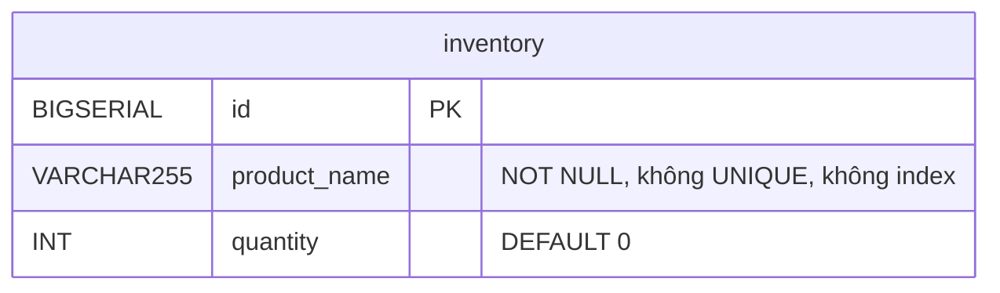
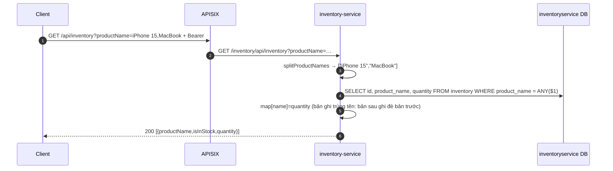

# inventory-service

> **Phiên bản:** 1.0 · **Trạng thái:** Final · **Cập nhật:** 2026-11-12 · **Phạm vi:** Ứng dụng (as-is)

| Thuộc tính | Giá trị |
| :--- | :--- |
| Ngôn ngữ / stack | Go 1.27, `go-chi/chi v5`, `bob` + `pgx v5` |
| Port | `8082` (env `PORT`, `services/inventory-service/main.go:57`; compose `docker-compose.yml:285-286`) |
| Database | PostgreSQL `inventoryservice` (bảng `inventory`) |
| Đường dẫn code | `services/inventory-service/` |
| Prefix gateway | `/api/inventory[/*]` → `/inventory/...` (upstream 5, Bearer) (`deploy/apisix/apisix.yaml:232-249`) |
| Tính năng phục vụ | [FEAT-12](../04-features/FEAT-12-inventory-stock-check.md); module admin Inventory là placeholder ([FEAT-26](../04-features/FEAT-26-admin-placeholder-modules.md)) |

## 1. Tổng quan & trách nhiệm

inventory-service chỉ có **một chức năng đọc**: kiểm tra danh sách tên sản phẩm có còn hàng hay không. Không có API nhập/xuất/điều chỉnh/giữ hàng; dữ liệu bảng `inventory` phải được chèn trực tiếp vào DB. Tồn kho được định danh bằng **`product_name`** (không unique) thay vì `product_id`/SKU, và hoàn toàn tách rời `products.quantity` của product-service (ISSUE-26). Hiện **không có màn hình nào** gọi service này (`api.inventory.checkStock` không được dùng và gửi sai tham số — ISSUE-51).

## 2. Tech stack & thư viện

`chi v5.3.2`, `go-chi/cors v1.2.2`, `pgx v5.11.0`, `bob v0.50.0`, `scan v0.9.0`, `testify`, `com.ecommerce/shared` (`services/inventory-service/go.mod`). Dockerfile 2 stage, `EXPOSE 8082` (`services/inventory-service/Dockerfile:21`).

## 3. Cấu hình

| Biến | Default | Compose (`docker-compose.yml:287-291`) | Ý nghĩa |
| :--- | :--- | :--- | :--- |
| `PORT` | `8082` | – | Cổng |
| `DATABASE_URL` / `SPRING_DATASOURCE_URL` / `POSTGRES_HOST/PORT/DB` | db `inventoryservice` (`main.go:35`) | `jdbc:postgresql://postgres:5432/inventoryservice` | Kết nối DB |
| `POSTGRES_USER/PASSWORD` | default trong code | từ `.env` | Secret |
| `JWT_ISSUER_URI` | – | có set | Không dùng |

## 4. Phụ thuộc

Chỉ PostgreSQL `inventoryservice`. Không Kafka, không gọi service khác.

## 5. Cấu trúc code

```
services/inventory-service/
├── main.go                                 # DSN, pool, InitSchema, router
├── main_test.go
└── internal/
    ├── handler/inventory_handler.go        # 2 endpoint × 2 prefix, splitProductNames
    ├── model/inventory.go                  # Inventory, InventoryResponse
    ├── repository/inventory_repo.go        # DDL + FindByProductNames (= ANY($1))
    └── service/inventory_service.go        # IsInStock: map tên → số lượng
```

## 6. API endpoints

JSON thô + `ErrorVm`. Prefix `/inventory/api/inventory` và `/api/inventory` (`inventory_handler.go:25-27`).

| # | Method | Path trong service | Path qua gateway | Auth GW | Mô tả |
| :--- | :--- | :--- | :--- | :--- | :--- |
| 1 | GET | `/actuator/health`, `/inventory/actuator/health` | – | – | Health luôn UP |
| 2 | GET | `/api/inventory?productName=a&productName=b` hoặc `?productName=a,b` | `/api/inventory?productName=…` | Bearer | Kiểm còn hàng theo query |
| 3 | GET | `/api/inventory/{products}` (vd `/api/inventory/iPhone,iPad`) | `/api/inventory/{products}` | Bearer | Như #2 nhưng danh sách tên trên path, tách dấu phẩy |
| – | GET | – | `/inventory/v3/api-docs/*` | Public | Route chết (ISSUE-16) |

**Request**: tên sản phẩm phân biệt hoa thường, so khớp chính xác; mỗi giá trị được tách theo `,` và `TrimSpace`, bỏ phần tử rỗng (`inventory_handler.go:39-51`). Tham số `skuCode` (mà frontend gửi) **bị bỏ qua** (ISSUE-51).

**Response 200** — mảng `InventoryResponse` (`internal/model/inventory.go:9-13`), cùng thứ tự với input:

```json
[
  { "productName": "iPhone 15", "isInStock": true, "quantity": 50 },
  { "productName": "MacBook", "isInStock": false }
]
```

- `quantity` có `omitempty` → khi bằng 0 (hết hàng hoặc không có bản ghi) field bị **ẩn**.
- Không truyền tên nào → `[]` (không lỗi).

**Lỗi**: 500 `ErrorVm` khi lỗi DB. Không có 400/404.

## 7. Data model



DDL `services/inventory-service/internal/repository/inventory_repo.go:28-34`. Chi tiết: [data-dictionary.md §inventoryservice](../06-data/data-dictionary.md#7-inventoryservice-inventory-service).

## 8. Business logic chi tiết



| # | Quy tắc | Nguồn |
| :--- | :--- | :--- |
| R1 | `isInStock = (tồn tại bản ghi) && quantity > 0`. | `inventory_service.go:29-37` |
| R2 | Nhiều bản ghi cùng `product_name` → lấy bản được duyệt sau cùng (thứ tự không xác định, không `ORDER BY`), **không cộng dồn**. | `inventory_service.go:24-27` |
| R3 | Tên trùng trong input → trả nhiều phần tử giống nhau. | – |
| R4 | DB `nil` hoặc danh sách rỗng → mọi tên `isInStock: false` (ISSUE-28). | `inventory_repo.go:41-43` |
| R5 | Không có số lượng yêu cầu: chỉ trả còn/hết, không kiểm "đủ N sản phẩm". | – |

## 9. Sự kiện (produce / consume)

Không có.

## 10. Health check & observability

Health luôn UP (ISSUE-36). `InitSchema` lỗi chỉ log notice.

## 11. Test

`services/inventory-service/main_test.go` (DB `nil`): `TestHealthCheck` (`:31-36`), `TestIsInStockQuery` (`:38-49`: một tên, nhiều tên dấu phẩy, không tham số), `TestIsInStockPath` (`:51-59`). Chỉ kiểm HTTP 200.

## 12. Vấn đề đã biết

| ID | Mức | Tóm tắt |
| :--- | :--- | :--- |
| ISSUE-16 | Low | Route api-docs chết |
| ISSUE-26 | High | Định danh theo `product_name`, chỉ đọc, tách biệt `products.quantity` |
| ISSUE-28 | High | Không migration; DB lỗi → trả "hết hàng" thay vì lỗi |
| ISSUE-36 | Low | Health luôn UP |
| ISSUE-51 | Low | Frontend gửi `skuCode`, service đọc `productName` |

## 13. Tham chiếu source

- `services/inventory-service/main.go:26-113`
- `services/inventory-service/internal/handler/inventory_handler.go:20-74`
- `services/inventory-service/internal/service/inventory_service.go:18-40`
- `services/inventory-service/internal/repository/inventory_repo.go:24-62`
- `services/inventory-service/internal/model/inventory.go:3-13`
- `services/inventory-service/main_test.go:15-59`
- `docker-compose.yml:279-296`
- `deploy/apisix/apisix.yaml:18-21`, `115-117`, `232-249`
- `frontend/packages/lib/src/server/api.ts:151`
