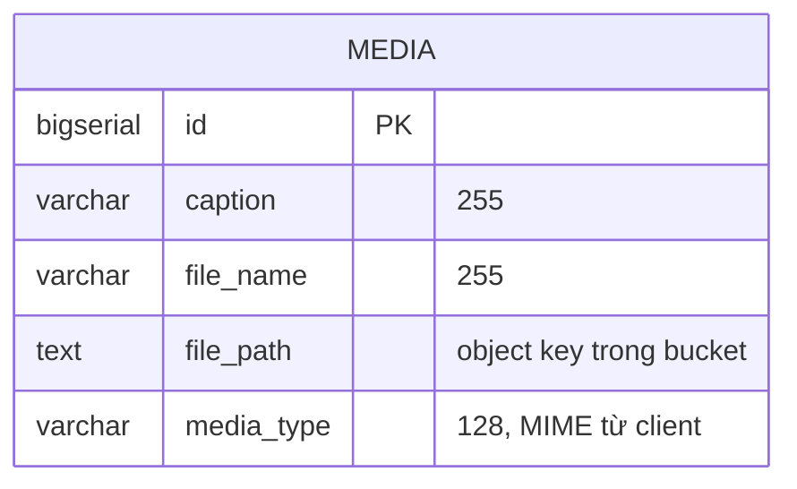

# media-service

> **Phiên bản:** 1.0 · **Trạng thái:** Final · **Cập nhật:** 2026-11-12 · **Phạm vi:** Ứng dụng (as-is)

| Thuộc tính | Giá trị |
| :--- | :--- |
| Ngôn ngữ / stack | TypeScript trên **Bun** (`oven/bun:1.4-alpine`), **Hono**, **drizzle-orm** (`bun:sql`), `S3Client` built-in của Bun |
| Port | `8083` (biến `PORT`) — `services/media-service/src/index.ts:139` |
| Database | PostgreSQL DB `mediaservice`, bảng `media` — `docker-compose.yml:327` |
| Object storage | S3-compatible (**RustFS** trong compose, `http://rustfs:9000`) — `docker-compose.yml:99-120,330-333` |
| Đường dẫn code | `services/media-service/` |
| Prefix gateway | `/media/medias/*` (Bearer, không rewrite) — `deploy/apisix/apisix.yaml:316-327` |
| Tính năng phục vụ | [FEAT-18 Quản lý media](../04-features/FEAT-18-media-management.md) |
| Frontend sử dụng | **Không** — ảnh sản phẩm dùng trường `imageUrl` dạng chuỗi của product-service |

## 1. Tổng quan & trách nhiệm

media-service nhận file upload (multipart), lưu **nội dung** vào bucket S3 và **metadata** (caption, tên file, object key, MIME) vào Postgres; cung cấp API lấy metadata (đơn lẻ / nhiều id), stream file về client và xóa media.

Không có liên kết nào giữa `media` và sản phẩm/danh mục; không service nào gọi media-service. Không xác thực ở service (dựa gateway, ISSUE-01).

Route đăng ký ở cả `/` và `/media` (`src/index.ts:133-137`).

## 2. Tech stack & thư viện

| Thư viện | Phiên bản | Vai trò |
| :--- | :--- | :--- |
| `hono` | `^4.13.13` | Router, `parseBody()` multipart, `logger`, `cors` |
| `drizzle-orm` | `1.0.0-rc.4` | Query builder |
| Bun `S3Client` | runtime | `write`, `unlink`, `file().exists()/stream()`, `list` |
| `typescript`, `@types/bun` (dev) | | Typecheck |

Không dùng Zod (`package.json` chỉ có hono, drizzle-orm). Middleware giống các service Bun khác: `logger`, `cors origin *`, `X-Correlation-Id` (`src/index.ts:11-25`).

## 3. Cấu hình

| Biến | Default | Ý nghĩa | Nguồn |
| :--- | :--- | :--- | :--- |
| `PORT` | `8083` | Cổng HTTP | `src/index.ts:139` |
| `DATABASE_URL`, `POSTGRES_*`, `SPRING_DATASOURCE_URL` | `POSTGRES_DB=mediaservice` | Kết nối Postgres (cơ chế như các service Bun khác) | `src/db.ts:4-32` |
| `STORAGE_ENDPOINT` | `http://localhost:9000` | Endpoint S3 | `src/storage.ts:3` |
| `STORAGE_REGION` | `us-east-1` | Region (không truyền trong compose) | `src/storage.ts:4` |
| `STORAGE_ACCESS_KEY` | có default hard-code (không ghi giá trị) | Access key | `src/storage.ts:5` |
| `STORAGE_SECRET_KEY` | có default hard-code (không ghi giá trị) | Secret key | `src/storage.ts:6` |
| `STORAGE_BUCKET` | `ecommerce-media` | Bucket | `src/storage.ts:7` |
| `PUBLIC_URL` | `http://localhost:8083` | Base URL dùng để build `url` trả về; **không set trong compose** (ISSUE-32) | `src/service.ts:21` |
| `JWT_ISSUER_URI` | — | Không đọc (ISSUE-37) | `docker-compose.yml:326` |

S3 client dùng path-style (`virtualHostedStyle: false`) — `src/storage.ts:9-16`.

## 4. Phụ thuộc

| Phụ thuộc | Chi tiết |
| :--- | :--- |
| PostgreSQL | DB `mediaservice` |
| S3 / RustFS | Bucket `STORAGE_BUCKET`; compose **không** có job tạo bucket — `initStorage` chỉ cảnh báo và gợi ý `storage-init` không tồn tại (ISSUE-32) |
| Kafka, Keycloak, service khác | Không |
| Gateway | Upstream `id: 9` → `media-service:8083` |

## 5. Cấu trúc code

```
services/media-service/
├── Dockerfile
├── package.json
└── src/
    ├── index.ts        # Hono app, health, route /medias..., mount /media, initDb + initStorage
    ├── db.ts           # kết nối + CREATE TABLE media
    ├── schema.ts       # drizzle pgTable media
    ├── service.ts      # MediaService: saveMedia, removeMedia, getMediaById(s), getFile; build URL & object key
    ├── storage.ts      # S3Client, initStorage, upload/delete/get stream
    └── index.test.ts   # bun test
```

## 6. API endpoints

Mỗi path tồn tại ở `/<path>` và `/media/<path>`. Gateway: chỉ `/media/medias/*` (có ít nhất một segment sau `/medias/`), Bearer bắt buộc.

| Method | Path trong service | Path qua gateway | Mô tả | Request | Response | Mã lỗi |
| :--- | :--- | :--- | :--- | :--- | :--- | :--- |
| GET | `/actuator/health`, `/media/actuator/health` | — | Health tĩnh (`db`, `storage` UP) | — | 200 | — |
| POST | `/medias` | `/media/medias` ❌ (ISSUE-15) | Upload | `multipart/form-data`: `multipartFile` hoặc `file` (File, bắt buộc), `caption`, `fileNameOverride` | `200 NoFileMediaVm {id, caption, fileName, mediaType}` | `400 File is required`, `500 {statusCode,message}` |
| GET | `/medias?ids=1,2,3` | `/media/medias?ids=` ❌ (ISSUE-15) | Metadata nhiều id | Query `ids` (CSV; phần tử không phải số bị bỏ) | `200 MediaVm[]` | `400 ids query param is required`, `404 No medias found` (danh sách rỗng), `500` |
| GET | `/medias/:id` | `/media/medias/{id}` ✅ | Metadata 1 media | — | `200 MediaVm {id, caption, fileName, mediaType, url}` | `400 Invalid ID`, `404 Media not found`, `500` |
| GET | `/medias/:id/file/:fileName` | `/media/medias/{id}/file/{fileName}` ✅ (cần Bearer) | Stream file | `fileName` phải khớp (không phân biệt hoa thường) với tên đã lưu | `200` body stream, `Content-Type` = MIME đã lưu, `Content-Disposition: attachment; filename="..."` | `400`, `404 File not found` (sai tên / không có object), `500` |
| DELETE | `/medias/:id` | `/media/medias/{id}` ✅ | Xóa object + metadata | — | `204` (kể cả id không tồn tại) | `400`, `500` |

`url` trong `MediaVm` = `${PUBLIC_URL}/medias/{id}/file/{encodeURIComponent(fileName)}` (`src/service.ts:23-25`) — với default trỏ **thẳng vào port service** (bỏ qua gateway), và không có prefix `/media` nên không khớp route gateway kể cả khi đổi host (ISSUE-63).

## 7. Data model



DDL `services/media-service/src/db.ts:48-56`; drizzle `src/schema.ts:4-10`. Object key = `<uuid>-<tên file đã thay ký tự ngoài [a-zA-Z0-9._-] bằng _>` (`src/service.ts:27-30`).

## 8. Business logic chi tiết

```mermaid
sequenceDiagram
    participant C as Client
    participant M as media-service
    participant S as S3 (RustFS)
    participant DB as Postgres mediaservice
    C->>M: POST /medias (multipart)
    M->>M: fileName = fileNameOverride || file.name || upload.bin; mediaType = file.type || application/octet-stream
    M->>M: file.arrayBuffer() (toàn bộ file vào RAM)
    M->>S: s3.write(objectKey, bytes, type)
    M->>DB: INSERT media
    M-->>C: 200 {id, caption, fileName, mediaType}
```

- **saveMedia** (`src/service.ts:33-57`): upload S3 **trước**, insert DB **sau**; nếu insert lỗi → object mồ côi trong bucket. Không giới hạn kích thước / loại file (ISSUE-32).
- **removeMedia** (`:59-68`): tìm `file_path`; `deleteFromStorage` nuốt lỗi (chỉ warn, `src/storage.ts:37-43`); sau đó luôn xóa dòng DB → có thể còn object mồ côi.
- **getFile** (`:101-118`): kiểm tên file khớp, `file.exists()` rồi `file.stream()`.
- **initStorage** (`src/storage.ts:18-31`): `s3.list({maxKeys:1})` để kiểm bucket; lỗi chỉ warn.
- `Content-Type` khi tải xuống là MIME do client khai lúc upload (không sniff); `Content-Disposition: attachment` giảm rủi ro thực thi nội dung.

## 9. Sự kiện

Không.

## 10. Health check & observability

Health tĩnh (`db`, `storage` luôn `UP`, ISSUE-36). Log `logger()` + cảnh báo init DB/bucket. Không metrics.

## 11. Test

`services/media-service/src/index.test.ts`: health 2 path; `GET /medias` không `ids` → 400; `GET /medias/abc` → 400; POST JSON không có file → 400. Không test upload/stream thật (ISSUE-46).

## 12. Vấn đề đã biết

| ID | Tóm tắt |
| :--- | :--- |
| ISSUE-01 | Upload/xóa chỉ cần token bất kỳ |
| ISSUE-15 | `POST /media/medias` và `GET /media/medias?ids=` không khớp route gateway → không upload được qua gateway |
| ISSUE-16 | `/media/v3/api-docs/*` chết |
| ISSUE-28 | Lỗi init DB chỉ warn |
| ISSUE-32 | Không giới hạn size/MIME, đọc cả file vào RAM, `PUBLIC_URL` không set, bucket không tự tạo |
| ISSUE-36 | Health luôn UP |
| ISSUE-63 | URL media trỏ thẳng port service, thiếu prefix `/media`; route file qua gateway yêu cầu Bearer → không dùng được làm ảnh public trên trình duyệt |
| ISSUE-65 | Upload trả 200 (không 201); DELETE id không tồn tại trả 204; lỗi xóa object bị nuốt; object mồ côi khi insert DB lỗi |

## 13. Tham chiếu source

- `services/media-service/src/index.ts:11-148`
- `services/media-service/src/service.ts:21-119`
- `services/media-service/src/storage.ts:1-51`
- `services/media-service/src/db.ts:46-61`, `src/schema.ts`
- `services/media-service/src/index.test.ts`
- `deploy/apisix/apisix.yaml:30-33,127-129,316-327`
- `docker-compose.yml:99-120,317-340`
