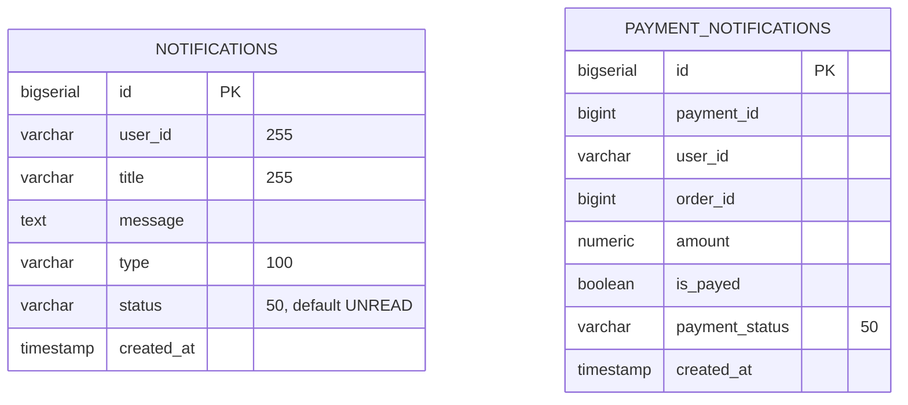
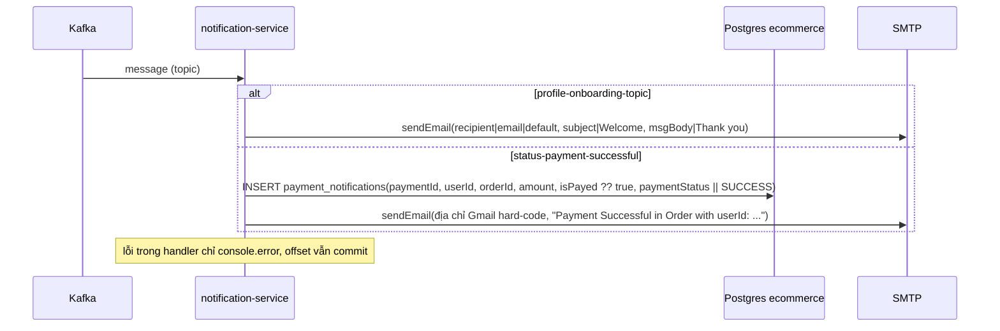

# notification-service

> **Phiên bản:** 1.0 · **Trạng thái:** Final · **Cập nhật:** 2026-11-12 · **Phạm vi:** Ứng dụng (as-is)

| Thuộc tính | Giá trị |
| :--- | :--- |
| Ngôn ngữ / stack | TypeScript trên **Bun** (`oven/bun:1.4-alpine`), **Hono**, **drizzle-orm** (`bun:sql`), **kafkajs**, **nodemailer** |
| Port | `8090` (biến `PORT`) — `services/notification-service/src/index.ts:194` |
| Database | PostgreSQL, DB **`ecommerce`** dùng chung (không có DB riêng) — `docker-compose.yml:393-395` |
| Kafka | Consumer group `notification-group`, topic `profile-onboarding-topic`, `status-payment-successful` — `src/kafka.ts:8,23` |
| SMTP | `MAIL_HOST` (mặc định Gmail) qua nodemailer — `src/mailer.ts:4-18` |
| Đường dẫn code | `services/notification-service/` |
| Prefix gateway | `/notification/api/email/*`, `/notification/api/notifications/*`, `/notification/api/payment-notifications/*` (Bearer, không rewrite) — `deploy/apisix/apisix.yaml:280-315` |
| Tính năng phục vụ | [FEAT-19 Thông báo & email](../04-features/FEAT-19-notifications-email.md) |
| Frontend sử dụng | **Không** |

## 1. Tổng quan & trách nhiệm

notification-service có 3 vai trò:

1. **HTTP email API** — gửi email văn bản tới người nhận bất kỳ (`sendSimpleMail`, `sendMailWithAttachment`, `sendMail`).
2. **HTTP CRUD** cho bảng `notifications` (thông báo chung) và `payment_notifications` (bản ghi thanh toán).
3. **Kafka consumer** — nhận sự kiện onboarding (gửi email chào mừng) và sự kiện thanh toán thành công (lưu `payment_notifications` + gửi email).

Thực tế khi chạy: không ai produce đúng tên topic mà service subscribe (payment-service publish `SUCCESSFUL` / `paymentCompleted`) → luồng Kafka **không bao giờ được kích hoạt** (ISSUE-17). Email thanh toán, nếu có, được gửi tới **một địa chỉ Gmail cá nhân hard-code** chứ không phải khách hàng (ISSUE-09, `src/kafka.ts:52`).

Route đăng ký ở cả `/` và `/notification` (`src/index.ts:188-192`). Service không đọc token, không lọc theo user (ISSUE-33).

## 2. Tech stack & thư viện

| Thư viện | Phiên bản (`package.json:11-21`) | Vai trò |
| :--- | :--- | :--- |
| `hono` | `^4.13.13` | Router, `logger`, `cors` |
| `drizzle-orm` | `1.0.0-rc.4` | Query builder |
| `kafkajs` | `^2.2.4` | Kafka consumer |
| `nodemailer` | `^10.1.0` | Gửi SMTP |
| `@types/nodemailer`, `@types/bun`, `typescript` (dev) | | Typecheck |

Không dùng Zod — body HTTP **không được validate**. Middleware: `logger`, `cors origin *`, `X-Correlation-Id` (`src/index.ts:12-26`).

## 3. Cấu hình

| Biến | Default | Ý nghĩa | Nguồn |
| :--- | :--- | :--- | :--- |
| `PORT` | `8090` | Cổng HTTP | `src/index.ts:194` |
| `DATABASE_URL` | — | Chuỗi kết nối đầy đủ (ưu tiên) | `src/db.ts:5-7` |
| `POSTGRES_USER` / `POSTGRES_PASSWORD` | có default hard-code (không ghi giá trị) | | `src/db.ts:9-10` |
| `POSTGRES_HOST` / `POSTGRES_PORT` | `localhost` / `5432` (compose: `postgres` / `5432`) | | `src/db.ts:11-12` |
| `POSTGRES_DB` | `ecommerce` | DB chung (compose cũng set `ecommerce`) | `src/db.ts:13`, `docker-compose.yml:395` |
| `SPRING_DATASOURCE_URL` | — | Ghi đè host/port/db nếu có (compose không set) | `src/db.ts:15-29` |
| `KAFKA_SERVERS` | `localhost:9092` | Danh sách broker (CSV) | `src/kafka.ts:6` |
| `PAYMENT_KAFKA_CONSUMER_GROUP_ID` | `notification-group` | Consumer group | `src/kafka.ts:8` |
| `MAIL_HOST` | `smtp.gmail.com` | SMTP host | `src/mailer.ts:4` |
| `MAIL_PORT` | `587` | SMTP port; `465` → `secure: true` | `src/mailer.ts:5,15` |
| `MAIL_USERNAME` | `""` | Tài khoản SMTP, đồng thời là địa chỉ `from` | `src/mailer.ts:6,37` |
| `MAIL_PASSWORD` | `""` | Mật khẩu SMTP (secret — xem `.env`) | `src/mailer.ts:7` |
| `JWT_ISSUER_URI` | — | Không đọc (ISSUE-37) | `docker-compose.yml:392` |

Nếu thiếu `MAIL_USERNAME` hoặc `MAIL_PASSWORD`, transporter = `null` và mọi email chuyển sang chế độ **mock** (chỉ log) — `src/mailer.ts:11-18,30-33`.

## 4. Phụ thuộc

| Phụ thuộc | Chi tiết |
| :--- | :--- |
| PostgreSQL | DB `ecommerce` (dùng chung với DB mặc định của container postgres) |
| Kafka | Consume `profile-onboarding-topic`, `status-payment-successful`; client id `notification-service`; retry 2 lần, `initialRetryTime 300ms` (`src/kafka.ts:12-19`) |
| SMTP | nodemailer |
| payment-service | Nguồn dự kiến của sự kiện thanh toán nhưng **tên topic lệch** (ISSUE-17) |
| auth-service | Nguồn dự kiến của sự kiện onboarding — **không produce** (ISSUE-17) |
| Gateway | Upstream `id: 8` → `notification-service:8090` |

## 5. Cấu trúc code

```
services/notification-service/
├── Dockerfile
├── package.json
└── src/
    ├── index.ts        # Hono app, health, route email + notifications + payment-notifications, initDb, initKafka
    ├── db.ts           # kết nối + CREATE TABLE notifications, payment_notifications
    ├── schema.ts       # drizzle pgTable notifications, payment_notifications
    ├── kafka.ts        # initKafka(): consumer, subscribe, eachMessage handler
    ├── mailer.ts       # nodemailer transporter, sendEmail()
    └── index.test.ts   # bun test
```

## 6. API endpoints

Mỗi path tồn tại ở `/<path>` và `/notification/<path>`. Qua gateway: Bearer bắt buộc, không kiểm role (ISSUE-01).

### 6.1 Email (`src/index.ts:42-72`)

| Method | Path trong service | Path qua gateway | Mô tả | Request | Response | Lỗi |
| :--- | :--- | :--- | :--- | :--- | :--- | :--- |
| POST | `/api/email/sendSimpleMail` | `/notification/api/email/sendSimpleMail` ✅ | Gửi email text | JSON `{recipient, subject, msgBody, attachment?}` (không validate) | `200 text/plain`: `Mail Sent Successfully...` / `Mail Sent Successfully (Mock)` / **`Error while Sending Mail: ...` (vẫn 200)** | `500 Error: ...` khi body không phải JSON |
| POST | `/api/email/sendMailWithAttachment` | `/notification/api/email/sendMailWithAttachment` ✅ | Như trên — `attachment` **bị bỏ qua** (ISSUE-33) | như trên | như trên | như trên |
| POST | `/api/email/sendMail` | `/notification/api/email/sendMail` ✅ | Gửi email từ query | Query `to`, `subject` (default `Notification`), `body` | như trên | |

### 6.2 Notifications (`src/index.ts:75-122`)

| Method | Path trong service | Path qua gateway | Mô tả | Request | Response | Lỗi |
| :--- | :--- | :--- | :--- | :--- | :--- | :--- |
| GET | `/api/notifications` | `/notification/api/notifications` ❌ (ISSUE-15) | **Tất cả** thông báo mọi user, `id DESC` (ISSUE-33) | — | `200 Notification[]`; lỗi DB → `200 []` | — |
| GET | `/api/notifications/:id` | ✅ | Chi tiết | — | `200 Notification` | `404` body rỗng, `500` body rỗng (id không phải số → NaN → 500) |
| POST | `/api/notifications` | ❌ (ISSUE-15) | Tạo | JSON `{userId, title, message, type (INFO), status (UNREAD)}` | `201 Notification` | `500 {error}` |
| DELETE | `/api/notifications/:id` | ✅ | Xóa | — | `200 true` (cả khi không tồn tại) | `500 false` |

`Notification`: `{id, userId, title, message, type, status, createdAt}` (`src/schema.ts:4-12`). Không có endpoint cập nhật / mark-as-read.

### 6.3 Payment notifications (`src/index.ts:125-185`)

| Method | Path trong service | Path qua gateway | Mô tả | Request | Response | Lỗi |
| :--- | :--- | :--- | :--- | :--- | :--- | :--- |
| GET | `/api/payment-notifications` | ❌ (ISSUE-15) | Tất cả | — | `200 PaymentNotification[]`; lỗi → `200 []` | — |
| GET | `/api/payment-notifications/:paymentId` | ✅ | Tìm theo `payment_id` **hoặc** `id` (OR) — trả dòng đầu | — | `200` | `404`, `500` |
| POST | `/api/payment-notifications` | ❌ (ISSUE-15) | Tạo | JSON `{paymentId, userId, orderId, amount, isPayed (true), paymentStatus (SUCCESS)}` | `200 PaymentNotification` | `500 {error}` |
| DELETE | `/api/payment-notifications/:paymentId` | ✅ | Xóa mọi dòng có `payment_id = x` **hoặc** `id = x` | — | `204` | `500` |

Lưu ý: điều kiện `OR` khiến id của bản ghi và id thanh toán bị trộn — `DELETE /api/payment-notifications/5` xóa cả bản ghi `id=5` và mọi bản ghi `payment_id=5` (ISSUE-65).

### 6.4 Health

`GET /actuator/health`, `/notification/actuator/health` → `200 {status:"UP",components:{db:{status:"UP"}}}` tĩnh (ISSUE-36).

## 7. Data model



DDL `services/notification-service/src/db.ts:48-70`; drizzle `src/schema.ts`. Không FK, không index.

## 8. Business logic chi tiết

### 8.1 sendEmail (`src/mailer.ts:27-47`)

1. Log người nhận + tiêu đề.
2. Không có transporter → trả `"Mail Sent Successfully (Mock)"`.
3. `transporter.sendMail({from: MAIL_USERNAME, to, subject, text})`.
4. Lỗi SMTP → **trả chuỗi** `"Error while Sending Mail: ..."` (không throw) → HTTP vẫn 200 (ISSUE-65).

Không giới hạn người nhận/tần suất: bất kỳ ai có token hợp lệ đều dùng được tài khoản SMTP của hệ thống để gửi email tùy ý (ISSUE-64).

### 8.2 Kafka consumer (`src/kafka.ts:10-65`)



- `subscribe({topics:[...], fromBeginning:false})` — chỉ nhận message mới.
- `initKafka()` được gọi **không await** (`src/index.ts:198`); nếu broker không sẵn sàng lúc khởi động, chỉ warn và **không thử kết nối lại** → service chạy tiếp không có consumer (ISSUE-65).
- Lỗi parse/insert/gửi mail bị nuốt (không retry, không DLQ).
- Payload kỳ vọng (theo field đọc): onboarding `{recipient|email, subject, msgBody}`; payment `{paymentId, userId, orderId, amount, isPayed, paymentStatus}`.

## 9. Sự kiện

| Hướng | Topic | Producer thực tế | Xử lý |
| :--- | :--- | :--- | :--- |
| Consume | `profile-onboarding-topic` | **Không có** (ISSUE-17) | Gửi email chào mừng |
| Consume | `status-payment-successful` | **Không có** — payment-service publish `SUCCESSFUL`, `paymentCompleted` (ISSUE-17, ISSUE-18) | Lưu `payment_notifications` + email tới địa chỉ hard-code (ISSUE-09) |
| Produce | — | — | Không produce |

## 10. Health check & observability

Health tĩnh (ISSUE-36), không phản ánh trạng thái Kafka/SMTP/DB. Log stdout: `logger()`, log mọi message Kafka nhận được **kèm toàn bộ payload** (`src/kafka.ts:31`) và địa chỉ người nhận email (`src/mailer.ts:28`). Không metrics.

## 11. Test

`services/notification-service/src/index.test.ts`: health 2 path; `sendSimpleMail` và `sendMail` → 200 chứa `Mail Sent Successfully` (dựa chế độ mock khi không có SMTP); `GET /api/notifications` → mảng (pass cả khi không DB vì trả `[]`). Import `./index` sẽ gọi `initKafka()` thật (ISSUE-46).

## 12. Vấn đề đã biết

| ID | Tóm tắt |
| :--- | :--- |
| ISSUE-01 | Không kiểm role trên CRUD/email |
| ISSUE-09 | Email thanh toán gửi tới địa chỉ cá nhân hard-code |
| ISSUE-15 | Path gốc `/notification/api/notifications`, `/notification/api/payment-notifications` không khớp route gateway → list/create không gọi được |
| ISSUE-16 | `/notification/v3/api-docs/*` chết |
| ISSUE-17 | Lệch tên topic; không ai produce onboarding |
| ISSUE-28 | Không migration |
| ISSUE-33 | List trả mọi thông báo; không mark-as-read; bỏ qua attachment; dùng DB `ecommerce` chung |
| ISSUE-36 | Health luôn UP |
| ISSUE-64 | Email API là "open relay" nội bộ: người nhận/nội dung tùy ý, không rate limit, không kiểm role |
| ISSUE-65 | Lỗi SMTP trả 200; Kafka không reconnect; điều kiện `OR` id/payment_id; xóa không tồn tại vẫn thành công |

## 13. Tham chiếu source

- `services/notification-service/src/index.ts:12-203`
- `services/notification-service/src/kafka.ts:1-65`
- `services/notification-service/src/mailer.ts:1-47`
- `services/notification-service/src/db.ts:46-75`, `src/schema.ts`
- `services/notification-service/src/index.test.ts`
- `services/payment-service/internal/service/payment_service.go:18-21,108-118` (topic phía producer)
- `deploy/apisix/apisix.yaml:26-29,124-126,280-315`
- `docker-compose.yml:383-407`
