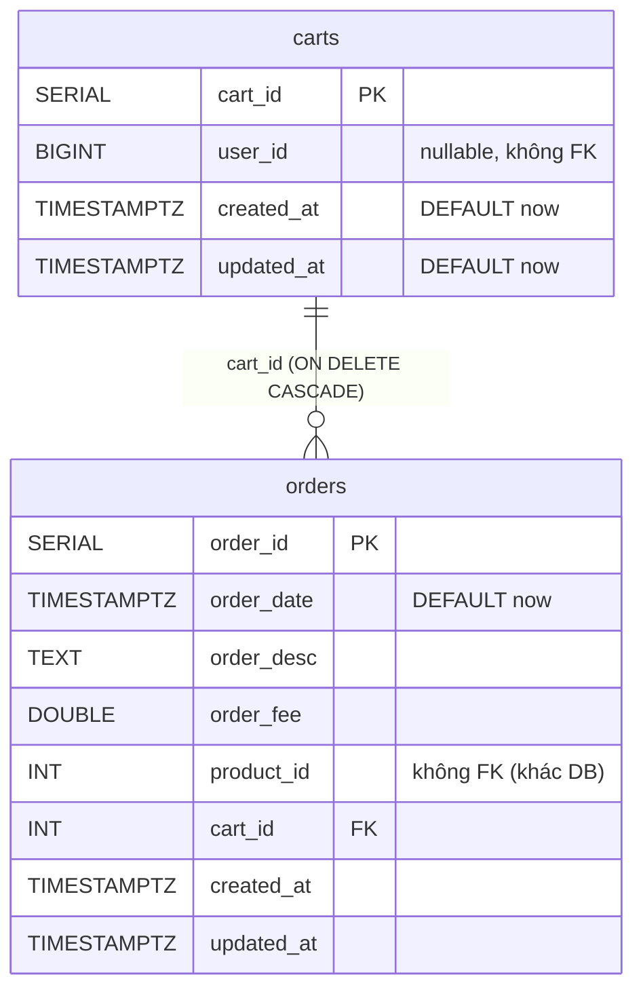
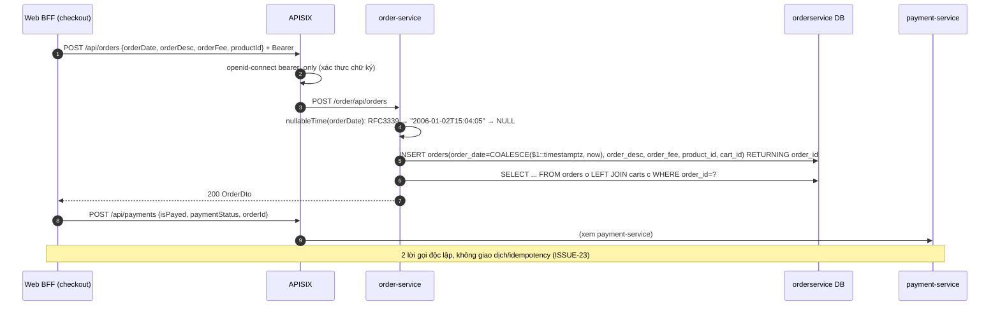

# order-service

> **Phiên bản:** 1.0 · **Trạng thái:** Final · **Cập nhật:** 2026-11-12 · **Phạm vi:** Ứng dụng (as-is)

| Thuộc tính | Giá trị |
| :--- | :--- |
| Ngôn ngữ / stack | Go 1.27, `go-chi/chi v5`, `stephenafamo/bob` + `pgx v5` |
| Port | `8084` (env `PORT`, `services/order-service/main.go:57`; compose `docker-compose.yml:222-223`) |
| Database | PostgreSQL `orderservice` (bảng `carts`, `orders`) |
| Đường dẫn code | `services/order-service/` |
| Prefix gateway | `/api/carts[/*]`, `/api/orders[/*]` → `/order/...` (upstream 3, Bearer) (`deploy/apisix/apisix.yaml:178-213`) |
| Tính năng phục vụ | [FEAT-09](../04-features/FEAT-09-checkout-place-order.md), [FEAT-10](../04-features/FEAT-10-order-history.md), [FEAT-22](../04-features/FEAT-22-admin-dashboard.md), [FEAT-25](../04-features/FEAT-25-admin-order-mgmt.md). Giỏ hàng storefront ([FEAT-08](../04-features/FEAT-08-shopping-cart.md)) chạy phía client, **không** dùng `/api/carts`. |

## 1. Tổng quan & trách nhiệm

order-service lưu **giỏ hàng (cart)** và **đơn hàng (order)** dưới dạng CRUD đơn giản:

- Một `cart` gắn với một `user_id` (BIGINT) và chứa nhiều `orders`.
- Một `order` = **một dòng**: ngày, mô tả, phí (`order_fee`), **một `product_id`**, tùy chọn thuộc một cart. Không có trạng thái, số lượng, địa chỉ, dòng hàng (ISSUE-20, ISSUE-22).

Service **không**: tính tổng tiền (ISSUE-21), kiểm/giữ tồn kho, gọi payment, publish/consume Kafka (biến `KAFKA_SERVERS` được set nhưng không dùng — ISSUE-37), lọc theo người dùng từ token (ISSUE-49).

## 2. Tech stack & thư viện

Giống product-service: `chi v5.3.2`, `go-chi/cors v1.2.2`, `pgx v5.11.0`, `bob v0.50.0`, `scan v0.9.0`, `testify`, `com.ecommerce/shared` (`services/order-service/go.mod`). Dockerfile 2 stage, `EXPOSE 8084`.

## 3. Cấu hình

`services/order-service/main.go:26-58`

| Biến | Default | Compose (`docker-compose.yml:224-229`) | Ý nghĩa |
| :--- | :--- | :--- | :--- |
| `PORT` | `8084` | – | Cổng |
| `DATABASE_URL` | – | – | DSN đầy đủ |
| `SPRING_DATASOURCE_URL` | – | `jdbc:postgresql://postgres:5432/orderservice` | Parse lấy host/port/db |
| `POSTGRES_HOST/PORT/DB` | `localhost`/`5432`/`orderservice` | – | |
| `POSTGRES_USER/PASSWORD` | default trong code | từ `.env` | Secret |
| `KAFKA_SERVERS` | – | `kafka:9092` | **Không được đọc** (ISSUE-37) |
| `JWT_ISSUER_URI` | – | có set | Không dùng |

## 4. Phụ thuộc

| Phụ thuộc | Ghi chú |
| :--- | :--- |
| PostgreSQL `orderservice` | Duy nhất |
| product-service | Không gọi; `product_id` không được kiểm tồn tại. BFF tự đọc lại sản phẩm trước khi đặt hàng. |
| payment-service | Không gọi; BFF gọi `POST /api/payments` sau khi tạo order (ISSUE-23). |
| Kafka | Không dùng (compose vẫn `depends_on: kafka`, `docker-compose.yml:233-234`). |

## 5. Cấu trúc code

```
services/order-service/
├── main.go                              # DSN, pool, InitSchema, router, graceful shutdown
├── main_test.go
└── internal/
    ├── handler/order_handler.go         # 15 handler cart/order, 2 prefix (/api, /order/api)
    ├── model/order.go                   # UserDto, ProductDto, OrderDto, CartDto, PageResponse[T]
    ├── repository/order_repository.go   # DDL + truy vấn carts/orders, nullableTime
    └── service/order_service.go         # wrapper + tính PageResponse, ErrCartNotFound/ErrOrderNotFound
```

## 6. API endpoints

**Quy ước**: JSON thô khi thành công, `ErrorVm` khi lỗi ([shared](shared-go-module.md#81-hai-định-dạng-response-song-song-issue-29)). Mọi route có ở `/api/...` và `/order/api/...` (`order_handler.go:28-36`). Gateway: `openid-connect` `bearer_only` (chỉ xác thực, không role, không scoping theo user).

### 6.1 Bảng tổng hợp

| # | Method | Path trong service | Path qua gateway | Mô tả |
| :--- | :--- | :--- | :--- | :--- |
| 1 | GET | `/actuator/health`, `/order/actuator/health`, `/health` | – | Health luôn UP |
| 2 | GET | `/api/carts` | `/api/carts` | Tất cả cart (kèm orders) |
| 3 | GET | `/api/carts/all?page&size&sortBy&sortOrder` | `/api/carts/all` | Cart phân trang |
| 4 | GET | `/api/carts/{cartId}` | `/api/carts/{id}` | Chi tiết cart |
| 5 | POST | `/api/carts` | `/api/carts` | Tạo cart (+ orders lồng nhau) |
| 6 | PUT | `/api/carts` | `/api/carts` | Cập nhật cart theo `cartId` trong body |
| 7 | PUT | `/api/carts/{cartId}` | `/api/carts/{id}` | Cập nhật cart theo path |
| 8 | DELETE | `/api/carts/{cartId}` | `/api/carts/{id}` | Xóa cart (cascade orders) |
| 9 | GET | `/api/orders` | `/api/orders` | Tất cả order của **mọi user** (mảng thô — ISSUE-48, ISSUE-49) |
| 10 | GET | `/api/orders/all?page&size&sortBy&sortOrder` | `/api/orders/all` | Order phân trang (`PageResponse`) |
| 11 | GET | `/api/orders/existOrderId?orderId=` | `/api/orders/existOrderId` | Kiểm tồn tại |
| 12 | GET | `/api/orders/{orderId}` | `/api/orders/{id}` | Chi tiết order |
| 13 | POST | `/api/orders` | `/api/orders` | Tạo order |
| 14 | PUT | `/api/orders` | `/api/orders` | Cập nhật theo `orderId` trong body |
| 15 | PUT | `/api/orders/{orderId}` | `/api/orders/{id}` | Cập nhật theo path |
| 16 | DELETE | `/api/orders/{orderId}` | `/api/orders/{id}` | Xóa order |
| – | GET | – | `/order/v3/api-docs/*` | Route chết (ISSUE-16) |

### 6.2 DTO

`internal/model/order.go:3-46` — mọi field đều `omitempty`.

```json
// OrderDto
{
  "orderId": 42,
  "orderDate": "2026-11-12T10:15:00",
  "orderDesc": "Giao giờ hành chính",
  "orderFee": 21990000,
  "productId": 15,
  "cart": { "cartId": 7, "userId": 3 }
}

// CartDto  (lưu ý: mảng orders có tên JSON là "order")
{
  "cartId": 7,
  "userId": 3,
  "order": [ { "orderId": 42, "orderDate": "2026-11-12T10:15:00", "orderDesc": "…", "orderFee": 21990000, "productId": 15 } ],
  "user": { "id": 3 }
}
```

`ProductDto` (`product`) có trong model nhưng **không bao giờ được điền**. `UserDto` chỉ có `id`.

### 6.3 Chi tiết cart

| # | Request | Response 2xx | Lỗi |
| :--- | :--- | :--- | :--- |
| 2 | – | 200 `CartDto[]` sắp `cart_id ASC`, mỗi cart kèm `order` (query N+1) | 500 |
| 3 | `page` (0), `size` (10, ≤0→10), `sortBy` `userId`/`user_id` → `user_id`, khác → `cart_id`; `sortOrder` `desc`→DESC | 200 `PageResponse<CartDto>` (xem ví dụ §6.5) | 500 |
| 4 | path `cartId` | 200 `CartDto` | 400 `Invalid cartId`; 404 `cart not found`; 500 |
| 5 | `{"userId":3,"order":[{"orderDesc":"…","orderFee":100,"productId":15}]}` | 200 `CartDto` có `cartId`, `user`, `order` đọc lại từ DB | 400 body; 500. **Lỗi khi insert từng order bị bỏ qua** (ISSUE-24) |
| 6 | `{"cartId":7,"userId":4}` | 200 `CartDto` đọc lại | 400 `cartId is required for update`; 404; 500 |
| 7 | path `cartId` + `{"userId":4}` | 200 | 400; 404; 500 |
| 8 | path `cartId` | 200 `true` (kể cả không tồn tại) | 400; 500 |

Update cart chỉ đổi `user_id` (COALESCE: `userId` null → giữ nguyên) và `updated_at`; mảng `order` trong body bị bỏ qua (`order_repository.go:212-230`).

### 6.4 Chi tiết order

| # | Request | Response 2xx | Lỗi |
| :--- | :--- | :--- | :--- |
| 9 | (query bị bỏ qua) | 200 `OrderDto[]` sắp `order_id ASC`, LEFT JOIN carts | 500 |
| 10 | `sortBy` ∈ `orderFee/order_fee`, `orderDate/order_date`, khác → `order_id` | 200 `PageResponse<OrderDto>` | 500 |
| 11 | `?orderId=42` | 200 `true`/`false` | 400 `Invalid orderId`; 500 |
| 12 | path | 200 `OrderDto` | 400; 404 `order not found`; 500 |
| 13 | xem ví dụ dưới | 200 `OrderDto` đọc lại từ DB (không phải 201) | 400 body; 500 (vd `cart.cartId` không tồn tại → FK) |
| 14 | body có `orderId` | 200 `OrderDto` | 400 `orderId is required for update`; 404; 500 |
| 15 | path + body | 200 | 400; 404; 500 |
| 16 | path | 200 `true` | 400; 500 |

Request tạo order mà BFF web gửi (`frontend/apps/web/src/routes/checkout/checkout.remote.ts:30-35`):

```json
{ "orderDate": "2026-11-12T03:15:20.123Z", "orderDesc": "EzBuy order", "orderFee": 22040000, "productId": 15 }
```

→ Order **không có cart** → `cart_id NULL` → không gắn với người dùng nào (ISSUE-49). `productId` chỉ lấy sản phẩm đầu tiên của giỏ (ISSUE-20).

### 6.5 `PageResponse` (`internal/model/order.go:36-46`, `internal/service/order_service.go:102-131`)

```json
{
  "content": [ { "orderId": 1, "orderDate": "2026-11-12T10:15:00", "orderFee": 100, "productId": 15 } ],
  "totalElements": 1, "totalPages": 1, "size": 10, "number": 0,
  "numberOfElements": 1, "first": true, "last": true, "empty": false
}
```

`/api/orders/all` có định dạng BFF cần, nhưng BFF lại gọi `/api/orders` (ISSUE-48).

## 7. Data model



DDL: `services/order-service/internal/repository/order_repository.go:36-54`. Chi tiết: [data-dictionary.md §orderservice](../06-data/data-dictionary.md#4-orderservice-order-service).

- `order_date` được đọc bằng `to_char(order_date, 'YYYY-MM-DD"T"HH24:MI:SS')` → **mất múi giờ** (theo timezone session DB) (`order_repository.go:248`, `303`).
- `user_id` BIGINT trong khi `sub` Keycloak là UUID (ISSUE-49).

## 8. Business logic chi tiết



| # | Quy tắc | Nguồn |
| :--- | :--- | :--- |
| R1 | `orderFee` lấy nguyên từ client, không tính lại (ISSUE-21). | `order_repository.go:413-425` |
| R2 | `orderDate` không parse được hoặc rỗng → `CURRENT_TIMESTAMP`. | `order_repository.go:416`, `487-499` |
| R3 | Update order dùng `COALESCE(new, old)` cho `order_desc`, `order_fee`, `product_id`, `cart_id`. Với `order_desc` kiểu `string` (không phải con trỏ), bỏ trống field gửi `''` (không phải NULL) → **mô tả cũ bị xóa** (ISSUE-59). | `order_repository.go:444-454` |
| R4 | `orderDate` **không thể cập nhật**. | `order_repository.go:444-454` |
| R5 | Không có trạng thái đơn, không có hủy/xác nhận (ISSUE-20). | – |
| R6 | Không kiểm tra người gọi sở hữu cart/order (ISSUE-49). | `order_handler.go` |
| R7 | Tạo cart lồng orders: mỗi order insert riêng, lỗi bị nuốt; không transaction (ISSUE-24). | `order_repository.go:201-207` |
| R8 | DB `nil` → list rỗng, get 404, save trả id `1` (ISSUE-28). | các nhánh `Pool == nil` |

## 9. Sự kiện (produce / consume)

Không có. `KAFKA_SERVERS` không được đọc.

## 10. Health check & observability

`/actuator/health`, `/order/actuator/health`, `/health` → luôn UP (ISSUE-36). `InitSchema` lỗi bị bỏ qua (`main.go`: `_ = repo.InitSchema(ctx)`).

## 11. Test

`services/order-service/main_test.go` (DB `nil`): `TestHealthCheck` (`:41-46`), `TestCartsEndpoints` (`:48-60` GET/POST/DELETE cart), `TestOrdersEndpoints` (`:62-77` GET list, POST, `existOrderId`, DELETE). Chỉ kiểm mã 200 (ISSUE-46).

## 12. Vấn đề đã biết

| ID | Mức | Tóm tắt |
| :--- | :--- | :--- |
| ISSUE-01 | Critical | Không kiểm role |
| ISSUE-16 | Low | Route api-docs chết |
| ISSUE-20 | High | Không status, 1 product/order, không số lượng |
| ISSUE-21 | High | `order_fee` tin client, không orchestration |
| ISSUE-22 | Medium | Không lưu địa chỉ giao |
| ISSUE-23 | Medium | Không idempotency/giao dịch order + payment |
| ISSUE-24 | Medium | `SaveCart` nuốt lỗi |
| ISSUE-27 | Medium | `DOUBLE PRECISION` cho tiền |
| ISSUE-28 | High | Không migration, stub khi không có DB |
| ISSUE-36 | Low | Health luôn UP |
| ISSUE-37 | Low | `KAFKA_SERVERS`, `JWT_ISSUER_URI` thừa |
| ISSUE-48 | Critical | `/api/orders` trả mảng thô, bỏ qua query |
| ISSUE-49 | High | Không lọc theo user; `user_id` integer vs UUID |
| ISSUE-59 | Medium | `COALESCE` với chuỗi rỗng xóa `order_desc` khi update |

## 13. Tham chiếu source

- `services/order-service/main.go:26-113`
- `services/order-service/internal/handler/order_handler.go:23-330`
- `services/order-service/internal/service/order_service.go:12-165`
- `services/order-service/internal/repository/order_repository.go:32-499`
- `services/order-service/internal/model/order.go:3-46`
- `services/order-service/main_test.go:41-77`
- `docker-compose.yml:216-236`
- `deploy/apisix/apisix.yaml:10-13`, `109-111`, `178-213`
- `frontend/apps/web/src/routes/checkout/checkout.remote.ts:30-41`
