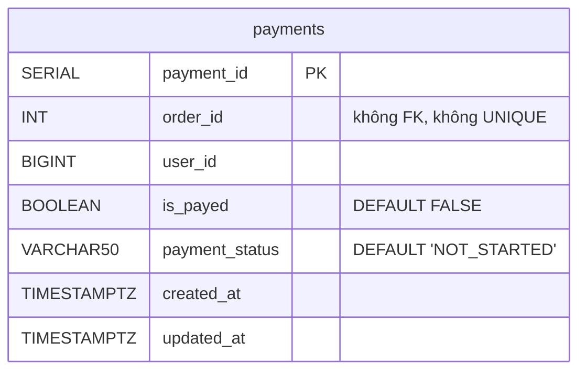

# payment-service

> **Phiên bản:** 1.0 · **Trạng thái:** Final · **Cập nhật:** 2026-11-12 · **Phạm vi:** Ứng dụng (as-is)

| Thuộc tính | Giá trị |
| :--- | :--- |
| Ngôn ngữ / stack | Go 1.27, `go-chi/chi v5`, `bob` + `pgx v5`, Kafka producer `segmentio/kafka-go v0.4.47` |
| Port | `8085` (env `PORT`, `services/payment-service/main.go:57`; compose `docker-compose.yml:244-245`) |
| Database | PostgreSQL `paymentservice` (bảng `payments`) |
| Kafka | Produce topic `SUCCESSFUL` và `paymentCompleted` |
| Đường dẫn code | `services/payment-service/` |
| Prefix gateway | `/api/payments[/*]` → `/payment/...` (upstream 4, Bearer) (`deploy/apisix/apisix.yaml:214-231`) |
| Tính năng phục vụ | [FEAT-09](../04-features/FEAT-09-checkout-place-order.md), [FEAT-11](../04-features/FEAT-11-payment.md), gián tiếp [FEAT-19](../04-features/FEAT-19-notifications-email.md) |

## 1. Tổng quan & trách nhiệm

payment-service **ghi nhận** bản ghi thanh toán cho một đơn (`order_id`, `is_payed`, `payment_status`) và phát sự kiện Kafka mỗi khi tạo bản ghi. Không có tích hợp cổng thanh toán, webhook, tính tiền, hoàn tiền hay xác minh đơn hàng (ISSUE-25). Trạng thái thanh toán do **client tự khai báo** (BFF gửi `isPayed: true` cho mọi phương thức khác COD).

## 2. Tech stack & thư viện

| Thư viện | Vai trò |
| :--- | :--- |
| `go-chi/chi/v5` v5.3.2, `go-chi/cors` v1.2.2 | Router, CORS |
| `jackc/pgx/v5` v5.11.0, `stephenafamo/bob` v0.50.0, `stephenafamo/scan` v0.9.0 | DB |
| `segmentio/kafka-go` v0.4.47 | `kafka.Writer` |
| `com.ecommerce/shared` | config/database/middleware/response |

Nguồn `services/payment-service/go.mod:5-14`. Dockerfile 2 stage, `EXPOSE 8085`.

## 3. Cấu hình

| Biến | Default | Compose (`docker-compose.yml:246-251`) | Ý nghĩa |
| :--- | :--- | :--- | :--- |
| `PORT` | `8085` | – | Cổng |
| `DATABASE_URL` / `SPRING_DATASOURCE_URL` / `POSTGRES_*` | `paymentservice` | `jdbc:postgresql://postgres:5432/paymentservice` | Như các service Go khác |
| `KAFKA_SERVERS` | `localhost:9092` | `kafka:9092` | Danh sách broker, tách dấu phẩy (`main.go:74-76`) |
| `JWT_ISSUER_URI` | – | có set | Không dùng |

Tham số producer hard-code (`internal/service/kafka_producer.go:20-25`): `Balancer: LeastBytes`, `WriteTimeout: 3s`, `RequiredAcks: RequireOne`. Không set `BatchTimeout`, `Async`, `AllowAutoTopicCreation` → dùng mặc định của kafka-go (xem ISSUE-57).

## 4. Phụ thuộc

| Phụ thuộc | Ghi chú |
| :--- | :--- |
| PostgreSQL `paymentservice` | Bảng `payments` |
| Kafka | Producer; `NewEventProducer` chỉ trả writer `nil` khi danh sách broker rỗng — không kiểm kết nối khi khởi động |
| order-service | **Không gọi**; `GET /getOrder/{orderId}` chỉ trả lại id (stub — ISSUE-25) |
| notification-service | Người nhận sự kiện dự kiến, nhưng subscribe topic khác tên (ISSUE-17) |

## 5. Cấu trúc code

```
services/payment-service/
├── main.go                               # DSN, pool, InitSchema, Kafka producer, router
├── main_test.go
└── internal/
    ├── handler/payment_handler.go        # 9 handler, 2 prefix
    ├── model/payment.go                  # OrderDto, UserDto, PaymentDto, KafkaPaymentDto, PageResponse
    ├── repository/payment_repository.go  # DDL + CRUD + ExistsByOrderIdAndIsPayed
    ├── service/payment_service.go        # nghiệp vụ, hằng số topic
    └── service/kafka_producer.go         # EventProducer (kafka.Writer)
```

## 6. API endpoints

JSON thô + `ErrorVm` (ISSUE-29). Prefix `/api/payments` và `/payment/api/payments` (`payment_handler.go:28-30`). Gateway: Bearer (không role).

### 6.1 Bảng tổng hợp

| # | Method | Path trong service | Path qua gateway | Mô tả |
| :--- | :--- | :--- | :--- | :--- |
| 1 | GET | `/actuator/health`, `/payment/actuator/health`, `/health` | – | Health luôn UP |
| 2 | GET | `/api/payments` | `/api/payments` | Tất cả payment |
| 3 | GET | `/api/payments/all?page&size&sortBy&sortOrder` | `/api/payments/all` | Phân trang |
| 4 | GET | `/api/payments/{paymentId}` | `/api/payments/{id}` | Chi tiết |
| 5 | GET | `/api/payments/getOrder/{orderId}` | `/api/payments/getOrder/{id}` | **Stub**: trả `{"orderId": id}` |
| 6 | POST | `/api/payments` | `/api/payments` | Tạo payment + publish Kafka |
| 7 | PUT | `/api/payments` | `/api/payments` | Cập nhật theo `paymentId` trong body |
| 8 | PUT | `/api/payments/{paymentId}` | `/api/payments/{id}` | Cập nhật theo path |
| 9 | DELETE | `/api/payments/{paymentId}` | `/api/payments/{id}` | Xóa |
| – | GET | – | `/payment/v3/api-docs/*` | Route chết (ISSUE-16) |

### 6.2 DTO (`internal/model/payment.go:18-26`)

```json
{
  "paymentId": 9,
  "isPayed": true,
  "paymentStatus": "IN_PROGRESS",
  "orderId": 42,
  "userId": 3,
  "order": { "orderId": 42 },
  "user": { "id": 3 }
}
```

`order`/`user` chỉ được dựng từ id (không gọi service khác). Mọi field `omitempty`.

### 6.3 Chi tiết

| # | Request | Response 2xx | Lỗi |
| :--- | :--- | :--- | :--- |
| 2 | – | 200 `PaymentDto[]` sắp `payment_id ASC` | 500 |
| 3 | `page`(0) `size`(10) `sortBy` ∈ `orderId/order_id`, `userId/user_id`, `isPayed/is_payed`, khác → `payment_id`; `sortOrder` | 200 `PageResponse<PaymentDto>` | 500 |
| 4 | path | 200 `PaymentDto` | 400 `Invalid paymentId`; 404 `payment not found`; 500 |
| 5 | path | 200 `{"orderId": 42}` | 400 `Invalid orderId` |
| 6 | `{"isPayed":false,"paymentStatus":"NOT_STARTED","orderId":42}` (BFF, `checkout.remote.ts:37-41`) | 200 `PaymentDto` đọc lại DB | 400 body; **404** `{"statusCode":"404","title":"Not found","detail":"Order has already been paid."}` khi đã có payment `is_payed = TRUE` cho cùng `orderId` (ISSUE-25a); 500 |
| 7 | body có `paymentId` | 200 | 404 `payment not found`; **500** khi thiếu `paymentId` (`paymentId is required for update` — nên là 400); 500 |
| 8 | path + body | 200 | 400; 404; 500 |
| 9 | path | 200 `true` (kể cả không tồn tại) | 400; 500 |

## 7. Data model



DDL `services/payment-service/internal/repository/payment_repository.go:34-44`. Chi tiết: [data-dictionary.md §paymentservice](../06-data/data-dictionary.md#5-paymentservice-payment-service).

- `payment_status` là chuỗi tự do; giá trị thực tế do BFF gửi: `NOT_STARTED` (COD), `IN_PROGRESS` (phương thức khác). Không có enum/kiểm tra.
- Không có ràng buộc một payment/đơn: có thể tạo nhiều payment `is_payed = false` cho cùng order.

## 8. Business logic chi tiết

```mermaid
sequenceDiagram
  autonumber
  participant W as Web BFF
  participant GW as APISIX
  participant PS as payment-service
  participant DB as paymentservice DB
  participant K as Kafka
  W->>GW: POST /api/payments {isPayed, paymentStatus, orderId} + Bearer
  GW->>PS: POST /payment/api/payments
  alt orderId != null
    PS->>DB: SELECT EXISTS(order_id=? AND is_payed=TRUE)
    alt đã thanh toán
      PS-->>W: 404 "Order has already been paid." (ISSUE-25)
    end
  end
  PS->>DB: INSERT payments(order_id,user_id,is_payed=COALESCE($,FALSE),payment_status=COALESCE($,'NOT_STARTED')) RETURNING payment_id
  PS->>DB: SELECT … WHERE payment_id=?
  PS->>K: WriteMessages(topic="SUCCESSFUL", value=KafkaPaymentDto) — lỗi bị bỏ qua
  PS->>K: WriteMessages(topic="paymentCompleted", value=KafkaPaymentDto) — lỗi bị bỏ qua
  Note over PS,K: Publish cho MỌI payment kể cả NOT_STARTED (ISSUE-18); writer đồng bộ (ISSUE-57)
  PS-->>W: 200 PaymentDto
```

| # | Quy tắc | Nguồn |
| :--- | :--- | :--- |
| R1 | Chặn tạo payment mới nếu đã có payment `is_payed = TRUE` cho cùng `orderId`. Không chặn khi `orderId` null. Kiểm tra và insert không nằm trong transaction (race). | `payment_service.go:87-96`, `payment_repository.go:185-200` |
| R2 | `paymentStatus` là `string` → client bỏ trống gửi `''`; `COALESCE('', 'NOT_STARTED')` = `''` → **default không bao giờ áp dụng ở INSERT**; tương tự UPDATE ghi đè thành `''` (ISSUE-25b, ISSUE-59). | `payment_repository.go:214-215`, `240` |
| R3 | `isPayed` là `*bool`: bỏ trống → FALSE khi tạo, giữ nguyên khi update. | `payment_repository.go:214`, `239` |
| R4 | Update cho phép đổi `order_id`, `user_id`, `is_payed`, `payment_status` tùy ý — không có state machine, không chặn chuyển `true → false`. | `payment_repository.go:228-249` |
| R5 | Kafka publish sau khi lưu DB; lỗi gửi bị bỏ qua, không outbox (ISSUE-18). | `payment_service.go:103-113` |
| R6 | DB `nil` → save trả `paymentId: 1`, kiểm "đã thanh toán" luôn false (ISSUE-28). | `payment_repository.go:186-206` |

## 9. Sự kiện (produce / consume)

| Topic | Khi nào | Key | Value | Consumer thực tế |
| :--- | :--- | :--- | :--- | :--- |
| `SUCCESSFUL` | Sau mỗi `POST` thành công | không set | JSON `KafkaPaymentDto` | **Không có** (notification nghe `status-payment-successful` — ISSUE-17) |
| `paymentCompleted` | Ngay sau topic trên | không set | như trên | **Không có** |

Payload (`internal/model/payment.go:28-34`, các field `omitempty`):

```json
{ "paymentId": 9, "isPayed": false, "paymentStatus": "NOT_STARTED", "orderId": 42 }
```

Không có `amount`, email người dùng hay `userId` (BFF không gửi `userId`) → kể cả khi tên topic được sửa, notification-service sẽ lưu `amount = 0` và không biết gửi email cho ai (ISSUE-09).

Đặc điểm producer (`internal/service/kafka_producer.go`): `kafka.Writer` dùng chung cho mọi topic (topic đặt trên từng message), gọi `WriteMessages` **đồng bộ** trong request HTTP; `Close()` khi shutdown (`main.go:77`). Không tạo topic khi khởi động và không bật `AllowAutoTopicCreation` (ISSUE-57).

## 10. Health check & observability

Health luôn UP, không kiểm DB/Kafka (ISSUE-36). Log producer: `[EventProducer] Sent Kafka message…` hoặc `Warning: Failed to send…`.

## 11. Test

`services/payment-service/main_test.go` (DB `nil`, producer `nil`): `TestHealthCheck` (`:42-47`), `TestPaymentsEndpoints` (`:49-64`: GET list, POST, `getOrder`, DELETE → 200). Không test Kafka, không test nhánh "đã thanh toán" (ISSUE-46).

## 12. Vấn đề đã biết

| ID | Mức | Tóm tắt |
| :--- | :--- | :--- |
| ISSUE-01 | Critical | Không kiểm role; ai có token cũng sửa `isPayed` |
| ISSUE-09 | High | Payload không có người nhận email |
| ISSUE-17 | High | Tên topic lệch với notification-service |
| ISSUE-18 | High | Publish "thành công" cho mọi payment; lỗi gửi bị bỏ qua |
| ISSUE-23 | Medium | Order + payment không giao dịch |
| ISSUE-25 | Medium | 404 cho "đã thanh toán"; chuỗi rỗng ghi đè status; `getOrder` stub; không cổng thanh toán |
| ISSUE-28 | High | Stub khi không có DB |
| ISSUE-36 | Low | Health luôn UP |
| ISSUE-57 | Medium | Kafka writer đồng bộ (`BatchTimeout` mặc định 1s × 2 topic) làm chậm POST; không tạo topic/không auto-create |
| ISSUE-59 | Medium | `COALESCE` với chuỗi rỗng — INSERT không bao giờ dùng default `NOT_STARTED` |

## 13. Tham chiếu source

- `services/payment-service/main.go:56-118`
- `services/payment-service/internal/handler/payment_handler.go:23-183`
- `services/payment-service/internal/service/payment_service.go:13-138`
- `services/payment-service/internal/service/kafka_producer.go:11-56`
- `services/payment-service/internal/repository/payment_repository.go:30-261`
- `services/payment-service/internal/model/payment.go:3-46`
- `services/payment-service/main_test.go:17-64`
- `docker-compose.yml:238-258`
- `deploy/apisix/apisix.yaml:14-17`, `112-114`, `214-231`
- `frontend/apps/web/src/routes/checkout/checkout.remote.ts:37-41`
