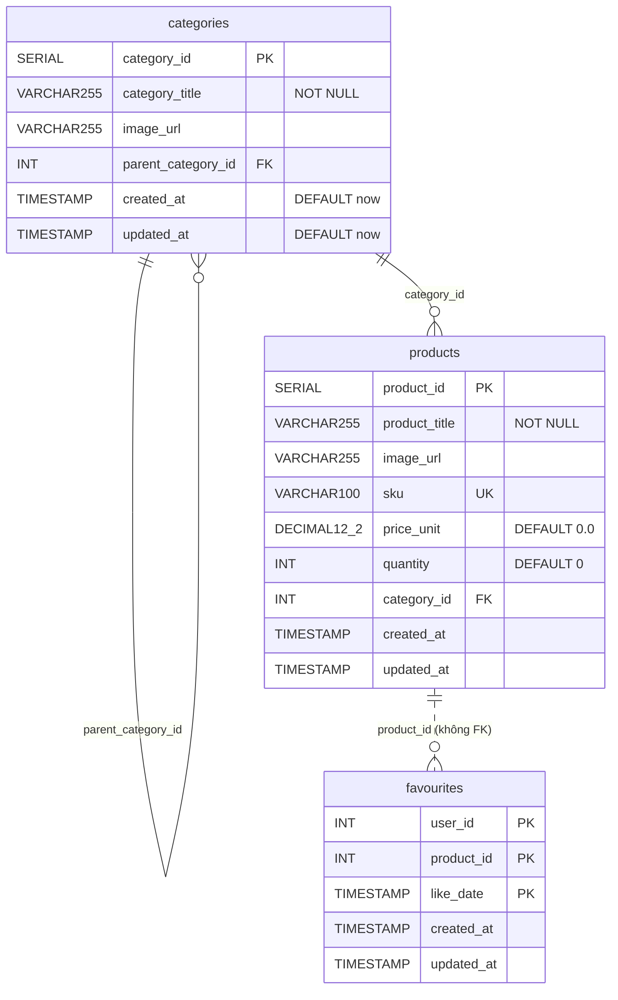
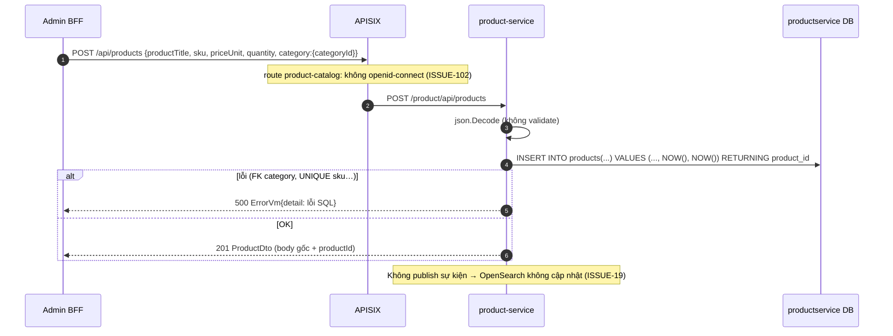

# product-service

> **Phiên bản:** 1.0 · **Trạng thái:** Final · **Cập nhật:** 2026-11-12 · **Phạm vi:** Ứng dụng (as-is)

| Thuộc tính | Giá trị |
| :--- | :--- |
| Ngôn ngữ / stack | Go 1.27, `go-chi/chi v5`, `stephenafamo/bob` + `pgx v5` |
| Port | `8086` (env `PORT`, `services/product-service/main.go:57`; compose `docker-compose.yml:203-204`) |
| Database | PostgreSQL `productservice` (bảng `categories`, `products`, `favourites`) |
| Đường dẫn code | `services/product-service/` |
| Prefix gateway | `/api/products[/*]`, `/api/categories[/*]` → `/product/...` (upstream 2, **không có auth**); `/api/favourites[/*]` → `/favourite/...` (upstream **7 không tồn tại** — ISSUE-13) |
| Tính năng phục vụ | [FEAT-05](../04-features/FEAT-05-home-page.md), [FEAT-06](../04-features/FEAT-06-product-catalog.md), [FEAT-07](../04-features/FEAT-07-product-detail.md), [FEAT-09](../04-features/FEAT-09-checkout-place-order.md) (BFF đọc lại giá), [FEAT-13](../04-features/FEAT-13-favourites.md), [FEAT-22](../04-features/FEAT-22-admin-dashboard.md), [FEAT-23](../04-features/FEAT-23-admin-product-mgmt.md), [FEAT-24](../04-features/FEAT-24-admin-category-mgmt.md) |

## 1. Tổng quan & trách nhiệm

product-service quản lý **danh mục sản phẩm**: CRUD `categories` và `products`, và chứa luôn chức năng **favourites** (di sản của một favourite-service riêng — vẫn giữ route `/favourite/...` và DB `favouriteservice` được tạo nhưng không dùng).

Phạm vi thực tế (so với README):

- Có: CRUD danh mục (có cột `parent_category_id` nhưng không trả ra khi đọc), CRUD sản phẩm (title, image, sku, giá, số lượng, category), lưu/xóa favourite.
- Không có: phân trang/lọc/sắp xếp/tìm kiếm (ISSUE-48), brand, slug, description (ISSUE-35, ISSUE-50), validate input, publish sự kiện cho search-service (ISSUE-19), kiểm tra quyền (ISSUE-01, ISSUE-102).

## 2. Tech stack & thư viện

| Thư viện | Vai trò |
| :--- | :--- |
| `github.com/go-chi/chi/v5` v5.3.2, `github.com/go-chi/cors` v1.2.2 | Router, CORS |
| `github.com/jackc/pgx/v5` v5.11.0 | Pool PostgreSQL |
| `github.com/stephenafamo/bob` v0.50.0, `github.com/stephenafamo/scan` v0.9.0 | Query builder, map row |
| `github.com/stretchr/testify` | Test |
| `com.ecommerce/shared` | config/database/middleware/response ([shared-go-module.md](shared-go-module.md)) |

Dockerfile 2 stage giống auth-service, `EXPOSE 8086` (`services/product-service/Dockerfile:21`).

## 3. Cấu hình

`services/product-service/main.go:26-58`

| Biến | Default | Compose (`docker-compose.yml:205-209`) | Ý nghĩa |
| :--- | :--- | :--- | :--- |
| `PORT` | `8086` | – | Cổng HTTP |
| `DATABASE_URL` | – | – | DSN đầy đủ (ưu tiên cao nhất) |
| `SPRING_DATASOURCE_URL` | – | `jdbc:postgresql://postgres:5432/productservice` | Parse lấy host/port/db |
| `POSTGRES_HOST/PORT/DB` | `localhost` / `5432` / `productservice` | – | |
| `POSTGRES_USER/PASSWORD` | default trong code | từ `.env` | Secret – không ghi giá trị |
| `JWT_ISSUER_URI` | – | có set | Không dùng (ISSUE-37) |

## 4. Phụ thuộc

| Phụ thuộc | Ghi chú |
| :--- | :--- |
| PostgreSQL `productservice` | Duy nhất. |
| Kafka | **Không** produce sự kiện thay đổi sản phẩm; search-service đợi Debezium không tồn tại (ISSUE-19). |
| inventory-service | Không liên kết; tồn kho riêng (`products.quantity`) — ISSUE-26. |
| media-service | `imageUrl` chỉ là chuỗi tự do, không tham chiếu media id. |

## 5. Cấu trúc code

```
services/product-service/
├── main.go                               # DSN, pool, InitSchema, 2 handler (product + favourite), middleware
├── main_test.go
└── internal/
    ├── handler/product_handler.go        # route categories + products (2 prefix), health
    ├── handler/favourite_handler.go      # route favourites (3 prefix)
    ├── model/product.go                  # CategoryDto, ProductDto
    ├── model/favourite.go                # FavouriteID, FavouriteDto, FavouriteCollectionResponse
    ├── repository/product_repo.go        # DDL 3 bảng + truy vấn categories/products
    ├── repository/favourite_repo.go      # truy vấn favourites, parse/format likeDate
    ├── service/product_service.go        # wrapper mỏng, ErrNotFound
    └── service/favourite_service.go      # wrapper mỏng
```

## 6. API endpoints

**Quy ước**: Response thành công là **JSON thô** (không envelope), lỗi là `ErrorVm` `{statusCode,title,detail}` (ISSUE-29). Route category/product đăng ký ở prefix `/product` và gốc (`product_handler.go:27-31`); favourite ở `/favourite/api/favourites`, `/product/api/favourites`, `/api/favourites` (`favourite_handler.go:27-29`).

**Auth qua gateway**: route `product-catalog` (`deploy/apisix/apisix.yaml:71-82`) **không có plugin `openid-connect`** và áp dụng cho mọi method → GET/POST/PUT/DELETE sản phẩm & danh mục đều **public** (ISSUE-102). Route `favourite` có `openid-connect` nhưng trỏ `upstream_id: 7` không được định nghĩa → không dùng được trên compose (ISSUE-13).

### 6.1 Bảng tổng hợp

| # | Method | Path trong service | Path qua gateway | Auth GW | Mô tả |
| :--- | :--- | :--- | :--- | :--- | :--- |
| 1 | GET | `/actuator/health`, `/product/actuator/health`, `/favourite/actuator/health` | – | – | Health luôn UP |
| 2 | GET | `/api/categories` | `/api/categories` | Public | Danh sách tất cả danh mục |
| 3 | GET | `/api/categories/paging` | `/api/categories/paging` | Public | **Giống #2** (không phân trang — ISSUE-35) |
| 4 | GET | `/api/categories/paging-and-sorting` | `/api/categories/paging-and-sorting` | Public | **Giống #2** |
| 5 | GET | `/api/categories/{categoryId}` | `/api/categories/{id}` | Public | Chi tiết danh mục |
| 6 | POST | `/api/categories` | `/api/categories` | Public ⚠ | Tạo danh mục (201) |
| 7 | PUT | `/api/categories` | `/api/categories` | Public ⚠ | Cập nhật theo `categoryId` trong body |
| 8 | PUT | `/api/categories/{categoryId}` | `/api/categories/{id}` | Public ⚠ | Cập nhật theo path |
| 9 | DELETE | `/api/categories/{categoryId}` | `/api/categories/{id}` | Public ⚠ | Xóa danh mục |
| 10 | GET | `/api/products` | `/api/products` | Public | Danh sách tất cả sản phẩm (mảng thô, bỏ qua query — ISSUE-48) |
| 11 | GET | `/api/products/{productId}` | `/api/products/{id}` | Public | Chi tiết sản phẩm |
| 12 | POST | `/api/products` | `/api/products` | Public ⚠ | Tạo sản phẩm (201) |
| 13 | PUT | `/api/products` | `/api/products` | Public ⚠ | Cập nhật theo `productId` trong body |
| 14 | PUT | `/api/products/{productId}` | `/api/products/{id}` | Public ⚠ | Cập nhật theo path |
| 15 | DELETE | `/api/products/{productId}` | `/api/products/{id}` | Public ⚠ | Xóa sản phẩm |
| 16 | GET | `/api/favourites` | `/api/favourites` (upstream 7 lỗi) | Bearer | Mọi favourite của mọi user |
| 17 | GET | `/api/favourites/find` (body JSON) | `/api/favourites/find` | Bearer | Tìm theo khóa trong **body của GET** |
| 18 | GET | `/api/favourites/{userId}/{productId}/{likeDate}` | tương tự | Bearer | Tìm theo khóa trên path |
| 19 | POST | `/api/favourites` | `/api/favourites` | Bearer | Lưu favourite (upsert) |
| 20 | PUT | `/api/favourites` | `/api/favourites` | Bearer | **Giống #19** |
| 21 | DELETE | `/api/favourites/delete` (body JSON) | `/api/favourites/delete` | Bearer | Xóa theo khóa trong **body của DELETE** |
| 22 | DELETE | `/api/favourites/{userId}/{productId}/{likeDate}` | tương tự | Bearer | Xóa theo path |
| – | GET | – | `/product/v3/api-docs/*`, `/favourite/v3/api-docs/*` | Public | Route chết (ISSUE-16) |

⚠ = thao tác ghi không cần token ở gateway (ISSUE-102).

### 6.2 Categories

DTO `model.CategoryDto` (`internal/model/product.go:3-8`):

```json
{ "categoryId": 3, "categoryTitle": "Laptop", "imageUrl": "https://…/laptop.png", "parentCategory": { "categoryId": 1 } }
```

- **GET #2/#3/#4** → 200 mảng, sắp theo `category_id ASC`; mỗi phần tử chỉ có `categoryId`, `categoryTitle`, `imageUrl` (rỗng nếu NULL). **`parentCategory` không bao giờ được trả** vì không được SELECT (`product_repo.go:72-78`). Khi DB không kết nối → `[]`.
- **GET #5** → 200 object; 400 `Invalid categoryId`; 404 `detail: "not found: category with id 9 not found"`; 500.
- **POST #6** body như trên (`categoryId` bị bỏ qua; `parentCategory.categoryId > 0` mới được lưu) → **201** trả lại chính body với `categoryId` mới. Lỗi: 400 `Invalid request body`; 500 (vd `parentCategory` trỏ id không tồn tại → vi phạm FK). DB không kết nối → 201 với `categoryId: 1` (stub, ISSUE-28).
- **PUT #7/#8** → ghi đè **toàn bộ** `category_title`, `image_url`, `parent_category_id` (field vắng = rỗng/NULL), set `updated_at = NOW()`; trả 200 body đã gửi + `categoryId`. **Không trả 404** khi id không tồn tại (UPDATE 0 dòng vẫn 200). `categoryTitle` rỗng ghi `''` (NOT NULL vẫn thỏa).
- **DELETE #9** → 200 body `true` (kể cả id không tồn tại). Danh mục đang được sản phẩm hoặc danh mục con tham chiếu → lỗi FK → 500 `ErrorVm` với `detail` là lỗi SQL nguyên văn.

### 6.3 Products

DTO `model.ProductDto` (`internal/model/product.go:10-18`):

```json
{
  "productId": 15,
  "productTitle": "iPhone 15 128GB",
  "imageUrl": "https://…/iphone15.png",
  "sku": "IP15-128-BLK",
  "priceUnit": 21990000,
  "quantity": 50,
  "category": { "categoryId": 2, "categoryTitle": "Điện thoại", "imageUrl": "" }
}
```

- **GET #10** → 200 mảng, `LEFT JOIN categories`, sắp theo `product_id DESC` (`product_repo.go:222-240`). `category` bị bỏ (omitempty) khi sản phẩm không có danh mục. Mọi query param (`page`, `size`, `sort`, `categoryId`, `search`) **bị bỏ qua**; BFF mong đợi `Page` (`content`, `totalElements`…) → ISSUE-48.
- **GET #11** → 200 object; 400 `Invalid productId`; 404 `not found: product with id 99 not found`; 500.
- **POST #12** → 201 body + `productId`. Chỉ đọc `category.categoryId` (>0). Lưu `sku` = chuỗi rỗng nếu không gửi → sản phẩm thứ hai không có SKU **vi phạm `UNIQUE(sku)`** → 500 (ISSUE-55). Không validate giá âm, số lượng âm, title rỗng.
- **PUT #13/#14** → ghi đè toàn bộ 6 cột, 200 trả body + id, không 404 khi không tồn tại.
- **DELETE #15** → 200 `true`. Không kiểm tra favourites/orders tham chiếu (không có FK giữa service).

Mã lỗi chung: 400 (path id không phải số, body không phải JSON), 404 (chỉ GET theo id), 500 (mọi lỗi DB, `detail` = thông điệp lỗi pgx).

### 6.4 Favourites

DTO (`internal/model/favourite.go:3-19`):

```json
// FavouriteID — dùng cho find/delete
{ "userId": 1, "productId": 100, "likeDate": "2026-01-01T10:00:00" }

// FavouriteDto — request/response save
{ "userId": 1, "productId": 100, "likeDate": "2026-01-01T10:00:00" }

// GET #16 — FavouriteCollectionResponse
{ "collection": [ { "userId": 1, "productId": 100, "likeDate": "2026-01-01T10:00:00" } ] }
```

- `likeDate` chấp nhận các layout `2006-01-02T15:04:05.000Z`, `…Z`, `2006-01-02T15:04:05`, `2006-01-02 15:04:05`, `2006-01-02`, RFC3339 (`favourite_repo.go:43-57`); khi trả về luôn format `2006-01-02T15:04:05` (mất múi giờ và phần thập phân).
- **GET #16** → 200 `{collection:[...]}` sắp `like_date DESC` — **không lọc theo user** (ISSUE-56).
- **GET #17/#18** → 200 `FavouriteDto`; 404 `Favourite not found`; 400 body/path sai; **500** nếu `likeDate` không parse được (`invalid likeDate: …`).
- **POST #19 / PUT #20** → upsert `ON CONFLICT (user_id, product_id, like_date) DO UPDATE SET updated_at = CURRENT_TIMESTAMP`; `likeDate` sai/rỗng → dùng `time.Now()`. Trả 200 body (đã chuẩn hóa `likeDate` nếu thay bằng now). `userId` lấy từ body (số nguyên), **không lấy từ token** (ISSUE-56).
- **DELETE #21/#22** → 200 `true` **luôn luôn** khi không lỗi (`affected >= 0`, `favourite_repo.go:171`); 500 nếu `likeDate` sai.
- #17 và #21 dùng body trong GET/DELETE (ISSUE-35).

## 7. Data model



DDL: `services/product-service/internal/repository/product_repo.go:34-64`. Chi tiết: [data-dictionary.md §productservice](../06-data/data-dictionary.md#3-productservice-product-service).

Ánh xạ:

| Cột | JSON | Ghi chú |
| :--- | :--- | :--- |
| `products.product_id` | `productId` | |
| `products.product_title` | `productTitle` | |
| `products.image_url` | `imageUrl` | `COALESCE ''` |
| `products.sku` | `sku` | `COALESCE ''` |
| `products.price_unit` | `priceUnit` (`float64`) | DECIMAL → float (ISSUE-27) |
| `products.quantity` | `quantity` | Tồn kho "thứ hai" (ISSUE-26) |
| `categories.*` | `category.{categoryId,categoryTitle,imageUrl}` | qua LEFT JOIN |
| `favourites.user_id` | `userId` | INT, không tương thích `sub` UUID của Keycloak (ISSUE-56) |

## 8. Business logic chi tiết



Quy tắc:

| # | Quy tắc / hành vi | Nguồn |
| :--- | :--- | :--- |
| R1 | Không có validation nào ngoài decode JSON và parse id số. | `product_handler.go` |
| R2 | Update là ghi đè toàn bộ (không phải PATCH); id không tồn tại vẫn 200. | `product_repo.go:140-160`, `287-310` |
| R3 | Delete luôn 200 `true` nếu không lỗi SQL. | `product_repo.go:162-172`, `312-322` |
| R4 | Response của create/update là **echo request** + id, không đọc lại DB (vd `category.categoryTitle` không được điền). | `product_service.go:39-55`, `78-94` |
| R5 | Không phân trang/lọc/sắp xếp phía server. | `product_repo.go:80-97`, `222-240` |
| R6 | Khi DB `nil`: list trả `[]`, get trả 404, create trả id `1`, update/delete no-op 200. | các nhánh `r.db.Pool == nil` |
| R7 | Favourite có khóa gồm cả `like_date` → cùng user/product có thể "thích" nhiều lần với `likeDate` khác nhau. | `product_repo.go:56-63` |

## 9. Sự kiện (produce / consume)

Không produce, không consume. (search-service kỳ vọng topic CDC `dbproduct.public.product` — ISSUE-19.)

## 10. Health check & observability

`/actuator/health`, `/product/actuator/health`, `/favourite/actuator/health` → luôn `{"status":"UP","components":{"db":{"status":"UP"}}}` (ISSUE-36). `InitSchema` chỉ log `Notice during schema verification` khi lỗi (`product_repo.go:65-67`).

## 11. Test

`services/product-service/main_test.go` (DB `nil`):

| Test | Kiểm tra |
| :--- | :--- |
| `TestHealthCheck` (`:47-53`) | 3 route health 200 |
| `TestCategoryEndpoints` (`:55-65`) | GET list 2 prefix 200; POST 201; DELETE 200 |
| `TestProductEndpoints` (`:67-77`) | GET list 200; POST 201; DELETE 200 |
| `TestFavouriteRoutes` (`:79-89`) | GET list 2 prefix; POST; DELETE theo path |

Không có test với DB thật, không test lỗi FK/UNIQUE (ISSUE-46).

## 12. Vấn đề đã biết

| ID | Mức | Tóm tắt |
| :--- | :--- | :--- |
| ISSUE-01 | Critical | Không kiểm role cho CRUD |
| ISSUE-13 | High | Route favourites trỏ upstream 7 không tồn tại |
| ISSUE-16 | Low | Route api-docs chết |
| ISSUE-19 | High | Không có đồng bộ sang OpenSearch |
| ISSUE-26 | High | `products.quantity` tách biệt với inventory-service |
| ISSUE-27 | Medium | Giá `DECIMAL` ↔ `float64` |
| ISSUE-28 | High | Schema lúc khởi động, stub khi không có DB |
| ISSUE-29 | Low | JSON thô + `ErrorVm` |
| ISSUE-35 | Medium | Không validate, không brand/slug/description, paging giả, GET/DELETE có body |
| ISSUE-36 | Low | Health luôn UP |
| ISSUE-48 | Critical | List trả mảng thô, BFF chờ Page |
| ISSUE-50 | Medium | Không có `description` |
| ISSUE-102 | Critical | Route gateway `product-catalog` public cho cả POST/PUT/DELETE |
| ISSUE-55 | Medium | `sku` UNIQUE nhưng lưu `''` khi bỏ trống → không tạo được sản phẩm thứ hai không SKU |
| ISSUE-56 | Medium | Favourites không gắn với danh tính token; list trả của mọi user; delete luôn `true` |

## 13. Tham chiếu source

- `services/product-service/main.go:26-118`
- `services/product-service/internal/handler/product_handler.go:23-236`
- `services/product-service/internal/handler/favourite_handler.go:22-160`
- `services/product-service/internal/service/product_service.go:12-98`, `favourite_service.go:10-32`
- `services/product-service/internal/repository/product_repo.go:30-322`
- `services/product-service/internal/repository/favourite_repo.go:29-172`
- `services/product-service/internal/model/product.go:3-18`, `favourite.go:3-19`
- `services/product-service/main_test.go:47-89`
- `docker-compose.yml:197-214`
- `deploy/apisix/apisix.yaml:6-9`, `71-82`, `106-108`, `121-123`, `250-267`
