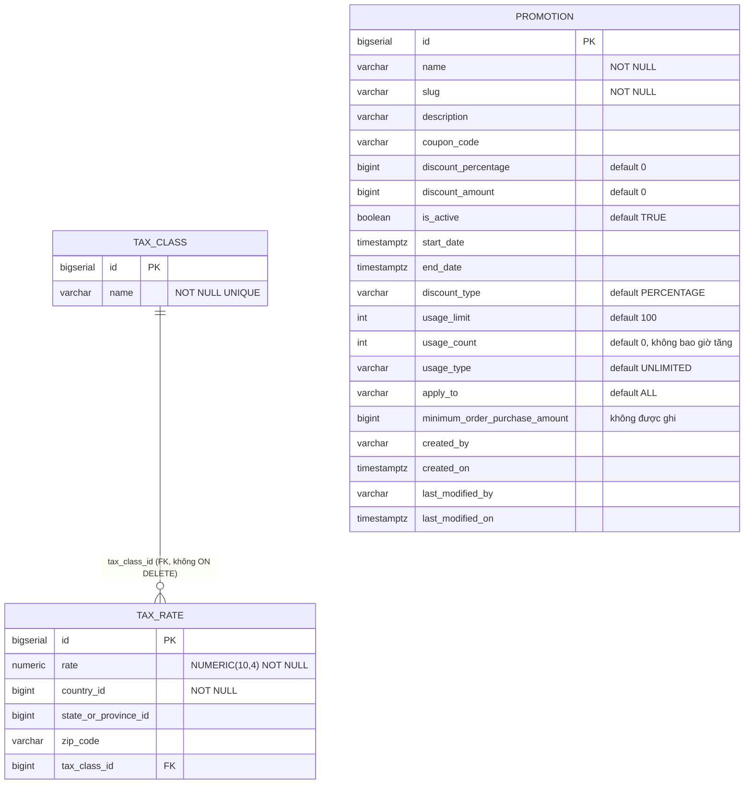
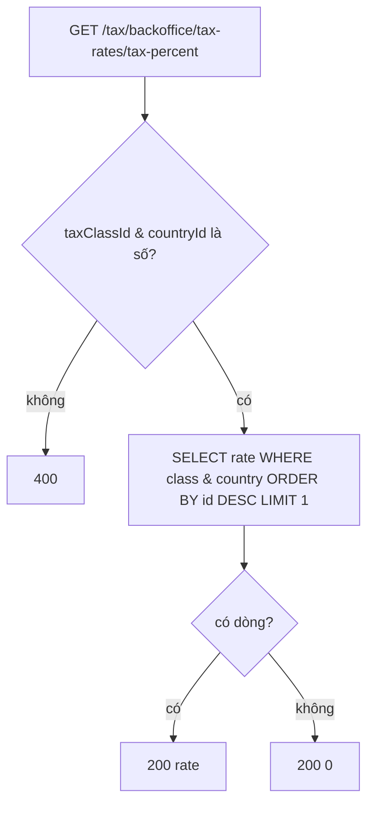

# promotion-service (Promotion & Tax)

> **Phiên bản:** 1.0 · **Trạng thái:** Final · **Cập nhật:** 2026-11-12 · **Phạm vi:** Ứng dụng (as-is)

| Thuộc tính | Giá trị |
| :--- | :--- |
| Ngôn ngữ / stack | TypeScript trên **Bun** (`oven/bun:1.4-alpine`), framework HTTP **Hono**, ORM **drizzle-orm** (`drizzle-orm/bun-sql`), validate **Zod** |
| Port | `8093` (biến `PORT`) — `services/promotion-service/src/index.ts:267`, `services/promotion-service/Dockerfile:10` |
| Database | PostgreSQL, DB `promotionservice` (bảng `promotion`, `tax_class`, `tax_rate`) — `docker-compose.yml:352` |
| Đường dẫn code | `services/promotion-service/` |
| Prefix gateway | `/promotion/backoffice/promotions/*` (upstream 12), `/tax/backoffice/tax-classes/*`, `/tax/backoffice/tax-rates/*` (upstream 13 — **không tồn tại**, xem ISSUE-13) — `deploy/apisix/apisix.yaml:340-375` |
| Tính năng phục vụ | [FEAT-16 Quản lý khuyến mãi](../04-features/FEAT-16-promotion-management.md), [FEAT-17 Quản lý thuế](../04-features/FEAT-17-tax-management.md) |
| Frontend sử dụng | **Không** — không có lời gọi nào từ `frontend/packages/lib/src/server/api.ts` |

## 1. Tổng quan & trách nhiệm

promotion-service là một service Bun duy nhất gộp **hai miền**:

1. **Promotion** — CRUD bản ghi khuyến mãi (tên, slug, mã coupon, % / số tiền giảm, thời gian hiệu lực, giới hạn lượt dùng). Đây là dữ liệu quản trị thuần túy: **không có endpoint áp dụng/kiểm tra coupon**, không service nào khác gọi tới để tính giá (ISSUE-30).
2. **Tax** — CRUD **tax class** (nhóm thuế) và **tax rate** (thuế suất theo `countryId` / `stateOrProvinceId` / `zipCode` / `taxClassId`), cùng 2 endpoint tra cứu thuế suất (`tax-percent`, `location-based-batch`). Bảng thuế nằm trong DB `promotionservice`; DB `taxservice` được tạo ở `deploy/postgres/init/create-all-databases.sql:11` nhưng **không dùng** (ISSUE-31).

Mọi route được đăng ký **hai lần**: dưới prefix ngữ cảnh (`/promotion` hoặc `/tax`) và ở gốc `/` (`services/promotion-service/src/index.ts:255-265`). Vì vậy `GET /backoffice/promotions` và `GET /promotion/backoffice/promotions` là cùng một handler; route tax cũng có ở gốc (`/backoffice/tax-classes`) và dưới `/tax`.

Service **không xác thực, không đọc token, không kiểm role** — mọi kiểm soát truy cập phụ thuộc gateway (ISSUE-01). Cột `created_by` / `last_modified_by` không bao giờ được ghi.

## 2. Tech stack & thư viện

| Thư viện | Phiên bản (`package.json`) | Vai trò |
| :--- | :--- | :--- |
| `hono` | `^4.13.13` | Router HTTP, middleware `logger`, `cors` |
| `drizzle-orm` | `1.0.0-rc.4` | Query builder trên driver `bun:sql` |
| `zod` | `^4.6.5` | Validate body POST/PUT |
| `typescript` (dev) | `^7.0.2` | `tsc --noEmit` (script `typecheck`) |
| `@types/bun` (dev) | `^1.4.2` | Kiểu cho Bun runtime |

Scripts: `dev` (`bun --watch src/index.ts`), `start`, `test` (`bun test`), `typecheck` — `services/promotion-service/package.json:5-10`.
Docker: image `oven/bun:1.4-alpine`, `bun install --frozen-lockfile || bun install`, chỉ copy `src/`, entrypoint `bun run src/index.ts` — `services/promotion-service/Dockerfile:1-12`.

Middleware chung (`services/promotion-service/src/index.ts:14-28`):
- `logger()` của Hono — log mỗi request ra stdout.
- `cors({ origin: "*" , allowHeaders: Authorization, Content-Type, X-Correlation-Id, X-Request-Id; allowMethods: GET, POST, PUT, DELETE, OPTIONS })`.
- Correlation ID: lấy header `X-Correlation-Id` hoặc sinh `crypto.randomUUID()`, trả lại trên response header.

## 3. Cấu hình

| Biến | Default trong code | Ý nghĩa | Nguồn |
| :--- | :--- | :--- | :--- |
| `PORT` | `8093` | Cổng HTTP | `src/index.ts:267` |
| `DATABASE_URL` | — | Nếu có, dùng nguyên chuỗi kết nối Postgres (ưu tiên cao nhất) | `src/db.ts:5-7` |
| `POSTGRES_USER` | có default hard-code | User Postgres | `src/db.ts:9` |
| `POSTGRES_PASSWORD` | có default hard-code (không ghi giá trị) | Mật khẩu Postgres | `src/db.ts:10` |
| `POSTGRES_HOST` | `localhost` | Host | `src/db.ts:11` |
| `POSTGRES_PORT` | `5432` | Port | `src/db.ts:12` |
| `POSTGRES_DB` | `promotionservice` | Tên DB | `src/db.ts:13` |
| `SPRING_DATASOURCE_URL` | — | Biến di sản Spring dạng `jdbc:postgresql://host:port/db`; nếu có thì **ghi đè** host/port/db | `src/db.ts:15-29` |
| `JWT_ISSUER_URI` | — | Được set trong compose nhưng **không được đọc** (ISSUE-37) | `docker-compose.yml:351` |

Pool kết nối: `max: 20`, `idleTimeout: 30`, `connectionTimeout: 5`, `prepare: false` (tương thích PgBouncer transaction mode) — `src/db.ts:36-42`. Chuỗi kết nối luôn kèm `sslmode=disable` (`src/db.ts:31`).

Compose truyền: `JWT_ISSUER_URI`, `SPRING_DATASOURCE_URL` (DB `promotionservice`), `POSTGRES_USER`, `POSTGRES_PASSWORD` — `docker-compose.yml:342-359`.

## 4. Phụ thuộc

| Phụ thuộc | Chi tiết |
| :--- | :--- |
| PostgreSQL | DB `promotionservice`; schema tự tạo khi khởi động (`initDb`) |
| Kafka | Không |
| Keycloak | Không trực tiếp; chỉ gateway (`openid-connect`) |
| Service khác | Không gọi service nào; không service nào gọi tới |
| Gateway | Upstream `id: 12` → `promotion-service:8093` (`deploy/apisix/apisix.yaml:42-45`) |

## 5. Cấu trúc code

```
services/promotion-service/
├── Dockerfile            # image Bun, EXPOSE 8093
├── package.json          # deps hono, drizzle-orm, zod
├── tsconfig.json         # strict, noEmit, types bun
└── src/
    ├── index.ts          # Hono app: middleware, health, đăng ký route promotion + tax, khởi động
    ├── db.ts             # build connection string, client bun:sql, drizzle, initDb() CREATE TABLE IF NOT EXISTS
    ├── schema.ts         # drizzle pgTable: promotion, tax_class, tax_rate
    ├── types.ts          # Zod PromotionPostVmSchema/PromotionPutVmSchema + interface PromotionDetailVm/ListVm
    ├── service.ts        # PromotionService: list/get/create/update/delete
    ├── tax-types.ts      # Zod TaxClassPostVmSchema/TaxRatePostVmSchema + VM interfaces
    ├── tax-service.ts    # TaxService: CRUD class/rate, paging, getTaxPercent, getBatchTaxRates
    └── index.test.ts     # bun test (health, validate)
```

## 6. API endpoints

Ký hiệu cột "Gateway": ✅ đi được qua APISIX local · ❌ không có route khớp. Tất cả route qua gateway đều yêu cầu Bearer token (`openid-connect bearer_only`), không kiểm role.

### 6.1 Health

| Method | Path trong service | Gateway | Response |
| :--- | :--- | :--- | :--- |
| GET | `/actuator/health`, `/promotion/actuator/health`, `/tax/actuator/health` | ❌ | `200 {"status":"UP","components":{"db":{"status":"UP"}}}` — **luôn UP** (ISSUE-36) — `src/index.ts:31-41` |

### 6.2 Promotion (`src/index.ts:45-126`)

Mỗi path dưới đây tồn tại ở cả `/<path>` và `/promotion/<path>`.

| Method | Path trong service | Path qua gateway | Mô tả | Request | Response | Mã lỗi |
| :--- | :--- | :--- | :--- | :--- | :--- | :--- |
| GET | `/backoffice/promotions` | `/promotion/backoffice/promotions` ❌ (ISSUE-15) | Danh sách có phân trang + lọc | Query `pageNo` (0), `pageSize` (5), `promotionName`, `couponCode`, `startDate`, `endDate` (bị bỏ qua) | `200 PromotionListVm {promotionDetailVmList[], totalElements, totalPages}` | `500 {statusCode,message}`; lỗi DB trong service → trả **danh sách rỗng** 200 (`src/service.ts:73-79`) |
| GET | `/backoffice/promotions/:promotionId` | `/promotion/backoffice/promotions/{id}` ✅ | Chi tiết | Path `promotionId` (int) | `200 PromotionDetailVm` | `400 Invalid ID`, `404 Promotion not found`, `500` |
| POST | `/backoffice/promotions` | ❌ (ISSUE-15) | Tạo khuyến mãi | Body `PromotionPostVm` | `201 PromotionDetailVm` | `400 {statusCode:"400", message:"Validation error", errors:[zod issues]}`; body không phải JSON → `500` |
| PUT | `/backoffice/promotions` | ❌ (ISSUE-15) | Cập nhật (id trong body) | Body `PromotionPutVm` (= Post + `id`) | `200 PromotionDetailVm` | `400` validate; id không tồn tại → **500** (ISSUE-65) |
| DELETE | `/backoffice/promotions/:promotionId` | `/promotion/backoffice/promotions/{id}` ✅ | Xóa cứng | Path `promotionId` | `200` body rỗng (kể cả khi id không tồn tại) | `400 Invalid ID`, `500` |

Body `PromotionPostVm` (`src/types.ts:3-17`):

| Field | Kiểu Zod | Default | Ghi chú |
| :--- | :--- | :--- | :--- |
| `name` | `string().min(1)` | bắt buộc | Không giới hạn độ dài (cột VARCHAR(255)) |
| `slug` | `string().optional()` | — | Nếu rỗng → `slugify(name)` |
| `description` | `string` | `""` | |
| `couponCode` | `string` | `""` | Không kiểm tra trùng |
| `usageLimit` | `number().int()` | `100` | |
| `discountType` | `string` | `"PERCENTAGE"` | Chuỗi tự do, không enum |
| `applyTo` | `string` | `"ALL"` | Chuỗi tự do |
| `usageType` | `string` | `"UNLIMITED"` | Chuỗi tự do |
| `discountPercentage` | `number().int()` | `0` | Không giới hạn 0–100 |
| `discountAmount` | `number().int()` | `0` | Không kiểm tra âm |
| `isActive` | `boolean` | `true` | |
| `startDate`, `endDate` | `string().optional()` | — | Chuyển `new Date(...)`; không kiểm tra định dạng / thứ tự |

`PromotionDetailVm` (`src/types.ts:27-46`): `id, name, slug, description, couponCode, usageLimit, usageCount, discountType, applyTo, usageType, discountPercentage, discountAmount, isActive, startDate, endDate` + `brands: [], categories: [], products: []` (luôn mảng rỗng — `src/service.ts:24-26`).

### 6.3 Tax class (`src/index.ts:130-178`)

Mỗi path tồn tại ở cả `/<path>` và `/tax/<path>`. Gateway local trỏ route tax tới `upstream_id: 13` không tồn tại → **toàn bộ ❌ trên docker compose** (ISSUE-13). Cột "Gateway (k8s)" là cấu hình `deploy/k8s/gateway/02-routes.yaml:316-333` (trỏ đúng promotion-service).

| Method | Path trong service | Gateway (k8s) | Mô tả | Request | Response | Mã lỗi |
| :--- | :--- | :--- | :--- | :--- | :--- | :--- |
| GET | `/backoffice/tax-classes/paging` | `/tax/backoffice/tax-classes/paging` ✅ | Phân trang | `pageNo` (0), `pageSize` (10) | `200 TaxClassListVm {taxClasses[], pageNo, pageSize, totalElements, totalPages, isLast}`; lỗi DB → trang rỗng | — |
| GET | `/backoffice/tax-classes/:id` | ✅ | Chi tiết | `id` | `200 {id,name}` | `400 Invalid tax class ID`, `404` |
| GET | `/backoffice/tax-classes` | ❌ (ISSUE-15) | Tất cả, sắp theo id | — | `200 TaxClassVm[]` | lỗi DB → 500 mặc định của Hono |
| POST | `/backoffice/tax-classes` | ❌ (ISSUE-15) | Tạo | Body `{name: string min 1}` | `201 {id,name}` + header `Location: /tax-classes/{id}` | `400 Invalid payload`; tên trùng (UNIQUE) → 500 |
| PUT | `/backoffice/tax-classes/:id` | ✅ | Đổi tên | Body `{name}` | `204` | `400`, `404 Tax class not found` |
| DELETE | `/backoffice/tax-classes/:id` | ✅ | Xóa | — | `204` | `400`, `404`; còn tax_rate tham chiếu (FK) → 500 |

### 6.4 Tax rate (`src/index.ts:180-252`)

| Method | Path trong service | Gateway (k8s) | Mô tả | Request | Response | Mã lỗi |
| :--- | :--- | :--- | :--- | :--- | :--- | :--- |
| GET | `/backoffice/tax-rates/paging` | ✅ | Phân trang (kèm tên class qua LEFT JOIN) | `pageNo` (0), `pageSize` (10) | `200 TaxRateListVm {taxRates[], pageNo, pageSize, totalElements, totalPages, isLast}` | Không try/catch → lỗi DB 500 |
| GET | `/backoffice/tax-rates/tax-percent` | ✅ | Tra thuế suất | `taxClassId`*, `countryId`*, `stateOrProvinceId`, `zipCode` (2 tham số cuối **bị bỏ qua**) | `200 number` (vd `10.0`); không có bản ghi → `0` | `400 taxClassId and countryId are required` |
| GET | `/backoffice/tax-rates/location-based-batch` | ✅ | Tra nhiều class | `taxClassIds`* (CSV), `countryId`*, `stateOrProvinceId`, `zipCode` (bỏ qua) | `200 TaxRateVm[]` | `400 taxClassIds and countryId are required` |
| GET | `/backoffice/tax-rates/:id` | ✅ | Chi tiết | `id` | `200 TaxRateVm` | `400`, `404 Tax rate not found` |
| GET | `/backoffice/tax-rates` | ❌ (ISSUE-15) | Tất cả | — | `200 TaxRateVm[]` | 500 |
| POST | `/backoffice/tax-rates` | ❌ (ISSUE-15) | Tạo | Body `TaxRatePostVm` | `201 TaxRateVm` (không có `taxClassName`) + `Location: /tax-rates/{id}` | `400 Invalid payload`; `taxClassId` không tồn tại (FK) → 500 |
| PUT | `/backoffice/tax-rates/:id` | ✅ | Cập nhật toàn bộ | Body `TaxRatePostVm` | `204` | `400`, `404` |
| DELETE | `/backoffice/tax-rates/:id` | ✅ | Xóa | — | `204` | `400`, `404` |

Body `TaxRatePostVm` (`src/tax-types.ts:23-29`): `rate: number` (không giới hạn khoảng), `countryId: int`, `stateOrProvinceId?: int|null`, `zipCode?: string|null`, `taxClassId: int`.
`TaxRateVm` (`src/tax-types.ts:33-41`): `id, rate (Number), countryId, stateOrProvinceId, zipCode, taxClassId (null → 0), taxClassName`.

> Thứ tự đăng ký: `/paging`, `/tax-percent`, `/location-based-batch` được khai báo **trước** `/:id` nên không bị nuốt bởi route tham số (`src/index.ts:181-219`).

## 7. Data model



DDL: `services/promotion-service/src/db.ts:48-87`; định nghĩa drizzle tương ứng: `src/schema.ts:4-39`. Không có index phụ, không có bảng liên kết promotion ↔ brand/category/product (dù VM trả `brands/categories/products`). `country_id`, `state_or_province_id` không tham chiếu tới bảng địa lý nào (không có trong hệ thống).

## 8. Business logic chi tiết

### 8.1 Promotion (`src/service.ts`)

- **List** (`:38-80`): `offset = pageNo * pageSize`; lọc `LOWER(COALESCE(name,'')) LIKE %promotionName%` **và** `LOWER(COALESCE(coupon_code,'')) LIKE %couponCode%`; sắp xếp `id DESC`. `startDate`/`endDate` được truyền vào nhưng **không dùng** (ISSUE-30). `totalPages = ceil(total / pageSize)`. Mọi exception (kể cả `pageNo` không phải số → `NaN`) bị nuốt và trả trang rỗng.
- **Create** (`:88-110`): `slug = req.slug || slugify(name)` với `slugify` = lowercase, bỏ ký tự không phải `\w`/space, thay space bằng `-` (`:30-35`) — ký tự tiếng Việt có dấu bị **xóa** khỏi slug. Không ghi `usage_count`, `minimum_order_purchase_amount`, `created_by`.
- **Update** (`:112-136`): ghi đè toàn bộ field + `last_modified_on = CURRENT_TIMESTAMP`. Nếu `id` không tồn tại, `returning()` rỗng → `mapRow(undefined)` ném TypeError → handler trả 500.
- **Delete** (`:138-140`): xóa cứng, không kiểm tồn tại.
- Không có logic: kiểm tra coupon hợp lệ, so sánh ngày, tăng `usage_count`, áp dụng giảm giá.

### 8.2 Tax (`src/tax-service.ts`)

- **getTaxPercent** (`:195-209`): `SELECT rate FROM tax_rate WHERE tax_class_id = ? AND country_id = ? ORDER BY id DESC LIMIT 1` → bản ghi **mới nhất** thắng; `stateOrProvinceId`, `zipCode` nhận nhưng không dùng (ISSUE-31). Không có → `0.0`.
- **getBatchTaxRates** (`:211-231`): `WHERE country_id = ? AND tax_class_id IN (...)`; có thể trả nhiều rate cho cùng class (không dedupe).
- **Paging** tax class bọc try/catch (trả rỗng khi lỗi); paging tax rate **không** bọc. `pageSize=0` → `totalPages = Infinity` (chia cho 0) ở tax.
- `rate` lưu dạng `NUMERIC(10,4)` (ghi bằng `String(vm.rate)`), đọc ra `Number(...)`.



## 9. Sự kiện

Không produce, không consume Kafka.

## 10. Health check & observability

- Health: 3 path (mục 6.1), trả cứng `UP` — không ping DB (ISSUE-36). Không có route gateway cho health.
- Log: Hono `logger()` + `console.log/warn` khi init DB (`src/db.ts:88-90`). Lỗi init DB chỉ **warn**, service vẫn chạy (ISSUE-28).
- Không có metrics endpoint, không tracing; chỉ propagate `X-Correlation-Id`.

## 11. Test

`services/promotion-service/src/index.test.ts` (bun test, gọi `app.fetch` trực tiếp, không mock DB):

| Test | Kỳ vọng |
| :--- | :--- |
| health 3 path | 200 |
| `GET /backoffice/promotions?pageNo=0&pageSize=5` | 200 (pass cả khi không có DB vì lỗi bị nuốt) |
| `GET /backoffice/promotions/not-a-number` | 400 |
| `POST /backoffice/promotions` body `{}` | 400 |
| `GET /tax/backoffice/tax-rates/tax-percent` thiếu tham số | 400 |
| `GET /tax/backoffice/tax-rates/location-based-batch` thiếu tham số | 400 |
| `GET /tax/backoffice/tax-classes/paging` | 200 |

Không có test cho create/update/delete thành công, không test tính thuế (ISSUE-46). Import `./index` chạy `await initDb()` ở top-level → test cố kết nối Postgres.

## 12. Vấn đề đã biết

| ID | Tóm tắt |
| :--- | :--- |
| ISSUE-01 | Không kiểm role — mọi user có token đều CRUD được promotion/tax |
| ISSUE-13 | Route tax trỏ `upstream_id: 13` không tồn tại trên compose |
| ISSUE-15 | Path gốc `/promotion/backoffice/promotions`, `/tax/backoffice/tax-classes`, `/tax/backoffice/tax-rates` không khớp route `/*` → list/create/update promotion và list/create tax không gọi được qua gateway |
| ISSUE-16 | Route `/promotion/v3/api-docs/*`, `/tax/v3/api-docs/*` không có handler |
| ISSUE-28 | Schema tạo bằng `CREATE TABLE IF NOT EXISTS`, lỗi chỉ warn |
| ISSUE-30 | Filter ngày bị bỏ qua, `usage_count` không tăng, `minimumOrderPurchaseAmount` không ghi, không API apply coupon, enum là varchar tự do |
| ISSUE-31 | Thuế bỏ qua state/zip; DB `taxservice` thừa |
| ISSUE-36 | Health luôn UP |
| ISSUE-37 | `JWT_ISSUER_URI`, `SPRING_DATASOURCE_URL` là biến di sản |
| ISSUE-62 | Validate input lỏng (độ dài, khoảng %, ngày, rate âm…) → lỗi DB 500 hoặc dữ liệu rác |
| ISSUE-65 | Mã lỗi sai/che lỗi: PUT id không tồn tại → 500; DELETE id không tồn tại → 200/204; body không phải JSON → 500; list nuốt lỗi DB |

## 13. Tham chiếu source

- `services/promotion-service/src/index.ts:14-28` — middleware
- `services/promotion-service/src/index.ts:45-126` — route promotion
- `services/promotion-service/src/index.ts:130-253` — route tax
- `services/promotion-service/src/index.ts:255-275` — mount prefix, port, initDb
- `services/promotion-service/src/db.ts:4-92` — kết nối & DDL
- `services/promotion-service/src/schema.ts:4-39`
- `services/promotion-service/src/service.ts:6-141`
- `services/promotion-service/src/tax-service.ts:13-232`
- `services/promotion-service/src/types.ts`, `src/tax-types.ts`
- `services/promotion-service/src/index.test.ts`
- `deploy/apisix/apisix.yaml:42-45,136-141,340-375`; `deploy/k8s/gateway/02-routes.yaml:293-339`
- `docker-compose.yml:342-359`
