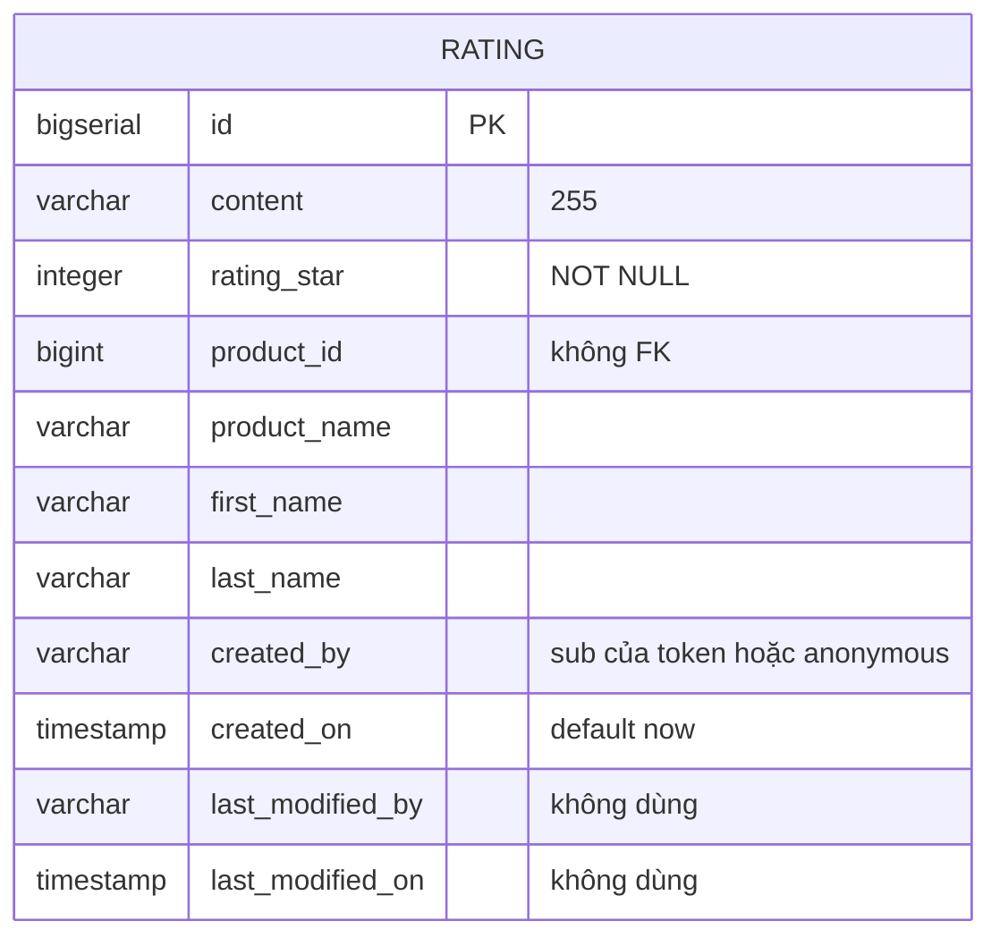

# rating-service

> **Phiên bản:** 1.0 · **Trạng thái:** Final · **Cập nhật:** 2026-11-12 · **Phạm vi:** Ứng dụng (as-is)

| Thuộc tính | Giá trị |
| :--- | :--- |
| Ngôn ngữ / stack | TypeScript trên **Bun** (`oven/bun:1.4-alpine`), **Hono**, **drizzle-orm** (`bun:sql`), **Zod** |
| Port | `8089` (biến `PORT`) — `services/rating-service/src/index.ts:156` |
| Database | PostgreSQL, DB `ratingservice`, bảng `rating` — `docker-compose.yml:308` |
| Đường dẫn code | `services/rating-service/` |
| Prefix gateway | `/storefront/ratings`, `/storefront/ratings/*` (**public**, rewrite → `/rating/...`); `/rating/backoffice/ratings/*` (Bearer) — `deploy/apisix/apisix.yaml:83-92,328-339` |
| Tính năng phục vụ | [FEAT-15 Đánh giá sản phẩm](../04-features/FEAT-15-ratings-reviews.md) |
| Frontend sử dụng | **Không** — web/admin không gọi rating-service (`frontend/packages/lib/src/server/api.ts` không có client rating) |

## 1. Tổng quan & trách nhiệm

rating-service lưu và truy vấn **đánh giá sản phẩm** (số sao 1–5 + nội dung):

- Storefront: tạo đánh giá, liệt kê đánh giá theo sản phẩm (phân trang), tính **điểm trung bình**.
- Backoffice: lọc đánh giá theo tên sản phẩm / tên khách / nội dung / khoảng ngày; xóa đánh giá.

Danh tính người đánh giá được lấy bằng cách **tự decode payload JWT không xác minh chữ ký** (`extractUser`, `src/index.ts:39-58`); không có token → `anonymous`/`Customer`. Gateway để route POST **public** (ISSUE-03). `productId` / `productName` do client gửi, không đối chiếu product-service.

Mọi route đăng ký ở cả `/` và `/rating` (`src/index.ts:150-154`).

## 2. Tech stack & thư viện

| Thư viện | Phiên bản | Vai trò |
| :--- | :--- | :--- |
| `hono` | `^4.13.13` | Router, `logger`, `cors` |
| `drizzle-orm` | `1.0.0-rc.4` | Query builder |
| `zod` | `^4.6.5` | Validate `RatingPostVm` |
| `typescript`, `@types/bun` (dev) | `^7.0.2`, `^1.4.2` | Typecheck |

Middleware (`src/index.ts:11-25`): `logger()`, `cors({origin:"*"})` (header `Authorization, Content-Type, X-Correlation-Id, X-Request-Id`; method GET/POST/PUT/DELETE/OPTIONS), middleware `X-Correlation-Id` (nhận hoặc sinh UUID, gắn vào response). Dockerfile giống các service Bun khác (`services/rating-service/Dockerfile`).

## 3. Cấu hình

| Biến | Default | Ý nghĩa | Nguồn |
| :--- | :--- | :--- | :--- |
| `PORT` | `8089` | Cổng HTTP | `src/index.ts:156` |
| `DATABASE_URL` | — | Chuỗi kết nối Postgres đầy đủ (ưu tiên) | `src/db.ts:5-7` |
| `POSTGRES_USER` / `POSTGRES_PASSWORD` | có default hard-code (không ghi giá trị) | Thông tin đăng nhập | `src/db.ts:9-10` |
| `POSTGRES_HOST` / `POSTGRES_PORT` | `localhost` / `5432` | | `src/db.ts:11-12` |
| `POSTGRES_DB` | `ratingservice` | | `src/db.ts:13` |
| `SPRING_DATASOURCE_URL` | — | Chuỗi JDBC di sản, ghi đè host/port/db | `src/db.ts:15-29` |
| `JWT_ISSUER_URI` | — | Set trong compose, **không đọc** (ISSUE-37) | `docker-compose.yml:307` |

Pool: `max 20`, `idleTimeout 30`, `connectionTimeout 5`, `prepare: false` (`src/db.ts:36-42`).

## 4. Phụ thuộc

| Phụ thuộc | Chi tiết |
| :--- | :--- |
| PostgreSQL | DB `ratingservice` |
| Keycloak | Không gọi; chỉ đọc claim `sub`, `given_name`/`name`, `family_name` từ token (không verify) |
| product-service | Không gọi (không kiểm sản phẩm tồn tại) |
| Kafka | Không |
| Gateway | Upstream `id: 10` → `rating-service:8089` (`deploy/apisix/apisix.yaml:34-37`) |

## 5. Cấu trúc code

```
services/rating-service/
├── Dockerfile
├── package.json
└── src/
    ├── index.ts        # Hono app, middleware, health, extractUser(), route, mount /rating
    ├── db.ts           # kết nối + initDb() CREATE TABLE rating
    ├── schema.ts       # drizzle pgTable rating
    ├── types.ts        # Zod RatingPostVmSchema; RatingVm, RatingListVm, ResponeStatusVm
    ├── service.ts      # RatingService: list theo product, filter backoffice, create, delete, average
    └── index.test.ts   # bun test
```

## 6. API endpoints

Mỗi path tồn tại ở cả `/<path>` và `/rating/<path>`.

| Method | Path trong service | Path qua gateway | Auth gateway | Mô tả | Request | Response | Mã lỗi |
| :--- | :--- | :--- | :--- | :--- | :--- | :--- | :--- |
| GET | `/actuator/health`, `/rating/actuator/health` | — | — | Health tĩnh | — | `200 {status:"UP",components:{db:{status:"UP"}}}` | — |
| GET | `/storefront/ratings/products/:productId` | `/storefront/ratings/products/{id}` | Public | Đánh giá theo sản phẩm, mới nhất trước | Query `pageNo` (0), `pageSize` (5) | `200 RatingListVm {ratingList[], totalElements, totalPages}` | `400 Invalid productId`, `500 {statusCode,message}` |
| POST | `/storefront/ratings` | `/storefront/ratings` | **Public** (ISSUE-03) | Tạo đánh giá | Body `RatingPostVm`; header `Authorization` tùy chọn | `200 RatingVm` (không phải 201) | `400 {statusCode:"400",message:"Validation error",errors}`; body không phải JSON → 500 |
| GET | `/storefront/ratings/product/:productId/average-star` | `/storefront/ratings/product/{id}/average-star` | Public | Điểm trung bình | — | `200 number` (2 chữ số thập phân; không có đánh giá → `0`) | Không bao giờ lỗi: `productId` sai hoặc lỗi DB → `200 0` |
| GET | `/backoffice/ratings` | `/rating/backoffice/ratings` ❌ không khớp route `/*` (ISSUE-15) | Bearer | Lọc backoffice | Query `productName`, `customerName`, `message`, `createdFrom` (mặc định epoch), `createdTo` (mặc định now), `pageNo` (0), `pageSize` (5) | `200 RatingListVm` | `500` (vd ngày sai định dạng) |
| DELETE | `/backoffice/ratings/:id` | `/rating/backoffice/ratings/{id}` ✅ | Bearer (không kiểm role — ISSUE-01) | Xóa cứng | — | `200 ResponeStatusVm {title:"Delete Rating", message, statusCode:"200"}` — kể cả khi id không tồn tại | `400 Invalid ID`, `500` |

Body `RatingPostVm` (`src/types.ts:3-8`):

| Field | Zod | Ghi chú |
| :--- | :--- | :--- |
| `content` | `string`, default `""` | Không giới hạn độ dài (cột VARCHAR(255) → quá dài lỗi 500) |
| `star` | `int`, `min(1).max(5)` | Bắt buộc |
| `productId` | `int` | Bắt buộc, không kiểm tồn tại |
| `productName` | `string`, default `""` | Client tự khai |

`RatingVm` (`src/types.ts:12-22`): `id, content, star, productId, productName, createdBy, lastName, firstName, createdOn (ISO)`.

## 7. Data model



DDL `services/rating-service/src/db.ts:48-62`; drizzle `src/schema.ts:4-16`. Không có index trên `product_id`, không unique `(created_by, product_id)`.

## 8. Business logic chi tiết

- **extractUser** (`src/index.ts:39-58`): nếu header bắt đầu `Bearer `, tách theo `.`; nếu đủ 3 phần → `JSON.parse(base64 decode phần giữa)`. `userId = sub`, `firstName = given_name || name || "Customer"`, `lastName = family_name || ""`. Lỗi parse bị nuốt. **Không verify chữ ký / hạn / issuer** → ai cũng có thể giả danh bất kỳ user (ISSUE-03).
- **createRating** (`src/service.ts:94-116`): insert một dòng; không kiểm trùng (một người đánh giá cùng sản phẩm nhiều lần), không kiểm đã mua hàng.
- **getRatingListByProductId** (`:21-48`): count + select `WHERE product_id = ? ORDER BY created_on DESC LIMIT/OFFSET`.
- **getRatingListWithFilter** (`:50-92`): `LIKE` không phân biệt hoa thường trên `product_name`, `first_name || ' ' || last_name`, `content`; `created_on BETWEEN createdFrom AND createdTo`.
- **calculateAverageStar** (`:127-144`): `SUM(rating_star)/COUNT(*)` làm tròn `toFixed(2)`.
- **deleteRating** (`:118-125`): `DELETE WHERE id = ?`, luôn trả thông điệp thành công.

```mermaid
sequenceDiagram
    participant C as Client
    participant G as APISIX
    participant R as rating-service
    participant DB as Postgres ratingservice
    C->>G: POST /storefront/ratings (token tùy chọn)
    Note over G: route rating-storefront không có openid-connect
    G->>R: POST /rating/storefront/ratings
    R->>R: Zod validate; extractUser() decode JWT không verify
    R->>DB: INSERT rating
    DB-->>R: row
    R-->>C: 200 RatingVm
```

## 9. Sự kiện

Không produce/consume Kafka.

## 10. Health check & observability

Health tĩnh luôn `UP` (ISSUE-36); `logger()` của Hono; lỗi `initDb` chỉ `console.warn` (`src/db.ts:64-66`, ISSUE-28). Không metrics.

## 11. Test

`services/rating-service/src/index.test.ts`: health (2 path), `average-star` trả 200 (pass cả khi không có DB vì lỗi → `0`), `products/xyz` → 400, POST `{}` → 400, DELETE `invalid-id` → 400. Không test luồng tạo/lọc thành công (ISSUE-46).

## 12. Vấn đề đã biết

| ID | Tóm tắt |
| :--- | :--- |
| ISSUE-01 | DELETE backoffice chỉ cần token bất kỳ, không kiểm role |
| ISSUE-03 | `extractUser` không verify chữ ký; POST public → rating ẩn danh / giả mạo |
| ISSUE-15 | `GET /rating/backoffice/ratings` (không có segment sau) không khớp route gateway |
| ISSUE-16 | Route `/rating/v3/api-docs/*` chết |
| ISSUE-28 | Không migration; lỗi DB init chỉ warn |
| ISSUE-36 | Health luôn UP |
| ISSUE-62 | Validate lỏng: không giới hạn độ dài `content`, không kiểm `productId` tồn tại, không chống đánh giá trùng, `createdFrom/To` không validate |
| ISSUE-65 | Mã lỗi sai/che lỗi: tạo trả 200 thay vì 201; xóa id không tồn tại vẫn "thành công"; average nuốt mọi lỗi thành 0 |

## 13. Tham chiếu source

- `services/rating-service/src/index.ts:11-37` — middleware, health
- `services/rating-service/src/index.ts:39-58` — `extractUser`
- `services/rating-service/src/index.ts:60-154` — route & mount
- `services/rating-service/src/service.ts:6-145`
- `services/rating-service/src/db.ts:46-67`, `src/schema.ts`, `src/types.ts`
- `services/rating-service/src/index.test.ts`
- `deploy/apisix/apisix.yaml:34-37,83-92,130-132,328-339`
- `docker-compose.yml:298-315`
