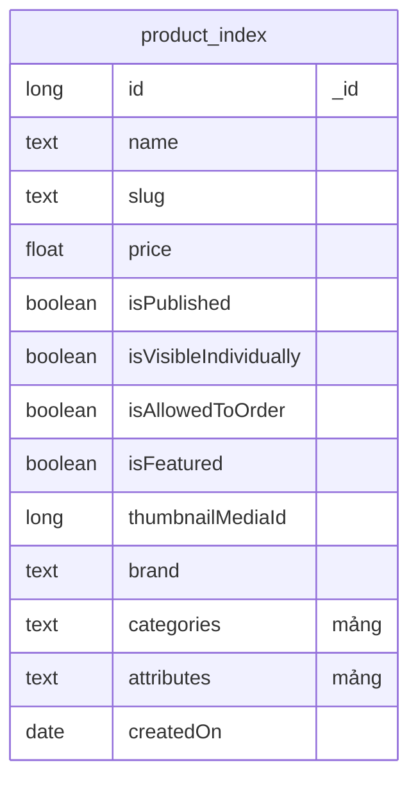
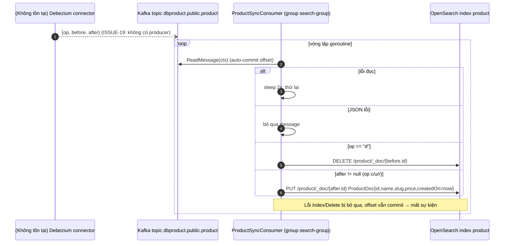

# search-service

> **Phiên bản:** 1.0 · **Trạng thái:** Final · **Cập nhật:** 2026-11-12 · **Phạm vi:** Ứng dụng (as-is)

| Thuộc tính | Giá trị |
| :--- | :--- |
| Ngôn ngữ / stack | Go 1.27, `go-chi/chi v5`, `opensearch-go/v5 v5.0.3`, `segmentio/kafka-go v0.4.47` |
| Port | `8094` (env `PORT`, `services/search-service/main.go:27`; compose `docker-compose.yml:367-368`) |
| Database | Không dùng PostgreSQL. Dùng **OpenSearch** index `product` |
| Kafka | Consume topic `dbproduct.public.product` (group `search-group`) |
| Đường dẫn code | `services/search-service/` |
| Prefix gateway | `/storefront/catalog-search`, `/storefront/search_suggest` → `/search/storefront/...` (upstream 11, **public**) (`deploy/apisix/apisix.yaml:93-102`) |
| Tính năng phục vụ | [FEAT-14](../04-features/FEAT-14-catalog-search-suggest.md) |

## 1. Tổng quan & trách nhiệm

search-service cung cấp 2 API đọc trên OpenSearch:

1. **Catalog search** — full-text + bộ lọc brand/category/attribute/khoảng giá, phân trang.
2. **Search suggest** — gợi ý tên sản phẩm theo tiền tố.

Và một **Kafka consumer** đồng bộ index `product` từ sự kiện CDC kiểu Debezium. Trên thực tế không có nguồn nào produce topic này và schema field không khớp bảng `products` (ISSUE-19) → index rỗng, mọi tìm kiếm trả rỗng. Frontend hiện không có màn hình gọi search (FEAT-14 🟡).

## 2. Tech stack & thư viện

| Thư viện | Phiên bản | Vai trò |
| :--- | :--- | :--- |
| `github.com/opensearch-project/opensearch-go/v5` | v5.0.3 | Client `opensearchapi` (Search, Document.Index, Document.Delete) |
| `github.com/segmentio/kafka-go` | v0.4.47 | `kafka.Reader` consumer group |
| `go-chi/chi/v5`, `go-chi/cors` | v5.3.2, v1.2.2 | Router |
| `com.ecommerce/shared` | local | config, middleware, response (không dùng `database`) |

Nguồn `services/search-service/go.mod:5-12`. Dockerfile 2 stage, `EXPOSE 8094`.

## 3. Cấu hình

`services/search-service/main.go:27-32`

| Biến | Default | Compose (`docker-compose.yml:369-374`) | Ý nghĩa |
| :--- | :--- | :--- | :--- |
| `PORT` | `8094` | – | Cổng |
| `OPENSEARCH_URL` | `http://localhost:9200` | `http://opensearch:9200` | Địa chỉ OpenSearch (một node) |
| `OPENSEARCH_USERNAME` / `OPENSEARCH_PASSWORD` | `""` | `""` (security plugin tắt) | Basic auth (secret nếu dùng) |
| `KAFKA_SERVERS` | `localhost:9092` | `kafka:9092` | Broker |
| `PRODUCT_TOPIC_NAME` | `dbproduct.public.product` | – | Topic CDC sản phẩm |
| `JWT_ISSUER_URI` | – | có set | Không dùng |

Hard-code: consumer group `search-group` (`main.go:59`), `MinBytes 10KB`, `MaxBytes 10MB` (`internal/consumer/product_sync_consumer.go:36-37`), `DiscoverNodesOnStart: false` (`main.go:36-43`), tên index `product`.

## 4. Phụ thuộc

| Phụ thuộc | Ghi chú |
| :--- | :--- |
| OpenSearch 3.9 (compose `docker-compose.yml:69-97`) | Index `product`; **service không tạo index/mapping** → dùng dynamic mapping khi document đầu tiên được index |
| Kafka | Consume `dbproduct.public.product`; repo không có Debezium/Kafka Connect (ISSUE-19) |
| product-service | Không gọi trực tiếp |

## 5. Cấu trúc code

```
services/search-service/
├── main.go                                    # cấu hình, client OpenSearch, khởi chạy consumer, router
├── main_test.go
└── internal/
    ├── handler/search_handler.go              # 2 endpoint × 2 prefix, parse query
    ├── model/search.go                        # ProductDoc, ProductGetVm, ProductListGetVm, ProductNameGetVm, ProductNameListVm
    ├── service/search_service.go              # dựng query DSL, Search/Index/Delete
    └── consumer/product_sync_consumer.go      # kafka.Reader → Index/Delete
```

## 6. API endpoints

JSON thô + `ErrorVm` (500). Route ở prefix `/search` và gốc (`search_handler.go:25-27`).

| # | Method | Path trong service | Path qua gateway | Auth | Mô tả |
| :--- | :--- | :--- | :--- | :--- | :--- |
| 1 | GET | `/actuator/health`, `/search/actuator/health` | – | – | Health luôn UP (component `opensearch`) |
| 2 | GET | `/storefront/catalog-search` | `/storefront/catalog-search` | Public | Tìm kiếm nâng cao |
| 3 | GET | `/storefront/search_suggest` | `/storefront/search_suggest` | Public | Gợi ý tên |
| – | GET | – | `/search/v3/api-docs/*` | Public | Route chết (ISSUE-16) |

### 6.1 `GET /storefront/catalog-search`

Query params (`search_handler.go:50-84`):

| Param | Kiểu | Default | Ghi chú |
| :--- | :--- | :--- | :--- |
| `keyword` | string | `""` | Full-text |
| `page` | int | `0` | Không phải số → default |
| `size` | int | `12` | Không chặn giá trị lớn/âm |
| `brand` | string | – | So khớp chính xác `brand.keyword` |
| `category` | string | – | `term` trên field `categories` |
| `attribute` | string | – | `term` trên field `attributes` |
| `minPrice`, `maxPrice` | float | – | Không parse được → bỏ qua |
| `sortType` | string | `DEFAULT` | **Bị bỏ qua** (ISSUE-34) |

Response 200 — `ProductListGetVm` (`internal/model/search.go:21-42`):

```json
{
  "products": [
    {
      "id": 15, "name": "iPhone 15 128GB", "slug": "iphone-15-128gb", "thumbnailId": 7,
      "price": 21990000, "isAllowedToOrder": false, "isPublished": false,
      "isFeatured": false, "isVisibleIndividually": false
    }
  ],
  "pageNo": 0, "pageSize": 12, "totalElements": 1, "totalPages": 1, "isLast": true,
  "aggregations": {}
}
```

- `createdOn` không bao giờ được điền (đọc thủ công từ `_source`, `search_service.go:142-175`). `thumbnailId` chỉ có khi document có `thumbnailMediaId`.
- `aggregations` luôn `{}` (ISSUE-34).
- **Lỗi OpenSearch** (index chưa tồn tại → 404 từ OpenSearch, mất kết nối…) → vẫn **200** với trang rỗng `isLast: true` (`search_service.go:119-131`, ISSUE-34). 500 chỉ khi encode body lỗi (thực tế không xảy ra).

### 6.2 `GET /storefront/search_suggest?keyword=iph`

Response 200 — `ProductNameListVm`:

```json
{ "productNames": [ { "id": 15, "name": "iPhone 15 128GB" } ] }
```

`keyword` rỗng/khoảng trắng hoặc client OpenSearch `nil` → `{"productNames": []}`. Lỗi OpenSearch → danh sách rỗng, 200.

## 7. Data model

### 7.1 OpenSearch index `product`

Không có mapping khai báo; document được ghi bởi consumer theo struct `ProductDoc` (`internal/model/search.go:5-19`):

| Field JSON | Kiểu Go | Kiểu dynamic mapping dự kiến | Giá trị consumer ghi thực tế |
| :--- | :--- | :--- | :--- |
| `id` | `int64` | `long` | `after.id` |
| `name` | `string` | `text` + `name.keyword` | `after.name` |
| `slug` | `string` | `text` + `.keyword` | `after.slug` |
| `price` | `float64` | `long`/`float` (tùy giá trị đầu tiên) | `after.price` (phải là số JSON) |
| `isPublished`, `isVisibleIndividually`, `isAllowedToOrder`, `isFeatured` | `bool` | `boolean` | luôn `false` |
| `thumbnailMediaId` | `*int64` | `long` | không ghi (omitempty) |
| `brand` | `string` | `text` + `brand.keyword` | luôn `""` |
| `categories` | `[]string` | `text` + `.keyword` | `null` |
| `attributes` | `[]string` | `text` + `.keyword` | `null` |
| `createdOn` | `time.Time` | `date` | thời điểm consumer xử lý (`time.Now()`) |

`_id` của document = `id` dạng chuỗi (`search_service.go:250-255`). Xem thêm [data-dictionary.md §OpenSearch](../06-data/data-dictionary.md#14-opensearch-index-product-search-service).



### 7.2 Query DSL thực tế

**Catalog search** (`search_service.go:44-117`) — body gửi tới `POST /product/_search?track_total_hits=true`:

```json
{
  "from": 0,
  "size": 12,
  "query": {
    "bool": {
      "should": [
        { "multi_match": { "query": "iphone", "fields": ["name^3", "brand^2", "categories"], "fuzziness": "AUTO" } }
      ],
      "must": [
        { "term":  { "brand.keyword": "Apple" } },
        { "term":  { "categories": "Điện thoại" } },
        { "term":  { "attributes": "128GB" } },
        { "range": { "price": { "gte": 1000000, "lte": 30000000 } } }
      ]
    }
  }
}
```

- `should` chỉ có khi `keyword` không rỗng; `must` chỉ có các điều kiện được truyền.
- Không có tham số nào → `{"from":…,"size":…,"query":{"match_all":{}}}`.
- Không có `sort`, `aggs`, `_source` filter, `highlight`.
- `from = page * size` — không giới hạn `max_result_window` (page lớn → OpenSearch lỗi → trang rỗng).

**Search suggest** (`search_service.go:199-207`):

```json
{ "size": 10, "query": { "match_phrase_prefix": { "name": "iph" } }, "_source": ["id", "name"] }
```

## 8. Business logic chi tiết

### 8.1 Ngữ nghĩa truy vấn

| # | Hành vi | Hệ quả |
| :--- | :--- | :--- |
| Q1 | `keyword` đặt trong `should`; khi bool query có `must`, `minimum_should_match` mặc định = 0. | Nếu có **bất kỳ** filter nào (brand/category/attribute/giá), keyword chỉ còn ảnh hưởng điểm, **không lọc** → trả mọi sản phẩm khớp filter (ISSUE-58). Chỉ có keyword → phải khớp keyword. |
| Q2 | `category`/`attribute` dùng `term` trên field `text` (dynamic mapping đã analyze, lowercase, tách từ). | Giá trị có chữ hoa hoặc nhiều từ (vd `Điện thoại`) **không bao giờ khớp** (ISSUE-58). `brand` dùng `.keyword` nên đúng. |
| Q3 | `fuzziness: AUTO` trên `name`, `brand`, `categories`. | Chịu lỗi chính tả 1–2 ký tự. |
| Q4 | `totalPages = ceil(total/size)`, `isLast = page+1 >= totalPages`. `size = 0` → `totalPages = 0`. | |

### 8.2 Đồng bộ index từ Kafka



Chi tiết (`internal/consumer/product_sync_consumer.go:30-87`):

- Payload kỳ vọng dạng Debezium **không có envelope `schema/payload`**: `{"op":"c|u|d|r","before":{…},"after":{"id":…,"name":…,"slug":…,"price":…}}`. Với Debezium mặc định (JSON converter có schema) field nằm trong `payload` → consumer sẽ không đọc được.
- Bảng thật của product-service là `products(product_id, product_title, price_unit…)` → các field `id/name/slug/price` không tồn tại (ISSUE-19). `price` kiểu DECIMAL qua Debezium mặc định được mã hóa base64 → ép `float64` thất bại → 0.
- `ReadMessage` với `GroupID` tự commit offset sau khi đọc; xử lý lỗi không retry.
- `MinBytes 10KB` → broker giữ fetch tới khi đủ 10KB hoặc hết `MaxWait` (mặc định 10s) → độ trễ đồng bộ tới ~10s khi lưu lượng thấp.
- Consumer chạy trong goroutine, dừng khi `ctx` bị hủy; tuy nhiên `cancel()` chỉ được gọi khi `main` return (`main.go:55-56`).

## 9. Sự kiện (produce / consume)

| Hướng | Topic | Group | Payload | Nguồn |
| :--- | :--- | :--- | :--- | :--- |
| Consume | `dbproduct.public.product` (env `PRODUCT_TOPIC_NAME`) | `search-group` | CDC Debezium `{op,before,after}` | `main.go:32`, `58-60` |
| Produce | – | – | – | – |

## 10. Health check & observability

`/actuator/health`, `/search/actuator/health` → `{"status":"UP","components":{"opensearch":{"status":"UP"}}}` luôn luôn, kể cả khi OpenSearch/Kafka chết (ISSUE-36). Log: `[Search Consumer] Subscribed…`, `[Search Service] Warning: OpenSearch Search failed…`. Lỗi Kafka đọc không được log (chỉ sleep).

## 11. Test

`services/search-service/main_test.go` (client OpenSearch `nil`): `TestHealthCheck`, `TestCatalogSearch` (có keyword, giá, 2 prefix), `TestSearchSuggest` — chỉ kiểm HTTP 200 với nhánh `os == nil` (`main_test.go:31-54`). Không test DSL, consumer hay OpenSearch thật (ISSUE-46).

## 12. Vấn đề đã biết

| ID | Mức | Tóm tắt |
| :--- | :--- | :--- |
| ISSUE-16 | Low | Route api-docs chết |
| ISSUE-19 | High | Không có producer CDC; schema field lệch bảng `products` → index rỗng |
| ISSUE-34 | Medium | `sortType` bị bỏ qua, aggregations rỗng, lỗi OpenSearch trả trang rỗng |
| ISSUE-36 | Low | Health luôn UP |
| ISSUE-46 | Medium | Test chỉ với client nil |
| ISSUE-58 | Medium | Keyword trong `should` bị vô hiệu khi có filter; `term` trên field text cho `categories`/`attributes`; không khai báo mapping |

## 13. Tham chiếu source

- `services/search-service/main.go:26-98`
- `services/search-service/internal/handler/search_handler.go:20-94`
- `services/search-service/internal/service/search_service.go:24-274`
- `services/search-service/internal/consumer/product_sync_consumer.go:14-87`
- `services/search-service/internal/model/search.go:5-51`
- `services/search-service/main_test.go:15-54`
- `services/search-service/go.mod:1-24`
- `docker-compose.yml:69-97`, `361-381`
- `deploy/apisix/apisix.yaml:38-41`, `93-102`, `133-135`
