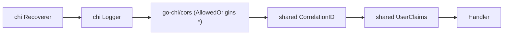

# shared (Go module dùng chung)

> **Phiên bản:** 1.0 · **Trạng thái:** Final · **Cập nhật:** 2026-11-12 · **Phạm vi:** Ứng dụng (as-is)

| Thuộc tính | Giá trị |
| :--- | :--- |
| Module | `com.ecommerce/shared` (`services/shared/go.mod:1`) |
| Ngôn ngữ / stack | Go 1.27 (`services/shared/go.mod:3`), `github.com/golang-jwt/jwt/v5`, `github.com/jackc/pgx/v5` |
| Port | Không áp dụng (thư viện, không chạy độc lập) |
| Database | Không sở hữu DB; cung cấp hàm tạo `pgxpool.Pool` |
| Đường dẫn code | `services/shared/` |
| Prefix gateway | Không áp dụng |
| Được dùng bởi | auth-service, product-service, order-service, payment-service, inventory-service, shipping-service, search-service (qua `replace com.ecommerce/shared => ../shared` trong `go.mod` của từng service, ví dụ `services/auth-service/go.mod:31`) |
| Tính năng phục vụ | Gián tiếp cho mọi FEAT có backend Go: [FEAT-01](../04-features/FEAT-01-sso-login-logout.md), [FEAT-04](../04-features/FEAT-04-user-role-management.md), [FEAT-06](../04-features/FEAT-06-product-catalog.md), [FEAT-09](../04-features/FEAT-09-checkout-place-order.md), [FEAT-11](../04-features/FEAT-11-payment.md), [FEAT-12](../04-features/FEAT-12-inventory-stock-check.md), [FEAT-14](../04-features/FEAT-14-catalog-search-suggest.md), [FEAT-20](../04-features/FEAT-20-shipping-order-items.md)… |

## 1. Tổng quan & trách nhiệm

`services/shared` là một Go module nhỏ (4 package, ~250 dòng) chứa các tiện ích dùng chung cho 7 service Go:

| Package | File | Trách nhiệm |
| :--- | :--- | :--- |
| `config` | `services/shared/config/config.go` | Đọc biến môi trường có giá trị mặc định (`GetEnv`). |
| `database` | `services/shared/database/postgres.go` | Tạo connection pool PostgreSQL (`pgxpool`) với tham số pool cố định. |
| `middleware` | `services/shared/middleware/middleware.go` | Middleware HTTP: Correlation ID và trích xuất claim JWT (không xác minh chữ ký). |
| `response` | `services/shared/response/api_response.go`, `response.go` | Ghi JSON response: envelope `ApiResponse` (auth-service), `ErrorVm` (các service khác), payload health. |

Module **không** chứa: router, logger có cấu trúc, client Kafka/OpenSearch, kiểm tra role, migration. Mỗi service tự khai báo các phần đó.

Workspace Go ở gốc repo liệt kê module này cùng 7 service (`go.work:3-12`); `Makefile` build/test tất cả qua biến `GO_MODULES`.

## 2. Tech stack & thư viện

| Thư viện | Phiên bản | Dùng ở |
| :--- | :--- | :--- |
| `github.com/golang-jwt/jwt/v5` | v5.3.1 | `middleware.UserClaims` — `ParseUnverified` |
| `github.com/jackc/pgx/v5` (`pgxpool`) | v5.11.0 | `database.ConnectPostgres` |
| `crypto/rand`, `encoding/hex` | stdlib | Sinh Correlation ID |
| `encoding/json`, `net/http`, `time` | stdlib | Package `response` |

Nguồn: `services/shared/go.mod:5-16`.

## 3. Cấu hình

Module không tự đọc biến môi trường nào. Hàm `config.GetEnv(key, defaultValue)` trả `os.Getenv(key)` nếu **khác chuỗi rỗng**, ngược lại trả `defaultValue` (`services/shared/config/config.go:5-10`).

> Hệ quả: không thể cố ý đặt một biến thành chuỗi rỗng để ghi đè default (ví dụ `OPENSEARCH_USERNAME=""` trong compose sẽ quay về default `""` — trùng nhau nên không ảnh hưởng; nhưng với `KEYCLOAK_CLIENT_SECRET` thì giá trị rỗng = "không gửi secret").

Các tham số pool PostgreSQL là **hard-code**, không cấu hình được qua env (`services/shared/database/postgres.go:27-30`):

| Tham số | Giá trị |
| :--- | :--- |
| `MaxConns` | 25 |
| `MinConns` | 2 |
| `MaxConnLifetime` | 1 giờ |
| `MaxConnIdleTime` | 30 phút |
| Timeout ping khởi động | 5 giây |

## 4. Phụ thuộc

| Phụ thuộc | Ghi chú |
| :--- | :--- |
| PostgreSQL | Chỉ khi service gọi `database.ConnectPostgres`. search-service không dùng package này. |
| Keycloak / JWT | `middleware.UserClaims` chỉ **đọc** payload JWT, không gọi Keycloak, không tải JWKS. |

## 5. Cấu trúc code

```
services/shared/
├── go.mod                       # module com.ecommerce/shared, Go 1.27
├── config/
│   └── config.go                # GetEnv(key, default)
├── database/
│   └── postgres.go              # Config struct (không dùng), ConnectPostgres(ctx, dsn)
├── middleware/
│   └── middleware.go            # CorrelationID, UserClaims, getters UserID/Email/Username/GetCorrelationID
└── response/
    ├── api_response.go          # ApiResponse[T], WriteJSON, OK, Message, Error, Health
    └── response.go              # ErrorVm, NotFound, BadRequest, InternalError
```

| Thành phần | Mô tả chi tiết |
| :--- | :--- |
| `database.Config` | Struct `Host/Port/User/Password/Database/SSLMode` (`services/shared/database/postgres.go:12-19`) — **không được service nào dùng**; mọi service tự dựng DSN bằng hàm `buildPostgresDSN()` riêng trong `main.go` (vd `services/product-service/main.go:26-54`). |
| `database.ConnectPostgres(ctx, dsn)` | Parse DSN → set tham số pool → `pgxpool.NewWithConfig` → `Ping` với timeout 5s. **Nếu ping lỗi chỉ log warning và vẫn trả pool** (`services/shared/database/postgres.go:37-43`). Chỉ trả lỗi khi DSN sai cú pháp hoặc tạo pool thất bại. |
| `middleware.CorrelationID` | Đọc header `X-Correlation-Id`; nếu rỗng sinh 16 byte ngẫu nhiên dạng hex (32 ký tự); set lại vào response header và context key `correlationId` (`services/shared/middleware/middleware.go:25-36`). |
| `middleware.UserClaims` | Nếu header `Authorization: Bearer <jwt>` tồn tại, gọi `jwt.Parser.ParseUnverified` → lấy `sub`, `email`, `preferred_username` (nếu là string) đưa vào context. Token lỗi/không có → đi tiếp, **không** trả 401 (`services/shared/middleware/middleware.go:45-69`). |
| `middleware.UserID/Email/Username/GetCorrelationID` | Getter từ context, trả `""` nếu không có (`services/shared/middleware/middleware.go:39-87`). |

### Thứ tự middleware trong các service Go

Mọi service Go đăng ký cùng một chuỗi middleware (ví dụ `services/auth-service/main.go:94-103`):



CORS ở service cho phép `*`, method `GET/POST/PUT/DELETE/OPTIONS`, header `Origin, Content-Type, Accept, Authorization, X-Correlation-Id` (vd `services/product-service/main.go:84-88`) — rộng hơn CORS của gateway (ISSUE-14).

## 6. API endpoints

Không áp dụng — module không đăng ký route. Hàm `response.Health` được các service dùng để phục vụ `/actuator/health` (xem mục 10).

## 7. Data model

Không sở hữu bảng nào. Các kiểu dữ liệu (DTO) mà module định nghĩa:

### 7.1 `ApiResponse[T]` — envelope "chuẩn nền tảng"

`services/shared/response/api_response.go:12-21`

| Field JSON | Kiểu Go | omitempty | Ý nghĩa |
| :--- | :--- | :---: | :--- |
| `success` | `bool` | – | `true` khi thành công |
| `code` | `string` | ✔ | `"OK"` khi thành công; mã lỗi (vd `BAD_REQUEST`, `NOT_FOUND`, `CONFLICT`, `UNAUTHORIZED`, `VALIDATION_FAILED`, `INVALID_ID`, `INTERNAL_ERROR`, `REGISTRATION_FAILED`, `AUTH_TOKEN_INVALID`) |
| `message` | `string` | ✔ | Thông điệp cho người đọc |
| `data` | `T` | ✔ | Payload (bị bỏ nếu là zero value: `nil`, slice rỗng `nil`…) |
| `errors` | `[]string` | ✔ | Danh sách lỗi chi tiết (chưa nơi nào truyền) |
| `path` | `string` | ✔ | `r.URL.Path` — **chỉ set khi lỗi** |
| `traceId` | `string` | ✔ | Correlation ID của request |
| `timestamp` | `time.Time` | – | Thời điểm UTC (RFC3339Nano) |

### 7.2 `ErrorVm` — lỗi kiểu Spring/RFC7807 rút gọn

`services/shared/response/response.go:6-10`

| Field JSON | Kiểu | Ý nghĩa |
| :--- | :--- | :--- |
| `statusCode` | `string` | Mã HTTP dạng chuỗi: `"400"`, `"404"`, `"500"` |
| `title` | `string` | `"Bad request"`, `"Not found"`, `"Internal server error"` |
| `detail` | `string` | Thông điệp chi tiết (thường là `err.Error()` — có thể lộ lỗi SQL) |

## 8. Business logic chi tiết

### 8.1 Hai định dạng response song song (ISSUE-29)

| Định dạng | Hàm | Service dùng |
| :--- | :--- | :--- |
| **A. Envelope `ApiResponse`** cho cả thành công và lỗi | `response.OK`, `response.Message`, `response.Error` | **chỉ auth-service** (`services/auth-service/internal/handler/auth_handler.go`) |
| **B. JSON thô** khi thành công + `ErrorVm` khi lỗi | `response.WriteJSON` + `response.BadRequest/NotFound/InternalError` | product, order, payment, inventory, shipping, search |

**A1 — `response.OK(w, r, data, "msg")`** → HTTP 200 (`services/shared/response/api_response.go:30-43`):

```json
{
  "success": true,
  "code": "OK",
  "message": "User updated successfully",
  "data": {
    "id": 12,
    "fullname": "Nguyen Van A",
    "username": "nva",
    "email": "nva@example.com",
    "gender": "MALE",
    "phone": "0901234567",
    "avatar": ""
  },
  "traceId": "4f1c2a0be3d94f5e8a7b6c5d4e3f2a1b",
  "timestamp": "2026-11-12T03:15:20.123456789Z"
}
```

**A2 — `response.Message(w, r, "msg")`** → HTTP 200, không có `data` (`services/shared/response/api_response.go:45-53`):

```json
{
  "success": true,
  "code": "OK",
  "message": "Logout successful",
  "traceId": "4f1c2a0be3d94f5e8a7b6c5d4e3f2a1b",
  "timestamp": "2026-11-12T03:15:20.123Z"
}
```

**A3 — `response.Error(w, r, status, code, message, errors...)`** → HTTP `status` (`services/shared/response/api_response.go:55-65`):

```json
{
  "success": false,
  "code": "NOT_FOUND",
  "message": "User not found",
  "path": "/auth/api/v1/users/99",
  "traceId": "4f1c2a0be3d94f5e8a7b6c5d4e3f2a1b",
  "timestamp": "2026-11-12T03:15:20.123Z"
}
```

> Lưu ý: vì `data` có `omitempty`, `response.OK(w, r, []string{})`… với slice rỗng **không nil** vẫn được serialize (`[]`), nhưng slice `nil` (ví dụ `GetUserRoles` khi user không có role → `bob.All` trả slice rỗng) có thể làm mất field `data`. Client nên coi thiếu `data` = rỗng.

**B1 — Thành công: `response.WriteJSON(w, status, v)`** — ghi trực tiếp object/mảng, không envelope (`services/shared/response/api_response.go:24-28`). Ví dụ `GET /api/categories` của product-service:

```json
[
  { "categoryId": 1, "categoryTitle": "Điện thoại", "imageUrl": "" }
]
```

Thậm chí giá trị nguyên thủy: `DELETE /api/products/5` trả body `true`.

**B2 — Lỗi `ErrorVm`** (`services/shared/response/response.go:12-34`):

```json
{
  "statusCode": "404",
  "title": "Not found",
  "detail": "not found: product with id 99 not found"
}
```

Chỉ có 3 helper: 400, 404, 500. Không có helper cho 401/403/409 → các service định dạng B không bao giờ trả 409 (ví dụ payment-service trả **404** cho "đã thanh toán", ISSUE-25).

### 8.2 Xác thực trong service (ISSUE-02)

`UserClaims` dùng `ParseUnverified` → **không** kiểm tra chữ ký, `exp`, `iss`, `aud`. Ý đồ thiết kế (comment dòng 44) là APISIX đã xác minh token. Tuy nhiên:

- Các service publish port ra host trong compose (`docker-compose.yml:177-178`, `203-204`, …) → gọi trực tiếp được với token giả.
- Không có middleware chặn request thiếu token và **không có kiểm tra role** (ISSUE-01).
- Trong toàn bộ code Go, chỉ auth-service đọc claim (`middleware.Username`/`UserID` trong `GetCurrentUser`, `services/auth-service/internal/handler/auth_handler.go:318-322`). Các service khác đăng ký middleware nhưng không dùng giá trị (ví dụ order-service không lọc đơn theo user — ISSUE-49). `middleware.Email` không được gọi ở đâu.

### 8.3 Kết nối DB "không fail"

`ConnectPostgres` chỉ log khi ping lỗi; các `main.go` cũng chỉ log khi `ConnectPostgres` trả lỗi và tiếp tục với `pool == nil`. Các repository kiểm tra `r.db.Pool == nil` và trả dữ liệu rỗng/stub (ví dụ `id = 1`). Đây là gốc của ISSUE-28.

## 9. Sự kiện (produce / consume)

Không áp dụng — module không có code Kafka (payment-service và search-service tự dùng `segmentio/kafka-go`).

## 10. Health check & observability

`response.Health(w, component)` luôn trả HTTP 200 (`services/shared/response/api_response.go:68-75`):

```json
{
  "status": "UP",
  "components": {
    "db": { "status": "UP" }
  }
}
```

`component` là `"db"` cho các service có Postgres và `"opensearch"` cho search-service. Hàm **không kiểm tra** kết nối thật (ISSUE-36).

Observability khác:

| Khía cạnh | Hiện trạng |
| :--- | :--- |
| Correlation ID | Có (`X-Correlation-Id`), trả lại trong header và `traceId` của envelope A. Không được truyền sang lời gọi downstream (không service Go nào gọi HTTP service khác) và không ghi vào log. |
| Logging | `chi/middleware.Logger` (text) do từng service đăng ký; module không cung cấp logger. |
| Metrics / tracing | Không có trong module (metrics Prometheus chỉ ở APISIX `global_rules`). |

## 11. Test

Module **không có file test** (`services/shared` không chứa `*_test.go`). Hành vi chỉ được kiểm gián tiếp qua `main_test.go` của các service (đều chạy với DB `nil`, ISSUE-46).

## 12. Vấn đề đã biết

| ID | Tóm tắt liên quan tới module |
| :--- | :--- |
| ISSUE-01 | Không có kiểm tra role; module không cung cấp `RequireRole`. |
| ISSUE-02 | `UserClaims` không xác minh chữ ký JWT. |
| ISSUE-28 | `ConnectPostgres` không fail-fast; service chạy tiếp khi DB lỗi. |
| ISSUE-29 | Hai định dạng response (`ApiResponse` vs JSON thô + `ErrorVm`). |
| ISSUE-36 | `Health` luôn trả UP. |

## 13. Tham chiếu source

- `services/shared/go.mod:1-16`
- `services/shared/config/config.go:5-10`
- `services/shared/database/postgres.go:12-44`
- `services/shared/middleware/middleware.go:13-87`
- `services/shared/response/api_response.go:12-75`
- `services/shared/response/response.go:6-34`
- `go.work:1-12`
- Ví dụ sử dụng: `services/auth-service/main.go:94-103`, `services/product-service/main.go:63-90`
