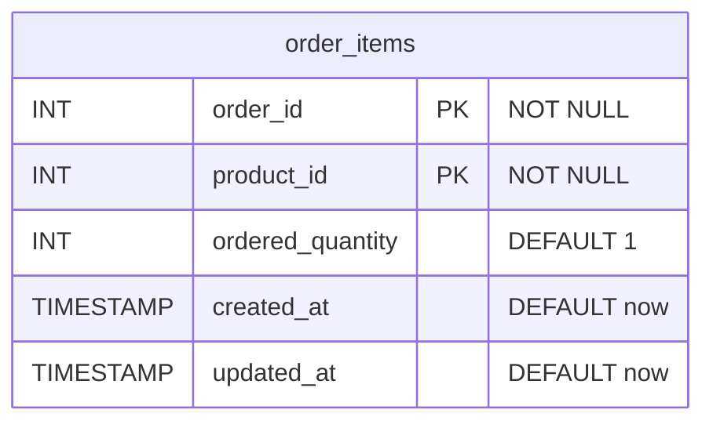
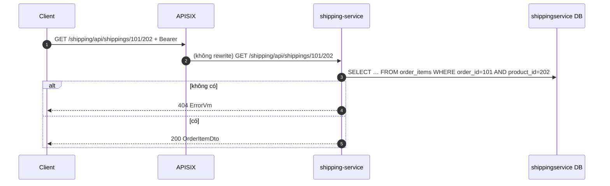

# shipping-service

> **Phiên bản:** 1.0 · **Trạng thái:** Final · **Cập nhật:** 2026-11-12 · **Phạm vi:** Ứng dụng (as-is)

| Thuộc tính | Giá trị |
| :--- | :--- |
| Ngôn ngữ / stack | Go 1.27, `go-chi/chi v5`, `bob` + `pgx v5` |
| Port | `8087` (env `PORT`, `services/shipping-service/main.go:57`; compose `docker-compose.yml:266-267`) |
| Database | PostgreSQL `shippingservice` (bảng `order_items`) |
| Đường dẫn code | `services/shipping-service/` |
| Prefix gateway | `/shipping/api/shippings/*` (upstream 6, Bearer, **không rewrite**) (`deploy/apisix/apisix.yaml:268-279`) |
| Tính năng phục vụ | [FEAT-20](../04-features/FEAT-20-shipping-order-items.md); module admin Shipping là placeholder ([FEAT-26](../04-features/FEAT-26-admin-placeholder-modules.md)) |

## 1. Tổng quan & trách nhiệm

Dù tên là "shipping", service chỉ lưu bảng **`order_items`** — các cặp (`order_id`, `product_id`, `ordered_quantity`). Không có khái niệm lô giao, hãng vận chuyển, mã vận đơn, địa chỉ, phí ship, trạng thái giao (ISSUE-45). Không được frontend hay service nào gọi; order-service không ghi vào đây (đơn hàng thực tế chỉ có một `product_id`, ISSUE-20).

## 2. Tech stack & thư viện

`chi v5.3.2`, `go-chi/cors v1.2.2`, `pgx v5.11.0`, `bob v0.50.0`, `scan v0.9.0`, `testify`, `com.ecommerce/shared`. Dockerfile 2 stage, `EXPOSE 8087`.

## 3. Cấu hình

| Biến | Default | Compose (`docker-compose.yml:268-272`) | Ý nghĩa |
| :--- | :--- | :--- | :--- |
| `PORT` | `8087` | – | Cổng |
| `DATABASE_URL` / `SPRING_DATASOURCE_URL` / `POSTGRES_HOST/PORT/DB` | db `shippingservice` (`main.go:35`) | `jdbc:postgresql://postgres:5432/shippingservice` | Kết nối DB |
| `POSTGRES_USER/PASSWORD` | default trong code | từ `.env` | Secret |
| `JWT_ISSUER_URI` | – | có set | Không dùng |

## 4. Phụ thuộc

Chỉ PostgreSQL `shippingservice`. Không kiểm `order_id`/`product_id` có tồn tại ở order/product-service.

## 5. Cấu trúc code

```
services/shipping-service/
├── main.go
├── main_test.go
└── internal/
    ├── handler/shipping_handler.go      # 7 endpoint × 2 prefix
    ├── model/shipping.go                # OrderItemId, OrderItemDto, DtoCollectionResponse[T]
    ├── repository/shipping_repo.go      # DDL + upsert/select/delete
    └── service/shipping_service.go      # ErrNotFound, Update = Save
```

## 6. API endpoints

JSON thô + `ErrorVm`. Prefix `/shipping/api/shippings` và `/api/shippings` (`shipping_handler.go:29-31`).

Gateway: route `shipping` chỉ có `uri: /shipping/api/shippings/*` và **không có `proxy-rewrite`** → path được chuyển nguyên văn, trúng prefix `/shipping/api/shippings` của service. Path gốc `/shipping/api/shippings` (list, POST, PUT) **không khớp** `/*` → 404 ở gateway (cùng loại ISSUE-15). Không có route `/api/shippings`.

| # | Method | Path trong service | Path qua gateway | Auth GW | Mô tả |
| :--- | :--- | :--- | :--- | :--- | :--- |
| 1 | GET | `/actuator/health`, `/shipping/actuator/health` | – | – | Health luôn UP |
| 2 | GET | `/api/shippings` | ⚠ `/shipping/api/shippings` không khớp route | Bearer | Tất cả order item |
| 3 | GET | `/api/shippings/find` (body JSON) | `/shipping/api/shippings/find` | Bearer | Tìm theo khóa trong body của GET |
| 4 | GET | `/api/shippings/{orderId}/{productId}` | `/shipping/api/shippings/{o}/{p}` | Bearer | Tìm theo path |
| 5 | POST | `/api/shippings` | ⚠ không khớp | Bearer | Upsert |
| 6 | PUT | `/api/shippings` | ⚠ không khớp | Bearer | Upsert (giống POST) |
| 7 | DELETE | `/api/shippings/delete` (body JSON) | `/shipping/api/shippings/delete` | Bearer | Xóa theo body |
| 8 | DELETE | `/api/shippings/{orderId}/{productId}` | `/shipping/api/shippings/{o}/{p}` | Bearer | Xóa theo path |
| – | GET | – | `/shipping/v3/api-docs/*` | Public | Route chết; lưu ý nó trùng tiền tố nhưng là route riêng (ISSUE-16) |

DTO (`internal/model/shipping.go:5-20`):

```json
// OrderItemId (body của find/delete)
{ "orderId": 101, "productId": 202 }

// OrderItemDto
{ "orderId": 101, "productId": 202, "orderedQuantity": 3,
  "createdAt": "2026-11-12T10:00:00Z", "updatedAt": "2026-11-12T10:00:00Z" }

// GET #2
{ "collection": [ { "orderId": 101, "productId": 202, "orderedQuantity": 3, "createdAt": "…", "updatedAt": "…" } ] }
```

| # | Response 2xx | Lỗi |
| :--- | :--- | :--- |
| 2 | 200 `{collection: OrderItemDto[]}` sắp `order_id DESC` | 500 |
| 3, 4 | 200 `OrderItemDto` | 400 `Invalid orderId`/`Invalid productId`/`Invalid request body`; 404 `not found: order item not found for orderId: 101, productId: 202`; 500 |
| 5, 6 | 200 **echo body** (không có `createdAt/updatedAt` vì không đọc lại DB) | 400 body; 500 |
| 7, 8 | 200 `true` (kể cả không tồn tại) | 400; 500 |

## 7. Data model



DDL `services/shipping-service/internal/repository/shipping_repo.go:32-41`. Chi tiết: [data-dictionary.md §shippingservice](../06-data/data-dictionary.md#6-shippingservice-shipping-service). `created_at`/`updated_at` là `TIMESTAMP` (không múi giờ) nhưng được scan vào `*time.Time` và serialize như UTC.

## 8. Business logic chi tiết



| # | Quy tắc | Nguồn |
| :--- | :--- | :--- |
| R1 | Save/Update = `INSERT … ON CONFLICT (order_id, product_id) DO UPDATE SET ordered_quantity = EXCLUDED.ordered_quantity, updated_at = NOW()`. | `shipping_repo.go:98-119` |
| R2 | `orderedQuantity` bỏ trống → gửi `0` (int) → **ghi 0**, default `1` của cột không bao giờ áp dụng; không chặn số âm. | `shipping_repo.go:107` |
| R3 | `orderId`/`productId` bỏ trống → 0 vẫn lưu được. | – |
| R4 | Delete luôn 200 `true`. | `shipping_handler.go:132-165` |
| R5 | DB `nil` → list rỗng, find 404, save/delete no-op 200 (ISSUE-28). | repository |

## 9. Sự kiện (produce / consume)

Không có.

## 10. Health check & observability

Health luôn UP (ISSUE-36); `InitSchema` lỗi chỉ log notice (`shipping_repo.go:42-44`).

## 11. Test

`services/shipping-service/main_test.go` (DB `nil`): `TestHealthCheck` (2 route), `TestShippingEndpoints` (list 2 prefix, POST, PUT, DELETE path, và `GET /api/shippings/abc/def` → 400) (`main_test.go:45-68`).

## 12. Vấn đề đã biết

| ID | Mức | Tóm tắt |
| :--- | :--- | :--- |
| ISSUE-01 | Critical | Không kiểm role |
| ISSUE-15 | Medium | Route gateway `/shipping/api/shippings/*` không khớp path gốc (list/POST/PUT) |
| ISSUE-16 | Low | Route api-docs chết |
| ISSUE-20 | High | Order không có dòng hàng; `order_items` không được order-service dùng |
| ISSUE-28 | High | Không migration; stub khi không có DB |
| ISSUE-35 | Medium | (cùng mẫu) GET/DELETE có body |
| ISSUE-36 | Low | Health luôn UP |
| ISSUE-45 | Medium | README mô tả carrier/tracking không tồn tại |

## 13. Tham chiếu source

- `services/shipping-service/main.go:26-113`
- `services/shipping-service/internal/handler/shipping_handler.go:23-165`
- `services/shipping-service/internal/service/shipping_service.go:12-51`
- `services/shipping-service/internal/repository/shipping_repo.go:28-134`
- `services/shipping-service/internal/model/shipping.go:5-20`
- `services/shipping-service/main_test.go:15-68`
- `docker-compose.yml:260-277`
- `deploy/apisix/apisix.yaml:22-25`, `118-120`, `268-279`
