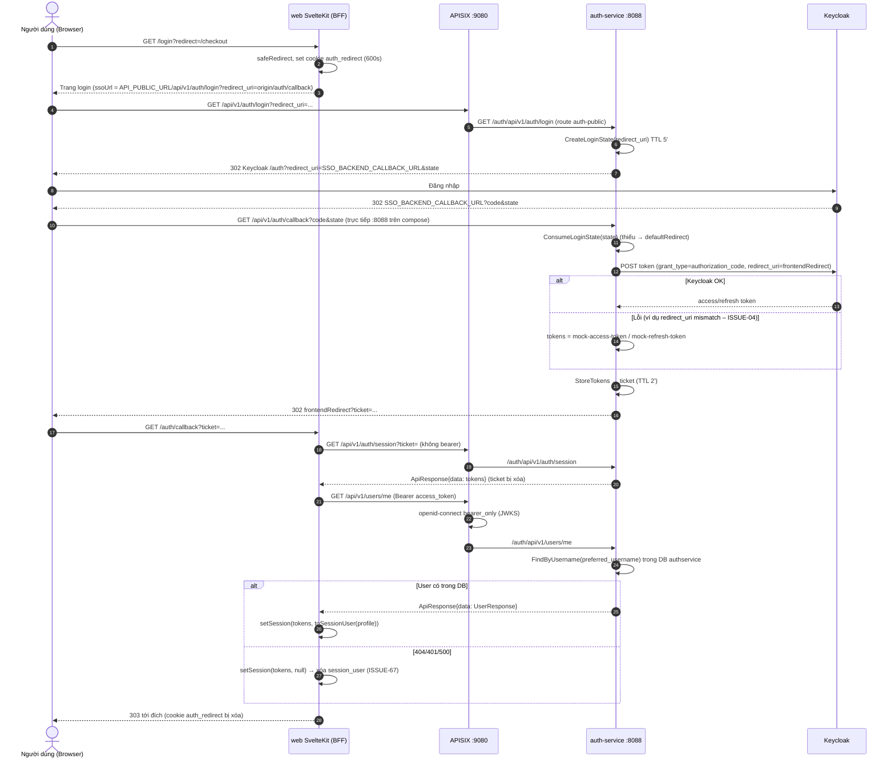
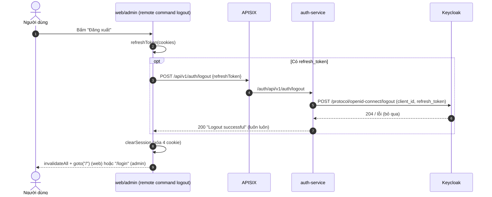
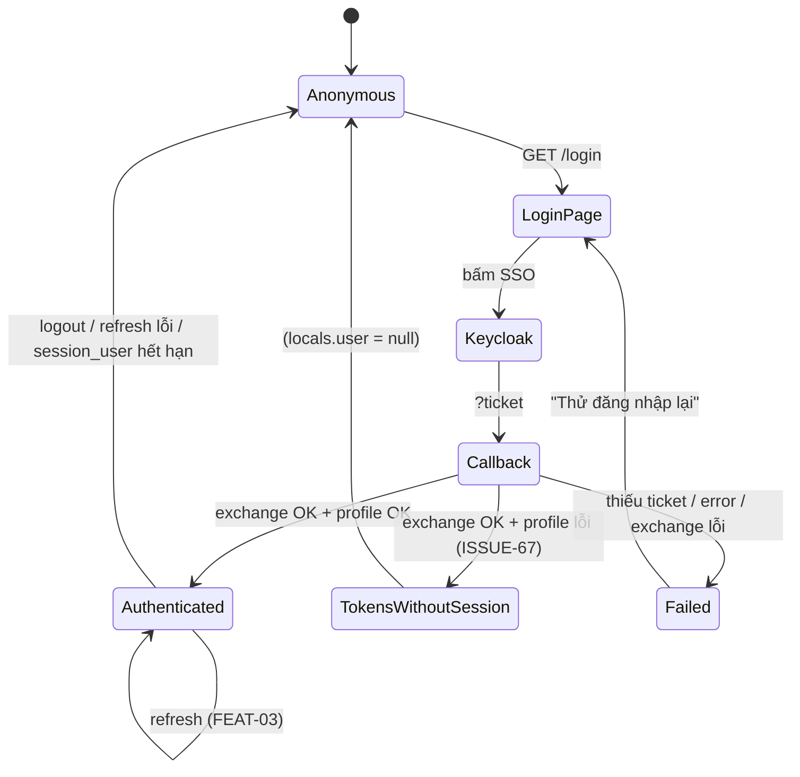

# FEAT-01 — Đăng nhập SSO / Đăng xuất

> **Phiên bản:** 1.0 · **Trạng thái:** Final · **Cập nhật:** 2026-11-12 · **Phạm vi:** Ứng dụng (as-is)

| Thuộc tính | Giá trị |
| :--- | :--- |
| ID | FEAT-01 |
| Business Requirement | BR-01 |
| Trạng thái | 🟡 **Một phần** — Code đầy đủ ở cả web, admin, auth-service; nhưng luồng đầu-cuối với Keycloak thật bị chặn bởi lệch `redirect_uri` (ISSUE-04), yêu cầu bản ghi user trong DB `authservice` (ISSUE-101; khi thiếu thì mất phiên im lặng — ISSUE-67) và lệch hợp đồng profile/role (ISSUE-100). Đăng xuất hoạt động. |
| Actor | Guest, Customer, Admin, Hệ thống (Keycloak, auth-service, APISIX) |
| Ứng dụng / Service | `frontend/apps/web`, `frontend/apps/admin`, `frontend/packages/lib` (BFF session), `services/auth-service`, Keycloak realm `ecommerce`, APISIX |
| Issue liên quan | ISSUE-04, ISSUE-05, ISSUE-06, ISSUE-08, ISSUE-11, ISSUE-12, ISSUE-14, ISSUE-37, ISSUE-61, ISSUE-66, ISSUE-67, ISSUE-69, ISSUE-71, ISSUE-52, ISSUE-100, ISSUE-101 |

## 1. Mô tả & mục tiêu nghiệp vụ

Cho phép khách hàng (storefront `web`) và quản trị viên (backoffice `admin`) đăng nhập **một lần (SSO)** qua Keycloak, không nhập mật khẩu trên website. Kiến trúc là **BFF (Backend-for-Frontend)**:

- Trình duyệt chỉ được chuyển hướng tới gateway public `GET /api/v1/auth/login`; mọi trao đổi token còn lại diễn ra **server-to-server** (SvelteKit server → APISIX → auth-service → Keycloak).
- auth-service đóng vai trò "SSO broker": tạo `state`, chuyển hướng tới Keycloak, nhận `code`, đổi lấy token, cất token trong **ticket một lần** (TTL 2 phút) và trả ticket về frontend qua query `?ticket=`.
- Frontend đổi ticket lấy token (`GET /api/v1/auth/session?ticket=`), gọi profile (`GET /api/v1/users/me`) và lưu phiên trong **4 cookie httpOnly**.
- Đăng xuất: remote command `logout` gọi `POST /api/v1/auth/logout` (best-effort) rồi xóa cookie.

Mục tiêu: mật khẩu không đi qua web app, token không bao giờ lộ ra JavaScript phía client (httpOnly), một identity provider dùng chung.

## 2. User stories

| ID | Story |
| :--- | :--- |
| US-01.1 | Là **khách**, tôi muốn bấm "Đăng nhập bằng SSO" để được chuyển tới trang đăng nhập Keycloak và quay lại đúng trang tôi đang xem sau khi đăng nhập. |
| US-01.2 | Là **khách hàng đã đăng nhập**, tôi muốn thấy tên/email của mình ở header và menu "Đơn hàng của tôi", "Giỏ hàng", "Đăng xuất". |
| US-01.3 | Là **khách hàng**, khi truy cập `/checkout` hoặc `/orders` mà chưa đăng nhập, tôi muốn được đưa tới `/login` và quay lại trang đó sau khi đăng nhập. |
| US-01.4 | Là **quản trị viên**, tôi muốn đăng nhập backoffice bằng cùng tài khoản SSO; tài khoản không có quyền ADMIN phải bị chặn ở `/access-denied`. |
| US-01.5 | Là **người dùng đã đăng nhập**, tôi muốn đăng xuất để xóa phiên trên trình duyệt và trên Keycloak. |
| US-01.6 | Là **hệ thống**, tôi muốn đăng nhập thất bại (ticket hết hạn, Keycloak trả lỗi) hiển thị trang lỗi có nút "Thử đăng nhập lại". |

## 3. Tiền điều kiện / Hậu điều kiện

**Tiền điều kiện**

- Keycloak chạy với realm `ecommerce` import từ `deploy/keycloak/import/ecommerce-realm.json` (client `ecommerce-client`, `publicClient: true`, `redirectUris`: `http://localhost:*`, `http://127.0.0.1:*`, `http://api.ecommerce.local/*`).
- auth-service cấu hình các biến `KEYCLOAK_SERVER_URL`, `KEYCLOAK_PUBLIC_SERVER_URL`, `KEYCLOAK_REALM`, `KEYCLOAK_CLIENT_ID`, `KEYCLOAK_CLIENT_SECRET` (tùy chọn), `SSO_BACKEND_CALLBACK_URL`, `SSO_DEFAULT_FRONTEND_REDIRECT`, `SSO_SCOPE` (`services/auth-service/main.go:74-87`; giá trị compose ở `docker-compose.yml:180-185`).
- Frontend có `API_INTERNAL_URL` (server → gateway) và `API_PUBLIC_URL` (browser → gateway) (`frontend/packages/lib/src/server/env.ts:11-27`; compose `docker-compose.yml:422-426`, `:442-444`).
- **Người dùng phải tồn tại cả trong Keycloak lẫn bảng `users` của DB `authservice`** với `user_name` = `preferred_username` (xem ISSUE-101).

**Hậu điều kiện (thành công)**

- Trình duyệt có cookie `access_token`, `refresh_token`, `session_expires`, `session_user` (httpOnly, `sameSite=lax`, `path=/`).
- `event.locals.user` được set ở mọi request tiếp theo; header web hiển thị menu tài khoản.

**Hậu điều kiện (đăng xuất)**

- 4 cookie bị xóa; refresh token bị Keycloak vô hiệu (nếu lời gọi logout tới được Keycloak).

## 4. Luồng nghiệp vụ

### 4.1 Luồng chính — Đăng nhập (web)

1. Người dùng bấm nút "Đăng nhập" ở header (`frontend/apps/web/src/lib/components/header.svelte:134-137`) → `/login`, hoặc bị redirect từ trang cần đăng nhập với `?redirect=<path>` (`frontend/apps/web/src/routes/checkout/+page.server.ts:5-9`, `orders/+page.server.ts:5-9`).
2. `load` của `/login` (`frontend/apps/web/src/routes/login/+page.server.ts:9-27`):
   - Lọc `redirect` qua `safeRedirect` (chỉ chấp nhận path bắt đầu bằng `/` và không phải `//`, `frontend/packages/lib/src/server/redirect.ts:2-5`).
   - Nếu đã có `locals.user` → redirect 303 tới đích.
   - Ghi cookie `auth_redirect` (httpOnly, lax, `maxAge: 600` giây) chứa đích sau đăng nhập.
   - Dựng `ssoUrl = ${API_PUBLIC_URL}/api/v1/auth/login?redirect_uri=${origin}/auth/callback`.
3. Trang `/login` hiển thị nút "Đăng nhập bằng SSO" là link tới `ssoUrl` (`frontend/apps/web/src/routes/login/+page.svelte:19-21`).
4. Trình duyệt gọi `GET /api/v1/auth/login` qua APISIX (route public `auth-public`, rewrite `/auth/api/v1/auth/*`, `deploy/apisix/apisix.yaml:63-70`).
5. auth-service `Login` (`services/auth-service/internal/handler/auth_handler.go:125-134`):
   - Lấy `redirect_uri` từ query, rỗng → dùng `SSO_DEFAULT_FRONTEND_REDIRECT`. **Không kiểm tra allowlist** (ISSUE-05).
   - `CreateLoginState(redirectURI)` sinh `state` ngẫu nhiên 32 byte base64url, TTL 5 phút, lưu trong map in-memory (`services/auth-service/internal/service/sso_store.go:71-81`).
   - `BuildAuthorizeURL` dựng URL `.../realms/{realm}/protocol/openid-connect/auth` với `client_id`, `response_type=code`, `scope`, `redirect_uri = SSO_BACKEND_CALLBACK_URL`, `state` (`services/auth-service/internal/service/keycloak_client.go:101-109`).
   - Trả **302** tới Keycloak.
6. Người dùng đăng nhập trên Keycloak. Keycloak redirect tới `SSO_BACKEND_CALLBACK_URL?code=...&state=...` (compose: `http://localhost:8088/api/v1/auth/callback` — gọi **thẳng auth-service**, không qua gateway).
7. auth-service `Callback` (`auth_handler.go:136-167`):
   - `ConsumeLoginState(state)` lấy và xóa redirect đã lưu; nếu không tìm thấy/hết hạn → **vẫn tiếp tục** với `defaultRedirect` (ISSUE-52).
   - `ExchangeAuthorizationCode(code, frontendRedirect)` POST form tới token endpoint với `redirect_uri = frontendRedirect` (khác với bước 5 → ISSUE-04).
   - Nếu đổi code lỗi → **tạo token giả** `mock-access-token` / `mock-refresh-token`, `ExpiresIn: 3600` (`auth_handler.go:153-162`).
   - `StoreTokens` sinh `ticket` (TTL 2 phút) (`sso_store.go:98-108`), redirect 302 tới `frontendRedirect?ticket=<ticket>`.
8. `load` của `/auth/callback` (web: `frontend/apps/web/src/routes/auth/callback/+page.server.ts:10-40`):
   - Đọc + xóa cookie `auth_redirect`, lọc qua `safeRedirect`.
   - Không có `ticket` hoặc có `error` → `clearSession`, trả `{ failed: true }`.
   - `createApi().auth.exchangeTicket(ticket)` → `GET /api/v1/auth/session?ticket=` (không gửi bearer, `frontend/packages/lib/src/server/api.ts:154-155`). auth-service `Session` tiêu thụ ticket một lần (`auth_handler.go:169-183`, `sso_store.go:110-123`) và trả `ApiResponse{data: KeycloakTokenResponse}`; BFF bóc envelope `data` (`api.ts:71-75`).
   - Gọi `auth.profile()` = `GET /api/v1/users/me` với access token mới (`api.ts:158`). Lỗi profile bị nuốt → `user = null`.
   - `setSession(cookies, tokens, user)` (`frontend/packages/lib/src/server/session.ts:32-49`) rồi redirect 303 tới `localizeHref(target)`.
9. Request tiếp theo: hook `handleSession` đọc cookie `session_user` → `locals.user` (`frontend/apps/web/src/hooks.server.ts:32-51`); `+layout.server.ts` trả `user` cho header (`frontend/apps/web/src/routes/+layout.server.ts:3-5`).

### 4.2 Luồng thay thế

- **A1 — Đã đăng nhập mà vào `/login`**: redirect 303 ngay tới `redirect` (hoặc `/`) (`login/+page.server.ts:12`).
- **A2 — Đăng nhập backoffice (admin)**: giống 4.1 với `frontend/apps/admin/src/routes/login/+page.server.ts:8-24` và `auth/callback/+page.server.ts:9-34`. Khác biệt: hook `handleAdminGuard` (`frontend/apps/admin/src/hooks.server.ts:58-77`) chặn mọi route trừ `/login`, `/auth/callback`, `/access-denied`, `/_app/*` và path có dấu `.`: chưa đăng nhập → `/login?redirect=<path>`; đã đăng nhập nhưng `isAdmin(user)` sai → `/access-denied`. `isAdmin` chấp nhận role `ADMIN` hoặc `ROLE_ADMIN` (`session.ts:23-25`).
- **A3 — Đăng xuất (web)**: menu tài khoản → "Đăng xuất" (`header.svelte:123-130`) → `handleLogout` (chống bấm lặp bằng cờ `loggingOut`) → remote command `logout` (`frontend/apps/web/src/lib/remote/auth.remote.ts:6-19`): đọc cookie `refresh_token`, nếu có gọi `POST /api/v1/auth/logout {refreshToken}` (lỗi bị bỏ qua) → `clearSession` → client `invalidateAll()` → `goto('/')` (`header.svelte:35-45`).
- **A4 — Đăng xuất (admin)**: từ sidebar (`frontend/apps/admin/src/routes/+layout.svelte:55-65`) hoặc trang `/access-denied` (`frontend/apps/admin/src/routes/access-denied/+page.svelte:11-21`) → cùng logic, sau đó `goto('/login')`.
- **A5 — auth-service Logout**: `Logout` decode body (lỗi decode bị bỏ qua), nếu có `refreshToken` → POST form `client_id`, `client_secret` (nếu có), `refresh_token` tới `.../protocol/openid-connect/logout`; lỗi bị bỏ qua; **luôn trả 200** `"Logout successful"` (`auth_handler.go:201-208`, `keycloak_client.go:136-161`).

### 4.3 Luồng ngoại lệ

| Mã | Tình huống | Hành vi hiện tại |
| :--- | :--- | :--- |
| E1 | Người dùng hủy/Keycloak trả `?error=` về callback backend | auth-service redirect tới **`SSO_DEFAULT_FRONTEND_REDIRECT`?error=...** (luôn là web, kể cả khi bắt đầu từ admin) (`auth_handler.go:142-146`). Trang callback hiển thị lỗi. |
| E2 | `state` không tồn tại / hết hạn (>5 phút) | Không chặn; dùng `defaultRedirect` và vẫn đổi code, cấp ticket (ISSUE-52). |
| E3 | Đổi code thất bại (sai `redirect_uri`, code hết hạn, Keycloak down) | Cấp ticket chứa **mock token** (ISSUE-04). Frontend đổi ticket thành công, nhưng `GET /users/me` với `mock-access-token` bị APISIX từ chối 401 → `user = null` → không có phiên (xem E5). |
| E4 | Ticket hết hạn (>2 phút), đã dùng, hoặc auth-service restart / khác replica | `GET /auth/session` trả **401** `UNAUTHORIZED "Invalid or expired ticket"` → callback `clearSession` + `{failed:true}` → trang lỗi "Đăng nhập không thành công" (ISSUE-06). |
| E5 | `GET /users/me` lỗi (user không có trong DB `authservice` → 404; DB down → 500; token không hợp lệ → 401) | `user = null` → `setSession(..., null)` **xóa** `session_user` nhưng vẫn ghi `access_token`/`refresh_token`. `session()` trả `null` → người dùng **không được coi là đã đăng nhập**, không có thông báo lỗi; bị redirect về đích như thể thành công (nguyên nhân phổ biến: ISSUE-101; hành vi mất phiên im lặng: ISSUE-67). |
| E6 | Admin đăng nhập thành công nhưng profile không có `roles` | `roles: []` → `isAdmin` = false → luôn bị đưa tới `/access-denied` (ISSUE-100). |
| E7 | `ticket` thiếu trên URL callback | `clearSession`, `{failed:true}`. |
| E8 | Logout khi Keycloak/gateway lỗi | Cookie vẫn bị xóa (best-effort). |

## 5. Sequence diagram

### 5.1 Đăng nhập (web)

### 5.2 Đăng xuất

### 5.3 Trạng thái phiên phía BFF

## 6. Màn hình & route (UI)

| App | Route | File | Mô tả |
| :--- | :--- | :--- | :--- |
| web | `/login` | `frontend/apps/web/src/routes/login/+page.svelte`, `+page.server.ts` | Card "Chào mừng trở lại!", nút "Đăng nhập bằng SSO", khối "Vì sao dùng SSO?" (3 gạch đầu dòng), nút "Tạo tài khoản" (cũng trỏ tới `ssoUrl`, xem FEAT-02). |
| web | `/auth/callback` | `frontend/apps/web/src/routes/auth/callback/+page.svelte`, `+page.server.ts` | Thành công → redirect 303 (người dùng không thấy UI). Thất bại → icon lỗi, tiêu đề, mô tả, nút "Thử đăng nhập lại" → `/login`. Trạng thái loading (spinner) chỉ hiển thị nếu `failed` falsy mà chưa redirect. |
| web | Header (mọi trang) | `frontend/apps/web/src/lib/components/header.svelte:100-138` | Có `user`: dropdown hiển thị `fullName \|\| username \|\| "Tài khoản của tôi"`, label `email \|\| username`, mục Đơn hàng / Giỏ hàng / Đăng xuất. Không có `user`: nút "Đăng nhập". |
| admin | `/login` | `frontend/apps/admin/src/routes/login/+page.svelte`, `+page.server.ts` | Brand, "Đăng nhập quản trị", ghi chú "Chỉ tài khoản quản trị được phép truy cập.", nút SSO. |
| admin | `/auth/callback` | `frontend/apps/admin/src/routes/auth/callback/+page.server.ts` | Như web. |
| admin | `/access-denied` | `frontend/apps/admin/src/routes/access-denied/+page.svelte` | Thông báo không có quyền + nút Đăng xuất. |
| admin | Sidebar | `frontend/apps/admin/src/routes/+layout.svelte:55-65,105,144,185` | Nút Đăng xuất (desktop, mobile). |

## 7. API sử dụng

| # | Method & path (gateway) | Route APISIX | Auth gateway | Handler | Request | Response |
| :--- | :--- | :--- | :--- | :--- | :--- | :--- |
| 1 | `GET /api/v1/auth/login?redirect_uri=` | `auth-public` (`apisix.yaml:63-70`) | Public | `AuthHandler.Login` (`auth_handler.go:125-134`) | query `redirect_uri` (tùy chọn) | `302 Location: <Keycloak authorize>` |
| 2 | `GET /api/v1/auth/callback?code&state[&error]` | `auth-public` (nhưng compose cấu hình gọi trực tiếp `:8088`) | Public | `Callback` (`:136-167`) | query | `302 Location: <frontendRedirect>?ticket=` hoặc `?error=` |
| 3 | `GET /api/v1/auth/session?ticket=` | `auth-public` | Public | `Session` (`:169-183`) | query `ticket` | `200 {success,code:"OK",data:{access_token,refresh_token,token_type,expires_in,refresh_expires_in,scope},traceId,timestamp}`; `400 BAD_REQUEST "Ticket is required"`; `401 UNAUTHORIZED "Invalid or expired ticket"` |
| 4 | `GET /api/v1/users/me` | `auth-users` (`apisix.yaml:160-177`) | Bearer JWT (openid-connect `bearer_only`, RS256/JWKS) | `GetCurrentUser` (`:318-339`) | header `Authorization` | `200 {data:{id,fullname,username,email,gender,phone,avatar}}`; `401 AUTH_TOKEN_INVALID`; `404 NOT_FOUND "User not found"`; `500 INTERNAL_ERROR` |
| 5 | `POST /api/v1/auth/logout` | `auth-public` | Public | `Logout` (`:201-208`) | `{ "refreshToken": "..." }` | luôn `200 {success:true, message:"Logout successful"}` |

Lời gọi Keycloak từ auth-service: authorize (browser), token endpoint `{KEYCLOAK_SERVER_URL}/realms/{realm}/protocol/openid-connect/token`, logout endpoint `.../logout` (`keycloak_client.go:77-91`), HTTP client timeout 10 giây (`:69-74`).

## 8. Dữ liệu

**Cookie phiên BFF** (`frontend/packages/lib/src/server/session.ts:4-11`, `:32-49`):

| Cookie | Nội dung | maxAge | Thuộc tính |
| :--- | :--- | :--- | :--- |
| `access_token` | JWT access token | `expires_in` (fallback 300 s) | httpOnly, lax, path `/`, **không đặt `secure`** |
| `refresh_token` | refresh token | `refresh_expires_in` (fallback 1800 s) | như trên |
| `session_expires` | epoch giây hết hạn access token | `refresh_expires_in` | như trên |
| `session_user` | JSON `SessionUser {id, username, fullName?, email?, roles[]}` | `refresh_expires_in` | như trên |
| `auth_redirect` | path đích sau login | 600 s | httpOnly, lax |

Web và admin dùng **cùng tên cookie, cùng path** → chia sẻ phiên khi cùng host (ISSUE-11).

**Store in-memory của auth-service** (`sso_store.go:12-47`): `states: map[state]{redirectURL, expiresAt}` (TTL 5 phút), `tickets: map[ticket]{tokens, expiresAt}` (TTL 2 phút), goroutine purge mỗi 1 phút. Không bền vững, không chia sẻ giữa replica (ISSUE-06).

**DB `authservice`**: `users`, `roles`, `user_role` (xem FEAT-04). `/users/me` tra theo `user_name`.

**Keycloak**: realm roles `ADMIN`, `USER`, `MANAGER`; seed user `testuser` (USER), `adminuser` (ADMIN, MANAGER) — mật khẩu nằm trong file import, không ghi ở đây (ISSUE-12). `registrationAllowed: false`.

## 9. Business rules & validation

| ID | Quy tắc | Nguồn |
| :--- | :--- | :--- |
| BR-01.1 | Đích sau đăng nhập chỉ được là path nội bộ (`/...`, không `//`); ngược lại dùng `/`. | `redirect.ts:2-5` |
| BR-01.2 | Đích được mang qua cookie `auth_redirect` (10 phút) chứ không qua query vì callback cố định `/auth/callback`. | `login/+page.server.ts:14-21` |
| BR-01.3 | `redirect_uri` gửi tới auth-service = `${url.origin}/auth/callback` của app hiện tại. | `login/+page.server.ts:23-24` |
| BR-01.4 | `state` 32 byte ngẫu nhiên (crypto/rand), dùng một lần, TTL 5 phút. **Không bắt buộc** khi callback. | `sso_store.go:34,65-96` |
| BR-01.5 | Ticket 32 byte ngẫu nhiên, dùng **một lần**, TTL 2 phút. | `sso_store.go:35,98-123` |
| BR-01.6 | Đổi ticket không gửi bearer token. | `api.ts:154-155` |
| BR-01.7 | Profile lỗi không làm callback thất bại, nhưng dẫn tới không có `session_user`. | `auth/callback/+page.server.ts:23-33` |
| BR-01.8 | Backoffice chỉ cho phép user có role `ADMIN` hoặc `ROLE_ADMIN` trong `session_user.roles`. | `session.ts:23-25`; admin `hooks.server.ts:72-74` |
| BR-01.9 | Đăng xuất luôn xóa cookie cục bộ dù gateway/Keycloak lỗi. | `auth.remote.ts:10-18` |
| BR-01.10 | `redirect_uri` của `/auth/login` không bị giới hạn bởi allowlist (biến `SSO_ALLOWED_REDIRECT_URIS` không được đọc). | ISSUE-05, ISSUE-37 |

## 10. Xử lý lỗi

- auth-service dùng envelope `ApiResponse` (`services/shared/response/api_response.go:12-65`): `success`, `code`, `message`, `errors`, `path`, `traceId` (từ header `X-Correlation-Id`), `timestamp`.
- BFF `request()` ném `ApiError(status, message, body)`; `message` lấy từ `body.message` nếu có (`api.ts:62-69`). Trong callback mọi lỗi exchange đều quy về `{failed: true}`; lỗi profile bị nuốt.
- UI lỗi: `auth_callbackErrorTitle` / `auth_callbackErrorText` / nút `auth_callbackRetry`.
- Không có log/telemetry phía frontend cho lỗi đăng nhập.

## 11. i18n (key chính)

Web (`frontend/apps/web/messages/vi.json`, `en.json`):

| Key | vi | en |
| :--- | :--- | :--- |
| `auth_loginPageTitle` | Đăng nhập | Log in |
| `auth_loginTitle` | Chào mừng trở lại! | Welcome back! |
| `auth_loginSubtitle` | Đăng nhập để tiếp tục mua sắm | Log in to continue shopping |
| `auth_ssoLoginBtn` | Đăng nhập bằng SSO | Sign in with SSO |
| `auth_ssoRedirectNote` | Bạn sẽ được chuyển đến trang đăng nhập bảo mật của Keycloak | You'll be redirected to the secure Keycloak login page |
| `auth_ssoWhy`, `auth_ssoFeature1..3` | Vì sao dùng SSO? / Đăng nhập một lần… / Hỗ trợ xác thực 2 lớp (2FA) / Mật khẩu không bao giờ đi qua website này | Why SSO? / … |
| `auth_callbackLoading` | Đang hoàn tất đăng nhập... | Finishing sign-in... |
| `auth_callbackErrorTitle` | Đăng nhập không thành công | Sign-in failed |
| `auth_callbackErrorText` | Phiên đăng nhập đã hết hạn hoặc không hợp lệ. Vui lòng thử lại. | Your login session expired or was invalid. Please try again. |
| `auth_callbackRetry` | Thử đăng nhập lại | Try signing in again |
| `header_login`, `header_logout`, `header_myAccount`, `header_myOrders` | Đăng nhập / Đăng xuất / Tài khoản của tôi / Đơn hàng của tôi | Log in / Log out / My account / My orders |

Admin (`frontend/apps/admin/messages/*.json`): `login_title` (Đăng nhập quản trị), `login_note`, `login_btn`, `sidebar_logout`, `access_denied_title`, `access_denied_text`, `auth_callback*`.

Lưu ý: `auth_ssoFeature2` quảng bá 2FA nhưng realm import không cấu hình OTP bắt buộc — chỉ là văn bản marketing.

## 12. Acceptance criteria (Given / When / Then — theo hành vi hiện tại)

| # | Given | When | Then |
| :--- | :--- | :--- | :--- |
| AC-01.1 | Khách chưa đăng nhập | Mở `/login?redirect=/orders` | Cookie `auth_redirect=/orders` (maxAge 600) được đặt; nút SSO trỏ tới `${API_PUBLIC_URL}/api/v1/auth/login?redirect_uri=<origin>/auth/callback`. |
| AC-01.2 | Khách mở `/login?redirect=https://evil.com` | Trang load | `auth_redirect` = `/`. |
| AC-01.3 | Người dùng đã có `session_user` hợp lệ | Mở `/login` | Redirect 303 tới `redirect` (hoặc `/`). |
| AC-01.4 | auth-service nhận `GET /api/v1/auth/login` không có `redirect_uri` | Xử lý | 302 tới Keycloak với `redirect_uri = SSO_BACKEND_CALLBACK_URL`, `state` mới được lưu với redirect = `SSO_DEFAULT_FRONTEND_REDIRECT`. |
| AC-01.5 | `GET /api/v1/auth/callback?code=x&state=khong-ton-tai` | Keycloak không đổi được code | Vẫn 302 tới `SSO_DEFAULT_FRONTEND_REDIRECT?ticket=<t>`; ticket chứa `mock-access-token` (hành vi hiện tại, được test `TestSSOFlow` xác nhận). |
| AC-01.6 | Ticket hợp lệ, chưa dùng, < 2 phút | `GET /api/v1/auth/session?ticket=t` | 200 với token; gọi lại lần 2 → 401 `Invalid or expired ticket`. |
| AC-01.7 | Ticket hợp lệ, profile `/users/me` trả 200 | Callback web | 4 cookie được đặt, redirect 303 tới đích; header hiển thị dropdown tài khoản. |
| AC-01.8 | Ticket hợp lệ, user không có trong DB `authservice` | Callback web | `access_token`/`refresh_token` được đặt nhưng `session_user` bị xóa; redirect 303 tới đích; header vẫn hiển thị "Đăng nhập" (không thông báo lỗi). |
| AC-01.9 | URL callback không có `ticket` hoặc có `error` | Callback | Mọi cookie phiên bị xóa; trang hiển thị "Đăng nhập không thành công" + "Thử đăng nhập lại". |
| AC-01.10 | Admin app, người dùng chưa đăng nhập | Mở `/orders` | Redirect 303 `/login?redirect=%2Forders`. |
| AC-01.11 | Admin app, `session_user.roles` không chứa `ADMIN`/`ROLE_ADMIN` | Mở bất kỳ route được bảo vệ | Redirect 303 `/access-denied`. Với backend hiện tại điều này xảy ra với **mọi** user vì profile không có `roles` (ISSUE-100). |
| AC-01.12 | Người dùng đã đăng nhập (web) | Bấm "Đăng xuất" | `POST /api/v1/auth/logout` được gọi nếu có refresh token; 4 cookie bị xóa; điều hướng về `/`; header hiển thị "Đăng nhập". |
| AC-01.13 | Gateway trả lỗi khi logout | Bấm "Đăng xuất" | Cookie vẫn bị xóa, không hiển thị lỗi. |
| AC-01.14 | auth-service nhận `POST /api/v1/auth/logout` body rỗng/không phải JSON | Xử lý | 200 `"Logout successful"`, không gọi Keycloak. |

## 13. Giới hạn & vấn đề đã biết

| Issue | Tóm tắt ảnh hưởng tới FEAT-01 |
| :--- | :--- |
| ISSUE-04 (Critical) | `redirect_uri` authorize ≠ `redirect_uri` exchange → Keycloak từ chối; fallback mock token che lỗi. |
| ISSUE-05 (Critical) | Open redirect: ticket có thể bị gửi tới domain bất kỳ. |
| ISSUE-06 (High) | State/ticket in-memory; restart hoặc >1 replica làm đăng nhập thất bại ngẫu nhiên. |
| ISSUE-08 (High) | Role chỉ nằm ở DB `authservice`, không đồng bộ Keycloak. |
| ISSUE-11 (Medium) | Cookie không `secure`, web/admin dùng chung tên cookie. |
| ISSUE-12 (Low) | `ecommerce-client` là public client nhưng gateway cấu hình `client_secret`; seed user mật khẩu plaintext. |
| ISSUE-14 (Medium) | CORS gateway thiếu origin admin (ít ảnh hưởng vì BFF gọi server-side). |
| ISSUE-37 (Low) | `SSO_ALLOWED_REDIRECT_URIS`, `JWT_ISSUER_URI` không được đọc. |
| ISSUE-61 | Rate limit gateway tính theo IP của BFF (mọi lời gọi server-side chung một bucket). |
| **ISSUE-100** (Critical) | Profile trả `fullname` (chữ thường) và không có `roles` → `fullName` rỗng, `roles=[]` → backoffice luôn từ chối. |
| **ISSUE-101** (High) | User có trong Keycloak nhưng không có bản ghi DB `authservice` (vd seed `testuser`/`adminuser`) → `/users/me` 404. |
| ISSUE-67 (High) | Khi profile lỗi, callback gọi `setSession(..., null)` **xóa** `session_user` → `session()` trả `null` → người dùng **không có phiên** dù token đã được ghi; không có thông báo lỗi; comment trong code ("keep the session with no roles") sai với hành vi thực. |
| **ISSUE-71** (High) | Không có đường tự đăng ký: nút "Tạo tài khoản" trỏ cùng URL login, realm tắt `registrationAllowed`, `POST /auth/signup` không có UI (xem FEAT-02). |
| ISSUE-52 (High) | `state` không bắt buộc ở callback (login CSRF); lỗi Keycloak luôn quay về redirect mặc định của web. |
| ISSUE-66 (High) | Cookie `session_user` là JSON không ký (kể cả `roles`) và được tin làm identity — chỉnh cookie là đổi được danh tính/role hiển thị ở BFF. |
| ISSUE-69 (Medium) | `session_user` không được gia hạn khi refresh → phiên kết thúc cố định sau `refresh_expires_in` ban đầu (xem FEAT-03). |

Khác: callback backend trên compose đi thẳng `localhost:8088` (bỏ qua gateway); logout không có front-channel redirect tới Keycloak (dựa vào việc thu hồi refresh token).

## 14. Test hiện có

| File | Nội dung |
| :--- | :--- |
| `services/auth-service/main_test.go:59-78` | `TestSSOFlow`: `/auth/login` trả 302 chứa `protocol/openid-connect/auth`, `response_type=code`; `/auth/callback?code=mock-code&state=mock-state` trả 302 chứa `ticket=` (tức là **khẳng định** hành vi fallback mock token). |
| `services/auth-service/main_test.go:92-117` | `TestSSOSessionStore`: state dùng một lần; ticket trả đúng token. |
| `frontend/packages/lib/src/server/session.test.ts` | `toSessionUser` (map role object → tên), `isAdmin`, `setSession` (giữ/xóa profile, fallback maxAge), `clearSession`, `session`, `shouldRefresh`, accessor. Test dùng fixture có `fullName` + `roles` — không phản ánh payload thật của auth-service (ISSUE-100). |
| `frontend/packages/lib/src/server/redirect.test.ts` | `safeRedirect`. |
| `frontend/packages/lib/src/server/api.test.ts:128` | `exchangeTicket` không gửi bearer. |

Không có test E2E/integration với Keycloak (ISSUE-46).

## 15. Tham chiếu source

- Web: `frontend/apps/web/src/routes/login/+page.server.ts`, `+page.svelte`; `frontend/apps/web/src/routes/auth/callback/+page.server.ts`, `+page.svelte`; `frontend/apps/web/src/hooks.server.ts`; `frontend/apps/web/src/lib/remote/auth.remote.ts`; `frontend/apps/web/src/lib/components/header.svelte`; `frontend/apps/web/src/routes/+layout.server.ts`.
- Admin: `frontend/apps/admin/src/hooks.server.ts`; `frontend/apps/admin/src/routes/login/*`; `frontend/apps/admin/src/routes/auth/callback/*`; `frontend/apps/admin/src/routes/access-denied/+page.svelte`; `frontend/apps/admin/src/lib/remote/auth.remote.ts`; `frontend/apps/admin/src/routes/+layout.svelte`.
- Lib: `frontend/packages/lib/src/server/session.ts`, `api.ts`, `env.ts`, `redirect.ts`; `frontend/packages/lib/src/types.ts:22-54`.
- auth-service: `services/auth-service/main.go`; `internal/handler/auth_handler.go`; `internal/service/keycloak_client.go`; `internal/service/sso_store.go`; `internal/model/user.go`.
- Shared: `services/shared/middleware/middleware.go:44-69`; `services/shared/response/api_response.go`.
- Gateway: `deploy/apisix/apisix.yaml:63-70,142-177`.
- Keycloak: `deploy/keycloak/import/ecommerce-realm.json` (chỉ cấu hình, không chép secret).
- Compose: `docker-compose.yml:180-185,422-426,442-444`.
