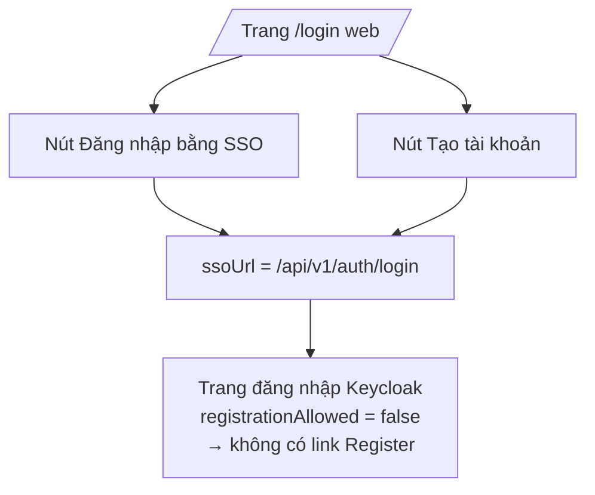

# FEAT-02 — Đăng ký tài khoản

> **Phiên bản:** 1.0 · **Trạng thái:** Final · **Cập nhật:** 2026-11-12 · **Phạm vi:** Ứng dụng (as-is)

| Thuộc tính | Giá trị |
| :--- | :--- |
| ID | FEAT-02 |
| Business Requirement | BR-02 |
| Trạng thái | 🟡 **Một phần** — Chỉ có API `POST /api/v1/auth/signup` ở auth-service (tạo user trên Keycloak + DB `authservice`). Không có UI đăng ký; nút "Tạo tài khoản" ở trang login chỉ dẫn tới trang đăng nhập Keycloak, còn realm import lại tắt tự đăng ký. |
| Actor | Guest (qua API), Hệ thống (auth-service, Keycloak Admin API) |
| Ứng dụng / Service | `services/auth-service`, Keycloak; `frontend/apps/web` (chỉ nút dẫn hướng) |
| Issue liên quan | ISSUE-01, ISSUE-08, ISSUE-17, ISSUE-28, ISSUE-29, ISSUE-53, ISSUE-55, ISSUE-71, ISSUE-101 |

## 1. Mô tả & mục tiêu nghiệp vụ

Cho phép người dùng mới tạo tài khoản để mua hàng. Trong code hiện tại, đăng ký được hiện thực **chỉ ở backend**:

- `POST /api/v1/auth/signup` nhận thông tin người dùng, kiểm tra trùng `username` / `email` / `phone` trong DB `authservice`, tạo user trên Keycloak bằng **Keycloak Admin REST API** (token admin lấy bằng password grant trên realm `master`), sau đó ghi bản ghi `users` + `user_role` trong transaction.
- Tài khoản được tạo với `emailVerified: true` và mật khẩu không tạm thời → đăng nhập SSO được ngay (nếu FEAT-01 hoạt động).
- Phía frontend **không có form đăng ký**. Trang `/login` của web có khối "Bạn sẽ được chuyển đến trang đăng ký của Keycloak" + nút "Tạo tài khoản", nhưng nút dùng **cùng `ssoUrl`** với nút đăng nhập (`frontend/apps/web/src/routes/login/+page.svelte:36-41`), không mở trang đăng ký; và realm `ecommerce` import có `registrationAllowed: false` → trang Keycloak không có link "Register".

Hệ quả: người dùng cuối không có đường tự đăng ký; mọi user muốn có phiên đầy đủ phải được tạo qua API này (để có bản ghi trong DB `authservice`, xem ISSUE-101).

## 2. User stories

| ID | Story |
| :--- | :--- |
| US-02.1 | Là **khách**, tôi muốn tạo tài khoản bằng username, email, mật khẩu để có thể đăng nhập và đặt hàng. *(Chỉ có API, chưa có UI.)* |
| US-02.2 | Là **khách**, tôi muốn nhận lỗi rõ ràng khi username/email/số điện thoại đã được dùng. |
| US-02.3 | Là **hệ thống**, tôi muốn mỗi user mới có role mặc định `USER` nếu không chỉ định. |
| US-02.4 | Là **khách** ở trang `/login`, tôi muốn bấm "Tạo tài khoản" để tới trang đăng ký Keycloak. *(Hiện dẫn tới trang đăng nhập; realm tắt đăng ký.)* |

## 3. Tiền điều kiện / Hậu điều kiện

**Tiền điều kiện**

- auth-service kết nối được Postgres DB `authservice` (nếu không, `ExistsBy*` trả `false` và `repo.Create` lỗi `db not connected`).
- Keycloak có tài khoản admin trên realm `KEYCLOAK_ADMIN_REALM` (mặc định `master`) với client `KEYCLOAK_ADMIN_CLIENT_ID` (mặc định `admin-cli`), thông tin đăng nhập qua `KEYCLOAK_ADMIN_USERNAME` / `KEYCLOAK_ADMIN_PASSWORD` (`services/auth-service/main.go:80-83`; mặc định trong code là giá trị dev — không ghi ở đây).

**Hậu điều kiện (thành công)**

- User được tạo trên Keycloak realm `ecommerce` (enabled, email verified, mật khẩu không tạm thời, `firstName`/`lastName` tách từ `fullName`).
- Bảng `users` có bản ghi với `keycloak_user_id`; bảng `user_role` có các role (mặc định `USER`).
- **Không** có sự kiện onboarding nào được phát (notification-service chờ `profile-onboarding-topic` nhưng không ai produce — ISSUE-17).

## 4. Luồng nghiệp vụ

### 4.1 Luồng chính — Đăng ký qua API

1. Client gọi `POST /api/v1/auth/signup` qua APISIX (route public `auth-public`, `deploy/apisix/apisix.yaml:63-70`) với JSON `RegisterRequest`.
2. `AuthHandler.Signup` (`services/auth-service/internal/handler/auth_handler.go:100-123`):
   - Decode JSON lỗi → `400 BAD_REQUEST "Invalid request body"`.
   - Thiếu `username`, `password` hoặc `email` (chuỗi rỗng) → `400 VALIDATION_FAILED "Username, password and email are required"`.
3. `UserService.Register` (`services/auth-service/internal/service/user_service.go:34-88`):
   1. `ExistsByUsername` → trùng → lỗi `username already exists: <u>`.
   2. `ExistsByEmail` → trùng → `email already exists: <e>`.
   3. Nếu `phone` khác rỗng: `ExistsByPhone` → trùng → `phone already exists: <p>`.
   4. `roles` rỗng → `["USER"]`.
   5. `KeycloakClient.CreateUser` (`services/auth-service/internal/service/keycloak_client.go:177-239`):
      - Lấy admin token (`FetchAdminAccessToken`, password grant, `:163-175`). **Lỗi → trả id giả `kc-<username>` và không tạo user Keycloak** (ISSUE-08).
      - POST `{KEYCLOAK_SERVER_URL}/admin/realms/{realm}/users` với `enabled`, `username`, `email`, `emailVerified: true`, `credentials[{type: password, value, temporary: false}]`, `firstName`/`lastName`.
      - Lỗi mạng → id giả `kc-<username>`; HTTP ≥ 400 (vd 409 user tồn tại trên Keycloak) → lỗi `failed to create keycloak user: ... (status N)`.
      - Lấy id từ header `Location` (phần tử cuối); không có header → `kc-<username>`.
      - Tham số `roles` **không** được gửi sang Keycloak.
   6. `repo.Create(user, roles)` (`services/auth-service/internal/repository/user_repository.go:217-270`): transaction insert `users` (RETURNING `user_id`), với mỗi role: `UPPER(TRIM(role))`, insert `user_role` chọn từ `roles` theo `role_name` (role không tồn tại → không insert gì, **không báo lỗi**), `ON CONFLICT DO NOTHING`; commit.
   7. Insert DB lỗi → **bù trừ**: `DeleteUser` trên Keycloak (lỗi bị bỏ qua) rồi trả lỗi.
4. Handler trả `200 {success:true, code:"OK", message:"User <username> registered successfully"}` (không trả dữ liệu user).

### 4.2 Luồng thay thế

- **A1 — Nút "Tạo tài khoản" trên web**: `/login` hiển thị `auth_registerSsoNote` + nút `auth_registerSsoBtn` với `href={data.ssoUrl}` — giống hệt nút đăng nhập → đi vào luồng FEAT-01. Không có tham số `kc_action=register` hay endpoint `/registrations`.
- **A2 — Chỉ định role**: client có thể gửi `roles: ["ADMIN"]` — API **public**, không xác thực → bất kỳ ai cũng tạo được user có role `ADMIN` trong DB `authservice` (ISSUE-53, ISSUE-01).
- **A3 — Keycloak không truy cập được**: user chỉ được tạo trong DB với `keycloak_user_id = kc-<username>`; trả 200 nhưng không đăng nhập được (ISSUE-08).

### 4.3 Luồng ngoại lệ

| Mã | Tình huống | HTTP | Body |
| :--- | :--- | :--- | :--- |
| E1 | Body không phải JSON | 400 | `code: BAD_REQUEST`, `message: Invalid request body` |
| E2 | Thiếu username/password/email | 400 | `code: VALIDATION_FAILED` |
| E3 | Trùng username / email / phone (DB) | 409 | `code: CONFLICT`, `message: "username already exists: x"` … |
| E4 | User đã tồn tại trên Keycloak nhưng không có trong DB | 400 | `code: REGISTRATION_FAILED`, `message: failed to create keycloak user: {...} (status 409)` |
| E5 | Vi phạm ràng buộc DB (vd `phone_number` > 11 ký tự, `email` > 50, `gender` NULL không xảy ra vì Go gửi `""`) | 400 | `REGISTRATION_FAILED` + thông báo lỗi pgx; user Keycloak bị xóa bù trừ |
| E6 | DB không kết nối | 400 | `REGISTRATION_FAILED "db not connected"` — nhưng **user Keycloak đã được tạo rồi bị xóa bù trừ** |

Mọi lỗi không phải conflict đều trả **400** (kể cả lỗi hạ tầng), không phải 5xx.

## 5. Sequence diagram

```mermaid
sequenceDiagram
    autonumber
    actor C as Client (API)
    participant G as APISIX
    participant H as AuthHandler.Signup
    participant S as UserService.Register
    participant R as UserRepository (authservice DB)
    participant K as Keycloak Admin API
    C->>G: POST /api/v1/auth/signup {username,password,email,...}
    G->>H: /auth/api/v1/auth/signup (public)
    H->>H: decode + kiểm tra 3 trường bắt buộc
    H->>S: Register(req)
    S->>R: ExistsByUsername / ExistsByEmail / ExistsByPhone
    alt Trùng
        S-->>H: ErrUsernameExists|ErrEmailExists|ErrPhoneExists
        H-->>C: 409 CONFLICT
    end
    S->>K: POST /realms/master/.../token (password grant admin)
    alt Không lấy được admin token
        S->>S: keycloakUserId = "kc-<username>" (không tạo trên Keycloak)
    else OK
        S->>K: POST /admin/realms/ecommerce/users
        K-->>S: 201 Location: .../users/{id} | 409/4xx
    end
    S->>R: BEGIN; INSERT users; INSERT user_role (USER mặc định); COMMIT
    alt Lỗi DB
        S->>K: DELETE /admin/realms/ecommerce/users/{id} (best-effort)
        H-->>C: 400 REGISTRATION_FAILED
    else OK
        H-->>C: 200 "User <u> registered successfully"
    end
```



## 6. Màn hình & route (UI)

Chưa có UI đăng ký. Thành phần liên quan duy nhất: khối cuối card trong `frontend/apps/web/src/routes/login/+page.svelte:36-41` (ghi chú + nút "Tạo tài khoản" trỏ tới `ssoUrl`). Admin không có liên kết đăng ký.

## 7. API sử dụng

| Method & path (gateway) | Path trong service | Auth | Request | Response |
| :--- | :--- | :--- | :--- | :--- |
| `POST /api/v1/auth/signup` | `/auth/api/v1/auth/signup` (cũng đăng ký `/api/v1/auth/signup`, `auth_handler.go:45-47,65`) | **Public** | `RegisterRequest` (bên dưới) | `200 ApiResponse{message}`; 400; 409 |

`RegisterRequest` (`services/auth-service/internal/model/user.go:25-34`):

```json
{
  "fullName": "Nguyen Van A",
  "username": "nguyenvana",
  "password": "********",
  "email": "a@example.com",
  "gender": "MALE",
  "phone": "0901234567",
  "avatar": "https://...",
  "roles": ["USER"]
}
```

Keycloak Admin API dùng bởi service: `POST {server}/realms/{adminRealm}/protocol/openid-connect/token`, `POST {server}/admin/realms/{realm}/users`, `DELETE {server}/admin/realms/{realm}/users/{id}` (`keycloak_client.go:93-99,177-260`).

Frontend `packages/lib` **không** có hàm gọi signup.

## 8. Dữ liệu

Bảng (tạo bởi `InitSchema`, `user_repository.go:31-66`):

| Bảng | Cột | Ràng buộc |
| :--- | :--- | :--- |
| `users` | `user_id` BIGINT identity PK; `full_name` VARCHAR(100); `user_name` VARCHAR(100) NOT NULL UNIQUE; `email` VARCHAR(50) NOT NULL UNIQUE; `gender` VARCHAR(255) NOT NULL; `phone_number` VARCHAR(11) UNIQUE; `image_url` TEXT; `keycloak_user_id` VARCHAR(64) UNIQUE | |
| `roles` | `id` BIGINT identity PK; `role_name` VARCHAR(60) UNIQUE | Seed: 1 `USER`, 2 `PM`, 3 `ADMIN` |
| `user_role` | `user_id`, `role_id` PK kép, FK `ON DELETE CASCADE` | |

Lưu ý: role DB (`USER`, `PM`, `ADMIN`) khác role realm Keycloak (`USER`, `ADMIN`, `MANAGER`).

## 9. Business rules & validation

| ID | Quy tắc | Nguồn |
| :--- | :--- | :--- |
| BR-02.1 | `username`, `password`, `email` bắt buộc (khác chuỗi rỗng). Không kiểm tra định dạng email, độ dài/độ mạnh mật khẩu, ký tự username. | `auth_handler.go:107-110` |
| BR-02.2 | `username` và `email` duy nhất (kiểm ở service + UNIQUE DB). Phân biệt hoa/thường theo Postgres mặc định. | `user_service.go:35-49` |
| BR-02.3 | `phone` duy nhất nếu được cung cấp; tối đa 11 ký tự (giới hạn cột). Chuỗi rỗng vẫn được ghi `''` → UNIQUE có thể xung đột giữa nhiều user không có phone **(chuỗi rỗng không phải NULL)**. | `user_service.go:51-59`; `user_repository.go:47,235` |
| BR-02.4 | Role mặc định `USER`; tên role chuẩn hóa `UPPER(TRIM())`; role không tồn tại bị bỏ qua im lặng. | `user_service.go:61-64`; `user_repository.go:246-263` |
| BR-02.5 | `fullName` tách: nhiều từ → `firstName` = các từ trừ từ cuối, `lastName` = từ cuối; một từ → cả hai bằng từ đó. | `keycloak_client.go:198-208` |
| BR-02.6 | Email được đánh dấu verified, không gửi email xác minh. | `keycloak_client.go:188` |
| BR-02.7 | Ghi DB thất bại → xóa user Keycloak (bù trừ best-effort). | `user_service.go:81-85` |

Ghi chú BR-02.3: vì `phone` rỗng được insert thành `''` (không phải NULL) và cột có `UNIQUE`, user thứ hai đăng ký không có số điện thoại sẽ vi phạm unique → `400 REGISTRATION_FAILED` (kiểm `ExistsByPhone` bị bỏ qua vì phone rỗng). Đây là hệ quả trực tiếp của code (ISSUE-55).

## 10. Xử lý lỗi

Envelope `ApiResponse` (`services/shared/response/api_response.go:55-65`) với `success:false`, `code`, `message`, `path`, `traceId`, `timestamp`. Phân loại mã: chỉ `ErrUsernameExists`/`ErrEmailExists`/`ErrPhoneExists` → 409; mọi lỗi khác → 400 `REGISTRATION_FAILED` với `err.Error()` thô (có thể lộ thông điệp Keycloak/pgx).

## 11. i18n (key chính)

Không có UI đăng ký. Key liên quan ở web: `auth_registerSsoNote` ("Bạn sẽ được chuyển đến trang đăng ký của Keycloak" / "You'll be redirected to the Keycloak sign-up page"), `auth_registerSsoBtn` ("Tạo tài khoản" / "Create an account") — nội dung hứa hẹn trang đăng ký nhưng hành vi thực là trang đăng nhập.

## 12. Acceptance criteria (Given / When / Then — theo hành vi hiện tại)

| # | Given | When | Then |
| :--- | :--- | :--- | :--- |
| AC-02.1 | Body `{}` | `POST /api/v1/auth/signup` | 400, `success:false`, `code: VALIDATION_FAILED` (test `TestSignupValidation`). |
| AC-02.2 | Body không phải JSON | POST | 400 `BAD_REQUEST "Invalid request body"`. |
| AC-02.3 | DB + Keycloak sẵn sàng, username/email chưa tồn tại, không có `roles` | POST hợp lệ | 200 `"User <u> registered successfully"`; Keycloak có user enabled, emailVerified; DB có `users` + `user_role(USER)`. |
| AC-02.4 | `username` đã có trong DB | POST | 409 `CONFLICT`, message `username already exists: <u>`. |
| AC-02.5 | `email` đã có trong DB | POST | 409 `email already exists: <e>`. |
| AC-02.6 | Keycloak đã có user cùng username (không có trong DB) | POST | 400 `REGISTRATION_FAILED` chứa `status 409`. |
| AC-02.7 | Keycloak không lấy được admin token | POST hợp lệ | 200; DB có user với `keycloak_user_id = kc-<username>`; user không đăng nhập được. |
| AC-02.8 | Body có `roles:["ADMIN"]`, không có token | POST qua gateway | 200; DB có `user_role(ADMIN)` (route public). |
| AC-02.9 | Khách ở `/login` | Bấm "Tạo tài khoản" | Được chuyển tới cùng URL SSO login như nút đăng nhập; trang Keycloak không có liên kết đăng ký. |

## 13. Giới hạn & vấn đề đã biết

| Issue | Ảnh hưởng |
| :--- | :--- |
| ISSUE-01 (Critical) | Không kiểm role; signup public cho phép tự gán `roles: ["ADMIN"]` vào DB `authservice` (role này hiện chưa được dùng bởi frontend do ISSUE-100, nhưng sẽ có hiệu lực ngay khi ISSUE-100 được sửa). |
| ISSUE-08 (High) | Id giả `kc-<username>` khi Keycloak không truy cập được; `roles` không đẩy sang Keycloak. |
| ISSUE-17 (High) | Không phát sự kiện onboarding → không có email chào mừng. |
| ISSUE-28 (High) | Schema tạo lúc khởi động, không migration. |
| ISSUE-29 (Low) | Envelope `ApiResponse` khác các service khác. |
| ISSUE-71 (High) | Không có UI/đường tự đăng ký cho người dùng cuối (nút "Tạo tài khoản" = URL login; realm `registrationAllowed: false`) |
| ISSUE-53 (Medium) | Signup public chấp nhận `roles` do client gửi → tự gán `ADMIN`. |
| ISSUE-55 (Medium) | `phone` rỗng ghi `''` vào cột `UNIQUE` → chỉ một user được phép không có số điện thoại. |
| ISSUE-101 (High) | User tạo trực tiếp trên Keycloak (không qua API này) không có bản ghi DB → không có phiên đầy đủ. |

Khác: không validate định dạng email/độ mạnh mật khẩu; không có captcha / rate limit riêng (chỉ limit-count toàn cục 1200 req/60 s theo IP, `deploy/apisix/apisix.yaml:55-61`).

## 14. Test hiện có

- `services/auth-service/main_test.go:80-90` — `TestSignupValidation`: body `{}` → 400, `success:false`.
- Không có test cho đường thành công, conflict, bù trừ Keycloak (repo `nil`, Keycloak không chạy) — ISSUE-46.

## 15. Tham chiếu source

- `services/auth-service/internal/handler/auth_handler.go:64-71,100-123`
- `services/auth-service/internal/service/user_service.go:13-20,34-88`
- `services/auth-service/internal/service/keycloak_client.go:93-99,163-260`
- `services/auth-service/internal/repository/user_repository.go:31-66,217-270,393-433`
- `services/auth-service/internal/model/user.go:25-34`
- `services/auth-service/main.go:74-87`
- `frontend/apps/web/src/routes/login/+page.svelte:36-41`
- `deploy/apisix/apisix.yaml:63-70`
- `deploy/keycloak/import/ecommerce-realm.json` (`registrationAllowed: false`)
