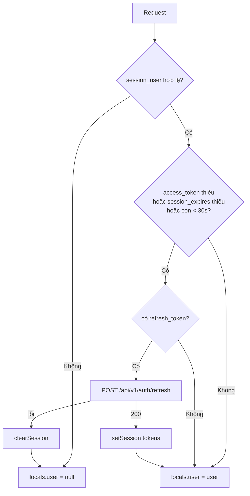

# FEAT-03 — Duy trì & làm mới phiên

> **Phiên bản:** 1.0 · **Trạng thái:** Final · **Cập nhật:** 2026-11-12 · **Phạm vi:** Ứng dụng (as-is)

| Thuộc tính | Giá trị |
| :--- | :--- |
| ID | FEAT-03 |
| Business Requirement | BR-03 |
| Trạng thái | 🟡 **Một phần** *(registry ban đầu: ✅)* — Cơ chế refresh token trong hook `handleSession` (web + admin) và `POST /api/v1/auth/refresh` hoạt động; nhưng cookie `session_user` không được gia hạn khi refresh nên phiên vẫn kết thúc sau một khoảng cố định tính từ lúc đăng nhập (ISSUE-69), và chỉ có tác dụng khi FEAT-01 tạo được `session_user` (ISSUE-67, ISSUE-100, ISSUE-101). |
| Actor | Hệ thống (SvelteKit server hook), Customer, Admin |
| Ứng dụng / Service | `frontend/apps/web`, `frontend/apps/admin`, `frontend/packages/lib/src/server/session.ts`, `services/auth-service`, Keycloak |
| Issue liên quan | ISSUE-06, ISSUE-11, ISSUE-66, ISSUE-67, ISSUE-69, ISSUE-100, ISSUE-101 |

## 1. Mô tả & mục tiêu nghiệp vụ

Giữ người dùng đăng nhập liên tục mà không phải quay lại Keycloak khi access token (thời hạn ngắn) hết hạn. Mỗi request tới SvelteKit server (trang, `load`, remote function) đi qua hook `handleSession`:

1. Đọc identity từ cookie `session_user`.
2. Nếu có identity và access token "sắp hết hạn" (`shouldRefresh`) → gọi `POST /api/v1/auth/refresh` với refresh token từ cookie, ghi lại cookie token mới.
3. Refresh thất bại → xóa toàn bộ phiên (không tự động chuyển về SSO).
4. Gán `event.locals.user` cho các route.

Token không bao giờ tới JavaScript phía client (cookie httpOnly).

## 2. User stories

| ID | Story |
| :--- | :--- |
| US-03.1 | Là **khách hàng đã đăng nhập**, tôi muốn tiếp tục mua sắm/đặt hàng khi access token hết hạn mà không bị yêu cầu đăng nhập lại. |
| US-03.2 | Là **hệ thống**, tôi muốn khi refresh token không còn hợp lệ thì phiên bị xóa sạch để người dùng được coi là khách. |
| US-03.3 | Là **quản trị viên**, tôi muốn phiên backoffice được làm mới tương tự storefront và bị đưa về `/login` khi phiên hết hạn. |

## 3. Tiền điều kiện / Hậu điều kiện

**Tiền điều kiện**: đã có phiên từ FEAT-01 (cookie `session_user` + `refresh_token`); Keycloak và auth-service truy cập được qua `API_INTERNAL_URL`.

**Hậu điều kiện**

- Refresh thành công: `access_token`, `refresh_token`, `session_expires` được ghi lại với maxAge mới; `session_user` **giữ nguyên** (không ghi lại → không gia hạn maxAge).
- Refresh thất bại: 4 cookie bị xóa; `locals.user = null`.

## 4. Luồng nghiệp vụ

### 4.1 Luồng chính

1. Request tới SvelteKit; `handle = sequence(handleParaglide, handleSession)` (web, `frontend/apps/web/src/hooks.server.ts:53`) hoặc thêm `handleAdminGuard` (admin, `frontend/apps/admin/src/hooks.server.ts:79`).
2. `session(cookies)` (`frontend/packages/lib/src/server/session.ts:70-80`): đọc `session_user`, `JSON.parse`; trả `null` nếu thiếu, JSON lỗi, hoặc `username` không phải string.
3. Nếu `current` khác null và `shouldRefresh(cookies)` (`session.ts:87-91`) đúng:
   - `shouldRefresh` = **true** khi không có cookie `access_token`, hoặc `session_expires` thiếu/0, hoặc còn **< 30 giây** tới hạn.
4. Lấy `refresh_token`; nếu có → `createApi().auth.refresh(token)` = `POST {API_INTERNAL_URL}/api/v1/auth/refresh` body `{"refreshToken": "..."}` không bearer (`frontend/packages/lib/src/server/api.ts:156`).
5. APISIX route `auth-public` (`deploy/apisix/apisix.yaml:63-70`) → auth-service `Refresh` (`services/auth-service/internal/handler/auth_handler.go:185-199`) → `KeycloakClient.RefreshToken` POST form `grant_type=refresh_token`, `client_id`, `client_secret` (nếu cấu hình), `refresh_token` (`services/auth-service/internal/service/keycloak_client.go:124-134`).
6. Trả `200 ApiResponse{data: KeycloakTokenResponse}`; BFF bóc `data`.
7. `setSession(cookies, tokens)` (không truyền `user`) (`session.ts:32-49`):
   - `access_token` maxAge = `expires_in` (≤0 → 300 s).
   - `refresh_token` maxAge = `refresh_expires_in` (≤0 → 1800 s).
   - `session_expires` = now + accessMaxAge, maxAge = refreshMaxAge.
   - `session_user` không đổi.
8. `current = session(cookies)` (đọc lại), `event.locals.user = current?.user ?? null`, `resolve(event)`.

### 4.2 Luồng thay thế

- **A1 — Token còn hạn (≥ 30 s)**: bỏ qua refresh, chỉ set `locals.user`.
- **A2 — Có `session_user` nhưng không còn cookie `refresh_token`**: không refresh, không xóa phiên; `locals.user` vẫn được set (trang hiển thị như đã đăng nhập) nhưng các lời gọi API dùng `accessToken(cookies)` = `null` → gateway trả 401 cho route bảo vệ (vd `/api/orders`). Trường hợp này xảy ra sau khi refresh trước đó ghi `refresh_token` với maxAge ngắn hơn `session_user` hoặc khi cookie bị xóa thủ công.
- **A3 — Không có `session_user`** (khách, hoặc ISSUE-67): không refresh dù có token cookie. Lưu ý `api()` của web vẫn gắn `access_token` còn lại (nếu có) vào request (`frontend/apps/web/src/lib/server/api.ts:10-13`).
- **A4 — Admin**: sau `handleSession`, `handleAdminGuard` dùng `locals.user` để quyết định redirect `/login` hoặc `/access-denied`.

### 4.3 Luồng ngoại lệ

| Mã | Tình huống | Hành vi |
| :--- | :--- | :--- |
| E1 | Keycloak từ chối refresh (hết hạn, đã logout, session bị thu hồi) | auth-service `401 UNAUTHORIZED` với message lỗi Keycloak → BFF bắt exception → `clearSession` → `locals.user = null`. Không redirect; route cần đăng nhập (checkout/orders) tự redirect `/login` ở `load`. |
| E2 | Body refresh rỗng / thiếu `refreshToken` | `400 BAD_REQUEST "Refresh token is required"` (không xảy ra từ BFF vì chỉ gọi khi có token). |
| E3 | Gateway/auth-service down | Exception → `clearSession` → người dùng bị đăng xuất. |
| E4 | `session_user` hết hạn (maxAge = `refresh_expires_in` lúc **đăng nhập**) trong khi `refresh_token` đã được gia hạn | `session()` → null → `locals.user = null` → người dùng bị coi là khách; các cookie token còn lại không bị dọn (ISSUE-69). |
| E5 | Nhiều request song song cùng thấy cần refresh | Mỗi request gọi refresh riêng; không khóa/đồng bộ. Hoạt động nếu Keycloak không bật "revoke refresh token" (realm import không bật). |

## 5. Sequence diagram

```mermaid
sequenceDiagram
    autonumber
    actor U as Browser
    participant H as SvelteKit handleSession
    participant G as APISIX
    participant A as auth-service
    participant K as Keycloak
    U->>H: Request (cookies)
    H->>H: current = session(cookies)
    alt current != null && shouldRefresh
        H->>H: token = refresh_token cookie
        opt token tồn tại
            H->>G: POST /api/v1/auth/refresh {refreshToken}
            G->>A: /auth/api/v1/auth/refresh (public)
            A->>K: POST /token grant_type=refresh_token
            alt OK
                K-->>A: tokens mới
                A-->>H: 200 {data: tokens}
                H->>H: setSession(tokens) (session_user giữ nguyên)
            else Lỗi
                K-->>A: 400/401
                A-->>H: 401 UNAUTHORIZED
                H->>H: clearSession; current = null
            end
        end
    end
    H->>H: locals.user = current?.user ?? null
    H-->>U: resolve(event) (Set-Cookie nếu có)
```



## 6. Màn hình & route (UI)

Không có màn hình riêng — chạy trong hook server cho mọi route. Ảnh hưởng hiển thị: header web (`frontend/apps/web/src/lib/components/header.svelte:101-138`), guard của `/checkout`, `/orders` (web) và mọi route admin.

## 7. API sử dụng

| Method & path (gateway) | Route | Auth | Handler | Request | Response |
| :--- | :--- | :--- | :--- | :--- | :--- |
| `POST /api/v1/auth/refresh` | `auth-public` | Public | `Refresh` (`auth_handler.go:185-199`) | `{"refreshToken": string}` | `200 {success:true, code:"OK", data:{access_token, refresh_token, token_type, expires_in, refresh_expires_in, scope}}`; `400 BAD_REQUEST`; `401 UNAUTHORIZED` (message = lỗi Keycloak thô) |

## 8. Dữ liệu

Cookie (`session.ts:4-11`): `access_token`, `refresh_token`, `session_expires`, `session_user` — thuộc tính `httpOnly`, `sameSite: 'lax'`, `path: '/'`, không `secure` (ISSUE-11). Hằng: `ACCESS_FALLBACK_SECONDS = 300`, `REFRESH_FALLBACK_SECONDS = 1800`, ngưỡng refresh 30 s.

Thời hạn token do realm Keycloak quyết định; realm import không đặt `accessTokenLifespan` / `ssoSessionIdleTimeout` → dùng mặc định Keycloak.

## 9. Business rules & validation

| ID | Quy tắc | Nguồn |
| :--- | :--- | :--- |
| BR-03.1 | Chỉ refresh khi có identity (`session_user`). | `hooks.server.ts:35` (web), `:35` (admin) |
| BR-03.2 | Refresh khi access token thiếu, không biết hạn, hoặc còn < 30 s. | `session.ts:87-91` |
| BR-03.3 | Refresh lỗi → xóa toàn bộ phiên, không redirect SSO. | `hooks.server.ts:42-45` |
| BR-03.4 | Refresh không đổi identity (`session_user` giữ nguyên). | `session.ts:27-31,44-48` |
| BR-03.5 | maxAge `session_expires` = maxAge refresh token. | `session.ts:39-42` |

## 10. Xử lý lỗi

Mọi exception từ `auth.refresh` bị bắt chung (`catch {}`), không log. Không phân biệt lỗi tạm thời (mạng) và lỗi vĩnh viễn (token bị thu hồi) → sự cố mạng ngắn cũng làm người dùng bị đăng xuất.

## 11. i18n (key chính)

Không áp dụng — không có thông điệp UI riêng.

## 12. Acceptance criteria (Given / When / Then — theo hành vi hiện tại)

| # | Given | When | Then |
| :--- | :--- | :--- | :--- |
| AC-03.1 | `session_user` hợp lệ, `session_expires` còn 10 phút | Request bất kỳ | Không gọi refresh; `locals.user` = user. |
| AC-03.2 | `session_user` hợp lệ, `session_expires` còn 20 giây, có `refresh_token` | Request | Gọi `POST /api/v1/auth/refresh`; cookie `access_token`, `refresh_token`, `session_expires` được ghi mới; `session_user` không bị ghi lại. |
| AC-03.3 | `session_user` hợp lệ, cookie `access_token` đã hết hạn (bị trình duyệt xóa), có `refresh_token` | Request | Refresh được gọi (`shouldRefresh` = true khi thiếu access token). |
| AC-03.4 | Refresh trả 401 | Request | 4 cookie bị xóa; `locals.user = null`; header hiển thị "Đăng nhập". |
| AC-03.5 | Không có `session_user` nhưng có `refresh_token` | Request | Không refresh; `locals.user = null`. |
| AC-03.6 | `session_user` hợp lệ, không có `refresh_token`, access token hết hạn | Request | Không refresh, không xóa; `locals.user` vẫn có giá trị. |
| AC-03.7 | Đăng nhập lúc T với `refresh_expires_in = R`, người dùng hoạt động liên tục | Thời điểm T + R | `session_user` hết hạn → người dùng thành khách dù refresh token còn hạn (ISSUE-69). |
| AC-03.8 | `session_user` chứa JSON hỏng | Request | `session()` = null → khách. |

## 13. Giới hạn & vấn đề đã biết

| Issue | Ảnh hưởng |
| :--- | :--- |
| ISSUE-06 | Store ticket in-memory chỉ ảnh hưởng đăng nhập; refresh gọi thẳng Keycloak nên không phụ thuộc. |
| ISSUE-11 | Cookie không `secure`; web và admin cùng host dùng chung cookie → refresh ở app này ảnh hưởng app kia. |
| ISSUE-67 / ISSUE-100 / ISSUE-101 | Không có `session_user` (hoặc `roles` rỗng) từ FEAT-01 → refresh không bao giờ chạy / admin bị từ chối. |
| ISSUE-66 (High) | Cookie `session_user` là JSON không ký (kể cả `roles`) và được tin làm identity — chỉnh cookie là đổi được danh tính/role hiển thị ở BFF. |
| ISSUE-69 (Medium) | `session_user` không được gia hạn khi refresh; cookie token mồ côi không bị dọn khi `session_user` hết hạn; A2 có thể để `locals.user` tồn tại mà không có token. |

## 14. Test hiện có

- `frontend/packages/lib/src/server/session.test.ts:96-149` — `setSession`: ghi token/expiry/profile; giữ profile khi `user` omitted; xóa profile khi `null`; fallback maxAge.
- `session.test.ts:183-205` — `shouldRefresh`: thiếu access token, trong ngưỡng 30 s, thiếu expiry, còn hạn.
- `frontend/packages/lib/src/server/api.test.ts` — envelope, bearer.
- Không có test cho `handleSession` (hook) hay `Refresh` handler của auth-service (ISSUE-46).

## 15. Tham chiếu source

- `frontend/apps/web/src/hooks.server.ts:27-53`
- `frontend/apps/admin/src/hooks.server.ts:32-51,79`
- `frontend/packages/lib/src/server/session.ts:4-11,32-55,70-91`
- `frontend/packages/lib/src/server/api.ts:39-76,153-159`
- `services/auth-service/internal/handler/auth_handler.go:185-199`
- `services/auth-service/internal/service/keycloak_client.go:124-134,262-289`
- `deploy/apisix/apisix.yaml:63-70`
