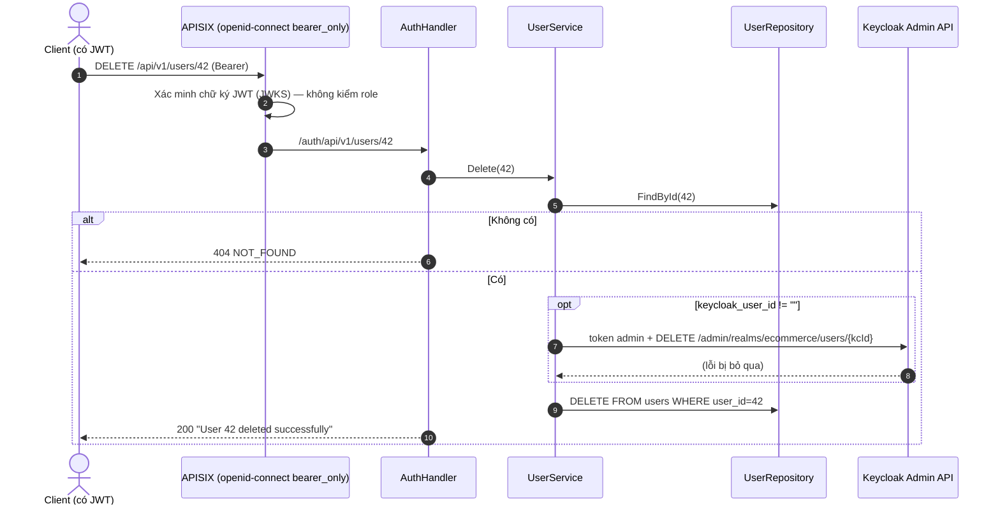
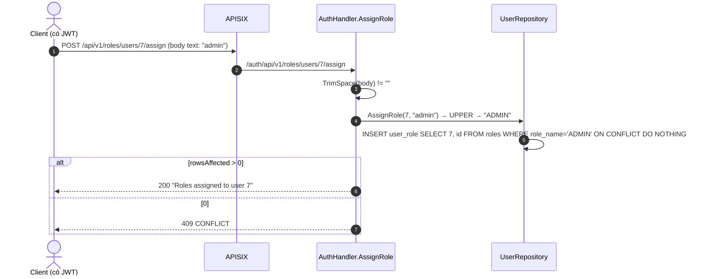
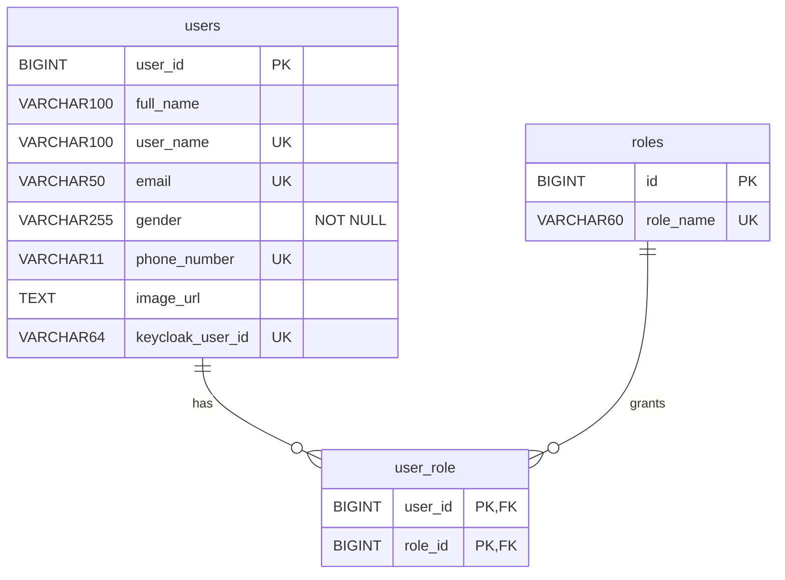

# FEAT-04 — Quản lý người dùng & vai trò (API)

> **Phiên bản:** 1.0 · **Trạng thái:** Final · **Cập nhật:** 2026-11-12 · **Phạm vi:** Ứng dụng (as-is)

| Thuộc tính | Giá trị |
| :--- | :--- |
| ID | FEAT-04 |
| Business Requirement | BR-04 |
| Trạng thái | 🟡 **Một phần** — auth-service có đủ API CRUD user (trừ tạo, xem FEAT-02), phân trang, gán/thu hồi role trên DB `authservice`; không có UI (module Users của admin là placeholder — FEAT-26), không kiểm tra role (ISSUE-01), đổi mật khẩu là stub (ISSUE-07), role không đồng bộ Keycloak (ISSUE-08). |
| Actor | Admin (dự kiến), thực tế: bất kỳ user có JWT hợp lệ |
| Ứng dụng / Service | `services/auth-service`; APISIX routes `auth-users`, `auth-roles` |
| Issue liên quan | ISSUE-01, ISSUE-02, ISSUE-07, ISSUE-08, ISSUE-28, ISSUE-29, ISSUE-100, ISSUE-101 |

## 1. Mô tả & mục tiêu nghiệp vụ

Cung cấp API để tra cứu, cập nhật, xóa người dùng và quản lý vai trò (`USER`, `PM`, `ADMIN`) lưu trong DB `authservice`. Đây là nguồn dữ liệu profile mà frontend dùng để dựng phiên (`GET /users/me`, FEAT-01). Chưa có giao diện quản trị gọi các API này (`frontend/apps/admin/src/routes/users/+page.svelte` là placeholder).

## 2. User stories

| ID | Story |
| :--- | :--- |
| US-04.1 | Là **người dùng đã đăng nhập**, tôi muốn lấy profile của mình (`/users/me`). |
| US-04.2 | Là **quản trị viên**, tôi muốn xem danh sách người dùng có phân trang & sắp xếp. |
| US-04.3 | Là **quản trị viên**, tôi muốn xem/cập nhật/xóa một người dùng theo id hoặc tìm theo username. |
| US-04.4 | Là **quản trị viên**, tôi muốn gán/thu hồi role và xem danh sách role của một người dùng. |
| US-04.5 | Là **người dùng**, tôi muốn đổi mật khẩu. *(Stub — không có hiệu lực.)* |

## 3. Tiền điều kiện / Hậu điều kiện

**Tiền điều kiện**: gọi qua APISIX với header `Authorization: Bearer <JWT Keycloak hợp lệ>` (route `auth-users`, `auth-roles` có `openid-connect bearer_only`, `deploy/apisix/apisix.yaml:142-177`). Không yêu cầu role. DB `authservice` khả dụng (nếu không, đa số endpoint trả 500 `db not connected`).

**Hậu điều kiện**: thay đổi chỉ áp dụng cho DB `authservice` (và xóa user trên Keycloak khi `DELETE`). Role Keycloak (thứ có trong JWT) **không** thay đổi.

## 4. Luồng nghiệp vụ

### 4.1 Luồng chính

**Lấy profile hiện tại** — `GET /api/v1/users/me` (`services/auth-service/internal/handler/auth_handler.go:318-339`): lấy `preferred_username` (fallback `sub`) từ JWT qua middleware `UserClaims` (parse **không xác minh chữ ký**, `services/shared/middleware/middleware.go:44-69`) → `FindByUsername` → `UserResponse`.

**Danh sách phân trang** — `GET /api/v1/users/all?page&size&sortBy&sortOrder` (`auth_handler.go:303-316`): mặc định `page=0`, `size=10`, `sortBy=id`, `sortOrder=ASC`; service ép `size<=0 → 10`, `page<0 → 0` (`services/auth-service/internal/service/user_service.go:139-173`); repository map `sortBy` ∈ {`username`/`user_name` → `user_name`, `email`, `fullname`/`full_name` → `full_name`, khác → `user_id`}, `sortOrder` chỉ `DESC` hoặc `ASC` (`services/auth-service/internal/repository/user_repository.go:167-215`). Trả `PageResponse` (`content`, `totalElements`, `totalPages`, `size`, `number`, `numberOfElements`, `first`, `last`, `empty`).

**Chi tiết / tìm** — `GET /api/v1/users/{id}` (`:283-301`), `GET /api/v1/users?username=` (`:263-281`).

**Cập nhật** — `PUT /api/v1/users/{id}` (`:214-238`) body `UpdateUserRequest` (mọi trường là con trỏ, chỉ trường gửi lên được ghi đè) → `repo.Update` đọc bản ghi, merge, `UPDATE users SET full_name, email, gender, phone_number, image_url` (`user_repository.go:272-317`). Không đồng bộ sang Keycloak.

**Xóa** — `DELETE /api/v1/users/{id}` (`:244-261`) → `FindById`; nếu có `keycloak_user_id` → `KeycloakClient.DeleteUser` (lỗi bị bỏ qua, `keycloak_client.go:241-260`) → `DELETE FROM users` (cascade `user_role`).

**Gán role** — `POST /api/v1/roles/users/{userId}/assign` body **text thuần** là tên role (`:345-370`) → `UPPER(TRIM)` → `INSERT INTO user_role SELECT userId, id FROM roles WHERE role_name = ? ON CONFLICT DO NOTHING` (`user_repository.go:331-354`).

**Thu hồi role** — `POST /api/v1/roles/users/{userId}/revoke` (`:372-397`) → `DELETE FROM user_role WHERE user_id = ? AND role_id IN (SELECT id FROM roles WHERE role_name = ?)` (`user_repository.go:356-377`).

**Xem role** — `GET /api/v1/roles/users/{userId}` (`:399-413`) → mảng tên role sắp theo `roles.id` (`user_repository.go:379-391`).

**Đổi mật khẩu** — `PUT /api/v1/users/me/password` (`:240-242`): **luôn** `200 "Password change request processed"`, không đọc body, không làm gì (ISSUE-07).

### 4.2 Luồng thay thế

- `GET /users/me` khi token không có `preferred_username` → dùng `sub` làm username (gần như chắc chắn 404).
- Các path cũng đăng ký với prefix `/auth/api/v1/...` (dùng bởi gateway rewrite) và `/api/v1/...` (gọi trực tiếp) (`auth_handler.go:45-57`).

### 4.3 Luồng ngoại lệ

| Tình huống | HTTP | `code` |
| :--- | :--- | :--- |
| `{id}`/`{userId}` không phải số | 400 | `INVALID_ID` "User ID must be numeric" |
| Body JSON lỗi (PUT user) | 400 | `BAD_REQUEST` |
| `username` query rỗng | 400 | `BAD_REQUEST` "username query parameter is required" |
| User không tồn tại (get/update/delete/me) | 404 | `NOT_FOUND` "User not found" |
| Không có claim username/sub (`/me`) | 401 | `AUTH_TOKEN_INVALID` |
| Body role rỗng | 400 | `BAD_REQUEST` "Role name cannot be empty" |
| Assign: role đã có, **role không tồn tại, hoặc user không tồn tại** | 409 | `CONFLICT` "Role already assigned or user/role not found" — trường hợp user không tồn tại: insert vi phạm FK → thực tế trả **500** `INTERNAL_ERROR` |
| Revoke: user không có role | 409 | `CONFLICT` "Role not present on user" |
| Lỗi DB (kể cả `db not connected`), trùng email khi update | 500 | `INTERNAL_ERROR` + thông điệp lỗi thô |
| JWT thiếu/không hợp lệ tại gateway | 401 | (do APISIX trả) |

`GET /roles/users/{userId}` với user không tồn tại hoặc không có role → `200` **không có trường `data`** (slice rỗng bị bỏ do tag `omitempty` của `ApiResponse.Data`).

## 5. Sequence diagram

## 6. Màn hình & route (UI)

Chưa có UI. Admin `/users` là placeholder (FEAT-26). Frontend chỉ dùng `GET /api/v1/users/me` trong callback đăng nhập (`frontend/packages/lib/src/server/api.ts:158`).

## 7. API sử dụng

Tất cả qua gateway yêu cầu Bearer JWT; envelope `ApiResponse`.

| Method | Path (gateway) | Mô tả | Request | Response `data` |
| :--- | :--- | :--- | :--- | :--- |
| GET | `/api/v1/users/me` | Profile hiện tại | — | `UserResponse` |
| PUT | `/api/v1/users/me/password` | Stub | (bỏ qua) | — (message) |
| GET | `/api/v1/users/all` | Phân trang | `page`, `size`, `sortBy`, `sortOrder` | `PageResponse<UserResponse>` |
| GET | `/api/v1/users/{id}` | Theo id | — | `UserResponse` |
| GET | `/api/v1/users?username=` | Theo username | — | `UserResponse` |
| PUT | `/api/v1/users/{id}` | Cập nhật | `{fullName?, email?, gender?, phone?, avatar?}` | `UserResponse`, message "User updated successfully" |
| DELETE | `/api/v1/users/{id}` | Xóa (DB + Keycloak) | — | message |
| POST | `/api/v1/roles/users/{userId}/assign` | Gán role | text/plain tên role | message |
| POST | `/api/v1/roles/users/{userId}/revoke` | Thu hồi role | text/plain | message |
| GET | `/api/v1/roles/users/{userId}` | Danh sách role | — | `string[]` |

`UserResponse` (`services/auth-service/internal/model/user.go:15-23`): `{id, fullname, username, email, gender, phone, avatar}` — **không có `roles`**, key `fullname` chữ thường (ISSUE-100). Lưu ý request dùng `fullName` (camelCase) còn response dùng `fullname`.

## 8. Dữ liệu

Seed role: `1 USER`, `2 PM`, `3 ADMIN` (`user_repository.go:60-62`). Realm Keycloak có `USER`, `ADMIN`, `MANAGER` — hai tập role độc lập.

## 9. Business rules & validation

| ID | Quy tắc | Nguồn |
| :--- | :--- | :--- |
| BR-04.1 | Id phải parse được `int64`. | handler |
| BR-04.2 | Cập nhật một phần (partial) theo con trỏ; không validate định dạng email/phone; ràng buộc độ dài do DB. | `user_repository.go:285-299` |
| BR-04.3 | Tên role không phân biệt hoa thường (`UPPER`), phải có trong bảng `roles`. | `user_repository.go:335,360` |
| BR-04.4 | `size` ≤ 0 → 10; không có giới hạn trên của `size`. | `user_service.go:140-145` |
| BR-04.5 | Xóa user cố gắng xóa trên Keycloak trước, bỏ qua lỗi. | `user_service.go:101-115` |
| BR-04.6 | Không có kiểm tra quyền: mọi JWT hợp lệ đều gọi được mọi endpoint (kể cả xóa user khác, tự gán ADMIN). | ISSUE-01 |

## 10. Xử lý lỗi

Envelope `ApiResponse` (`services/shared/response/api_response.go`). Lỗi không phân loại trả 500 với `err.Error()` (có thể lộ chi tiết SQL). `traceId` lấy từ `X-Correlation-Id`.

## 11. i18n (key chính)

Chưa có UI.

## 12. Acceptance criteria (Given / When / Then — theo hành vi hiện tại)

| # | Given | When | Then |
| :--- | :--- | :--- | :--- |
| AC-04.1 | JWT có `preferred_username = alice`, DB có `alice` | `GET /api/v1/users/me` | 200, `data` có `fullname`, không có `roles`. |
| AC-04.2 | JWT hợp lệ, user không có trong DB | `GET /users/me` | 404 `NOT_FOUND`. |
| AC-04.3 | 25 user | `GET /users/all?page=1&size=10&sortBy=email&sortOrder=desc` | 200; `content` 10 phần tử sắp email giảm dần; `totalPages=3`, `first=false`, `last=false`. |
| AC-04.4 | — | `GET /users/abc` | 400 `INVALID_ID`. |
| AC-04.5 | User 7 tồn tại | `PUT /users/7 {"phone":"0901"}` | 200; chỉ `phone_number` thay đổi. |
| AC-04.6 | User 7 chưa có ADMIN, JWT của user thường | `POST /roles/users/7/assign` body `admin` | 200 "Roles assigned to user 7" (không kiểm role người gọi). |
| AC-04.7 | User 7 đã có ADMIN | assign lại | 409 `CONFLICT`. |
| AC-04.8 | Role `FOO` không tồn tại | assign `FOO` | 409 `CONFLICT`. |
| AC-04.9 | — | `PUT /users/me/password` bất kỳ body | 200 "Password change request processed"; không có gì thay đổi. |
| AC-04.10 | Không có header Authorization | Gọi bất kỳ endpoint trên qua gateway | 401 từ APISIX. |

## 13. Giới hạn & vấn đề đã biết

| Issue | Ảnh hưởng |
| :--- | :--- |
| ISSUE-01 (Critical) | Không kiểm role — mọi user đăng nhập quản lý được user/role. |
| ISSUE-02 (High) | `UserClaims` không xác minh chữ ký; gọi thẳng `:8088` (port publish trên compose) có thể giả `preferred_username`. |
| ISSUE-07 (High) | Đổi mật khẩu là stub. |
| ISSUE-08 (High) | Role chỉ ở DB, không đồng bộ Keycloak; cập nhật email/fullName không đồng bộ Keycloak. |
| ISSUE-28 (High) | Không migration; DB down vẫn chạy và trả 500. |
| ISSUE-29 (Low) | Envelope khác các service khác. |
| ISSUE-100 (Critical) | `UserResponse` thiếu `roles`, key `fullname`. |
| ISSUE-101 (High) | User Keycloak không có bản ghi DB. |

## 14. Test hiện có

`services/auth-service/main_test.go` chỉ test health, SSO, signup validation và `PUT /users/me/password` = 200 (`:75-77`). Không có test cho CRUD user/role (ISSUE-46).

## 15. Tham chiếu source

- `services/auth-service/internal/handler/auth_handler.go:49-58,73-87,214-413`
- `services/auth-service/internal/service/user_service.go:90-197`
- `services/auth-service/internal/repository/user_repository.go:31-391`
- `services/auth-service/internal/model/user.go`
- `services/auth-service/internal/service/keycloak_client.go:241-260`
- `services/shared/middleware/middleware.go:44-87`
- `deploy/apisix/apisix.yaml:142-177`
