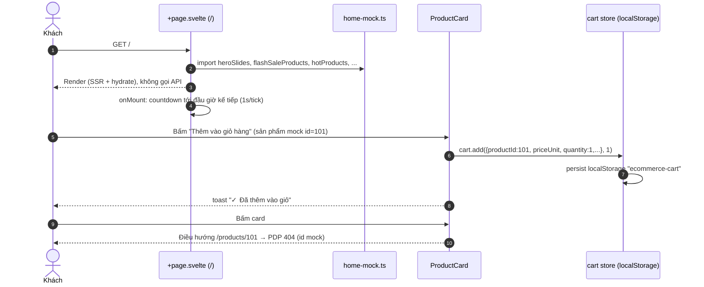
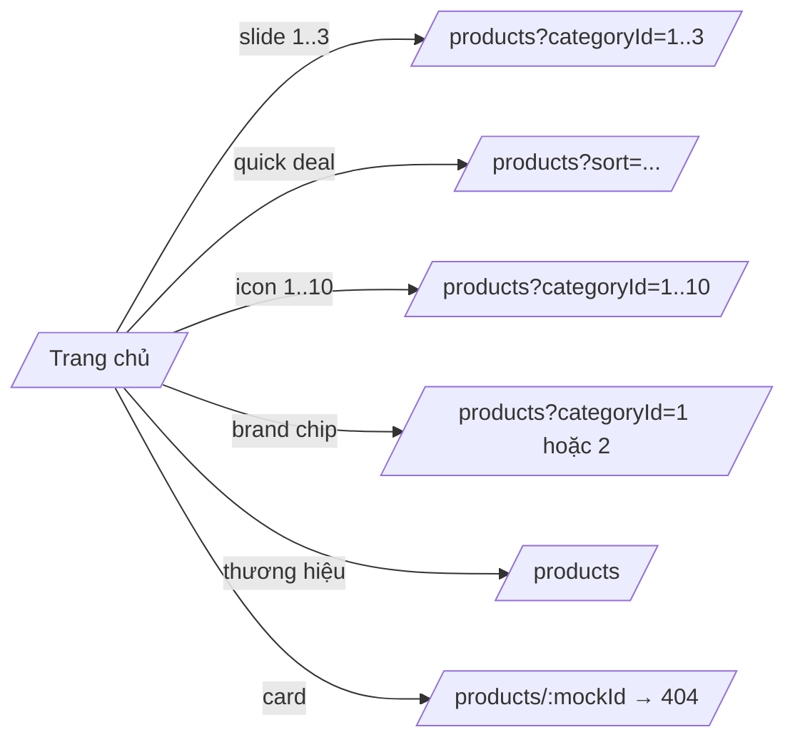

# FEAT-05 — Trang chủ storefront

> **Phiên bản:** 1.0 · **Trạng thái:** Final · **Cập nhật:** 2026-11-12 · **Phạm vi:** Ứng dụng (as-is)

| Thuộc tính | Giá trị |
| :--- | :--- |
| ID | FEAT-05 |
| Business Requirement | BR-05 |
| Trạng thái | 🟡 **Một phần** — Giao diện đầy đủ (hero, deal, danh mục, flash sale, sản phẩm nổi bật, khối điện thoại/laptop, thương hiệu, USP) nhưng **toàn bộ dữ liệu là mock tĩnh** trong `home-mock.ts`; không gọi API nào. Thêm sản phẩm mock vào giỏ dẫn tới lỗi khi đặt hàng. |
| Actor | Guest, Customer |
| Ứng dụng / Service | `frontend/apps/web` (route `/`) |
| Issue liên quan | ISSUE-38, ISSUE-39, ISSUE-42, ISSUE-44, ISSUE-79 |

## 1. Mô tả & mục tiêu nghiệp vụ

Trang landing của storefront "EzBuy" giới thiệu khuyến mãi, danh mục và sản phẩm nổi bật, dẫn khách tới catalog (`/products`) và cho phép thêm nhanh vào giỏ. Hiện trạng: nội dung là **dữ liệu cấu trúc mock** (`frontend/apps/web/src/lib/data/home-mock.ts:1-4` ghi rõ "the homepage showcase stays local until the content API exists"); nhãn văn bản lấy từ Paraglide (`m.*`), tên/giá sản phẩm hard-code tiếng Việt.

## 2. User stories

| ID | Story |
| :--- | :--- |
| US-05.1 | Là **khách**, tôi muốn thấy banner khuyến mãi và đi tới danh mục tương ứng bằng một cú nhấp. |
| US-05.2 | Là **khách**, tôi muốn thấy Flash Sale với đồng hồ đếm ngược và tiến độ đã bán. |
| US-05.3 | Là **khách**, tôi muốn thêm nhanh một sản phẩm nổi bật vào giỏ ngay từ trang chủ. *(Có UI; sản phẩm mock không đặt hàng được.)* |
| US-05.4 | Là **khách**, tôi muốn duyệt nhanh theo danh mục / thương hiệu. |

## 3. Tiền điều kiện / Hậu điều kiện

- Tiền điều kiện: không (trang public, không cần đăng nhập, không gọi backend).
- Hậu điều kiện: khi bấm "Thêm vào giỏ hàng" trên card, giỏ `localStorage` có thêm dòng với `productId` mock (101–106, 201–210, 301–305, 401–405).

## 4. Luồng nghiệp vụ

### 4.1 Luồng chính

1. Người dùng mở `/` (hoặc `/en`). Layout gốc render header/footer và `cart.hydrate()` khi mount (`frontend/apps/web/src/routes/+layout.svelte:15`).
2. `+page.svelte` (`frontend/apps/web/src/routes/+page.svelte`) import dữ liệu từ `#lib/data/home-mock` và render theo thứ tự:
   1. **Hero** (`:104-151`): sidebar 10 mục (`heroSidebar`, chỉ hiển thị từ `lg`), 3 slide (`heroSlides`) link tới `/products?categoryId=1|2|3`, 2 banner phụ (`heroSideBanners` → `/products`, ẩn dưới `sm`).
   2. **Quick deals** (`:153-163`): 5 ô (`quickDeals`), ví dụ "Deal sốc giá rẻ" → `/products?sort=priceUnit,asc`, "Hàng mới về" → `/products?sort=productId,desc`.
   3. **Icon danh mục** (`:165-177`): 10 ô → `/products?categoryId=1..10`, nhãn `category_c1..c10`.
   4. **Flash Sale** (`:179-215`): tiêu đề + đồng hồ đếm ngược `HH:MM:SS` tới **đầu giờ kế tiếp** (`nextFlashSaleDeadline`, `home-mock.ts:450-455`; tick 1 giây, `+page.svelte:83-96`); 6 sản phẩm (`flashSaleProducts`) với thanh tiến độ `soldPercent = min(100, round(sold/stockTotal*100))` và nhãn "Đã bán {count}"; link "Xem tất cả" → `/products?sort=priceUnit,asc`.
   5. **Sản phẩm nổi bật** (`:217-227`): 10 sản phẩm `hotProducts`.
   6. **Khối điện thoại / laptop** (`:229-261`): banner gradient + chip thương hiệu (`phoneBrands`, `laptopBrands` đều trỏ `/products?categoryId=1|2`) + 5 sản phẩm mỗi khối.
   7. **Thương hiệu nổi bật** (`:263-275`): 8 thương hiệu, tất cả trỏ `/products` (không lọc).
   8. **USP** (`:277-288`): 4 cam kết (chính hãng, giao nhanh, đổi trả 30 ngày, hỗ trợ 24/7).
3. Mỗi sản phẩm render bằng `ProductCard` (`frontend/apps/web/src/lib/components/product-card.svelte`): ảnh (mock không có ảnh → emoji 📦), badge `-x%`, giá + giá gạch (`oldPrice`), sao (`rating`), "Đã bán", nút "Thêm vào giỏ hàng".

### 4.2 Luồng thay thế

- **A1 — Thêm nhanh vào giỏ**: `addToCart` (`product-card.svelte:19-33`) `preventDefault` (vì card là thẻ `<a>`), gọi `cart.add({productId, productTitle, imageUrl, priceUnit, quantity: stock ?? 1, category}, 1)`; với sản phẩm mock `stock` = `undefined` (mock không có `quantity`) → `quantity: 1` ghi vào object sản phẩm; toast "✓ Đã thêm vào giỏ".
- **A2 — Nhấp card**: đi tới `/products/{productId}` (href không qua `localizeHref`, ISSUE-39) → PDP gọi `GET /api/products/{id}` → id mock không tồn tại → "Không tìm thấy sản phẩm" (FEAT-07).
- **A3 — Ngôn ngữ en**: nhãn đổi theo Paraglide; tên sản phẩm/thương hiệu vẫn tiếng Việt/cố định.

### 4.3 Luồng ngoại lệ

| Tình huống | Hành vi |
| :--- | :--- |
| Đặt hàng với sản phẩm mock trong giỏ | `placeOrder` gọi `GET /api/products/{mockId}` → 404 → toast "Đặt hàng thất bại" (ISSUE-38, FEAT-09). |
| JS tắt | Trang SSR vẫn hiển thị; đồng hồ hiển thị `00:00:00`; nút thêm giỏ không hoạt động. |

## 5. Sequence diagram

## 6. Màn hình & route (UI)

| Route | File | Ghi chú |
| :--- | :--- | :--- |
| `/` | `frontend/apps/web/src/routes/+page.svelte` | `<title>` = `home_metaTitle`, `<meta description>` = `home_metaDesc`. Không có `+page.server.ts` / remote function. |
| — | `frontend/apps/web/src/lib/data/home-mock.ts` | Interface `ShowcaseProduct` (productId, productTitle, imageUrl?, priceUnit, oldPrice?, discountPercent?, rating?, sold?, stockTotal?, memberExtra?, installment?, badge?, category?) và các mảng dữ liệu. |
| — | `frontend/apps/web/src/lib/components/product-card.svelte` | Dùng chung với catalog. |

Bố cục responsive: hero 3 cột từ `lg` (`240px_1fr_260px`); flash sale 2/3/6 cột; hot products 2/3/5 cột.

## 7. API sử dụng

Không có. (Trang không có `load` hay remote function.)

## 8. Dữ liệu

Toàn bộ trong `home-mock.ts`:

| Mảng | Số phần tử | Ghi chú |
| :--- | :--- | :--- |
| `heroSlides` | 3 | `/products?categoryId=1..3` |
| `heroSideBanners` | 2 | `/products` |
| `quickDeals` | 5 | |
| `categoryIcons` | 10 | `categoryId=1..10` |
| `heroSidebar` | 10 | Nhãn lấy từ mảng `sidebarText` trong `+page.svelte:46-57` theo **chỉ số**; mục 9 (`🎮`, `categoryId=9`) hiển thị nhãn `category_c9`, mục 10 (`♻️`, `/products`) hiển thị nhãn `category_c1` — nhãn không khớp đích. |
| `brands` | 8 | đều `/products` |
| `flashSaleProducts` | 6 | id 101–106, có `sold`/`stockTotal` |
| `hotProducts` | 10 | id 201–210 |
| `phoneProducts`, `laptopProducts` | 5 + 5 | id 301–305, 401–405 |
| `phoneBrands`, `laptopBrands` | 6 + 6 | |

## 9. Business rules & validation

| ID | Quy tắc | Nguồn |
| :--- | :--- | :--- |
| BR-05.1 | Flash sale kết thúc ở đầu giờ kế tiếp theo giờ máy khách; về 0 thì giữ `00:00:00` (không reset cho tới khi tải lại). | `home-mock.ts:450-455`; `+page.svelte:86-91` |
| BR-05.2 | % đã bán = `min(100, round(sold / stockTotal × 100))`, chỉ hiển thị khi có `stockTotal`. | `+page.svelte:200-210` |
| BR-05.3 | Card hiển thị badge giảm giá nếu có `discountPercent`, ngược lại badge "Hết hàng" nếu `quantity <= 0` (không áp dụng mock). | `product-card.svelte:54-64` |
| BR-05.4 | Thêm nhanh luôn thêm số lượng 1. | `product-card.svelte:21-31` |

## 10. Xử lý lỗi

Không có lời gọi mạng nên không có xử lý lỗi. Lỗi chỉ xuất hiện ở bước sau (PDP 404, checkout thất bại).

## 11. i18n (key chính)

`home_metaTitle`, `home_metaDesc`, `home_heroBadge` ("🔥 Ưu đãi hôm nay"), `home_heroCta` ("Mua ngay"), `home_slide1..3Title/Sub`, `home_side1..2Title/Sub`, `home_deal1..5`, `category_c1..c10`, `home_flashSaleTitle`, `home_flashSaleEndsIn` ("Kết thúc trong"), `home_sold` ("Đã bán {count}"), `home_hotProducts`, `home_phoneBannerTitle/Sub`, `home_laptopBannerTitle/Sub`, `home_viewAll`, `common_viewAll`, `home_featuredBrands`, `home_usp*` (`home_uspShippingDesc` = "Đơn từ 300.000đ"), `productcard_addToCart`, `productcard_added`, `productcard_outOfStock`, `productcard_remaining`.

## 12. Acceptance criteria (Given / When / Then — theo hành vi hiện tại)

| # | Given | When | Then |
| :--- | :--- | :--- | :--- |
| AC-05.1 | Khách bất kỳ | Mở `/` | Trang hiển thị 8 khu vực; không có request tới API gateway. |
| AC-05.2 | Lúc 10:15:00 giờ máy | Mở `/` | Đồng hồ Flash Sale hiển thị `00:45:00` và giảm mỗi giây. |
| AC-05.3 | Flash sale item `sold=120`, `stockTotal=150` | Render | Thanh tiến độ 80%, nhãn "Đã bán 120". |
| AC-05.4 | Giỏ trống | Bấm "Thêm vào giỏ hàng" trên item id 101 | Giỏ có 1 dòng `productId=101` số lượng 1; badge giỏ = 1; toast thành công. |
| AC-05.5 | Giỏ chứa item mock | Đặt hàng ở `/checkout` | Thất bại, toast "Đặt hàng thất bại. Vui lòng thử lại." |
| AC-05.6 | Locale `en` (`/en`) | Bấm card | Điều hướng `/products/{id}` (mất prefix `/en`). |
| AC-05.7 | — | Bấm icon danh mục thứ 4 | Điều hướng `/products?categoryId=4` (danh mục id 4 có thể không tồn tại trong DB). |

## 13. Giới hạn & vấn đề đã biết

| Issue | Ảnh hưởng |
| :--- | :--- |
| ISSUE-38 (High) | Dữ liệu mock; add-to-cart mock làm `placeOrder` lỗi. |
| ISSUE-39 (Low) | Card dùng href không localize. |
| ISSUE-42 (Low) | Quick add ghi `quantity` (tồn kho) vào object sản phẩm trong giỏ. |
| ISSUE-44 (Medium) | `categoryId=1..10` và nhãn `category_c*` hard-code. |
| ISSUE-79 (Medium) | Thông điệp ngưỡng miễn phí vận chuyển không nhất quán (`home_uspShippingDesc` 300.000đ vs ngưỡng thực 500.000đ). |

Khác: nhãn sidebar hero lệch đích ở mục 9–10 (mảng `sidebarText` lặp `c9`, `c1`); giá/khuyến mãi/"trả góp 0%" là nội dung minh họa, không gắn với promotion-service.

## 14. Test hiện có

Không có test component/E2E cho trang chủ (ISSUE-46). `frontend/packages/lib/src/format.test.ts` kiểm `formatPrice` dùng bởi card.

## 15. Tham chiếu source

- `frontend/apps/web/src/routes/+page.svelte`
- `frontend/apps/web/src/lib/data/home-mock.ts`
- `frontend/apps/web/src/lib/components/product-card.svelte`
- `frontend/apps/web/src/lib/stores/cart.svelte.ts:46-54`
- `frontend/apps/web/src/routes/+layout.svelte`
- `frontend/apps/web/messages/vi.json`, `en.json` (key `home_*`, `category_*`, `productcard_*`)
