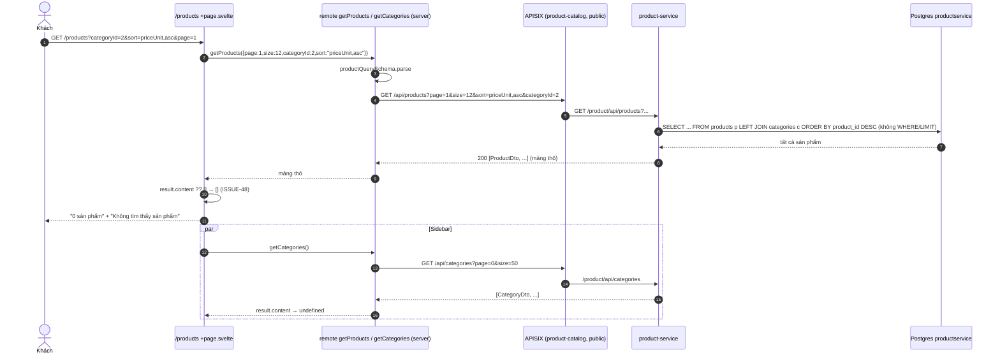
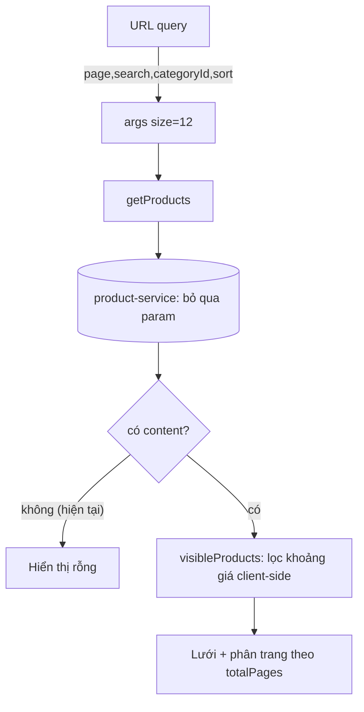

# FEAT-06 — Danh mục sản phẩm (lọc / sắp xếp / phân trang)

> **Phiên bản:** 1.0 · **Trạng thái:** Final · **Cập nhật:** 2026-11-12 · **Phạm vi:** Ứng dụng (as-is)

| Thuộc tính | Giá trị |
| :--- | :--- |
| ID | FEAT-06 |
| Business Requirement | BR-06 |
| Trạng thái | 🟡 **Một phần** — UI `/products` đầy đủ (lọc danh mục, khoảng giá, tìm kiếm, sắp xếp, phân trang) nhưng BFF kỳ vọng `Page` còn product-service trả **mảng thô** và bỏ qua mọi query param → với backend thật danh sách hiển thị rỗng ("0 sản phẩm") và sidebar danh mục rỗng (ISSUE-48). |
| Actor | Guest, Customer |
| Ứng dụng / Service | `frontend/apps/web` (`/products`), `frontend/packages/lib`, `services/product-service`, APISIX route `product-catalog` |
| Issue liên quan | ISSUE-27, ISSUE-35, ISSUE-39, ISSUE-40, ISSUE-42, ISSUE-44, ISSUE-48, ISSUE-50, ISSUE-78, ISSUE-102 |

## 1. Mô tả & mục tiêu nghiệp vụ

Cho phép khách duyệt toàn bộ sản phẩm, lọc theo danh mục và khoảng giá, tìm theo từ khóa, sắp xếp (mới nhất, giá tăng/giảm) và phân trang 12 sản phẩm/trang. Trạng thái lọc (trừ khoảng giá) nằm trên URL để chia sẻ được. Dữ liệu lấy qua remote query `getProducts` / `getCategories` (SvelteKit remote functions, chạy server-side) → APISIX (public) → product-service.

## 2. User stories

| ID | Story |
| :--- | :--- |
| US-06.1 | Là **khách**, tôi muốn xem danh sách sản phẩm có phân trang. |
| US-06.2 | Là **khách**, tôi muốn lọc theo danh mục từ sidebar hoặc từ menu header. |
| US-06.3 | Là **khách**, tôi muốn lọc theo khoảng giá định sẵn. |
| US-06.4 | Là **khách**, tôi muốn tìm theo từ khóa (ô tìm ở header hoặc trên trang). |
| US-06.5 | Là **khách**, tôi muốn sắp xếp theo mới nhất / giá thấp→cao / giá cao→thấp. |
| US-06.6 | Là **khách**, tôi muốn thêm nhanh sản phẩm vào giỏ từ lưới. |

## 3. Tiền điều kiện / Hậu điều kiện

- Tiền điều kiện: product-service chạy và có dữ liệu trong bảng `products`/`categories` (DB `productservice`; repo không seed dữ liệu). Không cần đăng nhập.
- Hậu điều kiện: không thay đổi dữ liệu (chỉ đọc); thêm nhanh giỏ cập nhật `localStorage` (FEAT-08).

## 4. Luồng nghiệp vụ

### 4.1 Luồng chính

1. Khách mở `/products` (từ header, trang chủ, hoặc form tìm kiếm header `GET /products?search=...`, `frontend/apps/web/src/lib/components/header.svelte:88-98`).
2. `+page.svelte` (`frontend/apps/web/src/routes/products/+page.svelte:30-41`) dẫn xuất tham số từ URL:
   - `page` = `max(0, Number(page) || 0)`; `size` cố định **12**.
   - `search` = `search.trim()` hoặc `undefined`.
   - `categoryId` = `Number(categoryId)` nếu có.
   - `sort` chỉ nhận một trong `productId,desc` | `priceUnit,asc` | `priceUnit,desc`, ngược lại `undefined`.
3. `{#await getProducts(args)}` (`:175`) gọi remote query `getProducts` (`frontend/apps/web/src/routes/products/catalog.remote.ts:13`):
   - Server validate bằng `productQuerySchema` (`frontend/packages/lib/src/schemas.ts:32-41`).
   - `api().products.list(input)` → `GET {API_INTERNAL_URL}/api/products?page&size&sort&categoryId&search` kèm Bearer nếu có cookie `access_token` (`frontend/apps/web/src/lib/server/api.ts:10-13`, `frontend/packages/lib/src/server/api.ts:129`).
4. APISIX route `product-catalog` (public, mọi method, `deploy/apisix/apisix.yaml:71-82`) rewrite → `/product/api/products` → `ProductHandler.ListProducts` (`services/product-service/internal/handler/product_handler.go:150-157`) → `FindAllProducts` trả **toàn bộ** sản phẩm `LEFT JOIN categories` sắp `product_id DESC`, **bỏ qua mọi query param** (`services/product-service/internal/repository/product_repo.go:222-240`).
5. Response là mảng JSON thô `[ProductDto]` → `request()` không thấy `data` nên trả nguyên mảng (`api.ts:71-75`).
6. UI: `result.content ?? []` → mảng thô không có `content` → **danh sách rỗng**; `result.totalElements ?? 0` → "0 sản phẩm"; hiển thị khối "Không tìm thấy sản phẩm" + "Xóa bộ lọc" (`+page.svelte:185-200`).
7. Song song, sidebar gọi `getCategories()` (`catalog.remote.ts:16-19`) → `GET /api/categories?page=0&size=50` → product-service `ListCategories` trả mảng thô (`product_handler.go:51-58`) → `result.content` = `undefined` → không có mục danh mục nào ngoài "Tất cả".

**Hành vi dự kiến khi API trả `Page` đúng hợp đồng** (code UI đã hỗ trợ): lưới 2/3/4 cột hiển thị `ProductCard`; dòng "{totalElements} sản phẩm"; phân trang khi `totalPages > 1` với nút Trước/Sau và cửa sổ tối đa 5 số trang (`pageWindow`, `+page.svelte:65-69`).

### 4.2 Luồng thay thế

- **A1 — Chọn danh mục**: link `urlFor({categoryId, page: undefined})` (giữ các param khác, xóa `page`) (`:45-53,102-111`). Mục đang chọn được tô nền.
- **A2 — Khoảng giá**: 5 nút (`PRICE_RANGES`, `:22-28`): `<100k`, `100k–500k`, `500k–1tr`, `1–5tr`, `>5tr`; điều kiện `min <= priceUnit < max`. Bấm lại để bỏ. **Lọc phía client trên trang hiện tại**, không lưu URL, không ảnh hưởng `totalElements`/phân trang (ISSUE-40).
- **A3 — Tìm kiếm**: form GET trên trang với input `search` (`:147-157`); `action = urlFor({search, page: undefined})`. Tiêu đề đổi thành `Kết quả cho "{query}"`. Không dùng search-service (ISSUE-78).
- **A4 — Sắp xếp**: `<select>` đổi → `goto(urlFor({sort, page: undefined}))` (`:162-171`). Khi không có `sort` trên URL, select hiển thị "Mới nhất" nhưng không gửi `sort`.
- **A5 — Phân trang**: `urlFor({page: n})`; nút Trước disabled khi `page <= 0`, Sau disabled khi `page >= totalPages - 1`.
- **A6 — Thêm nhanh vào giỏ**: như FEAT-05 A1; card có `quantity <= 0` → badge "Hết hàng", nút disabled; `1 ≤ quantity ≤ 10` → "Còn {count} sản phẩm" (`product-card.svelte:96-98,102`).

### 4.3 Luồng ngoại lệ

| Tình huống | Hành vi |
| :--- | :--- |
| Tham số URL không hợp lệ ở server (vd `sort` lạ đã bị client lọc; `categoryId=abc` → client gửi `NaN`) | Remote query validate lỗi → `{:catch}` → "Không thể tải sản phẩm. Vui lòng thử lại." + nút "Thử lại" (`:241-250`). |
| Gateway/product-service lỗi (5xx, timeout) | `{:catch}` như trên. |
| `getCategories` lỗi | Sidebar hiển thị "—" (`:112-114`). |
| `search` chỉ gồm khoảng trắng | Client chuyển thành `undefined` trước khi gọi (`:32`). |
| `size` > 60 hoặc `page` < 0 (gọi trực tiếp remote) | Schema từ chối (`schemas.ts:32-35`). |

## 5. Sequence diagram

## 6. Màn hình & route (UI)

| Thành phần | File | Mô tả |
| :--- | :--- | :--- |
| Trang `/products` | `frontend/apps/web/src/routes/products/+page.svelte` | Bố cục 2 cột từ `lg` (`240px_1fr`): sidebar Bộ lọc (Danh mục, Giá) + nội dung (tiêu đề, form tìm, select sắp xếp, đếm, lưới, phân trang). Skeleton 8 ô khi đang tải. `<title>` = `products_metaTitle`. |
| Remote | `frontend/apps/web/src/routes/products/catalog.remote.ts` | `getProducts` (query có schema), `getCategories` (lấy trang 0, size 50). |
| Card | `frontend/apps/web/src/lib/components/product-card.svelte` | Ảnh/emoji, tiêu đề 2 dòng, giá, tồn kho thấp, nút thêm giỏ. |
| Header | `frontend/apps/web/src/lib/components/header.svelte:22-33,153-163` | Menu 10 danh mục hard-code `categoryId=1..10` (ISSUE-44). |

## 7. API sử dụng

| Method & path (gateway) | Route APISIX | Auth | Service handler | Query BFF gửi | Response thực tế |
| :--- | :--- | :--- | :--- | :--- | :--- |
| `GET /api/products` | `product-catalog` → `/product/api/products` | Public | `ListProducts` (`product_handler.go:150-157`) | `page`, `size`, `sort`, `categoryId`, `search` (bỏ qua) | `200 [ProductDto]` (không phân trang) |
| `GET /api/categories` | `product-catalog` → `/product/api/categories` | Public | `ListCategories` (`:51-58`) | `page=0`, `size=50` (bỏ qua) | `200 [CategoryDto]` |

`ProductDto` (`services/product-service/internal/model/product.go:10-18`): `productId`, `productTitle`, `imageUrl`, `sku`, `priceUnit` (float64), `quantity`, `category{categoryId, categoryTitle, imageUrl}` (chỉ khi `category_id > 0`). Không có `description` (ISSUE-50).

Kiểu BFF kỳ vọng: `PaginatedResponse<Product>` (`frontend/packages/lib/src/types.ts:12-20`).

## 8. Dữ liệu

Bảng `products` (`product_repo.go:44-54`): `product_id` SERIAL PK, `product_title` VARCHAR(255) NOT NULL, `image_url` VARCHAR(255), `sku` VARCHAR(100) UNIQUE, `price_unit` DECIMAL(12,2) default 0, `quantity` INT default 0, `category_id` FK `categories`, `created_at`, `updated_at`. Bảng `categories` (`:35-42`): `category_id`, `category_title`, `image_url`, `parent_category_id` (tự tham chiếu).

Tiền tệ hiển thị: `formatPrice` VND locale `vi-VN` (`frontend/packages/lib/src/format.ts:1-6`).

## 9. Business rules & validation

| ID | Quy tắc | Nguồn |
| :--- | :--- | :--- |
| BR-06.1 | `page` integer ≥ 0 (mặc định 0); `size` integer 1–60 (mặc định 12; UI luôn gửi 12). | `schemas.ts:32-35` |
| BR-06.2 | `sort` ∈ {`productId,asc`, `productId,desc`, `priceUnit,asc`, `priceUnit,desc`} (UI chỉ dùng 3 giá trị). | `schemas.ts:37-38`; `+page.svelte:15-19` |
| BR-06.3 | `categoryId`: chuỗi rỗng → bỏ; chuỗi số → number; số nguyên dương. | `schemas.ts:21-30` |
| BR-06.4 | `search`: trim, tối thiểu 1 ký tự. | `schemas.ts:40` |
| BR-06.5 | Khoảng giá: `[min, max)` theo `priceUnit`, chỉ lọc trên kết quả trang hiện tại. | `+page.svelte:22-28,57-63` |
| BR-06.6 | Thay đổi danh mục/tìm/sắp xếp reset `page`. | `+page.svelte:55,89,104,166` |
| BR-06.7 | Sản phẩm hết hàng (`quantity <= 0`) không thêm nhanh được; tồn ≤ 10 hiển thị cảnh báo số lượng. | `product-card.svelte:16-17,96-102` |

## 10. Xử lý lỗi

- Remote query lỗi (validation, `ApiError`) → khối `{:catch}` với `productgrid_loadError` + `common_retry` (link reload `/products`, mất bộ lọc).
- product-service: DB lỗi → `500 ErrorVm {statusCode:"500", title, detail}` (`services/shared/response/response.go:28-34`); không có DB → mảng rỗng `[]` (ISSUE-28).

## 11. i18n (key chính)

`products_metaTitle`, `products_title` ("Tất cả sản phẩm"), `products_searchResults` ('Kết quả cho "{query}"'), `products_filtersTitle`, `products_categoriesTitle`, `products_allCategories`, `products_priceTitle`, `products_price1..5`, `products_filter` ("Lọc" — dùng làm label cho select sắp xếp), `products_sortNewest`, `products_sortPriceLow`, `products_sortPriceHigh`, `products_count` ("{count} sản phẩm"), `products_notFound`, `products_notFoundHint`, `products_clearFilter`, `productgrid_loadError`, `common_prev`, `common_next`, `common_retry`, `header_searchPlaceholder`. Key không dùng: `products_sortNameAZ`, `products_loadingFallback`, `productgrid_notFound*` (ISSUE-43).

## 12. Acceptance criteria (Given / When / Then — theo hành vi hiện tại)

| # | Given | When | Then |
| :--- | :--- | :--- | :--- |
| AC-06.1 | product-service có 30 sản phẩm | Mở `/products` | BFF gọi `GET /api/products?page=0&size=12`; service trả mảng 30 phần tử; UI hiển thị "0 sản phẩm" và "Không tìm thấy sản phẩm" (ISSUE-48). |
| AC-06.2 | Như trên | Sidebar tải danh mục | Chỉ có mục "Tất cả". |
| AC-06.3 | — | Mở `/products?sort=foo` | `sort` không được gửi; select hiển thị "Mới nhất". |
| AC-06.4 | — | Nhập "  " vào ô tìm và gửi | `search` không được gửi; tiêu đề "Tất cả sản phẩm". |
| AC-06.5 | — | Gửi form tìm với "iphone" | URL `/products?search=iphone`; tiêu đề `Kết quả cho "iphone"`; BFF gửi `search=iphone` (service bỏ qua). |
| AC-06.6 | Giả định API trả Page có 3 sản phẩm giá 50k, 300k, 2tr | Chọn "100k - 500k" | Chỉ hiển thị sản phẩm 300k; dòng đếm vẫn theo `totalElements` của server. |
| AC-06.7 | Đang ở `?categoryId=2&page=3` | Chọn sắp xếp "Giá thấp đến cao" | URL `?categoryId=2&sort=priceUnit%2Casc` (không còn `page`). |
| AC-06.8 | Gateway trả 500 | Mở trang | Hiển thị "Không thể tải sản phẩm. Vui lòng thử lại." và nút "Thử lại". |
| AC-06.9 | Card sản phẩm `quantity=0` | Render | Badge "Hết hàng", nút thêm giỏ disabled. |

## 13. Giới hạn & vấn đề đã biết

| Issue | Ảnh hưởng |
| :--- | :--- |
| ISSUE-48 (Critical) | API trả mảng thô, bỏ qua `page/size/sort/categoryId/search` → catalog rỗng. |
| ISSUE-40 (Medium) | Lọc khoảng giá chỉ trên trang hiện tại, không trên URL. |
| ISSUE-44 (Medium) | Menu danh mục hard-code. |
| ISSUE-39 / ISSUE-42 (Low) | Link card mất locale; quick add ghi tồn kho vào giỏ. |
| ISSUE-35 / ISSUE-50 | Không validate input, không có description/brand/slug. |
| ISSUE-27 (Medium) | Giá `DECIMAL` scan sang `float64`. |
| ISSUE-78 (Medium) | Tìm kiếm storefront không dùng search-service. |
| ISSUE-102 (Critical) | Route `product-catalog` không giới hạn method, không auth → ghi catalog không cần đăng nhập (ảnh hưởng toàn vẹn dữ liệu hiển thị ở đây). |

## 14. Test hiện có

- `frontend/packages/lib/src/schemas.test.ts:19-57` — `pageQuerySchema`, `productQuerySchema` (sort hợp lệ, categoryId, search trim/khoảng trắng).
- `frontend/packages/lib/src/server/api.test.ts:65` — build query string bỏ tham số rỗng.
- `services/product-service/main_test.go:67-77` — `GET /api/products` 200 (repo `nil` → `[]`).
- Không có test hợp đồng Page ↔ mảng (ISSUE-46).

## 15. Tham chiếu source

- `frontend/apps/web/src/routes/products/+page.svelte`
- `frontend/apps/web/src/routes/products/catalog.remote.ts`
- `frontend/apps/web/src/lib/components/product-card.svelte`, `header.svelte`
- `frontend/apps/web/src/lib/server/api.ts`
- `frontend/packages/lib/src/schemas.ts:8-41`, `server/api.ts:30-37,128-141`, `types.ts:12-20,56-74`, `format.ts`
- `services/product-service/internal/handler/product_handler.go:23-58,141-157`
- `services/product-service/internal/repository/product_repo.go:30-97,176-240`
- `deploy/apisix/apisix.yaml:71-82`
