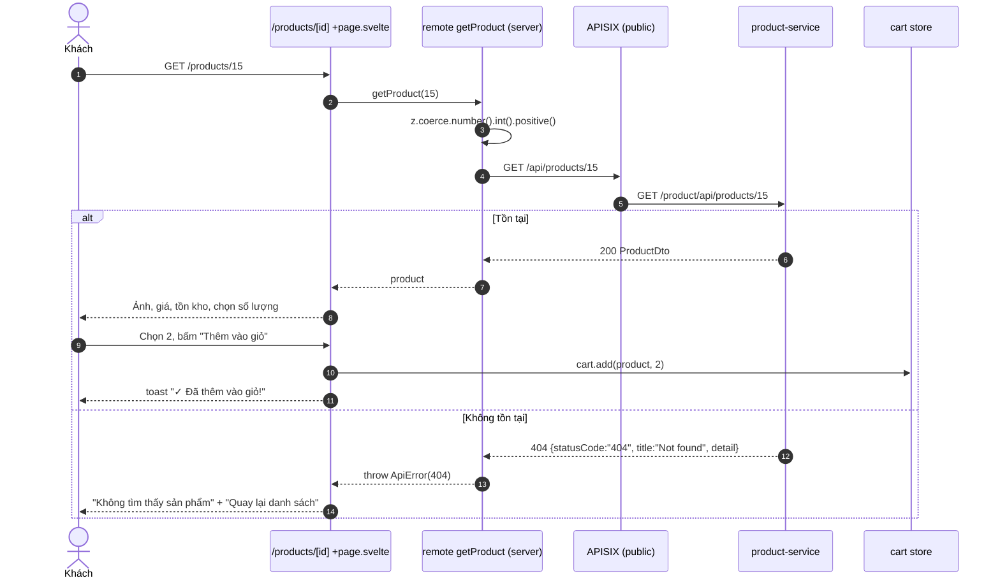

# FEAT-07 — Chi tiết sản phẩm

> **Phiên bản:** 1.0 · **Trạng thái:** Final · **Cập nhật:** 2026-11-12 · **Phạm vi:** Ứng dụng (as-is)

| Thuộc tính | Giá trị |
| :--- | :--- |
| ID | FEAT-07 |
| Business Requirement | BR-07 |
| Trạng thái | ✅ **Đã triển khai** — `/products/[id]` gọi `GET /api/products/{id}`; endpoint trả đúng một `ProductDto` (không bị lệch hợp đồng như danh sách). Hạn chế: không có mô tả (ISSUE-50), không có `<title>` riêng, card dẫn tới trang mất locale (ISSUE-39). |
| Actor | Guest, Customer |
| Ứng dụng / Service | `frontend/apps/web` (`/products/[id]`), `services/product-service`, APISIX `product-catalog` |
| Issue liên quan | ISSUE-21, ISSUE-26, ISSUE-27, ISSUE-38, ISSUE-39, ISSUE-50, ISSUE-79, ISSUE-102 |

## 1. Mô tả & mục tiêu nghiệp vụ

Hiển thị thông tin một sản phẩm (ảnh, tên, SKU, giá, tình trạng tồn kho, mô tả nếu có), cho phép chọn số lượng, "Thêm vào giỏ" hoặc "Mua ngay" (thêm vào giỏ rồi chuyển tới `/checkout`).

## 2. User stories

| ID | Story |
| :--- | :--- |
| US-07.1 | Là **khách**, tôi muốn xem giá, SKU, tình trạng còn hàng của sản phẩm. |
| US-07.2 | Là **khách**, tôi muốn chọn số lượng (không vượt tồn kho) và thêm vào giỏ. |
| US-07.3 | Là **khách**, tôi muốn "Mua ngay" để tới thẳng thanh toán. |
| US-07.4 | Là **khách**, khi sản phẩm không tồn tại, tôi muốn thấy thông báo và nút quay lại danh sách. |

## 3. Tiền điều kiện / Hậu điều kiện

- Tiền điều kiện: sản phẩm tồn tại trong `products`; trang public.
- Hậu điều kiện: thêm vào giỏ cập nhật `localStorage` (FEAT-08); "Mua ngay" điều hướng `/checkout` (yêu cầu đăng nhập, FEAT-09).

## 4. Luồng nghiệp vụ

### 4.1 Luồng chính

1. Khách mở `/products/{id}` (từ card catalog/trang chủ hoặc link giỏ hàng).
2. `+page.svelte` (`frontend/apps/web/src/routes/products/[id]/+page.svelte:22`) lấy `productId = Number(page.params.id)`, gọi `getProduct(productId)` trong `{#await}` (`:36`).
3. Remote query `getProduct` (`frontend/apps/web/src/routes/products/[id]/product.remote.ts:5`) validate `z.coerce.number().int().positive()` → `api().products.get(id)` → `GET /api/products/{id}` (`frontend/packages/lib/src/server/api.ts:130`).
4. APISIX `product-catalog` (public, `deploy/apisix/apisix.yaml:71-82`) → `/product/api/products/{id}` → `GetProductByID` (`services/product-service/internal/handler/product_handler.go:159-175`) → `FindProductByID` (`services/product-service/internal/repository/product_repo.go:242-260`): `SELECT` có `LEFT JOIN categories`, `COALESCE` các cột rỗng.
5. 200 `ProductDto` → UI render (`+page.svelte:46-158`):
   - Breadcrumb "Trang chủ › Sản phẩm" (`:26-34`).
   - Ảnh vuông (`imageUrl`) hoặc emoji 📦.
   - `<h1>` tên; "SKU: …" nếu có `sku`.
   - Giá `formatPrice(priceUnit)` + "Đã bao gồm VAT".
   - Badge "Còn {quantity} sản phẩm" (quantity > 0) hoặc "Hết hàng".
   - Bộ chọn số lượng: `-` (min 1), `+` (max `product.quantity || 99`).
   - Nút "Thêm vào giỏ": `cart.add(product, quantity)` + toast "✓ Đã thêm vào giỏ!".
   - Nút "Mua ngay": `href=/checkout`, `onclick` gọi `cart.add(product, quantity)` trước khi điều hướng.
   - 3 dòng cam kết tĩnh (miễn phí vận chuyển >500k, bảo hành 12 tháng, đổi trả 30 ngày).
   - Khối "Mô tả sản phẩm" chỉ khi có `description` (không bao giờ có — ISSUE-50).

### 4.2 Luồng thay thế

- **A1 — Hết hàng** (`quantity <= 0`): badge đỏ "Hết hàng"; hai nút disabled. Nút `+` vẫn cho tăng tới 99 (vì `quantity || 99` với quantity = 0 → 99) nhưng không thêm được.
- **A2 — Mua ngay khi chưa đăng nhập**: thêm giỏ rồi `/checkout` → redirect `/login?redirect=/checkout` (FEAT-01).
- **A3 — Thêm nhiều lần**: `cart.add` cộng dồn số lượng vào dòng hiện có, **không** so với tồn kho (FEAT-08, ISSUE-79).
- **A4 — Chuyển sang sản phẩm khác trong cùng route**: biến `quantity` là state của component, không reset khi `id` đổi.

### 4.3 Luồng ngoại lệ

| Tình huống | Hành vi |
| :--- | :--- |
| `id` không phải số nguyên dương (`/products/abc`, `/products/0`) | Validation remote lỗi → `{:catch}` "Không tìm thấy sản phẩm" + "Quay lại danh sách" (`:159-168`). |
| Sản phẩm không tồn tại | product-service `404 ErrorVm` (`product_handler.go:166-169`) → `ApiError(404)` → `{:catch}` như trên. |
| product-service không có DB | `FindProductByID` trả `nil` → 404 (ISSUE-28). |
| Lỗi 5xx / mạng | Cùng thông điệp "Không tìm thấy sản phẩm" (không phân biệt lỗi hệ thống và 404). |
| Id mock từ trang chủ (101–405) | 404 (ISSUE-38). |

## 5. Sequence diagram

## 6. Màn hình & route (UI)

| Route | File | Ghi chú |
| :--- | :--- | :--- |
| `/products/[id]` | `frontend/apps/web/src/routes/products/[id]/+page.svelte` | Lưới 2 cột từ `lg`; skeleton khi tải. **Không có `<svelte:head>`** → title kế thừa (key `productdetail_metaTitle` tồn tại nhưng không dùng). |
| Remote | `frontend/apps/web/src/routes/products/[id]/product.remote.ts` | `getProduct`. |

## 7. API sử dụng

| Method & path (gateway) | Route | Auth | Handler | Response |
| :--- | :--- | :--- | :--- | :--- |
| `GET /api/products/{id}` | `product-catalog` → `/product/api/products/{id}` | Public | `GetProductByID` | `200 ProductDto`; `400 ErrorVm "Invalid productId"`; `404 ErrorVm "not found: product with id N not found"`; `500 ErrorVm` |

`ProductDto`: `{productId, productTitle, imageUrl, sku, priceUnit, quantity, category?: {categoryId, categoryTitle, imageUrl}}` (`services/product-service/internal/model/product.go:10-18`).

## 8. Dữ liệu

Đọc bảng `products` + `categories` (xem FEAT-06 §8). `quantity` ở đây là tồn kho của product-service, **độc lập** với inventory-service (ISSUE-26).

## 9. Business rules & validation

| ID | Quy tắc | Nguồn |
| :--- | :--- | :--- |
| BR-07.1 | `id` phải là số nguyên dương. | `product.remote.ts:5` |
| BR-07.2 | Số lượng chọn: tối thiểu 1, tối đa `quantity` (hoặc 99 nếu `quantity` = 0/falsy). | `+page.svelte:95,104` |
| BR-07.3 | Không cho thêm/mua khi `quantity <= 0`. | `+page.svelte:114,126` |
| BR-07.4 | Không kiểm tra tổng số lượng trong giỏ so với tồn kho. | `cart.svelte.ts:46-54` |
| BR-07.5 | Giá hiển thị là `priceUnit` hiện tại; được snapshot vào giỏ khi thêm. | `+page.svelte:116` |

## 10. Xử lý lỗi

Mọi lỗi của `getProduct` gom vào một trạng thái "Không tìm thấy sản phẩm". Không retry, không log phía client.

## 11. i18n (key chính)

`productdetail_breadcrumbHome`, `productdetail_breadcrumbProducts`, `productdetail_vatIncluded`, `productdetail_inStock` ("Còn {count} sản phẩm"), `productdetail_outOfStock`, `productdetail_quantityLabel`, `productdetail_addToCart`, `productdetail_added`, `productdetail_buyNow`, `productdetail_freeShipping`, `productdetail_warranty`, `productdetail_freeReturn`, `productdetail_description`, `productdetail_notFound`, `productdetail_backToList`, `common_decrease`, `common_increase`. Không dùng: `productdetail_metaTitle`, `productdetail_reviews` (không có rating trên PDP).

## 12. Acceptance criteria (Given / When / Then — theo hành vi hiện tại)

| # | Given | When | Then |
| :--- | :--- | :--- | :--- |
| AC-07.1 | Sản phẩm 15 tồn tại, `quantity=5`, có SKU | Mở `/products/15` | Hiển thị tên, "SKU: …", giá VND, badge "Còn 5 sản phẩm", nút bật. |
| AC-07.2 | Như trên, số lượng đang 5 | Bấm `+` | Vẫn 5. |
| AC-07.3 | Số lượng 1 | Bấm `-` | Vẫn 1. |
| AC-07.4 | Số lượng 2 | Bấm "Thêm vào giỏ" | Giỏ có dòng `productId=15` với +2; toast. |
| AC-07.5 | Chưa đăng nhập | Bấm "Mua ngay" | Giỏ được cộng; điều hướng `/checkout` → bị redirect `/login?redirect=%2Fcheckout`. |
| AC-07.6 | `quantity=0` | Mở trang | Badge "Hết hàng"; hai nút disabled. |
| AC-07.7 | — | Mở `/products/9999` (không tồn tại) | "Không tìm thấy sản phẩm" + nút "Quay lại danh sách". |
| AC-07.8 | — | Mở `/products/abc` | Như AC-07.7 (lỗi validation). |
| AC-07.9 | Mọi sản phẩm | Mở trang | Không có khối "Mô tả sản phẩm" (backend không có description). |

## 13. Giới hạn & vấn đề đã biết

| Issue | Ảnh hưởng |
| :--- | :--- |
| ISSUE-50 (Medium) | Mô tả luôn trống. |
| ISSUE-39 (Low) | Link từ card không có prefix `/en`. |
| ISSUE-38 (High) | Id mock từ trang chủ → 404. |
| ISSUE-26 / ISSUE-21 | Tồn kho hiển thị từ `products.quantity`; không giữ hàng, không trừ kho khi đặt. |
| ISSUE-27 (Medium) | Giá float. |
| ISSUE-79 (Medium) | Giỏ không giới hạn theo tồn kho khi cộng dồn; giới hạn 99/dòng chỉ ở checkout. |
| ISSUE-102 (Critical) | Dữ liệu sản phẩm có thể bị sửa bởi bất kỳ ai (route ghi không auth). |

Khác: không có `<title>`/meta riêng cho SEO; không có đánh giá/rating trên PDP dù rating-service tồn tại (FEAT-15).

## 14. Test hiện có

- `services/product-service/main_test.go:67-77` — CRUD cơ bản với repo `nil` (không kiểm `GET /api/products/{id}`).
- Không có test component PDP (ISSUE-46).

## 15. Tham chiếu source

- `frontend/apps/web/src/routes/products/[id]/+page.svelte`
- `frontend/apps/web/src/routes/products/[id]/product.remote.ts`
- `frontend/apps/web/src/lib/stores/cart.svelte.ts:46-54`
- `frontend/packages/lib/src/server/api.ts:39-76,130`
- `services/product-service/internal/handler/product_handler.go:159-175`
- `services/product-service/internal/service/product_service.go:67-76`
- `services/product-service/internal/repository/product_repo.go:189-260`
- `deploy/apisix/apisix.yaml:71-82`
