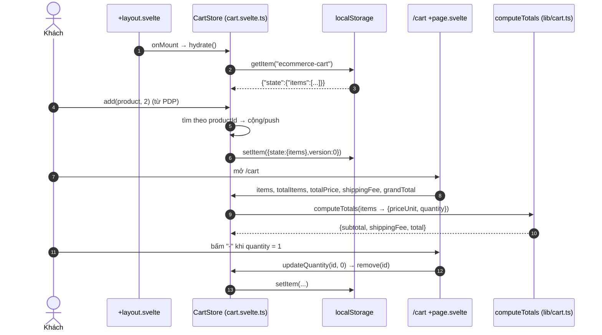
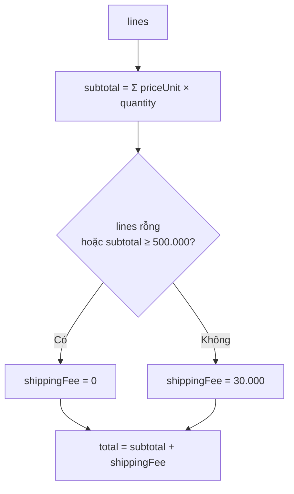

# FEAT-08 — Giỏ hàng

> **Phiên bản:** 1.0 · **Trạng thái:** Final · **Cập nhật:** 2026-11-12 · **Phạm vi:** Ứng dụng (as-is)

| Thuộc tính | Giá trị |
| :--- | :--- |
| ID | FEAT-08 |
| Business Requirement | BR-08 |
| Trạng thái | ✅ **Đã triển khai** (client-side) — Giỏ hàng lưu trong `localStorage`, thêm/sửa/xóa/xóa hết, tính tạm tính, phí ship (30.000đ, miễn phí từ 500.000đ) bằng hàm dùng chung `computeTotals`. Không đồng bộ backend (API `/api/carts` của order-service không được dùng). |
| Actor | Guest, Customer |
| Ứng dụng / Service | `frontend/apps/web` (store `cart.svelte.ts`, route `/cart`), `frontend/packages/lib/src/cart.ts` |
| Issue liên quan | ISSUE-24, ISSUE-38, ISSUE-42, ISSUE-79 |

## 1. Mô tả & mục tiêu nghiệp vụ

Cho phép khách (kể cả chưa đăng nhập) gom sản phẩm trước khi thanh toán. Giỏ là **trạng thái phía trình duyệt**: một store Svelte 5 (`$state`/`$derived`) singleton, persist vào `localStorage` key `ecommerce-cart`. Tổng tiền tính bởi `computeTotals` — cùng hàm được checkout server dùng lại để tính `orderFee` (FEAT-09), đảm bảo UI và server cùng công thức (nhưng không cùng giá, xem §13).

## 2. User stories

| ID | Story |
| :--- | :--- |
| US-08.1 | Là **khách**, tôi muốn thêm sản phẩm vào giỏ từ card hoặc trang chi tiết và thấy số lượng trên icon giỏ ở header. |
| US-08.2 | Là **khách**, tôi muốn tăng/giảm số lượng, xóa từng dòng hoặc xóa tất cả. |
| US-08.3 | Là **khách**, tôi muốn biết tạm tính, phí vận chuyển, tổng cộng và còn thiếu bao nhiêu để được miễn phí ship. |
| US-08.4 | Là **khách**, tôi muốn giỏ còn nguyên khi tải lại trang hoặc quay lại sau. |
| US-08.5 | Là **khách**, tôi muốn bấm "Tiến hành thanh toán" để sang checkout. |

## 3. Tiền điều kiện / Hậu điều kiện

- Tiền điều kiện: trình duyệt bật JavaScript; `localStorage` khả dụng (nếu không, giỏ chỉ sống trong bộ nhớ trang).
- Hậu điều kiện: `localStorage["ecommerce-cart"] = {"state":{"items":[...]},"version":0}` phản ánh giỏ hiện tại.

## 4. Luồng nghiệp vụ

### 4.1 Luồng chính

1. Root layout gọi `cart.hydrate()` trong `onMount` (`frontend/apps/web/src/routes/+layout.svelte:15`): đọc `localStorage`, chấp nhận 3 định dạng — `{state:{items}}` (dạng zustand-persist cũ), `{items}`, hoặc mảng trần; JSON lỗi → `[]`; đặt `hydrated = true` (`frontend/apps/web/src/lib/stores/cart.svelte.ts:6-23,40-44`).
2. **Thêm** (`cart.add(product, quantity = 1)`, `:46-54`): tìm dòng theo `product.productId`; có → cộng `quantity`; chưa có → push `{product, quantity}`; `persist()`.
   - Từ card (`frontend/apps/web/src/lib/components/product-card.svelte:19-33`): luôn +1, object sản phẩm tối giản (`quantity: stock ?? 1` — ISSUE-42).
   - Từ PDP (`frontend/apps/web/src/routes/products/[id]/+page.svelte:115-118,128-130`): +`quantity` đã chọn, lưu toàn bộ `ProductDto`.
3. Header hiển thị badge `cart.totalItems` (tổng số lượng các dòng) khi `hydrated` và > 0 (`frontend/apps/web/src/lib/components/header.svelte:18,140-147`).
4. Trang `/cart` (`frontend/apps/web/src/routes/cart/+page.svelte`):
   - Chưa hydrate → 3 skeleton; giỏ trống → khối "Giỏ hàng trống" + "Tiếp tục mua sắm".
   - Mỗi dòng: ảnh/emoji (link PDP), tên (link PDP), đơn giá, nút `-`/`+`, nút xóa, thành tiền `priceUnit × quantity`.
   - Tóm tắt: "Tạm tính ({count} sp)", "Phí vận chuyển" (0 → "Miễn phí"), gợi ý "Mua thêm {amount} để được miễn phí vận chuyển" khi `500.000 − subtotal > 0`, "Tổng cộng", nút "Tiến hành thanh toán" → `/checkout`, dòng "🔒 Thanh toán an toàn".
5. **Sửa số lượng** `updateQuantity(id, q)` (`:61-71`): `q <= 0` → `remove`; ngược lại gán và persist.
6. **Xóa dòng** `remove(id)` (`:56-59`); **Xóa tất cả** `clear()` (`:73-76`) — nút "Xóa tất cả" không hỏi xác nhận.
7. Mỗi thay đổi gọi `persist()` ghi JSON; lỗi quota/disabled bị nuốt (`:78-88`).

### 4.2 Luồng thay thế

- **A1 — Giỏ sau đặt hàng thành công**: checkout gọi `cart.clear()` (FEAT-09).
- **A2 — Nhiều tab**: mỗi tab có store riêng, chỉ đọc `localStorage` lúc hydrate; không lắng nghe sự kiện `storage` → tab cũ có thể ghi đè giỏ của tab mới khi thay đổi.
- **A3 — Đổi ngôn ngữ**: header dùng `data-sveltekit-reload` khi đổi locale → trang tải lại, giỏ hydrate lại từ `localStorage`.
- **A4 — Đăng nhập/đăng xuất**: giỏ không gắn với user; đăng xuất không xóa giỏ.

### 4.3 Luồng ngoại lệ

| Tình huống | Hành vi |
| :--- | :--- |
| `localStorage` hỏng JSON | Giỏ rỗng sau hydrate (dữ liệu cũ bị ghi đè ở lần persist kế tiếp). |
| `localStorage` không khả dụng (SSR, chế độ riêng tư chặn) | SSR: `readStoredItems` trả `[]`; client: persist lỗi bị nuốt. |
| Sản phẩm trong giỏ bị xóa/đổi giá trên server | Giỏ vẫn giữ snapshot cũ; chỉ phát hiện khi checkout (404 → lỗi, hoặc giá mới được dùng) (ISSUE-79). |
| Số lượng một dòng > 99 | Không bị chặn ở giỏ; checkout bị từ chối bởi schema (ISSUE-79). |

## 5. Sequence diagram





## 6. Màn hình & route (UI)

| Thành phần | File | Mô tả |
| :--- | :--- | :--- |
| `/cart` | `frontend/apps/web/src/routes/cart/+page.svelte` | Tiêu đề "Giỏ hàng ({count} sản phẩm)" khi có hàng; lưới `1fr_360px` từ `lg`. `<title>` = `cart_metaTitle`. |
| Store | `frontend/apps/web/src/lib/stores/cart.svelte.ts` | `items`, `hydrated`, `totalItems`, `totals`, `totalPrice`, `shippingFee`, `grandTotal`; `hydrate`, `add`, `remove`, `updateQuantity`, `clear`. |
| Badge header | `frontend/apps/web/src/lib/components/header.svelte:140-148` | |
| Hàm tính | `frontend/packages/lib/src/cart.ts` | `FREE_SHIPPING_THRESHOLD = 500_000`, `SHIPPING_FEE = 30_000`, `computeTotals`. |

## 7. API sử dụng

Không có. order-service có `/api/carts` (route `order-carts`, `deploy/apisix/apisix.yaml:178-195`) nhưng frontend không gọi; `Cart` type trong `frontend/packages/lib/src/types.ts:76-80` không được dùng ở web.

## 8. Dữ liệu

`CartItem` (`frontend/packages/lib/src/types.ts:137-141`): `{ product: Product; quantity: number }` — `product` là snapshot (`productId`, `productTitle`, `imageUrl`, `priceUnit`, `quantity` (tồn kho/hoặc 1), `category`, có thể thêm `sku`).

Ví dụ `localStorage`:

```json
{"state":{"items":[{"product":{"productId":15,"productTitle":"...","priceUnit":250000,"quantity":5},"quantity":2}]},"version":0}
```

## 9. Business rules & validation

| ID | Quy tắc | Nguồn |
| :--- | :--- | :--- |
| BR-08.1 | Mỗi `productId` chỉ một dòng; thêm trùng thì cộng dồn. | `cart.svelte.ts:46-54` |
| BR-08.2 | Số lượng ≤ 0 → xóa dòng. Không có giới hạn trên ở giỏ. | `cart.svelte.ts:61-65` |
| BR-08.3 | `subtotal = Σ priceUnit × quantity`. | `cart.ts:23` |
| BR-08.4 | `shippingFee = 0` nếu giỏ rỗng hoặc `subtotal ≥ 500.000`; ngược lại `30.000`. | `cart.ts:24` |
| BR-08.5 | `total = subtotal + shippingFee`. | `cart.ts:25` |
| BR-08.6 | Gợi ý miễn phí ship hiển thị khi `500.000 − subtotal > 0`. | `cart/+page.svelte:12,144-148` |
| BR-08.7 | Giá dùng trong giỏ là giá tại thời điểm thêm (không làm mới). | `cart.svelte.ts:30-34` |

## 10. Xử lý lỗi

Lỗi đọc/ghi `localStorage` bị nuốt (giỏ chạy trong bộ nhớ). Không có lỗi mạng (không gọi API).

## 11. i18n (key chính)

`cart_metaTitle`, `cart_title` ("Giỏ hàng ({count} sản phẩm)"), `cart_emptyTitle`, `cart_emptyHint`, `cart_continueShopping`, `cart_clearAll`, `cart_orderSummary`, `cart_subtotal` ("Tạm tính ({count} sp)"), `cart_shippingFee`, `cart_freeShipping`, `cart_shippingPromo` ("Mua thêm {amount} để được miễn phí vận chuyển"), `cart_total`, `cart_checkout`, `cart_securePayment`, `common_decrease`, `common_increase`, `header_cart`, `productcard_added`, `productdetail_added`, `header_topShipping` ("Miễn phí vận chuyển cho đơn hàng trên 500.000đ"). Không dùng: `cart_applyCoupon`, `cart_couponPlaceholder`, `cart_returnPolicy` (không có mã giảm giá).

## 12. Acceptance criteria (Given / When / Then — theo hành vi hiện tại)

| # | Given | When | Then |
| :--- | :--- | :--- | :--- |
| AC-08.1 | Giỏ trống | Thêm sản phẩm A (giá 200.000) ×1 | Badge = 1; `/cart`: tạm tính 200.000, phí 30.000, tổng 230.000, gợi ý "Mua thêm 300.000 ₫…". |
| AC-08.2 | Giỏ có A ×1 | Thêm A ×2 từ PDP | Một dòng A ×3. |
| AC-08.3 | Giỏ có A (200.000) ×2, B (100.000) ×1 | Mở `/cart` | Tạm tính 500.000; phí "Miễn phí"; tổng 500.000; không có gợi ý. |
| AC-08.4 | Giỏ có A ×1 | Bấm `-` | Dòng A bị xóa; hiển thị "Giỏ hàng trống". |
| AC-08.5 | Giỏ có 3 dòng | Bấm "Xóa tất cả" | Giỏ trống ngay, không hỏi xác nhận. |
| AC-08.6 | Giỏ có hàng | Tải lại trang | Giỏ giữ nguyên sau hydrate (skeleton hiển thị trước). |
| AC-08.7 | `localStorage["ecommerce-cart"]` = `[{"product":{...},"quantity":1}]` (mảng trần) | Hydrate | Giỏ đọc được 1 dòng. |
| AC-08.8 | `localStorage` chứa `{` (JSON hỏng) | Hydrate | Giỏ rỗng. |
| AC-08.9 | Giỏ có A ×100 | Bấm `+` | Lên 101 (không giới hạn). |

## 13. Giới hạn & vấn đề đã biết

| Issue | Ảnh hưởng |
| :--- | :--- |
| ISSUE-38 (High) | Có thể chứa sản phẩm mock từ trang chủ. |
| ISSUE-42 (Low) | Quick add ghi `quantity` (tồn kho) vào object sản phẩm. |
| ISSUE-24 (Medium) | API giỏ của order-service tồn tại nhưng không được dùng (và có lỗi bỏ qua lỗi insert). |
| ISSUE-79 (Medium) | Không giới hạn số lượng theo tồn kho / 99; giá snapshot có thể lệch giá server khi checkout; thông điệp ngưỡng miễn phí ship không nhất quán. |

Khác: không đồng bộ giỏ giữa thiết bị/tab; không có mã giảm giá (key i18n coupon tồn tại nhưng không dùng); không kiểm tồn kho (inventory-service không được gọi, FEAT-12).

## 14. Test hiện có

- `frontend/packages/lib/src/cart.test.ts:4-39` — `computeTotals`: giỏ rỗng (0 phí), dưới ngưỡng tính 30.000, đúng ngưỡng miễn phí, sát dưới ngưỡng vẫn tính phí, nhiều dòng.
- Không có test cho `CartStore` (hydrate, cộng dồn, persist) (ISSUE-46).

## 15. Tham chiếu source

- `frontend/apps/web/src/lib/stores/cart.svelte.ts`
- `frontend/packages/lib/src/cart.ts`, `cart.test.ts`
- `frontend/apps/web/src/routes/cart/+page.svelte`
- `frontend/apps/web/src/routes/+layout.svelte:15`
- `frontend/apps/web/src/lib/components/header.svelte:18,140-148`
- `frontend/apps/web/src/lib/components/product-card.svelte:19-33`
- `frontend/apps/web/src/routes/products/[id]/+page.svelte:112-133`
- `frontend/packages/lib/src/types.ts:137-141`
