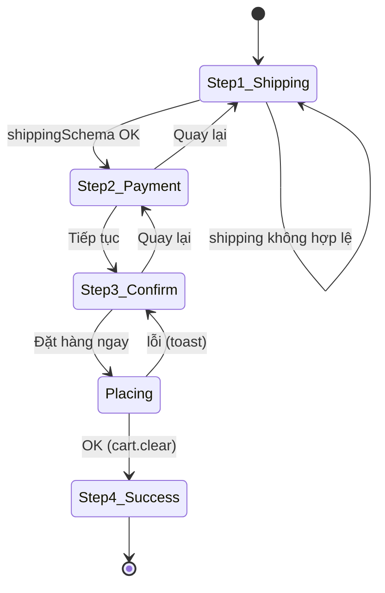

# FEAT-09 — Checkout & đặt hàng

> **Phiên bản:** 1.0 · **Trạng thái:** Final · **Cập nhật:** 2026-11-12 · **Phạm vi:** Ứng dụng (as-is)

| Thuộc tính | Giá trị |
| :--- | :--- |
| ID | FEAT-09 |
| Business Requirement | BR-09 |
| Trạng thái | 🟡 **Một phần** — Wizard 3 bước (giao hàng → thanh toán → xác nhận) và remote command `placeOrder` tạo **1 order + 1 payment**; nhưng order chỉ lưu sản phẩm đầu tiên, không lưu số lượng/địa chỉ/người đặt, không kiểm/trừ kho, không idempotency; phương thức "Chuyển khoản" đánh dấu đã thanh toán dù chưa nhận tiền. Phụ thuộc đăng nhập (FEAT-01). |
| Actor | Customer |
| Ứng dụng / Service | `frontend/apps/web` (`/checkout`), `frontend/packages/lib`, `services/product-service`, `services/order-service`, `services/payment-service` (+ Kafka) |
| Issue liên quan | ISSUE-17, ISSUE-18, ISSUE-20, ISSUE-21, ISSUE-22, ISSUE-23, ISSUE-25, ISSUE-26, ISSUE-27, ISSUE-38, ISSUE-49, ISSUE-57, ISSUE-59, ISSUE-67, ISSUE-75, ISSUE-76, ISSUE-79 |

## 1. Mô tả & mục tiêu nghiệp vụ

Biến giỏ hàng client-side thành đơn hàng trên backend. Khách đã đăng nhập nhập thông tin giao hàng, chọn phương thức thanh toán (COD hoặc chuyển khoản), xác nhận; BFF (SvelteKit server) **đọc lại giá từ catalog**, tính tổng bằng `computeTotals`, tạo order ở order-service và payment ở payment-service, rồi hiển thị mã đơn.

## 2. User stories

| ID | Story |
| :--- | :--- |
| US-09.1 | Là **khách hàng**, tôi muốn nhập họ tên, điện thoại, địa chỉ, tỉnh/thành, quận/huyện, ghi chú để giao hàng. |
| US-09.2 | Là **khách hàng**, tôi muốn chọn thanh toán khi nhận hàng (COD) hoặc chuyển khoản. |
| US-09.3 | Là **khách hàng**, tôi muốn xem lại thông tin trước khi đặt và thấy tóm tắt đơn (tạm tính, phí ship, tổng). |
| US-09.4 | Là **khách hàng**, tôi muốn nhận mã đơn sau khi đặt và giỏ được làm trống. |
| US-09.5 | Là **hệ thống**, tôi muốn số tiền đơn được tính phía server từ giá catalog, không tin giá client. |

## 3. Tiền điều kiện / Hậu điều kiện

**Tiền điều kiện**
- `locals.user` khác null (cookie `session_user` hợp lệ) — nếu không, `load` redirect `/login?redirect=/checkout` (`frontend/apps/web/src/routes/checkout/+page.server.ts:5-11`).
- Cookie `access_token` tồn tại (command kiểm lại).
- Giỏ có ≥ 1 dòng; mọi `productId` tồn tại ở product-service.

**Hậu điều kiện (thành công)**
- `orders` có 1 bản ghi: `order_date` = thời điểm đặt, `order_desc` = ghi chú hoặc `"EzBuy order"`, `order_fee` = tổng (gồm phí ship), `product_id` = sản phẩm của **dòng đầu tiên**, `cart_id` = NULL.
- `payments` có 1 bản ghi với `order_id`, `is_payed`, `payment_status` theo phương thức (bảng §9).
- payment-service gửi 2 message Kafka (`SUCCESSFUL`, `paymentCompleted`) (FEAT-11).
- Giỏ client bị xóa; UI ở bước 4 (thành công).

## 4. Luồng nghiệp vụ

### 4.1 Luồng chính

1. Khách bấm "Tiến hành thanh toán" ở `/cart` hoặc "Mua ngay" ở PDP → `/checkout`.
2. `load` kiểm đăng nhập, trả `{ user }`.
3. `+page.svelte` (`frontend/apps/web/src/routes/checkout/+page.svelte`) khởi tạo `step = 1`, `paymentMethod = 'COD'`, `shipping.fullName = data.user.fullName ?? ''` (`:18-32`). Hiển thị thanh bước 1-2-3 và cột tóm tắt đơn từ store giỏ (`:249-288`).
4. **Bước 1 — Thông tin giao hàng** (`:110-157`): 6 trường; bấm "Tiếp tục → Thanh toán" → `showErrors = true`; nếu `shippingSchema.safeParse(shipping).success` → `step = 2`; ngược lại hiện "Vui lòng điền đầy đủ thông tin giao hàng".
5. **Bước 2 — Phương thức thanh toán** (`:158-196`): 2 lựa chọn dạng nút: COD ("Thanh toán khi nhận hàng") / ONLINE ("Chuyển khoản ngân hàng — VietcomBank, BIDV, Techcombank..."); "← Quay lại" về bước 1; nút tiếp tục → `step = 3`.
6. **Bước 3 — Xác nhận** (`:197-230`): hiển thị họ tên, SĐT, `address, district, city`, phương thức; nút "Đặt hàng ngay" (disabled + spinner khi `placing`).
7. `submit()` (`:46-66`) gọi remote command `placeOrder({shipping, paymentMethod, items: cart.items.map({productId, quantity})})`.
8. Server `placeOrder` (`frontend/apps/web/src/routes/checkout/checkout.remote.ts:13-44`):
   1. Validate input bằng `checkoutSchema` (`frontend/packages/lib/src/schemas.ts:43-64`).
   2. Lấy `access_token`; thiếu → `error(401, 'Your session has expired. Please sign in again.')`.
   3. `Promise.all(items.map(api.products.get(productId)))` — `GET /api/products/{id}` cho **từng dòng** song song.
   4. `computeTotals` với `priceUnit` từ server và `quantity` từ client.
   5. `api.orders.create({orderDate: new Date().toISOString(), orderDesc: shipping.note || 'EzBuy order', orderFee: totals.total, productId: products[0].productId})` → `POST /api/orders` (Bearer).
   6. `api.payments.create({isPayed: paymentMethod !== 'COD', paymentStatus: COD ? 'NOT_STARTED' : 'IN_PROGRESS', orderId: order.orderId})` → `POST /api/payments` (Bearer).
   7. Trả `{orderId, total}`.
9. Client: `orderId = result.orderId`, `cart.clear()`, `step = 4` → màn "Đặt hàng thành công!" với "Mã đơn hàng: #<id>", nút "Xem đơn hàng" (`/orders`) và "Tiếp tục mua sắm" (`:231-246`). `total` trả về **không** được hiển thị.

**Phía backend**
- order-service `SaveOrder` (`services/order-service/internal/handler/order_handler.go:255-268`) → `OrderRepository.SaveOrder` (`services/order-service/internal/repository/order_repository.go:401-431`): insert `orders(order_date = COALESCE(parsed orderDate, CURRENT_TIMESTAMP), order_desc, order_fee, product_id, cart_id = NULL)`, trả `FindOrderById` → `200 OrderDto`.
- payment-service `Save` (`services/payment-service/internal/handler/payment_handler.go:108-125`, `internal/service/payment_service.go:87-116`): kiểm order đã có payment `is_payed = TRUE` chưa; insert; publish Kafka; `200 PaymentDto`.

### 4.2 Luồng thay thế

- **A1 — Quay lại**: bước 2 → 1, bước 3 → 2; dữ liệu đã nhập được giữ (state component).
- **A2 — Giỏ trống**: khi `cart.hydrated && items.length === 0 && step !== 4` → khối "Giỏ hàng trống" thay cho wizard (`:75-85`).
- **A3 — Chưa đăng nhập**: redirect `/login?redirect=/checkout`; sau đăng nhập quay lại (nếu FEAT-01 thành công).
- **A4 — Chọn ONLINE**: không có bước chuyển hướng cổng thanh toán, không hiển thị thông tin chuyển khoản; payment được tạo với `isPayed: true`, `IN_PROGRESS` (ISSUE-75).

### 4.3 Luồng ngoại lệ

| Mã | Tình huống | Hành vi |
| :--- | :--- | :--- |
| E1 | Shipping không hợp lệ ở bước 1 | Ở lại bước 1; thông báo chung; chỉ ô Họ tên có `aria-invalid`. |
| E2 | Input command sai schema (vd quantity > 99, items rỗng) | Command lỗi validation (400) → toast "Đặt hàng thất bại. Vui lòng thử lại." |
| E3 | Không có `access_token` | `error(401)` → toast chung (không redirect login). |
| E4 | Một `productId` không tồn tại (sản phẩm mock ISSUE-38, sản phẩm đã xóa) | `GET /api/products/{id}` 404 → `ApiError` → toast chung; không tạo order. |
| E5 | `POST /api/orders` lỗi (401 token, 500 DB) | Toast chung; không tạo payment. |
| E6 | `POST /api/payments` lỗi (500, hoặc "Order has already been paid." trả **404**) | Toast chung; **order đã tạo vẫn tồn tại không có payment**; giỏ không bị xóa → khách bấm lại tạo thêm order mới (ISSUE-23). |
| E7 | Double-click / retry | Cờ `placing` chặn bấm lặp trong cùng phiên trang; không có idempotency key phía server (ISSUE-23). |
| E8 | Kafka không sẵn sàng | Lỗi publish bị bỏ qua; payment vẫn 200 (có thể chậm tới ~3 s/message do `WriteTimeout`, ISSUE-57). |

## 5. Sequence diagram

```mermaid
sequenceDiagram
    autonumber
    actor U as Khách hàng
    participant P as /checkout +page.svelte
    participant C as remote placeOrder (server)
    participant G as APISIX
    participant PS as product-service
    participant OS as order-service
    participant PY as payment-service
    participant K as Kafka
    U->>P: Bước 1 → 2 → 3, bấm "Đặt hàng ngay"
    P->>C: placeOrder({shipping, paymentMethod, items})
    C->>C: checkoutSchema.parse; token = access_token cookie
    alt Không có token
        C-->>P: error 401 → toast lỗi
    end
    par Mỗi dòng giỏ
        C->>G: GET /api/products/{id} (Bearer)
        G->>PS: /product/api/products/{id}
        PS-->>C: ProductDto (priceUnit)
    end
    C->>C: computeTotals(priceUnit server × quantity client)
    C->>G: POST /api/orders {orderDate, orderDesc, orderFee=total, productId=products[0]}
    G->>OS: /order/api/orders (openid-connect)
    OS-->>C: 200 OrderDto {orderId}
    C->>G: POST /api/payments {isPayed, paymentStatus, orderId}
    G->>PY: /payment/api/payments (openid-connect)
    PY->>PY: ExistsByOrderIdAndIsPayed? → insert
    PY->>K: SUCCESSFUL, paymentCompleted (lỗi bỏ qua)
    PY-->>C: 200 PaymentDto
    C-->>P: {orderId, total}
    P->>P: cart.clear(); step = 4
    P-->>U: "Đặt hàng thành công! Mã đơn hàng: #orderId"
```



## 6. Màn hình & route (UI)

| Thành phần | File | Mô tả |
| :--- | :--- | :--- |
| `/checkout` | `frontend/apps/web/src/routes/checkout/+page.svelte` | Tiêu đề "Thanh toán"; thanh 3 bước; nội dung bước; cột tóm tắt (danh sách `tên × số lượng`, giá dòng, tạm tính, vận chuyển, tổng — tính từ giá **trong giỏ**). |
| Guard | `frontend/apps/web/src/routes/checkout/+page.server.ts` | Redirect login. |
| Command | `frontend/apps/web/src/routes/checkout/checkout.remote.ts` | `placeOrder`. |

Trường bước 1: Họ và tên *, Số điện thoại * (`inputmode=tel`), Địa chỉ * (placeholder "Số nhà, tên đường"), Tỉnh/Thành phố * (input text, placeholder "Chọn tỉnh/thành" — không phải dropdown), Quận/Huyện (nhãn không có * nhưng bắt buộc theo schema), Ghi chú (textarea).

## 7. API sử dụng

| # | Method & path (gateway) | Route APISIX | Auth | Body | Response |
| :--- | :--- | :--- | :--- | :--- | :--- |
| 1 | `GET /api/products/{id}` | `product-catalog` (public) | Bearer gửi kèm nhưng không bắt buộc | — | `ProductDto` |
| 2 | `POST /api/orders` | `order-orders` (`deploy/apisix/apisix.yaml:196-213`) | Bearer (openid-connect) | `CreateOrderPayload {orderDate, orderDesc?, orderFee, productId}` (`frontend/packages/lib/src/types.ts:158-163`) | `200 OrderDto {orderId, orderDate, orderDesc, orderFee, productId}`; `400 ErrorVm`; `500 ErrorVm` |
| 3 | `POST /api/payments` | `payment` (`apisix.yaml:214-231`) | Bearer | `CreatePaymentPayload {isPayed, paymentStatus, orderId}` (`types.ts:165-169`) | `200 PaymentDto`; `404 ErrorVm "Order has already been paid."`; `500` |

Lưu ý `request()` (`frontend/packages/lib/src/server/api.ts:62-69`) lấy message lỗi từ `body.message`, còn order/payment-service trả `ErrorVm {statusCode, title, detail}` → message rơi về `"<status> <statusText>"`.

## 8. Dữ liệu

| Bảng | Ghi gì từ checkout |
| :--- | :--- |
| `orders` (`order_repository.go:44-53`) | `order_date`, `order_desc`, `order_fee` DOUBLE PRECISION, `product_id`, `cart_id` NULL. Không có `user_id`, trạng thái, số lượng, dòng hàng, địa chỉ. |
| `payments` (`services/payment-service/internal/repository/payment_repository.go:35-43`) | `order_id`, `user_id` NULL, `is_payed`, `payment_status`. Không có số tiền, phương thức. |

Dữ liệu **không được lưu**: họ tên, SĐT, địa chỉ, tỉnh, quận (ISSUE-22); danh sách dòng hàng và số lượng (ISSUE-20); người đặt (ISSUE-76); phương thức thanh toán (chỉ suy ra từ `payment_status`).

## 9. Business rules & validation

| ID | Quy tắc | Nguồn |
| :--- | :--- | :--- |
| BR-09.1 | `fullName`: trim, ≥ 2 ký tự. | `schemas.ts:44` |
| BR-09.2 | `phone`: trim, regex `^[0-9+\-\s]{8,15}$`. | `schemas.ts:45-48` |
| BR-09.3 | `address`: trim, ≥ 5 ký tự. | `schemas.ts:49` |
| BR-09.4 | `city`, `district`: trim, ≥ 1 ký tự. | `schemas.ts:50-51` |
| BR-09.5 | `note`: trim, ≤ 500 ký tự, tùy chọn. | `schemas.ts:52` |
| BR-09.6 | `paymentMethod` ∈ {`COD`, `ONLINE`}. | `schemas.ts:62` |
| BR-09.7 | `items`: ≥ 1 dòng; `productId` nguyên dương; `quantity` nguyên 1–99. | `schemas.ts:55-63` |
| BR-09.8 | Tổng tiền = `computeTotals` trên giá server (phí ship 30.000 nếu tạm tính < 500.000). | `checkout.remote.ts:21-26`; `cart.ts` |
| BR-09.9 | Order lưu `productId` của dòng đầu tiên. | `checkout.remote.ts:28-35` |
| BR-09.10 | Payment theo phương thức: | `checkout.remote.ts:37-41` |

| Phương thức | `isPayed` | `paymentStatus` |
| :--- | :--- | :--- |
| COD | `false` | `NOT_STARTED` |
| ONLINE (chuyển khoản) | `true` | `IN_PROGRESS` |

| BR-09.11 | payment-service từ chối tạo payment mới nếu order đã có payment `is_payed = TRUE` (→ với ONLINE, mọi payment sau cho cùng order đều bị từ chối). | `payment_service.go:87-96` |

## 10. Xử lý lỗi

- Mọi lỗi command → `catch {}` → `toast.error(m.checkout_orderFailed())`; không phân biệt hết phiên, sản phẩm không tồn tại hay lỗi hệ thống; không redirect login khi 401.
- Không rollback order khi payment lỗi; không retry.
- order-service/payment-service lỗi DB → `500 ErrorVm`; DB không kết nối → **giả thành công** với `orderId = 1` / `paymentId = 1` (ISSUE-28) → UI hiển thị "Mã đơn hàng: #1".

## 11. i18n (key chính)

`checkout_metaTitle`, `checkout_title`, `checkout_stepShipping`, `checkout_stepPayment`, `checkout_stepConfirm`, `checkout_fullName`, `checkout_phone`, `checkout_address`, `checkout_addressPlaceholder`, `checkout_city`, `checkout_selectCity`, `checkout_district`, `checkout_note`, `checkout_notePlaceholder`, `checkout_validationErr`, `checkout_continueToPayment` (dùng cho cả nút bước 1 và bước 2), `checkout_paymentMethod`, `checkout_cod`, `checkout_codDesc`, `checkout_bankTransfer`, `checkout_bankTransferDesc`, `checkout_back`, `checkout_placeOrder`, `checkout_orderFailed`, `checkout_successTitle`, `checkout_orderCode`, `checkout_successMsg`, `checkout_viewOrders`, `checkout_continueShopping`, `checkout_yourOrder`, `checkout_subtotal`, `checkout_shipping`, `checkout_freeShipping`, `checkout_total`. Không dùng: `checkout_paypal`, `checkout_paypalDesc`.

## 12. Acceptance criteria (Given / When / Then — theo hành vi hiện tại)

| # | Given | When | Then |
| :--- | :--- | :--- | :--- |
| AC-09.1 | Chưa đăng nhập | Mở `/checkout` | 303 → `/login?redirect=%2Fcheckout`. |
| AC-09.2 | Đã đăng nhập, giỏ trống (đã hydrate) | Mở `/checkout` | Khối "Giỏ hàng trống". |
| AC-09.3 | Bước 1, SĐT "12345" | Bấm tiếp tục | Ở lại bước 1, hiện "Vui lòng điền đầy đủ thông tin giao hàng". |
| AC-09.4 | Bước 1 hợp lệ | Bấm tiếp tục | Sang bước 2, COD được chọn sẵn. |
| AC-09.5 | Giỏ: A (giá server 200.000) ×2; COD | Đặt hàng | `POST /api/orders` với `orderFee = 430.000`, `productId = A`; `POST /api/payments {isPayed:false, paymentStatus:"NOT_STARTED", orderId}`; giỏ trống; màn thành công "#<orderId>". |
| AC-09.6 | Giỏ: A ×1, B ×1; ONLINE | Đặt hàng | Order chỉ có `productId = A`; payment `isPayed:true`, `IN_PROGRESS`. |
| AC-09.7 | Giỏ chứa sản phẩm mock id 101 | Đặt hàng | Toast "Đặt hàng thất bại. Vui lòng thử lại."; không tạo order. |
| AC-09.8 | Giỏ có dòng quantity 120 | Đặt hàng | Toast lỗi (schema max 99). |
| AC-09.9 | Payment-service trả 500 sau khi order đã tạo | Đặt hàng | Toast lỗi; order tồn tại không có payment; giỏ còn nguyên. |
| AC-09.10 | Giá A trong giỏ 200.000, giá server đã đổi 250.000 | Đặt hàng A ×1 | `orderFee = 280.000`; UI tóm tắt trước đó hiển thị 230.000; màn thành công không hiển thị tổng. |
| AC-09.11 | Ghi chú rỗng | Đặt hàng | `orderDesc = "EzBuy order"`. |

## 13. Giới hạn & vấn đề đã biết

| Issue | Ảnh hưởng |
| :--- | :--- |
| ISSUE-20 (High) | Order 1 sản phẩm, không số lượng, không trạng thái. |
| ISSUE-21 (High) | Không kiểm/giữ kho, không khuyến mãi/thuế; `order_fee` do client gửi (BFF tính lại nhưng API mở). |
| ISSUE-22 (Medium) | Địa chỉ giao hàng không được lưu. |
| ISSUE-23 (Medium) | Không idempotency; order + payment không giao dịch. |
| ISSUE-25 (Medium) | "Đã thanh toán" trả 404; `paymentStatus` rỗng ghi đè. |
| ISSUE-17 / ISSUE-18 (High) | Lệch topic Kafka; publish "thành công" cho mọi payment kể cả COD. |
| ISSUE-26 / ISSUE-27 | Tồn kho 2 nguồn; tiền tệ float. |
| ISSUE-57 (Medium) | Kafka writer đồng bộ trong request tạo payment → checkout chậm thêm ~2 s+, topic không tự tạo. |
| ISSUE-59 (Medium) | `COALESCE` với chuỗi rỗng ghi đè `order_desc`/`payment_status` khi update. |
| ISSUE-38 (High) | Sản phẩm mock làm checkout lỗi. |
| ISSUE-49 (High) | Order không lọc theo user khi đọc lại. |
| ISSUE-67 (High) | Không có `session_user` → vòng lặp `/checkout` → `/login`. |
| **ISSUE-75** (High) | ONLINE ghi `isPayed: true` khi chưa thu tiền. |
| **ISSUE-76** (High) | Order không mang danh tính người đặt (không cart/user). |
| **ISSUE-79** (Medium) | Giá snapshot giỏ ≠ giá server; giới hạn 99/dòng chỉ ở checkout; tổng thực tế không hiển thị. |

## 14. Test hiện có

- `frontend/packages/lib/src/schemas.test.ts:109-157` — `shippingSchema` (hợp lệ + trim, phone/tên/địa chỉ sai, note ≤ 500), `checkoutSchema` (≥ 1 dòng, quantity 1–99, chỉ COD/ONLINE).
- `frontend/packages/lib/src/cart.test.ts` — `computeTotals`.
- `services/order-service/main_test.go:62-77`, `services/payment-service/main_test.go:49-64` — POST trả 200 với repo `nil`.
- Không có test cho `placeOrder` hay wizard (ISSUE-46).

## 15. Tham chiếu source

- `frontend/apps/web/src/routes/checkout/+page.svelte`, `+page.server.ts`, `checkout.remote.ts`
- `frontend/packages/lib/src/schemas.ts:43-64`, `cart.ts`, `server/api.ts:39-76,142-149`, `types.ts:90-106,158-169`
- `frontend/apps/web/src/lib/stores/cart.svelte.ts:73-76`
- `services/order-service/internal/handler/order_handler.go:187-268`; `internal/repository/order_repository.go:32-57,272-431,487-499`; `internal/model/order.go`
- `services/payment-service/internal/handler/payment_handler.go:108-125`; `internal/service/payment_service.go:87-116`; `internal/repository/payment_repository.go:185-226`
- `deploy/apisix/apisix.yaml:71-82,196-231`
