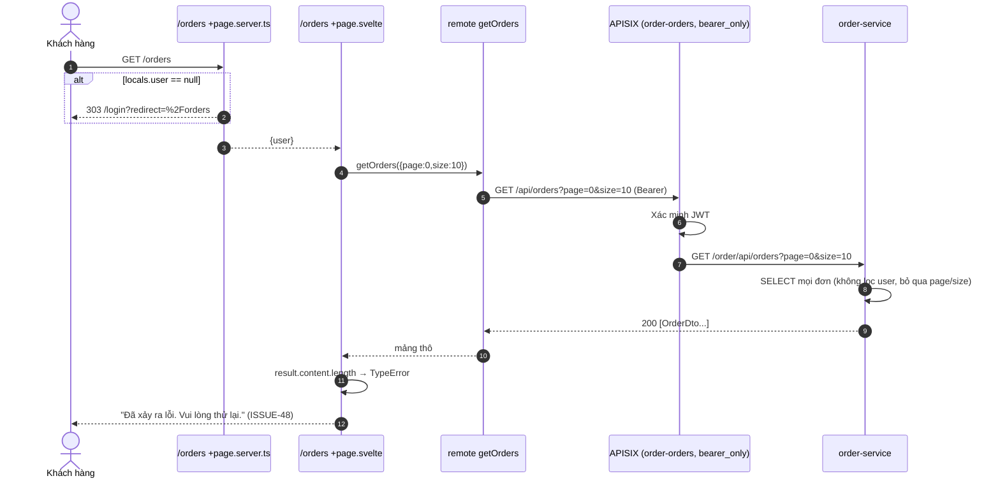

# FEAT-10 — Lịch sử đơn hàng của khách

> **Phiên bản:** 1.0 · **Trạng thái:** Final · **Cập nhật:** 2026-11-12 · **Phạm vi:** Ứng dụng (as-is)

| Thuộc tính | Giá trị |
| :--- | :--- |
| ID | FEAT-10 |
| Business Requirement | BR-10 |
| Trạng thái | 🟡 **Một phần** — Trang `/orders` (yêu cầu đăng nhập, phân trang 10/trang) gọi `GET /api/orders`; nhưng order-service trả **mảng thô mọi đơn của mọi người** nên UI rơi vào trạng thái lỗi (`result.content` undefined); kể cả khi sửa hợp đồng, đơn không gắn với người đặt và không có trạng thái. |
| Actor | Customer |
| Ứng dụng / Service | `frontend/apps/web` (`/orders`), `services/order-service`, APISIX `order-orders` |
| Issue liên quan | ISSUE-20, ISSUE-27, ISSUE-41, ISSUE-48, ISSUE-49, ISSUE-59, ISSUE-67, ISSUE-76 |

## 1. Mô tả & mục tiêu nghiệp vụ

Cho khách đã đăng nhập xem danh sách đơn đã đặt (mã đơn, ngày, tổng tiền, ghi chú, trạng thái) có phân trang, và điều hướng mua sắm khi chưa có đơn. Truy cập từ header ("Tra cứu đơn hàng" ở thanh trên, mục "Đơn hàng của tôi" trong menu tài khoản) hoặc nút "Xem đơn hàng" sau khi đặt hàng.

## 2. User stories

| ID | Story |
| :--- | :--- |
| US-10.1 | Là **khách hàng**, tôi muốn xem danh sách đơn của mình, mới nhất trước, có phân trang. |
| US-10.2 | Là **khách hàng**, tôi muốn thấy trạng thái, ngày đặt, tổng tiền mỗi đơn. |
| US-10.3 | Là **khách hàng chưa có đơn**, tôi muốn thấy thông báo và nút "Mua sắm ngay". |
| US-10.4 | Là **khách**, khi chưa đăng nhập tôi muốn được đưa tới đăng nhập rồi quay lại `/orders`. |

## 3. Tiền điều kiện / Hậu điều kiện

- Tiền điều kiện: `locals.user` khác null (`frontend/apps/web/src/routes/orders/+page.server.ts:5-11`); cookie `access_token` hợp lệ (route gateway yêu cầu Bearer).
- Hậu điều kiện: chỉ đọc.

## 4. Luồng nghiệp vụ

### 4.1 Luồng chính

1. Khách mở `/orders` (hoặc `/orders?page=n`).
2. `load` kiểm `locals.user`; không có → 303 `/login?redirect=/orders`.
3. `+page.svelte` (`frontend/apps/web/src/routes/orders/+page.svelte:13-14`): `currentPage = max(0, Number(page) || 0)`, `args = {page, size: 10}`.
4. Remote query `getOrders` (`frontend/apps/web/src/routes/orders/orders.remote.ts:6-8`) validate `pageQuerySchema` → `api().orders.list({page, size})` → `GET /api/orders?page&size` kèm Bearer (`frontend/packages/lib/src/server/api.ts:143`). Comment "the gateway scopes them by the JWT" **không đúng** (ISSUE-49).
5. APISIX `order-orders` (openid-connect `bearer_only`, `deploy/apisix/apisix.yaml:196-213`) → `/order/api/orders` → `FindAllOrders` (`services/order-service/internal/handler/order_handler.go:198-205`) → repository `FindAllOrders` (`services/order-service/internal/repository/order_repository.go:312-331`): **mọi** đơn, `LEFT JOIN carts`, sắp `order_id ASC`, không lọc user, không phân trang.
6. Response `200 [OrderDto]` (mảng thô) → `request()` trả nguyên mảng.
7. UI: `{#if result.content.length === 0}` → `result.content` là `undefined` → **TypeError** → khối `{:catch}`: "Đã xảy ra lỗi. Vui lòng thử lại." + nút "Thử lại" (`+page.svelte:80-87`).

**Hành vi UI nếu API trả `Page` đúng hợp đồng** (code đã sẵn): `content` rỗng → `EmptyState` "Chưa có đơn hàng nào" + "Mua sắm ngay" (`:33-38`); ngược lại mỗi đơn một card: badge **"Đang xử lý"** (luôn cố định, ISSUE-41), "Đơn #{orderId}", `formatDate(orderDate)` (`dd/MM/yyyy HH:mm`, locale vi-VN), `formatPrice(orderFee)`, `orderDesc` nếu có (`:40-54`); phân trang khi `totalPages > 1`: Trước / "Trang {current}/{total}" / Sau (`:56-78`).

### 4.2 Luồng thay thế

- **A1 — Endpoint phân trang có sẵn nhưng không dùng**: order-service có `GET /api/orders/all?page&size&sortBy&sortOrder` trả `PageResponse` (`order_handler.go:207-219`, `order_repository.go:333-379`), cũng không lọc theo user. BFF không gọi endpoint này.
- **A2 — Xem chi tiết đơn**: không có trang chi tiết; `api.orders.get(id)` tồn tại trong lib nhưng web không dùng.

### 4.3 Luồng ngoại lệ

| Tình huống | Hành vi |
| :--- | :--- |
| Chưa đăng nhập | Redirect login. |
| Token hết hạn & refresh thất bại | `handleSession` xóa phiên → `load` redirect login. |
| Có `session_user` nhưng không còn `access_token` | Gateway 401 → `{:catch}` lỗi chung. |
| order-service lỗi / DB không kết nối | 500 hoặc `[]` → đều rơi vào `{:catch}` vì `content` undefined. |
| `page` query âm/không phải số | Client chuẩn hóa về 0. |

## 5. Sequence diagram

## 6. Màn hình & route (UI)

| Thành phần | File | Mô tả |
| :--- | :--- | :--- |
| `/orders` | `frontend/apps/web/src/routes/orders/+page.svelte` | Tiêu đề "Đơn hàng của tôi"; skeleton 3 khối khi tải; danh sách card; phân trang; `<title>` = `orders_metaTitle`. |
| Guard | `frontend/apps/web/src/routes/orders/+page.server.ts` | |
| Remote | `frontend/apps/web/src/routes/orders/orders.remote.ts` | `getOrders`. |
| Empty state | `@ecommerce/ui/empty-state` | |

## 7. API sử dụng

| Method & path (gateway) | Route | Auth | Handler | Query | Response thực tế |
| :--- | :--- | :--- | :--- | :--- | :--- |
| `GET /api/orders` | `order-orders` → `/order/api/orders` | Bearer | `FindAllOrders` | `page`, `size` (bỏ qua) | `200 [OrderDto]` |
| *(không dùng)* `GET /api/orders/all` | như trên | Bearer | `FindAllOrdersPaged` | `page`, `size`, `sortBy` (`orderId`/`orderFee`/`orderDate`), `sortOrder` | `200 PageResponse<OrderDto>` |

`OrderDto` (`services/order-service/internal/model/order.go:19-27`): `orderId`, `orderDate` (chuỗi `YYYY-MM-DDTHH24:MI:SS` không có múi giờ, `order_repository.go:303`), `orderDesc`, `orderFee`, `productId`, `cart?{cartId, userId}`. Kiểu frontend `Order` (`frontend/packages/lib/src/types.ts:90-97`).

## 8. Dữ liệu

Bảng `orders` (`order_repository.go:44-53`): `order_id`, `order_date` TIMESTAMPTZ, `order_desc`, `order_fee` DOUBLE PRECISION, `product_id`, `cart_id` FK `carts` (ON DELETE CASCADE). Bảng `carts`: `cart_id`, `user_id` BIGINT. Đơn tạo từ checkout có `cart_id` NULL (ISSUE-76) → không thể suy ra chủ đơn.

## 9. Business rules & validation

| ID | Quy tắc | Nguồn |
| :--- | :--- | :--- |
| BR-10.1 | Chỉ người đã đăng nhập vào được trang. | `+page.server.ts:5-9` |
| BR-10.2 | `page` ≥ 0, `size` 1–60 (UI gửi 10). | `schemas.ts:32-35`; `+page.svelte:14` |
| BR-10.3 | Trạng thái hiển thị luôn "Đang xử lý". | `+page.svelte:44` |
| BR-10.4 | Ngày hiển thị theo `formatDate` (`new Date(orderDate)` — chuỗi không múi giờ được trình duyệt/Bun hiểu là giờ địa phương của máy chạy SSR/client). | `frontend/packages/lib/src/format.ts:8-16` |
| BR-10.5 | Không có lọc theo người dùng ở bất kỳ tầng nào. | ISSUE-49 |

## 10. Xử lý lỗi

Mọi lỗi (mạng, 401, 500, sai hợp đồng) → một khối lỗi chung `common_error` + `common_retry` (link `/orders`).

## 11. i18n (key chính)

`orders_metaTitle`, `orders_title` ("Đơn hàng của tôi"), `orders_emptyTitle` ("Chưa có đơn hàng nào"), `orders_emptyHint`, `orders_shopNow`, `orders_processing` ("Đang xử lý"), `orders_orderLabel` ("Đơn #{id}"), `common_page` ("Trang {current}/{total}"), `common_prev`, `common_next`, `common_error`, `common_retry`, `header_myOrders`, `header_topTrackOrder`.

## 12. Acceptance criteria (Given / When / Then — theo hành vi hiện tại)

| # | Given | When | Then |
| :--- | :--- | :--- | :--- |
| AC-10.1 | Chưa đăng nhập | Mở `/orders?page=2` | 303 `/login?redirect=%2Forders%3Fpage%3D2`. |
| AC-10.2 | Đã đăng nhập, DB có 5 đơn (của nhiều người) | Mở `/orders` | BFF gọi `GET /api/orders?page=0&size=10`; service trả 5 đơn; UI hiển thị "Đã xảy ra lỗi. Vui lòng thử lại." |
| AC-10.3 | Gọi trực tiếp `GET /api/orders` với JWT của user A | — | 200, trả cả đơn của user khác (ISSUE-49). |
| AC-10.4 | Giả định API trả `Page{content:[], totalPages:0}` | Mở trang | "Chưa có đơn hàng nào" + "Mua sắm ngay". |
| AC-10.5 | Giả định API trả Page có đơn `orderFee=430000` | Render | Card "Đang xử lý · Đơn #id · ngày · 430.000 ₫". |
| AC-10.6 | Không có header Authorization | `GET /api/orders` qua gateway | 401 từ APISIX. |

## 13. Giới hạn & vấn đề đã biết

| Issue | Ảnh hưởng |
| :--- | :--- |
| ISSUE-48 (Critical) | API trả mảng thô → UI lỗi. |
| ISSUE-49 (High) | Không lọc theo user → lộ đơn của người khác. |
| ISSUE-20 / ISSUE-41 | Không có trạng thái → luôn "Đang xử lý"; không có dòng hàng. |
| ISSUE-76 (High) | Đơn từ checkout không gắn người đặt → không thể lọc dù sửa ISSUE-49. |
| ISSUE-27 (Medium) | `order_fee` DOUBLE PRECISION. |
| ISSUE-59 (Medium) | Update order với `orderDesc` rỗng ghi đè ghi chú. |
| ISSUE-67 (High) | Không có `session_user` → bị đẩy về login. |

Khác: không có trang chi tiết đơn, hủy đơn, theo dõi vận chuyển (link "Tra cứu đơn hàng" ở header chỉ dẫn tới `/orders`).

## 14. Test hiện có

- `services/order-service/main_test.go:62-77` — `GET /api/orders` 200 với repo `nil`.
- `frontend/packages/lib/src/schemas.test.ts:19-33` — `pageQuerySchema`.
- Không có test UI/hợp đồng (ISSUE-46).

## 15. Tham chiếu source

- `frontend/apps/web/src/routes/orders/+page.svelte`, `+page.server.ts`, `orders.remote.ts`
- `frontend/packages/lib/src/server/api.ts:142-146`; `types.ts:90-97`; `format.ts:8-16`; `schemas.ts:32-35`
- `services/order-service/internal/handler/order_handler.go:187-238`
- `services/order-service/internal/service/order_service.go:98-142`
- `services/order-service/internal/repository/order_repository.go:272-399`
- `deploy/apisix/apisix.yaml:196-213`
