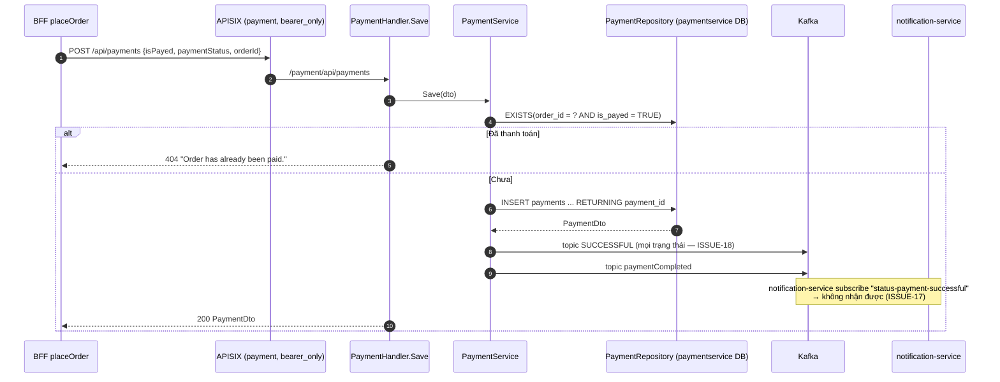
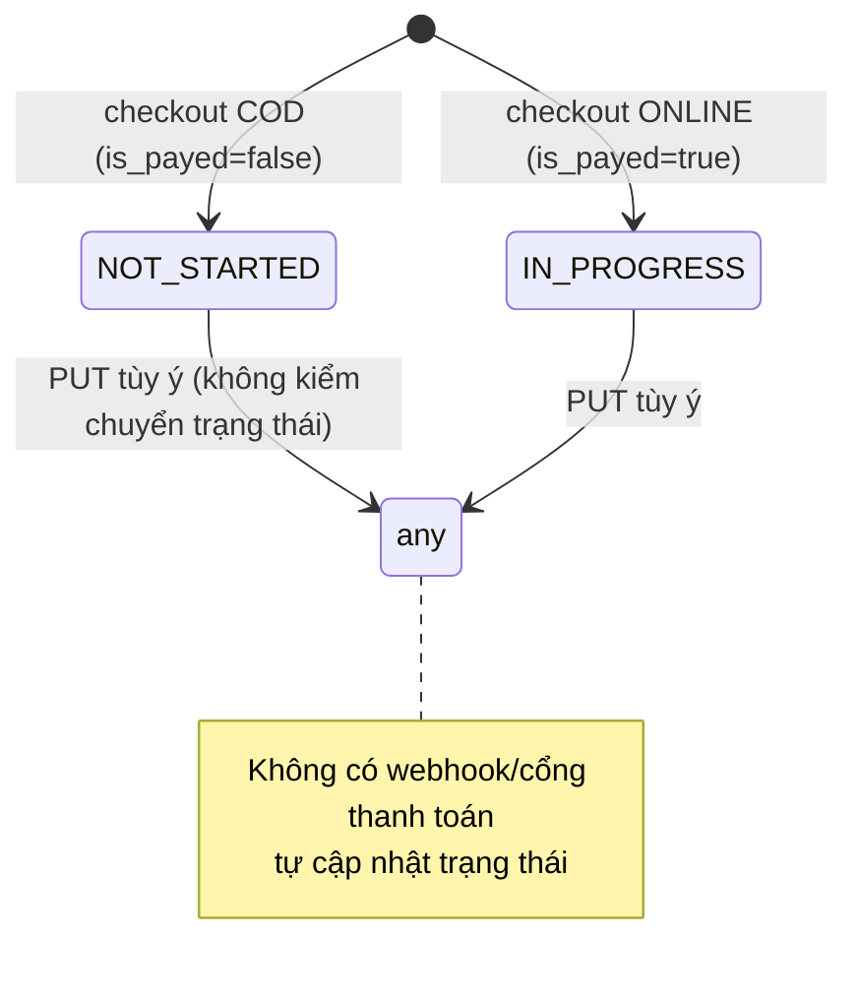
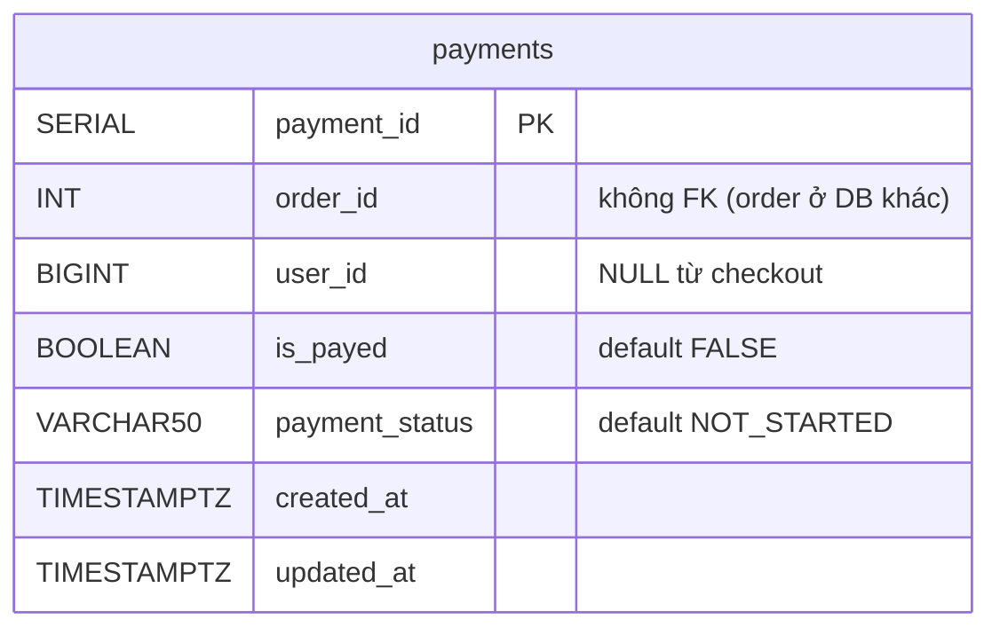

# FEAT-11 — Ghi nhận thanh toán

> **Phiên bản:** 1.0 · **Trạng thái:** Final · **Cập nhật:** 2026-11-12 · **Phạm vi:** Ứng dụng (as-is)

| Thuộc tính | Giá trị |
| :--- | :--- |
| ID | FEAT-11 |
| Business Requirement | BR-11 |
| Trạng thái | 🟡 **Một phần** — payment-service có CRUD payment, chặn tạo payment cho đơn đã thanh toán, publish Kafka khi tạo. Không tích hợp cổng thanh toán, không có số tiền/phương thức, sự kiện "thành công" phát cho mọi payment, topic lệch với notification-service. Checkout là nơi duy nhất gọi API (chỉ tạo). |
| Actor | Hệ thống (BFF checkout), Customer (gián tiếp) |
| Ứng dụng / Service | `services/payment-service`, Kafka, `frontend/apps/web` (checkout) |
| Issue liên quan | ISSUE-01, ISSUE-17, ISSUE-18, ISSUE-23, ISSUE-25, ISSUE-28, ISSUE-29, ISSUE-57, ISSUE-59, ISSUE-75, ISSUE-76 |

## 1. Mô tả & mục tiêu nghiệp vụ

Lưu bản ghi thanh toán gắn với một đơn hàng (`order_id`), gồm cờ `is_payed` và `payment_status` (`NOT_STARTED`, `IN_PROGRESS`, `COMPLETED`, `FAILED`, `CANCELLED` — theo type frontend; service không ràng buộc). Khi tạo payment, service phát sự kiện Kafka để các service khác (notification) phản ứng. Hiện không có cổng thanh toán thật: trạng thái do client quyết định.

## 2. User stories

| ID | Story |
| :--- | :--- |
| US-11.1 | Là **hệ thống checkout**, tôi muốn tạo payment cho đơn vừa đặt với trạng thái theo phương thức thanh toán. |
| US-11.2 | Là **hệ thống**, tôi muốn không tạo thêm payment cho đơn đã thanh toán. |
| US-11.3 | Là **hệ thống**, tôi muốn phát sự kiện khi có payment để gửi thông báo/email. |
| US-11.4 | Là **quản trị viên**, tôi muốn xem/cập nhật/xóa payment (chỉ có API, chưa có UI). |

## 3. Tiền điều kiện / Hậu điều kiện

- Tiền điều kiện: gọi qua gateway với Bearer JWT (route `payment`, `deploy/apisix/apisix.yaml:214-231`); DB `paymentservice`; Kafka `KAFKA_SERVERS` (mặc định `localhost:9092`, compose `kafka:9092`).
- Hậu điều kiện (tạo): 1 bản ghi `payments`; 2 message Kafka (topic `SUCCESSFUL`, `paymentCompleted`) nếu Kafka sẵn sàng.

## 4. Luồng nghiệp vụ

### 4.1 Luồng chính — Tạo payment (từ checkout)

1. `placeOrder` (FEAT-09) sau khi tạo order gọi `api.payments.create({isPayed, paymentStatus, orderId})` → `POST /api/payments` (`frontend/apps/web/src/routes/checkout/checkout.remote.ts:37-41`; `frontend/packages/lib/src/server/api.ts:147-149`).
2. APISIX → `/payment/api/payments` → `PaymentHandler.Save` (`services/payment-service/internal/handler/payment_handler.go:108-125`): decode `PaymentDto`; lỗi → `400 ErrorVm "Invalid request body"`.
3. `PaymentService.Save` (`services/payment-service/internal/service/payment_service.go:87-116`):
   1. Nếu có `orderId`: `ExistsByOrderIdAndIsPayed` (`internal/repository/payment_repository.go:185-200`) — có payment `is_payed = TRUE` cho order → `ErrOrderAlreadyPaid` → handler trả **404** `"Order has already been paid."` (ISSUE-25a).
   2. `repo.Save` (`payment_repository.go:202-226`): insert `order_id`, `user_id`, `COALESCE(is_payed, FALSE)`, `COALESCE(payment_status, 'NOT_STARTED')` (chuỗi rỗng **không** được thay bằng default — ISSUE-25b/59), `created_at`, `updated_at`; đọc lại bằng `FindById`.
   3. Tạo `KafkaPaymentDto {paymentId, isPayed, paymentStatus, orderId, userId}` → `producer.Send("SUCCESSFUL", json)` và `producer.Send("paymentCompleted", json)`; lỗi bị bỏ qua (`:103-113`).
4. Trả `200 PaymentDto`.

Giá trị checkout gửi:

| Phương thức | `isPayed` | `paymentStatus` |
| :--- | :--- | :--- |
| COD | `false` | `NOT_STARTED` |
| ONLINE | `true` | `IN_PROGRESS` (ISSUE-75) |

### 4.2 Luồng thay thế — Các API khác (không được frontend dùng)

| API | Hành vi | Nguồn |
| :--- | :--- | :--- |
| `GET /api/payments` | Mọi payment (`ORDER BY payment_id`), không lọc user | `payment_handler.go:55-62` |
| `GET /api/payments/all?page&size&sortBy&sortOrder` | Phân trang; `sortBy` ∈ `orderId`, `userId`, `isPayed` (khác → `payment_id`) | `:64-76`; `payment_repository.go:115-163` |
| `GET /api/payments/{paymentId}` | Chi tiết; không có → 404 | `:78-95` |
| `GET /api/payments/getOrder/{orderId}` | **Stub**: trả `{orderId}` không gọi order-service (ISSUE-25c) | `:97-106`; `payment_service.go:81-85` |
| `PUT /api/payments/{paymentId}`, `PUT /api/payments` (cần `paymentId` trong body) | Update từng trường bằng `COALESCE(arg, cột)`; không publish Kafka; không kiểm chuyển trạng thái hợp lệ | `:127-169`; `payment_repository.go:228-249` |
| `DELETE /api/payments/{paymentId}` | Xóa; luôn 200 `true` | `:171-183` |

### 4.3 Luồng ngoại lệ

| Tình huống | HTTP |
| :--- | :--- |
| Body JSON lỗi | 400 `ErrorVm` |
| Order đã có payment `is_payed = TRUE` | **404** "Order has already been paid." |
| Lỗi DB | 500 `ErrorVm` (detail = lỗi thô) |
| DB không kết nối | Save trả giả `paymentId = 1`, 200 (ISSUE-28) |
| Kafka không kết nối / topic chưa có | Log cảnh báo, request vẫn 200 sau timeout ghi (`WriteTimeout` 3 s mỗi message, ISSUE-57) |
| `paymentId` update không tồn tại | 404 |
| `PUT /api/payments` thiếu `paymentId` | **500** (lỗi `errors.New`, không phải 400) |

## 5. Sequence diagram

## 6. Màn hình & route (UI)

Không có màn hình payment. Phương thức chọn ở bước 2 checkout (FEAT-09); admin không có module payment.

## 7. API sử dụng

| Method | Path gateway | Path service | Auth | Body / Query | Response |
| :--- | :--- | :--- | :--- | :--- | :--- |
| POST | `/api/payments` | `/payment/api/payments`, `/api/payments` | Bearer | `PaymentDto` | `200 PaymentDto` |
| GET | `/api/payments` | | Bearer | — | `200 [PaymentDto]` |
| GET | `/api/payments/all` | | Bearer | `page`, `size`, `sortBy`, `sortOrder` | `200 PageResponse` |
| GET | `/api/payments/{id}` | | Bearer | — | `200` / `404` |
| GET | `/api/payments/getOrder/{orderId}` | | Bearer | — | `200 {orderId}` (stub) |
| PUT | `/api/payments/{id}`, `/api/payments` | | Bearer | `PaymentDto` | `200` / `404` / `500` |
| DELETE | `/api/payments/{id}` | | Bearer | — | `200 true` |

`PaymentDto` (`services/payment-service/internal/model/payment.go:18-26`): `paymentId?`, `isPayed?`, `paymentStatus`, `orderId?`, `userId?`, `order?{orderId}`, `user?{id}`. Sự kiện Kafka `KafkaPaymentDto` (`:28-34`): `{paymentId, isPayed, paymentStatus, orderId, userId}` (trường nil bị bỏ, `omitempty`).

## 8. Dữ liệu

Không có cột số tiền, tiền tệ, phương thức, mã giao dịch cổng. `order_id` không unique → một đơn có thể có nhiều payment chưa thanh toán.

## 9. Business rules & validation

| ID | Quy tắc | Nguồn |
| :--- | :--- | :--- |
| BR-11.1 | Không tạo payment mới cho order đã có payment `is_payed = TRUE`. | `payment_service.go:88-96` |
| BR-11.2 | `is_payed` mặc định `FALSE`, `payment_status` mặc định `NOT_STARTED` chỉ khi trường **vắng mặt** (không phải chuỗi rỗng). | `payment_repository.go:214-215` |
| BR-11.3 | `payment_status` là chuỗi tự do (không enum). | model |
| BR-11.4 | Mỗi lần tạo phát 2 sự kiện bất kể trạng thái. | `payment_service.go:103-113` |
| BR-11.5 | Update không phát sự kiện. | `payment_service.go:125-134` |
| BR-11.6 | Không kiểm order tồn tại ở order-service. | — |

## 10. Xử lý lỗi

Lỗi trả `ErrorVm {statusCode, title, detail}` (`services/shared/response/response.go`). BFF không đọc được `message` từ `ErrorVm` → message `"<status> <statusText>"`; checkout chỉ hiển thị toast chung. Lỗi Kafka chỉ log.

## 11. i18n (key chính)

Không có UI riêng. Nhãn phương thức ở checkout: `checkout_cod`, `checkout_codDesc`, `checkout_bankTransfer`, `checkout_bankTransferDesc`.

## 12. Acceptance criteria (Given / When / Then — theo hành vi hiện tại)

| # | Given | When | Then |
| :--- | :--- | :--- | :--- |
| AC-11.1 | Order 10 chưa có payment | `POST /api/payments {isPayed:false, paymentStatus:"NOT_STARTED", orderId:10}` | 200; bản ghi mới; 2 message Kafka `SUCCESSFUL` & `paymentCompleted` với `paymentStatus:"NOT_STARTED"`. |
| AC-11.2 | Order 10 có payment `is_payed=true` | POST payment mới cho order 10 | **404** `{"statusCode":"404","title":"Not found","detail":"Order has already been paid."}`. |
| AC-11.3 | Order 10 chỉ có payment `is_payed=false` | POST thêm | 200 (cho phép nhiều payment). |
| AC-11.4 | — | POST `{orderId:11, paymentStatus:""}` | 200; `payment_status = ''`. |
| AC-11.5 | Kafka down | POST hợp lệ | 200 sau độ trễ ghi; log cảnh báo. |
| AC-11.6 | — | `GET /api/payments/getOrder/5` | 200 `{"orderId":5}`. |
| AC-11.7 | Không có Bearer | Bất kỳ endpoint qua gateway | 401. |

## 13. Giới hạn & vấn đề đã biết

| Issue | Ảnh hưởng |
| :--- | :--- |
| ISSUE-17 (High) | Topic `SUCCESSFUL`/`paymentCompleted` ≠ topic notification subscribe. |
| ISSUE-18 (High) | Sự kiện "thành công" cho mọi payment; lỗi gửi bị bỏ qua. |
| ISSUE-25 (Medium) | 404 cho "đã thanh toán"; `''` ghi đè; `getOrder` stub; không webhook. |
| ISSUE-57 (Medium) | Kafka writer đồng bộ thêm độ trễ; topic không tự tạo. |
| ISSUE-59 (Medium) | `COALESCE` không bắt chuỗi rỗng. |
| ISSUE-75 (High) | Checkout ONLINE ghi `is_payed=true` khi chưa thu tiền → chặn mọi payment sau đó cho đơn. |
| ISSUE-76 (High) | Payment từ checkout không có `userId`. |
| ISSUE-01 (Critical) | Mọi JWT có thể cập nhật/xóa payment. |
| ISSUE-23 / ISSUE-28 / ISSUE-29 | Không giao dịch với order; giả thành công khi không có DB; định dạng lỗi khác auth-service. |

## 14. Test hiện có

`services/payment-service/main_test.go:42-64` — health, `GET /api/payments`, `POST` (repo `nil` → 200), `getOrder/1`, `DELETE /1`. Không có test cho chặn "đã thanh toán" hay Kafka (ISSUE-46).

## 15. Tham chiếu source

- `services/payment-service/main.go:55-90`
- `services/payment-service/internal/handler/payment_handler.go`
- `services/payment-service/internal/service/payment_service.go`, `kafka_producer.go`
- `services/payment-service/internal/repository/payment_repository.go`
- `services/payment-service/internal/model/payment.go`
- `frontend/apps/web/src/routes/checkout/checkout.remote.ts:37-41`
- `frontend/packages/lib/src/types.ts:99-106,165-169`
- `deploy/apisix/apisix.yaml:214-231`
