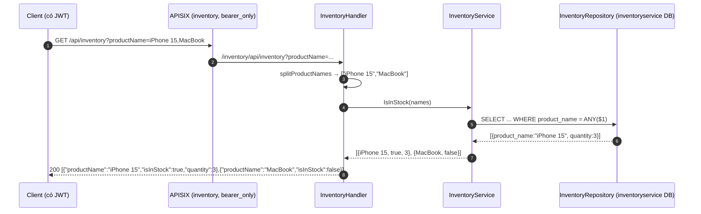

# FEAT-12 — Kiểm tra tồn kho

> **Phiên bản:** 1.0 · **Trạng thái:** Final · **Cập nhật:** 2026-11-12 · **Phạm vi:** Ứng dụng (as-is)

| Thuộc tính | Giá trị |
| :--- | :--- |
| ID | FEAT-12 |
| Business Requirement | BR-12 |
| Trạng thái | 🟡 **Một phần** — inventory-service chỉ có API **đọc** "còn hàng không" theo **tên sản phẩm**; không có API nhập/xuất/giữ hàng, không có dữ liệu seed, không màn hình nào gọi tới (checkout không kiểm kho), hàm client `checkStock` sai tham số. |
| Actor | Hệ thống (dự kiến: checkout / admin) |
| Ứng dụng / Service | `services/inventory-service`; `frontend/packages/lib` (`api.inventory.checkStock`, không dùng) |
| Issue liên quan | ISSUE-01, ISSUE-21, ISSUE-26, ISSUE-28, ISSUE-29, ISSUE-36, ISSUE-43, ISSUE-51 |

## 1. Mô tả & mục tiêu nghiệp vụ

Trả lời câu hỏi "các sản phẩm X, Y, Z còn hàng không, còn bao nhiêu?" dựa trên bảng `inventory` riêng của inventory-service. Mục tiêu nghiệp vụ là chống bán vượt tồn; hiện tại chưa thành phần nào dùng kết quả này — tồn kho hiển thị trên storefront lấy từ `products.quantity` của product-service (ISSUE-26).

## 2. User stories

| ID | Story |
| :--- | :--- |
| US-12.1 | Là **hệ thống**, tôi muốn kiểm tra một hoặc nhiều sản phẩm còn hàng trước khi đặt. *(API có, chưa được gọi.)* |
| US-12.2 | Là **quản trị viên**, tôi muốn xem/điều chỉnh tồn kho. *(Chưa có — admin `/inventory` là placeholder, FEAT-26.)* |

## 3. Tiền điều kiện / Hậu điều kiện

- Tiền điều kiện: Bearer JWT (route `inventory`, `deploy/apisix/apisix.yaml:232-249`); DB `inventoryservice` có dữ liệu bảng `inventory` (không có API ghi, phải nạp bằng SQL thủ công).
- Hậu điều kiện: chỉ đọc.

## 4. Luồng nghiệp vụ

### 4.1 Luồng chính

1. Client gọi `GET /api/inventory?productName=A&productName=B` hoặc `?productName=A,B` → APISIX rewrite `/inventory/api/inventory` → `InventoryHandler.IsInStock` (`services/inventory-service/internal/handler/inventory_handler.go:53-63`).
2. `splitProductNames` (`:39-51`): tách theo dấu phẩy, `TrimSpace`, bỏ phần tử rỗng; giữ thứ tự và trùng lặp.
3. `InventoryService.IsInStock` (`services/inventory-service/internal/service/inventory_service.go:18-40`) → `FindByProductNames` (`internal/repository/inventory_repo.go:40-62`): `SELECT id, product_name, quantity FROM inventory WHERE product_name = ANY($1)` (so khớp **chính xác, phân biệt hoa thường**).
4. Dựng map `product_name → quantity` (nếu tên trùng nhiều dòng: dòng sau ghi đè).
5. Với mỗi tên yêu cầu (đúng thứ tự): `{productName, isInStock: tồn tại && quantity > 0, quantity}`.
6. `200 [InventoryResponse]`.

### 4.2 Luồng thay thế

- **A1 — Dạng path**: `GET /api/inventory/{products}` với `products = "A,B,C"` (`inventory_handler.go:65-74`) — cùng logic.
- **A2 — Không có tham số**: danh sách tên rỗng → repository trả `[]` ngay → `200 []`.
- **A3 — Client frontend**: `api.inventory.checkStock(skuCode)` gửi `GET /api/inventory?skuCode=...` (`frontend/packages/lib/src/server/api.ts:150-152`) → service đọc `productName` → danh sách rỗng → `[]`; kiểu trả về khai báo là một `InventoryItem {id, skuCode, quantity}` trong khi API trả mảng `{productName, isInStock, quantity}` (ISSUE-51). Hàm này không được gọi ở đâu (ISSUE-43).

### 4.3 Luồng ngoại lệ

| Tình huống | Hành vi |
| :--- | :--- |
| Tên không có trong bảng | `isInStock: false`, `quantity` bị bỏ khỏi JSON (`omitempty` khi 0). |
| DB không kết nối | Repository trả `[]` → mọi tên `isInStock: false` (ISSUE-28); health vẫn UP (ISSUE-36). |
| Lỗi SQL | `500 ErrorVm`. |
| Không có Bearer qua gateway | 401. |

## 5. Sequence diagram

## 6. Màn hình & route (UI)

Chưa có UI. Admin `/inventory` (`frontend/apps/admin/src/routes/inventory/+page.svelte`) là placeholder (FEAT-26). Storefront không gọi inventory (badge tồn kho dùng `products.quantity`).

## 7. API sử dụng

| Method | Path gateway | Path service | Auth | Query/Path | Response |
| :--- | :--- | :--- | :--- | :--- | :--- |
| GET | `/api/inventory` | `/inventory/api/inventory`, `/api/inventory` | Bearer | `productName` (lặp hoặc phân cách phẩy) | `200 [{productName, isInStock, quantity?}]` |
| GET | `/api/inventory/{products}` | `/inventory/api/inventory/{products}` | Bearer | path phân cách phẩy | như trên |

Model: `Inventory {id, productName, quantity}`, `InventoryResponse {productName, isInStock, quantity (omitempty)}` (`services/inventory-service/internal/model/inventory.go`).

## 8. Dữ liệu

Bảng `inventory` (`inventory_repo.go:28-34`): `id` BIGSERIAL PK, `product_name` VARCHAR(255) NOT NULL (**không UNIQUE**), `quantity` INT default 0. Không có `product_id`, `sku`, kho, lịch sử nhập/xuất, giữ chỗ. Không có seed trong `deploy/postgres/init/create-all-databases.sql` (chỉ tạo DB `inventoryservice`).

## 9. Business rules & validation

| ID | Quy tắc | Nguồn |
| :--- | :--- | :--- |
| BR-12.1 | Còn hàng ⇔ tồn tại bản ghi tên khớp chính xác và `quantity > 0`. | `inventory_service.go:31-35` |
| BR-12.2 | Kết quả giữ thứ tự và số lượng phần tử theo danh sách tên đầu vào (kể cả trùng). | `:29-37` |
| BR-12.3 | Tên trùng trong bảng: lấy bản ghi đọc sau cùng. | `:24-27` |
| BR-12.4 | Không giới hạn số tên trong một request. | — |

## 10. Xử lý lỗi

`ErrorVm` 500 cho lỗi DB; không có 400 (input luôn được chấp nhận).

## 11. i18n (key chính)

Chưa có UI.

## 12. Acceptance criteria (Given / When / Then — theo hành vi hiện tại)

| # | Given | When | Then |
| :--- | :--- | :--- | :--- |
| AC-12.1 | Bảng có `("iPhone 15", 3)` | `GET /api/inventory?productName=iPhone%2015` | `[{"productName":"iPhone 15","isInStock":true,"quantity":3}]`. |
| AC-12.2 | Bảng có `("iPhone 15", 0)` | Như trên | `[{"productName":"iPhone 15","isInStock":false}]`. |
| AC-12.3 | — | `GET /api/inventory/iPhone,iPad,MacBook` | Mảng 3 phần tử theo thứ tự. |
| AC-12.4 | — | `GET /api/inventory` | `200 []`. |
| AC-12.5 | Bảng có "iphone 15" (chữ thường) | Hỏi "iPhone 15" | `isInStock: false`. |
| AC-12.6 | — | `GET /api/inventory?skuCode=SKU-1` (như `checkStock`) | `200 []`. |
| AC-12.7 | Đặt hàng qua checkout | — | inventory-service không được gọi; tồn không đổi. |

## 13. Giới hạn & vấn đề đã biết

| Issue | Ảnh hưởng |
| :--- | :--- |
| ISSUE-26 (High) | Định danh theo tên, chỉ đọc, tách biệt `products.quantity`. |
| ISSUE-21 (High) | Checkout không kiểm/giữ kho. |
| ISSUE-51 (Low) | Client gửi `skuCode` thay vì `productName`; kiểu trả về khai báo sai (object thay vì mảng). |
| ISSUE-43 (Low) | `checkStock`, `InventoryItem` không dùng. |
| ISSUE-28 / ISSUE-36 | Không có DB → luôn "hết hàng", health vẫn UP. |
| ISSUE-01 / ISSUE-29 | Không kiểm role; định dạng lỗi `ErrorVm`. |

## 14. Test hiện có

`services/inventory-service/main_test.go:31-59` — health; query một tên, nhiều tên phân cách phẩy, không tham số; dạng path (repo `nil` → 200). Không kiểm nội dung kết quả.

## 15. Tham chiếu source

- `services/inventory-service/main.go:55-80`
- `services/inventory-service/internal/handler/inventory_handler.go`
- `services/inventory-service/internal/service/inventory_service.go`
- `services/inventory-service/internal/repository/inventory_repo.go`
- `services/inventory-service/internal/model/inventory.go`
- `frontend/packages/lib/src/server/api.ts:101-103,150-152`; `types.ts:108-112`
- `deploy/apisix/apisix.yaml:232-249`
