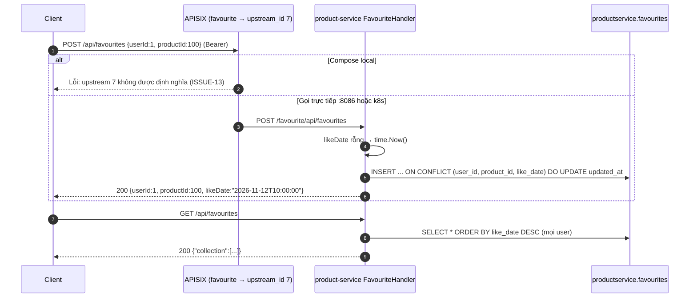

# FEAT-13 — Sản phẩm yêu thích

> **Phiên bản:** 1.0 · **Trạng thái:** Final · **Cập nhật:** 2026-11-12 · **Phạm vi:** Ứng dụng (as-is)

| Thuộc tính | Giá trị |
| :--- | :--- |
| ID | FEAT-13 |
| Business Requirement | BR-13 |
| Trạng thái | 🟡 **Một phần** — product-service có API favourites (list, tìm, thêm/cập nhật, xóa) nhưng route gateway trỏ upstream không tồn tại trên compose (ISSUE-13), danh tính lấy từ body chứ không từ token (ISSUE-56), không có UI nào sử dụng. |
| Actor | Customer (dự kiến) |
| Ứng dụng / Service | `services/product-service` (handler favourite), APISIX route `favourite` |
| Issue liên quan | ISSUE-01, ISSUE-13, ISSUE-28, ISSUE-35, ISSUE-43, ISSUE-56, ISSUE-74 |

## 1. Mô tả & mục tiêu nghiệp vụ

Cho phép khách đánh dấu sản phẩm yêu thích để xem lại. Code hiện tại là bản chuyển từ "favourite-service" Spring cũ vào product-service: khóa chính tổng hợp `(user_id, product_id, like_date)`, người dùng xác định bằng `userId` số nguyên **do client gửi**. Không có trang "Yêu thích" hay nút tim trên storefront; type `Favourite` ở frontend không dùng (ISSUE-43).

## 2. User stories

| ID | Story |
| :--- | :--- |
| US-13.1 | Là **khách hàng**, tôi muốn thêm sản phẩm vào danh sách yêu thích. *(API có, không UI.)* |
| US-13.2 | Là **khách hàng**, tôi muốn xem danh sách yêu thích của tôi. *(API trả của mọi người.)* |
| US-13.3 | Là **khách hàng**, tôi muốn bỏ yêu thích. |

## 3. Tiền điều kiện / Hậu điều kiện

- Tiền điều kiện: qua gateway cần Bearer JWT (route `favourite`, openid-connect, `deploy/apisix/apisix.yaml:250-267`) **và** upstream 7 phải tồn tại (không có trong `apisix.yaml` local → lỗi tại gateway; k8s đã cấu hình khác — ISSUE-13). Gọi trực tiếp product-service (`:8086`) không cần token.
- Hậu điều kiện: bảng `favourites` (DB `productservice`) thay đổi.

## 4. Luồng nghiệp vụ

### 4.1 Luồng chính

**Thêm** — `POST /api/favourites` body `{userId, productId, likeDate?}` → APISIX rewrite `/favourite/api/favourites` → `FavouriteHandler.Save` (`services/product-service/internal/handler/favourite_handler.go:103-116`) → `FavouriteRepository.Save` (`services/product-service/internal/repository/favourite_repo.go:120-144`):
1. Parse `likeDate` theo các layout `2006-01-02T15:04:05.000Z`, `...Z`, `2006-01-02T15:04:05`, `2006-01-02 15:04:05`, `2006-01-02`, RFC3339 (`:43-57`); không parse được/không có → `time.Now()` và ghi lại `likeDate` dạng `2006-01-02T15:04:05`.
2. `INSERT INTO favourites(user_id, product_id, like_date) ... ON CONFLICT (user_id, product_id, like_date) DO UPDATE SET updated_at = CURRENT_TIMESTAMP`.
3. Trả `200` DTO (echo input, `likeDate` có thể được điền).

**Danh sách** — `GET /api/favourites` → `FindAll` (`favourite_handler.go:46-53`; `favourite_repo.go:63-85`): **mọi** bản ghi, `ORDER BY like_date DESC` → `200 {"collection":[{userId, productId, likeDate}]}`.

**Xóa** — `DELETE /api/favourites/{userId}/{productId}/{likeDate}` (`favourite_handler.go:137-160`) → `DeleteByID` (`favourite_repo.go:146-172`) → `200 true` (kể cả khi không xóa được dòng nào — điều kiện `affected >= 0`).

### 4.2 Luồng thay thế

- `PUT /api/favourites` = `Save` (`favourite_handler.go:118-120`).
- `GET /api/favourites/find` với **body JSON** `{userId, productId, likeDate}` (`:55-72`) và `DELETE /api/favourites/delete` với body (`:122-135`) — GET/DELETE có body (ISSUE-35).
- `GET /api/favourites/{userId}/{productId}/{likeDate}` (`:74-101`) — tìm theo khóa.
- Path service được đăng ký dưới 3 prefix: `/favourite/api/favourites`, `/product/api/favourites`, `/api/favourites` (`:22-30`).

### 4.3 Luồng ngoại lệ

| Tình huống | HTTP |
| :--- | :--- |
| Body JSON lỗi | 400 `ErrorVm "Invalid request payload"` |
| `userId`/`productId` path không phải số | 400 |
| `likeDate` không parse được khi tìm/xóa | **500** (`invalid likeDate: ...`) |
| Không tìm thấy (find/findById) | 404 "Favourite not found" |
| DB không kết nối | List `[]`, Save echo, Delete `true`, Find 404 (ISSUE-28) |
| Qua gateway compose | Lỗi upstream (ISSUE-13) |

## 5. Sequence diagram

## 6. Màn hình & route (UI)

Chưa có UI (storefront không có nút yêu thích; admin không có module).

## 7. API sử dụng

| Method | Path gateway | Auth | Body / Path | Response |
| :--- | :--- | :--- | :--- | :--- |
| GET | `/api/favourites` | Bearer | — | `200 {collection: FavouriteDto[]}` |
| GET | `/api/favourites/find` | Bearer | body `FavouriteID` | `200 FavouriteDto` / 404 |
| GET | `/api/favourites/{userId}/{productId}/{likeDate}` | Bearer | path | `200` / 404 / 500 |
| POST / PUT | `/api/favourites` | Bearer | `FavouriteDto {userId, productId, likeDate?}` | `200 FavouriteDto` |
| DELETE | `/api/favourites/delete` | Bearer | body `FavouriteID` | `200 true` |
| DELETE | `/api/favourites/{userId}/{productId}/{likeDate}` | Bearer | path | `200 true` |

Model (`services/product-service/internal/model/favourite.go`): `FavouriteID {userId:int, productId:int, likeDate:string}`, `FavouriteDto` (+ `user`, `product` interface, luôn rỗng), `FavouriteCollectionResponse {collection}`.

## 8. Dữ liệu

Bảng `favourites` (`services/product-service/internal/repository/product_repo.go:56-63`): `user_id` INT NOT NULL, `product_id` INT NOT NULL, `like_date` TIMESTAMP NOT NULL, `created_at`, `updated_at`, **PK (user_id, product_id, like_date)**. Không FK tới `products`; `user_id` kiểu INT trong khi định danh Keycloak (`sub`) là UUID.

## 9. Business rules & validation

| ID | Quy tắc | Nguồn |
| :--- | :--- | :--- |
| BR-13.1 | Định danh người dùng = `userId` trong body/path (không lấy từ token). | handler |
| BR-13.2 | Một cặp (user, product) có thể có **nhiều** bản ghi khác `like_date` (thêm lại không gửi `likeDate` → bản ghi mới). | PK `favourite`; `favourite_repo.go:124-139` |
| BR-13.3 | Không kiểm `productId` tồn tại. | — |
| BR-13.4 | Xóa luôn trả `true`. | `favourite_repo.go:171` |
| BR-13.5 | `likeDate` trả ra dạng `YYYY-MM-DDTHH:mm:ss` (không múi giờ). | `favourite_repo.go:59-61` |

## 10. Xử lý lỗi

`ErrorVm` (400/404/500). Lỗi parse `likeDate` ở tìm/xóa thành 500 thay vì 400.

## 11. i18n (key chính)

Chưa có UI.

## 12. Acceptance criteria (Given / When / Then — theo hành vi hiện tại)

| # | Given | When | Then |
| :--- | :--- | :--- | :--- |
| AC-13.1 | Compose local | `GET /api/favourites` qua gateway với Bearer hợp lệ | Lỗi tại APISIX (upstream 7 không tồn tại). |
| AC-13.2 | Gọi trực tiếp product-service | `POST /api/favourites {"userId":1,"productId":100,"likeDate":"2026-01-01T10:00:00"}` | 200 echo; DB có bản ghi. |
| AC-13.3 | Như trên, gọi lại `POST` không có `likeDate` | — | Bản ghi thứ hai cho cùng (1,100). |
| AC-13.4 | Có favourites của user 1 và 2 | `GET /api/favourites` | Trả cả hai user. |
| AC-13.5 | Không có bản ghi khớp | `DELETE /api/favourites/1/100/2026-01-01T10:00:00` | `200 true`. |
| AC-13.6 | — | `GET /api/favourites/1/100/abc` | 500 `invalid likeDate`. |

## 13. Giới hạn & vấn đề đã biết

| Issue | Ảnh hưởng |
| :--- | :--- |
| ISSUE-13 (High) | Route gateway trỏ upstream 7 không tồn tại (compose). |
| ISSUE-56 (Medium) | Favourites không gắn danh tính token; `GET` trả của mọi người; ai cũng thêm/xóa thay người khác. |
| **ISSUE-74** (Low) | PK gồm `like_date` → trùng (user, product) nhiều lần; xóa luôn trả `true`; `likeDate` sai định dạng ở tìm/xóa trả 500. |
| ISSUE-35 (Medium) | GET/DELETE có body. |
| ISSUE-01 / ISSUE-28 / ISSUE-43 | Không role; giả thành công khi không có DB; type frontend không dùng. |

## 14. Test hiện có

`services/product-service/main_test.go:79-89` — `GET /api/favourites`, `/favourite/api/favourites`, `POST`, `DELETE` theo path (repo `nil` → 200); `main_test.go:52` health `/favourite/actuator/health`.

## 15. Tham chiếu source

- `services/product-service/internal/handler/favourite_handler.go`
- `services/product-service/internal/service/favourite_service.go`
- `services/product-service/internal/repository/favourite_repo.go`
- `services/product-service/internal/repository/product_repo.go:56-63`
- `services/product-service/internal/model/favourite.go`
- `services/product-service/main.go:74-93`
- `deploy/apisix/apisix.yaml:250-267`
- `frontend/packages/lib/src/types.ts:114-118`
